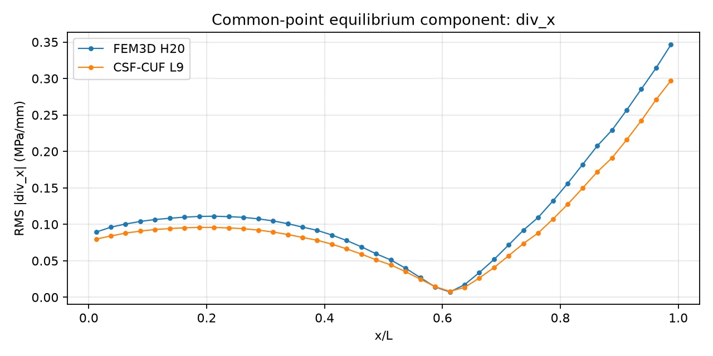
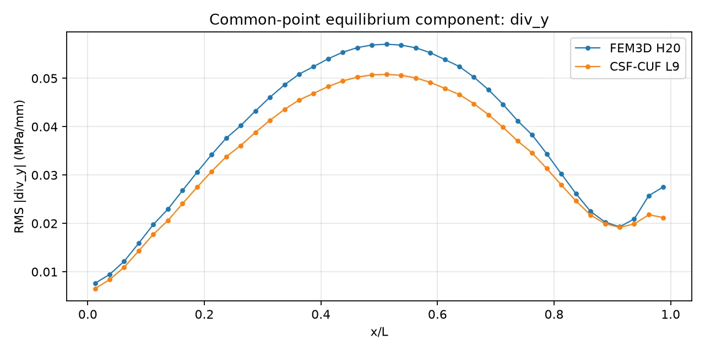
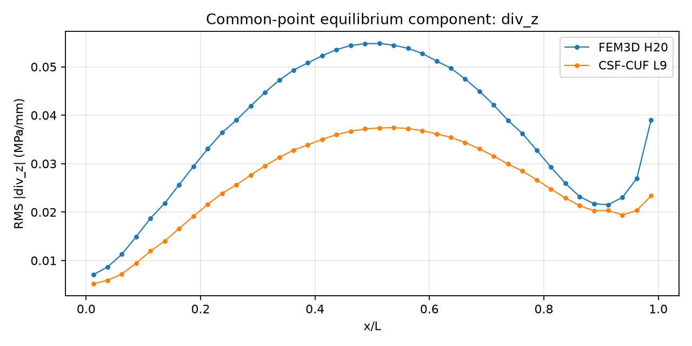
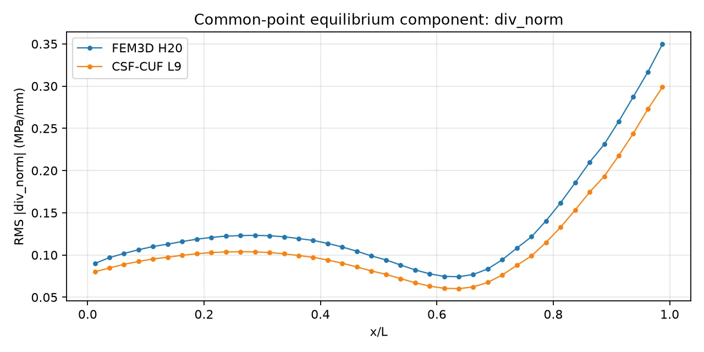
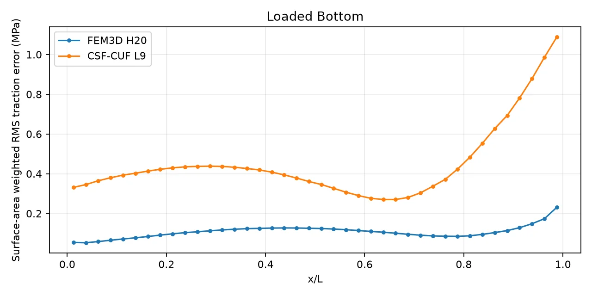
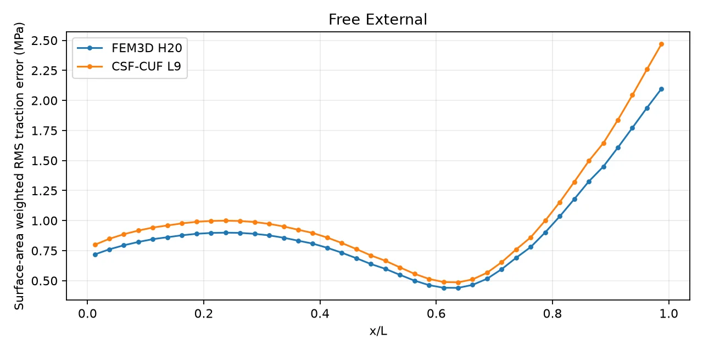
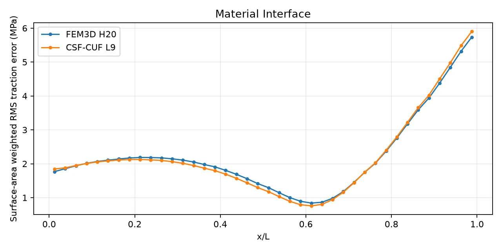
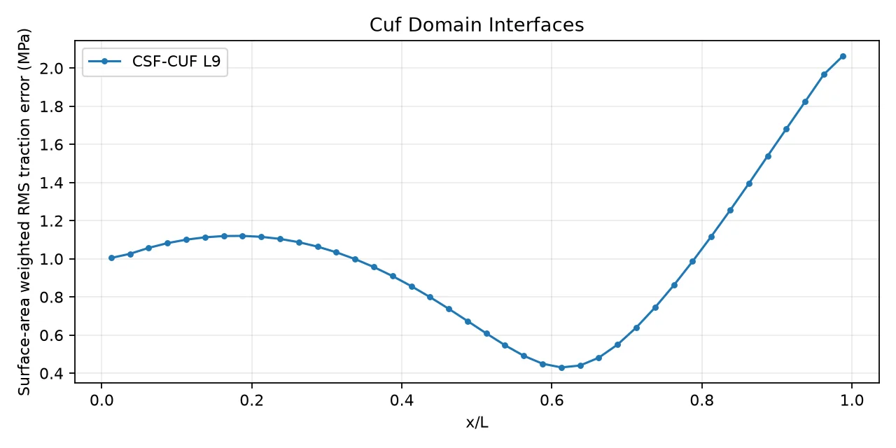

# Chapter IV - Equilibrium Inside the Member and on Its Boundaries
## Assessing local balance and the forces transmitted across surfaces

The displacement solutions alone do not establish how accurately the reconstructed stresses satisfy mechanical equilibrium. The stresses must balance local forces inside the material and transmit the prescribed tractions across its boundaries. This chapter examines these two requirements separately, using the same physical sampling positions for H20 and CSF-CUF in each comparison.

### Glossary for the equilibrium tests

| Term | Meaning |
|---|---|
| **Stress tensor** | The set of normal and shear stresses acting on the faces of a very small material volume. |
| **Divergence of stress** | A vector made from spatial derivatives of the stress components; it describes the remaining local force imbalance. |
| **Strong residual** | The value of the equilibrium equation computed from an approximate stress field; the exact target is zero. |
| **Common sampling point** | A physical location at which both H20 and CUF are evaluated independently. |
| **Volume weight** | The amount of physical volume represented by a numerical integration point. |
| **Weighted RMS** | The square root of the mean squared residual, accounting for the physical-volume weights. |
| **Surface normal $\mathbf n$** | A unit vector perpendicular to a surface, defining the direction in which surface forces are evaluated. |
| **Traction $\mathbf t$** | The force per unit area acting on a surface: $\mathbf t=\boldsymbol\sigma\mathbf n$. |
| **Free surface** | A boundary on which the prescribed external traction is zero. |
| **Loaded surface** | A boundary on which a known traction is imposed. |
| **Material interface** | The common boundary between two different material regions. |
| **Traction jump** | The difference between the tractions transmitted by the two sides of an interface. |
| **Area-weighted RMS** | A root-mean-square statistic that accounts for the actual area represented by each surface sample. |

## Part I - Differential Equilibrium Inside the Member

The first test evaluates the divergence of the reconstructed stress tensor in the material volume. Both solutions are sampled at the same 24,576 interior positions, with the same volume weights.

### 1. From force balance to differential equilibrium

In a static body without a volumetric force, stress equilibrium requires

$$\nabla\cdot\boldsymbol\sigma=\mathbf 0.$$

In the physical coordinates used here, $x$ is longitudinal and $y,z$ are transverse. The three equations are

$$
\begin{aligned}
r_x&=\frac{\partial\sigma_{xx}}{\partial x}
    +\frac{\partial\tau_{xy}}{\partial y}
    +\frac{\partial\tau_{xz}}{\partial z},\\
r_y&=\frac{\partial\tau_{xy}}{\partial x}
    +\frac{\partial\sigma_{yy}}{\partial y}
    +\frac{\partial\tau_{yz}}{\partial z},\\
r_z&=\frac{\partial\tau_{xz}}{\partial x}
    +\frac{\partial\tau_{yz}}{\partial y}
    +\frac{\partial\sigma_{zz}}{\partial z}.
\end{aligned}
$$

Here $\sigma_{xx}$, $\sigma_{yy}$ and $\sigma_{zz}$ are normal stresses; $\tau_{xy}$, $\tau_{xz}$ and $\tau_{yz}$ are shear stresses. Because stress is measured in MPa and position in mm, each residual is expressed in **MPa/mm**.

The total residual magnitude at a point is

$$\|\mathbf r\|=\sqrt{r_x^2+r_y^2+r_z^2}.$$

This local differential test is distinct from verifying the total external force or comparing support reactions. A finite-element solution satisfies the discretized system of weak equilibrium, while its reconstructed stress derivatives need not vanish at every interior position.

### 2. Why identical physical points matter

A comparison is affected by where each method is sampled. The reference calculation avoids that ambiguity by choosing points inside the solved H20 mesh and evaluating **both** fields at those exact physical coordinates.

The selected mesh has **3,072 twenty-node elements**. Two Gauss points per local coordinate direction give eight interior positions per element, for a total of

$$3{,}072\times2\times2\times2=24{,}576\quad\text{common points}.$$

All points were accepted. Each point carries the same physical-volume weight for the two models. The sum of weights agrees with the member's physical volume of **4,800,000 mm$^3$**, within numerical roundoff.

At each sample point, H20 reconstructs stress from its quadratic displacement field and its element material properties. CUF reconstructs stress from the saved longitudinal and sectional coefficients and the continuously varying CSF material law. H20 stress derivatives are evaluated in the element's local coordinates and converted to physical derivatives. CUF derivatives are evaluated within the relevant physical CSF domain.

For samples $p$ with positive volume weights $w_p$, the reported measure is

$$
\mathrm{RMS}(r_i)=\sqrt{\frac{\sum_p w_p\,r_i(p)^2}{\sum_p w_p}},
\qquad
\mathrm{RMS}(\|\mathbf r\|)=
\sqrt{\frac{\sum_p w_p\,[r_x(p)^2+r_y(p)^2+r_z(p)^2]}{\sum_p w_p}}.
$$

The RMS of the combined residual is calculated from the vector norm **at each point**. It is not obtained by adding the three component RMS values.

### 3. The measured interior residuals

| Equation | H20 RMS (MPa/mm) | CSF-CUF RMS (MPa/mm) | CUF reduction |
|---|---:|---:|---:|
| $r_x$ | 0.13127148 | 0.11150557 | 15.1% |
| $r_y$ | 0.04039661 | 0.03615182 | 10.5% |
| $r_z$ | 0.03909369 | 0.02734043 | 30.1% |
| $\|\mathbf r\|$ | **0.14280197** | **0.12036588** | **15.7%** |

These values show a smaller volume-weighted RMS for CSF-CUF in every equilibrium equation. The most pronounced relative reduction occurs in the $z$ equation. The reduction of the total residual is computed as $100(1-R_{\mathrm{CUF}}/R_{\mathrm{H20}})$ percent.









The 24,576 points are grouped into **40 longitudinal intervals**, with every point assigned once. CSF-CUF has a smaller RMS of the total residual in **40 of 40** intervals. Component by component, it has the smaller value in 38/40 intervals for $r_x$ and 40/40 for $r_y$ and $r_z$.

### 4. What a second statistic reveals

RMS puts particular emphasis on large values because it squares the residual before averaging. The **weighted median absolute residual** answers a different question: what residual magnitude separates the lower and upper halves of the sampled physical volume?

| Median of absolute residual (MPa/mm) | H20 | CSF-CUF | Lower median |
|---|---:|---:|---|
| $|r_x|$ | **0.021064** | 0.038378 | H20 |
| $|r_y|$ | **0.003717** | 0.005044 | H20 |
| $|r_z|$ | 0.007038 | **0.006038** | CSF-CUF |
| $\|\mathbf r\|$ | **0.028999** | 0.046390 | H20 |

Thus H20 has the smaller *typical* total residual at the median, while CSF-CUF has the smaller total RMS. The two statements describe different properties of the same residual distributions. At the largest sampled values, the maximum total residual is approximately **2.639 MPa/mm for H20** and **1.393 MPa/mm for CUF**.

A method cannot be declared uniformly better at every point from one aggregate statistic. In this case the results demonstrate a lower median for H20 and stronger control of the largest residual contributions for CSF-CUF.

### 5. The three physical material regions

The common-point results can also be grouped according to the physical region in which each H20 element lies. Here the comparison concerns the **total** residual norm.

| Physical region | H20 RMS (MPa/mm) | CSF-CUF RMS (MPa/mm) | CUF reduction |
|---|---:|---:|---:|
| Upper flange | 0.125124 | 0.112848 | 9.8% |
| Web | 0.165164 | 0.121696 | 26.3% |
| Lower flange | 0.137361 | 0.126288 | 8.1% |

The largest regional reduction occurs in the web, where both geometry and elastic modulus vary along the beam. This observation identifies an important region for further refinement studies; it does not, by itself, separate the influence of geometry from that of material interpolation.

### 6. A distinction about material representation

The H20 reference stores one elastic modulus per element, based on its longitudinal midpoint. CUF uses the continuously varying material modulus supplied by CSF. Therefore, even at matched spatial sampling points, the two stress reconstructions are not based on precisely the same *discrete* approximation of the modulus.

This is a documented aspect of the benchmark, not a change in the intended physical model. It is one of the factors that would need to be isolated in a study devoted specifically to the convergence of local stresses.

### 7. Reproduce the comparison

From `cuf/I-Shape_L`, with both solved checkpoints available:

```bash
PYTHONPATH=../../src python3 compare_fem3d_h20_cuf_equilibrium.py \
  --fem fem3d/output/h20_convergence/T4_h20.npz \
  --cuf output/taper/carrera_i_shaped_taper80_lagrangeL9_v4_web3/carrera_i_shaped_taper80_lagrangeL9_v4_web3_eq1.cuf.npz \
  --csf models/carrera_i_shaped_taper80_l9_web3.yaml \
  --max-elements 0 \
  --gauss 2 \
  --sections 40 \
  --output-dir diagnostics/h20_vs_cuf_T4_v3
```

The principal numerical record is `diagnostics/h20_vs_cuf_T4_v3/summary.json`. The script additionally writes a [human-readable interior summary](diagnostics/h20_vs_cuf_T4_v3/summary.md), common-point data, longitudinally grouped statistics and PNG graphs. No new structural solution is computed.

### 8. Interpretation

**At the selected T4 and `eq1` discretizations, CSF-CUF has a 15.7% smaller RMS of the interior vector-equilibrium residual over the same 24,576 physical points.** H20 has the smaller median total residual. The result characterizes local equilibrium **inside** the material.

It does not measure force transmission across surfaces. Part II applies the same principle of matched physical sampling to external tractions and the real material interfaces.

---

## Part II - Forces on Surfaces and Material Interfaces

A second test examines the forces transmitted through loaded and free external faces and across the physical junctions between web and flanges. It uses surface areas rather than volumes, so its error measures have different units and must be interpreted independently from Part I.

### 1. How stress produces surface force

At a point on a surface, the three-dimensional stress tensor $\boldsymbol\sigma$ acts on the outward unit normal $\mathbf n$ to produce the traction vector

$$\mathbf t=\boldsymbol\sigma\mathbf n.$$

This equation describes the force transmitted through a surface of any orientation. In the tapered I-section, the bottom surface is inclined along the length. Its normal therefore changes relative to the global axes; it is important to evaluate the traction using the **actual physical surface normal**.

On a surface with prescribed traction $\overline{\mathbf t}$, the difference to be measured is

$$\mathbf e_{\Gamma}=\boldsymbol\sigma\mathbf n-\overline{\mathbf t}.$$

On the lower loaded face, $\overline{\mathbf t}=(0,0,-\sin(\pi x/L))$ MPa. On the other free lateral faces, $\overline{\mathbf t}=\mathbf 0$.

The supported end sections are **not treated as traction-free**: they are allowed to develop reactions required by the support conditions.

### 2. Continuity across the web-to-flange interfaces

The I-section contains three physical material regions: upper flange, web and lower flange. At each web-to-flange interface, the traction transmitted through one side must equal the force received by the other side.

With $\mathbf n_A$ pointing from material A toward material B, this condition is expressed as

$$
(\boldsymbol\sigma_A-\boldsymbol\sigma_B)\mathbf n_A=\mathbf 0.
$$

The quantity on the left is the **traction jump**. A smaller jump means a closer approximation to local force continuity at the interface.

The CSF-CUF L9 section also has boundaries between its nine quadrilateral numerical domains. Boundaries within one physical material do not introduce a new material interface. They are examined as **separate discretization diagnostics**, rather than being added to the physical web-flange measurements.

### 3. How the surfaces are sampled

The T4 H20 mesh defines the physical faces to be examined. The calculation uses **2 x 2 Gaussian points per quadratic face** and evaluates each method at the same physical positions, with the same surface-area weights. All physical surface positions are reconstructed from their quadratic geometry rather than projected onto an idealized flat section.

For traction-error vectors $\mathbf e_p$ and positive physical-area weights $a_p$, the reported statistic is

$$
R_{\Gamma}=\sqrt{\frac{\sum_p a_p\,\|\mathbf e_p\|^2}{\sum_p a_p}}.
$$

The result is measured in **MPa**. This differs from the **MPa/mm** of the interior stress-divergence residual. Adding or directly dividing these two types of results would not have a physical interpretation.

For CSF-CUF, the stress on a face is recovered from a point placed $10^{-5}$ mm inside the relevant domain. This one-sided evaluation avoids accidentally using the stress of a neighboring material. It also defines a small numerical parameter that can be varied to check sensitivity.

### 4. Measured traction errors and jumps

| Surface class | Common points | H20 RMS (MPa) | CSF-CUF RMS (MPa) |
|---|---:|---:|---:|
| Lower loaded surface: $\boldsymbol\sigma\mathbf n-\overline{\mathbf t}$ | 1,536 | **0.111526** | 0.485354 |
| Free external surfaces: $\boldsymbol\sigma\mathbf n$ | 7,680 | **0.940525** | 1.062006 |
| Physical web-flange interfaces: traction jump | 1,536 | 2.505574 | 2.516598 |

These are vector RMS values: all three traction components contribute at each point.

#### 4.1 Loaded lower surface



H20 gives **0.111526 MPa**, while CUF gives **0.485354 MPa**. On this surface, the CUF traction error is approximately **4.35 times** the H20 error. The distinction is especially useful because the applied load has a known direction and amplitude, so the reconstructed force can be compared directly with a prescribed field.

The physical lower face has an area of approximately **66,052.779 mm$^2$**. The quadrature reproduces the half-wave force resultant of approximately **-42,050.505 N**. The latter agrees with the nodal force integral stored in the H20 checkpoint.

#### 4.2 Free external surfaces



H20 gives a smaller traction error on the free lateral surfaces: **0.940525 MPa**, compared with **1.062006 MPa** for CUF. These surfaces should transmit no prescribed external force, so the measured quantity is simply the norm of the reconstructed traction.

#### 4.3 Physical material interfaces



The area-weighted jump is **2.505574 MPa** for H20 and **2.516598 MPa** for CUF, a difference of approximately **0.44%**. Both approximations therefore show similar interface-jump magnitudes under this particular test.

The interfaces are evaluated from the two material sides separately, rather than by smoothing or averaging a stress across the junction.

### 5. Numerical-domain boundaries are a different check

The CUF section contains additional boundaries where two L9 domains meet within the same physical material. At these numerical seams, an independent CUF-only traction-jump diagnostic uses **1,280 sampled points** and gives an RMS of approximately **1.076776 MPa**.



This value is not a second measurement of web-flange material continuity. Its role is to examine the reconstructed stresses on opposite sides of a numerical domain boundary. The displacement field is joined continuously at shared L9 nodes, but equality of stress traction is not imposed pointwise by that continuity alone.

### 6. The distinction from interior equilibrium

The interior comparison in Part I found a lower volume-weighted RMS of $\nabla\cdot\boldsymbol\sigma$ for CSF-CUF. The surface comparison finds lower external traction errors for H20 and nearly equal traction jumps at the physical interfaces.

These observations describe **different equations evaluated in different places**. Interior divergence examines how stress varies inside a volume. Surface traction examines how the reconstructed stress acts on a boundary. Their separate evaluation makes it possible to identify a numerical model that performs well by one measure while remaining less accurate by another.

### 7. Reproduce and verify the surface calculation

From `cuf/I-Shape_L`, using the existing T4 and `eq1` checkpoints:

```bash
PYTHONPATH=../../src python3 compare_fem3d_h20_cuf_surface_equilibrium.py \
  --fem fem3d/output/h20_convergence/T4_h20.npz \
  --cuf output/taper/carrera_i_shaped_taper80_lagrangeL9_v4_web3/carrera_i_shaped_taper80_lagrangeL9_v4_web3_eq1.cuf.npz \
  --csf models/carrera_i_shaped_taper80_l9_web3.yaml \
  --load-amplitude -1.0 \
  --face-gauss 2 \
  --domain-nx 40 \
  --sections 40 \
  --max-faces 0 \
  --output-dir diagnostics/h20_vs_cuf_T4_surfaces
```

The script writes `summary.json`, the [surface/interface equilibrium summary](diagnostics/h20_vs_cuf_T4_surfaces/summary.md), detailed surface-point CSV files and the four plots shown in this chapter. The data can then be checked by a separate program:

```bash
python3 verify_h20_cuf_surface_outputs.py \
  diagnostics/h20_vs_cuf_T4_surfaces
```

The successful verification ends with **`ALL TESTS PASS`**. It checks the surface-area-weighted RMS values, the assignment of surface points to axial intervals, the physical area of the loaded face, and the integral of the applied half-wave traction.

For a one-sided stress sensitivity study, repeat the surface command with `--epsilon-mm 1e-6` and `--epsilon-mm 1e-4`, then compare the corresponding results. The reported dataset uses the default **`1e-5` mm**. For a full comparison keep `--max-faces 0`; positive values generate exploratory samples only.

### 8. Closing result

**The T4 H20 solution reproduces the prescribed and free-surface tractions more accurately than the selected CUF solution.** The two methods have nearly identical area-weighted traction-jump RMS values at the physical web-flange interfaces. These measurements complement, rather than replace, the common-point interior equilibrium comparison and the displacement convergence study.
