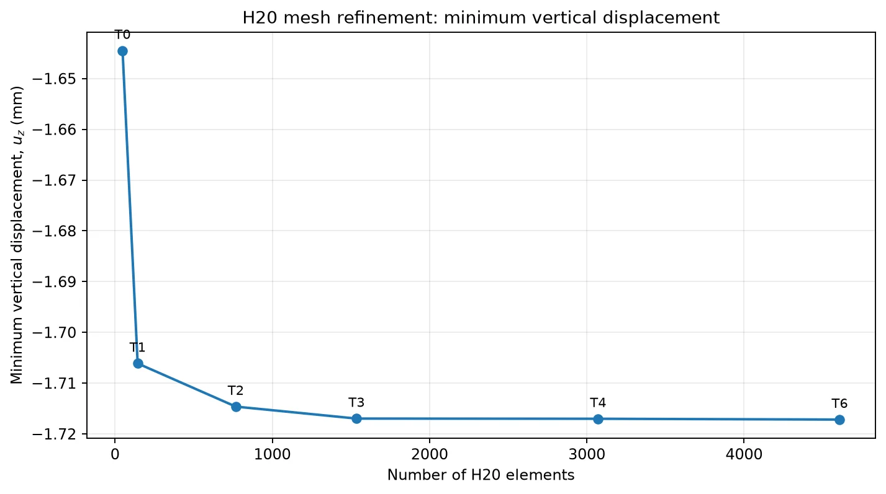
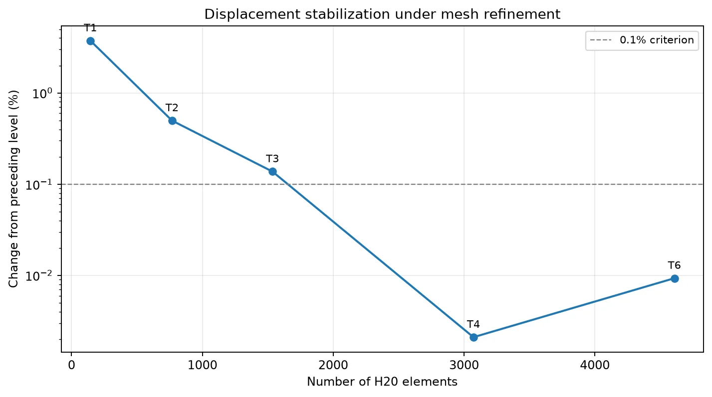
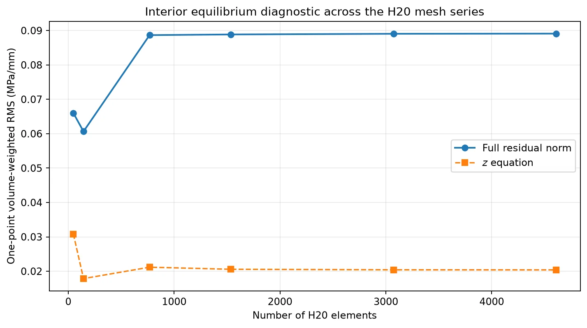

# Chapter II - H20 Mesh Convergence
## Selecting a reference three-dimensional solution

Mesh convergence asks a simple question: if the numerical description of a structure becomes finer, does the quantity of interest stop changing? The answer depends on which quantity is measured. In the present study the primary selection quantity is the **minimum vertical displacement** of the tapered I-shaped member.

### Terms used in this chapter

| Term | Meaning |
|---|---|
| **Mesh** | The collection of solid elements used to approximate the volume. |
| **Refinement level** | One particular choice of mesh subdivisions, named T0 through T6. |
| **Longitudinal subdivision** | Division of the member along its length, the physical $x$ direction. |
| **Transverse subdivision** | Division of the cross-section across the flanges and web. |
| **$u_z$** | Displacement in the global $z$ direction, measured in mm. |
| **Relative change** | The size of the change between two successive computed values, expressed as a percentage. |
| **Equilibrium residual** | The remaining imbalance in the differential stress-equilibrium equations inside an element. |

## 1. What is held constant

Every H20 mesh describes the **same** physical member. Its length is 1,000 mm; the clear web height decreases from 100 to 20 mm; both flanges have constant dimensions; and the web modulus decreases linearly from 71,700 to 51,700 MPa. The support conditions and the global-$z$ half-wave traction on the actual bottom surface are also unchanged.

The driver [`fem3d/run_h20_convergence.py`](fem3d/run_h20_convergence.py) calls [`fem3d/run_bending_fem3d_h20.py`](fem3d/run_bending_fem3d_h20.py) for each mesh. All reported displacement solutions use the SciPy backend. The same consistent surface-load integration is performed on every mesh.

Consequently, the changes in the results can be attributed to the chosen numerical discretizations, rather than to changes in geometry, supports or loading.

## 2. The refinement sequence

The `quick` profile in `run_h20_convergence.py` defines the six levels listed below. The first five subdivision columns describe the section; $n_x$ is the number of elements along the beam.

| Level | $n_x$ | Left flange width | Web width | Right flange width | Flange thickness | Web height | Elements | Nodes |
|---|---:|---:|---:|---:|---:|---:|---:|---:|
| T0 | 3 | 1 | 2 | 1 | 1 | 4 | 48 | 379 |
| T1 | 6 | 1 | 2 | 1 | 2 | 4 | 144 | 941 |
| T2 | 12 | 2 | 4 | 2 | 2 | 8 | 768 | 4,201 |
| T3 | 24 | 2 | 4 | 2 | 2 | 8 | 1,536 | 8,161 |
| T4 | 48 | 2 | 4 | 2 | 2 | 8 | 3,072 | 16,081 |
| T6 | 72 | 2 | 4 | 2 | 2 | 8 | 4,608 | 24,001 |

The headings "left flange width", "web width", and "right flange width" indicate **mesh subdivisions**, not physical changes of those dimensions. From **T2 through T6**, the transverse subdivision is fixed. Those levels isolate the effect of longitudinal refinement at that transverse resolution.

The available source also defines a more demanding `production` profile (P0, P1 and P2). No computed production-profile results are included in this chapter.

## 3. The displacement convergence criterion

Let $u_i$ denote the minimum of the $z$-displacement over all nodes of mesh level $i$. The script measures the change from the preceding level using

$$
\delta_i = 100\,\frac{|u_i-u_{i-1}|}{|u_{i-1}|}\quad\text{percent}.
$$

The specified tolerance is **0.1%**. A level receives the status `STABLE_MIN_UZ` when $\delta_i\le 0.1\%$; otherwise it receives `CHECK_REFINEMENT`. The first level has no preceding value, so its relative change is undefined.

| Level | Minimum $u_z$ (mm) | Change from preceding level | Status |
|---|---:|---:|---|
| T0 | -1.644499 | - | CHECK_REFINEMENT |
| T1 | -1.706124 | 3.747373% | CHECK_REFINEMENT |
| T2 | -1.714627 | 0.498361% | CHECK_REFINEMENT |
| T3 | -1.716985 | 0.137555% | CHECK_REFINEMENT |
| **T4** | **-1.717022** | **0.002104%** | **STABLE_MIN_UZ** |
| **T6** | **-1.717182** | **0.009327%** | **STABLE_MIN_UZ** |





The measured displacement is nearly stationary by T4, and its change to T6 remains below 0.01%. The T4 solution is therefore adopted as the **reference displacement model** for the cross-method comparisons. Choosing T4 also avoids the greater cost of the T6 mesh while retaining the observed stability of this global quantity.

The sequence is not strictly monotonic in its successive change: the T4 change is smaller than the T6 change. Both satisfy the stated criterion. The criterion is a check on one observable, not a mathematical proof of convergence of all reconstructed fields.

## 4. A second diagnostic: interior stress equilibrium

The convergence driver also evaluates the strong-equilibrium residual inside each H20 element. For zero body force,

$$
\mathbf r=\nabla\cdot\boldsymbol\sigma,
$$

where $\boldsymbol\sigma$ is the stress tensor. The ideal value of $\mathbf r$ is zero. Residual components are measured in **MPa/mm**. The driver computes a volume-weighted RMS, giving each integration point a weight proportional to its represented physical volume.

In the saved series, `--residual-gauss 1` means **one residual sample at the center of each element**. All elements are included because `--max-elements 0` is selected.

| Level | RMS $r_x$ | RMS $r_y$ | RMS $r_z$ | RMS $\|\mathbf r\|$ |
|---|---:|---:|---:|---:|
| T0 | 0.054555 | 0.020705 | 0.030838 | 0.065999 |
| T1 | 0.055992 | 0.014976 | 0.017864 | 0.060650 |
| T2 | 0.083631 | 0.020457 | 0.021174 | 0.088662 |
| T3 | 0.083983 | 0.020488 | 0.020569 | 0.088859 |
| T4 | 0.084206 | 0.020555 | 0.020417 | 0.089051 |
| T6 | 0.084262 | 0.020577 | 0.020389 | 0.089102 |

<small>All values are in MPa/mm. The statistic is a physical-volume-weighted RMS of one sampled point per element.</small>



The full residual RMS decreases from T0 to T1 but then increases and approaches approximately 0.0891 MPa/mm from T2 onward. Thus **the displacement stabilizes, but the interior residual does not decrease to zero in this refinement series**. This is an important distinction between the convergence of a global displacement and the convergence of local stress derivatives.

The **interior H20-CUF comparison** in the [equilibrium chapter](FEM3D-H20-CUF-equilibrium.md) uses **2 x 2 x 2 points per T4 element**, not the single center point used in the table above. With eight points per element, H20 gives $\mathrm{RMS}(r_z)=0.03909369$ MPa/mm and $\mathrm{RMS}(\|\mathbf r\|)=0.14280197$ MPa/mm. These values are larger because additional positions within each element are examined. The two tables must not be treated as interchangeable measures.

## 5. Independent numerical checks

The total global-$z$ load obtained from the H20 nodal force array is **-42,050.50506558 N** at every refinement level. This provides a useful check that the surface load does not change as the mesh changes.

The H20 driver also checks the positivity of the geometric Jacobian in a sample of solid elements. Its `--self-test` exercises the element interpolation, the quadratic surface-load integration and a manufactured displacement field for which a stress-divergence term is known.

These checks test different parts of the implementation: geometry, applied forces and local differential reconstruction. Their role is to make a convergence observation reproducible and interpretable.

## 6. Reproduce the sequence

Install the project and its Python dependencies as explained in [Reproducibility](reproducibility.md). Then, from `cuf/I-Shape_L`, run:

```bash
python3 fem3d/run_bending_fem3d_h20.py --self-test

python3 fem3d/run_h20_convergence.py \
  models/carrera_i_shaped_taper80.yaml \
  --backend scipy \
  --profile quick \
  --max-elements 0 \
  --residual-gauss 1 \
  --tol-pct 0.1 \
  --output-dir fem3d/output/h20_convergence
```

Existing solved checkpoints are reused by default. Add `--force` only when the intention is to recompute the solutions. The driver writes `T*_h20.npz`, per-level logs, `T*_strong_residual.json`, `convergence.csv` and the [generated convergence report](fem3d/output/h20_convergence/convergence.md).

To draw the convergence figures **without solving again**:

```bash
python3 fem3d/plot_h20_convergence.py
```

The figures are written to `fem3d/output/h20_convergence/figures/`.

For a higher-resolution residual integration on the selected mesh:

```bash
python3 fem3d/h20_strong_residual.py \
  fem3d/output/h20_convergence/T4_h20.npz \
  --max-elements 0 \
  --gauss 2 \
  --output fem3d/output/h20_convergence/T4_gauss2.json
```

This last command recalculates a diagnostic from a saved solution; it does not refine the H20 displacement field.

## 7. What the criterion establishes

**Established by the supplied six levels:** minimum vertical displacement changes by less than 0.01% in the final two comparisons at the chosen cross-sectional resolution. The selected T4 mesh is an appropriate reference for the reported displacement comparison.

**Not established by this particular series:** convergence of every stress component, surface traction error, material-interface traction, or a combined longitudinal-and-transverse refinement limit. Those quantities require their own refinement criteria. Their evaluation on the selected T4 solution is documented in [Equilibrium inside the member and on its boundaries](FEM3D-H20-CUF-equilibrium.md).
