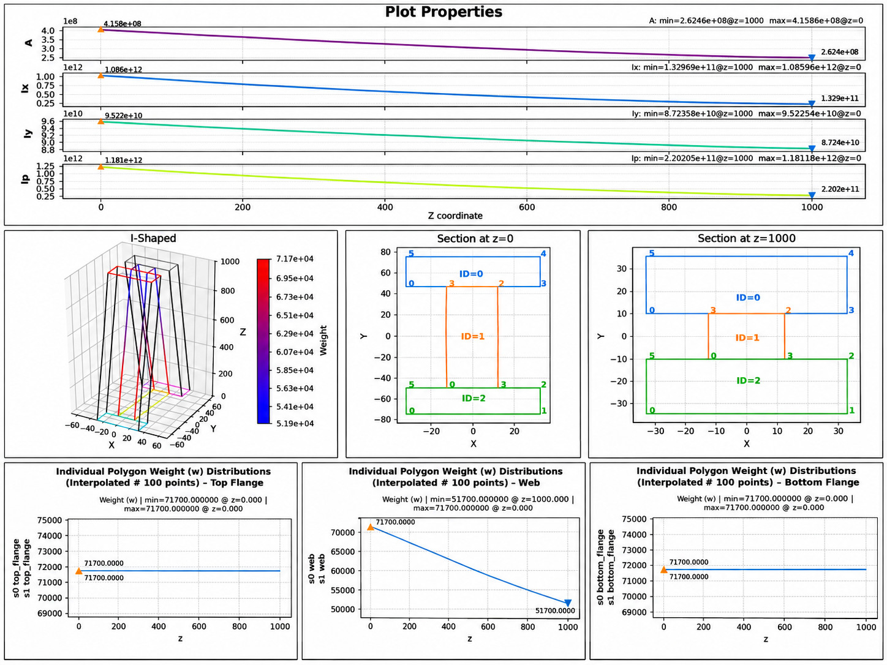

CSF-CUF Model and Organization of the Analysis

## Tapered I-shaped beam with a variable web material

This chapter describes the **CSF-CUF structural model** adopted in the `I-Shape_L` benchmark. It identifies the files required to reconstruct the model, explains the geometry and material fields supplied by CSF, and documents the transverse and longitudinal approximations, applied load, boundary conditions, and execution settings.

The member is a tapered I-section with a continuously decreasing clear web height and a longitudinally varying Young's modulus in the web. The analysis is defined through separate **model**, **problem**, and **case** configurations. This chapter describes the CSF-CUF calculation itself; the independent FEM3D reference and the numerical comparisons are documented separately in the [scenario README](README.md).

All paths in this document are relative to `cuf/I-Shape_L/`, except paths explicitly beginning with `../../`.

## 1. Organization of the model

### 1.1 Responsibilities of the components

| Component | Responsibility | Information supplied or calculated |
|---|---|---|
| **CSF - Continuous Section Field** | Describes the physical member | End sections, polygonal domains, dimensions, section interpolation, Young's modulus and isotropic material law |
| **Transverse CUF expansion** | Describes the variation of displacement over each section | Nine-node Lagrange (L9) functions, derivatives, polygon connectivity and global transverse unknowns |
| **Longitudinal finite elements** | Approximate the axial evolution of the generalized CUF unknowns | Element boundaries, Lagrange interpolation, integration along the beam |
| **Physical problem adapter** | Converts the loading and constraints into the generalized system | Distributed surface-traction vector, transverse end-section restraints, axial gauge condition |
| **CSF-CUF solver** | Assembles and solves the equilibrium equations | Stiffness matrix, generalized load vector, constrained solution |
| **Output and postprocessing** | Reconstructs physical fields | Displacements, strains and stresses at the requested positions |

The physical model and the structural approximation remain separate. CSF provides the geometry and material properties at the required longitudinal stations, while the CUF components define and solve the displacement approximation. Neither the I-section dimensions nor the material values are hard-coded into the general CUF assembly.

```text
                 CSF MODEL (geometry + material)
             models/carrera_i_shaped_taper80_l9_web3.yaml
                                |
                                v
       PROBLEM YAML --------------------------- CASE YAML
       load parameters, selected surfaces       selects approximations,
       and physical-model reference             quadrature and output
                |                                      |
                v                                      v
       PYTHON PROBLEM ADAPTER              L9 TRANSVERSE BASIS
       loads + constraints                  + LONGITUDINAL FE
                |                                      |
                +------------------+-------------------+
                                   v
                             CSF-CUF ASSEMBLY
                           stiffness, load, BCs
                                   |
                                   v
                              CUF SOLUTION
                                   |
                                   v
                      3D DISPLACEMENTS / STRAINS /
                              STRESSES
```

### 1.2 Files involved in the analysis

| File | Type | Role |
|---|---|---|
| [`models/carrera_i_shaped_taper80_l9_web3.yaml`](models/carrera_i_shaped_taper80_l9_web3.yaml) | CSF **model** | Physical I-section at `S0` and `S1`, nine quadrilateral domains, material properties |
| [`problems/taper_table9_l9_web3.yaml`](problems/taper_table9_l9_web3.yaml) | **Problem** YAML | References the CSF model; identifies three loaded bottom edges and the traction amplitude |
| [`validation/surface_halfwave_multi.py`](validation/surface_halfwave_multi.py) | Python **problem adapter** | Builds the surface load vector and the transverse end constraints, including the mean axial gauge |
| [`cases/taper/carrera_i_shaped_taper80_lagrangeL9_v4_E10_web3.yaml`](cases/taper/carrera_i_shaped_taper80_lagrangeL9_v4_E10_web3.yaml) | CUF **case** YAML | Selects the problem, L9 expansion, longitudinal FE discretization, integration, solver and output settings |
| [`src/csf/cuf/expansions/lagrangeL9_v4.py`](../../src/csf/cuf/expansions/lagrangeL9_v4.py) | Transverse basis plugin | Implements the registered `lagrangeL9` basis and its variable-section geometric evaluation |
| [`models/action.yaml`](models/action.yaml) | CSF inspection actions | Optional plotting and sectional-property inspection; **not required by the CSF-CUF solver** |
| [`reproducibility.md`](reproducibility.md) | Execution guide | Commands for running the case and the subsequent comparison workflow |

For comparison purposes, [`models/carrera_i_shaped_taper80.yaml`](models/carrera_i_shaped_taper80.yaml) provides an **equivalent three-domain representation** (top flange, web, bottom flange) used by the independent solid reference. The CSF-CUF case uses the nine-domain model listed above. The two YAML models represent the same physical cross-section and material field.

## 2. CSF physical model: geometry

### 2.1 Coordinate conventions

The structural beam axis is denoted by **`x`**, with `0 <= x <= L`. The section lies in the physical **`(y,z)`** plane.

| CSF source representation | Structural-coordinate interpretation |
|---|---|
| `sections.S0.z`, `sections.S1.z` | Longitudinal stations `x = 0` and `x = L` |
| First coordinate in a polygon vertex `[a,b]` | Transverse coordinate `y = a` |
| Second coordinate in a polygon vertex `[a,b]` | Transverse coordinate `z = b` |

The YAML station key `z` therefore denotes the CSF longitudinal parameter; it should not be confused with the structural transverse `z` coordinate.

### 2.2 End sections and taper

The CSF model defines two end sections, `S0` at `x = 0 mm` and `S1` at `x = 1000 mm`. The corresponding physical dimensions are:

| Geometric quantity | At `S0` (`x = 0`) | At `S1` (`x = L`) |
|---|---:|---:|
| Beam length `L` | 1,000 mm | 1,000 mm |
| Flange width | 66 mm | 66 mm |
| Thickness of each flange | 25 mm | 25 mm |
| Web thickness | 25 mm | 25 mm |
| Clear web height | 100 mm | 20 mm |
| Total section height | 150 mm | 70 mm |
| Sectional area | 5,800 mm² | 3,800 mm² |

The clear web height decreases by **80%** between the two stations. The flange width, flange thickness and web thickness remain constant. At each station, the area is the sum of the two flanges and the clear web:

$$
A(x) = 2b_f t_f + t_w h_w(x).
$$

For this model, with `x` measured in millimetres,

$$
h_w(x) = 100\ \mathrm{mm} - 80\ \mathrm{mm}\,\frac{x}{L},
\qquad L=1000\ \mathrm{mm}.
$$

CSF interpolates the corresponding polygon vertices along the axis, thereby generating a continuously tapered section. The geometry does **not** require a separate volumetric mesh for the CUF unknowns.



*Geometric and material evolution of the reference I-section, as supplied by the CSF model.* The CSF section-property panel uses the polygon `weight` values. In this case, its plotted `A` is the **E-weighted area** (for example, `415,860,000` at `S0`), whereas the table above reports the **geometric area** (`5,800 mm²` at `S0`). These two quantities must not be confused.

### 2.3 Nine-domain sectional partition

To support L9 interpolation, the I-section is partitioned into nine non-overlapping four-vertex CSF domains:

| Physical region | CSF polygon names | Number of domains | Description |
|---|---|---:|---|
| Upper flange | `top_flange_left`, `top_flange_center`, `top_flange_right` | 3 | Left, central and right flange regions |
| Web | `web_bottom`, `web_middle`, `web_top` | 3 | Three successive regions along the clear web height |
| Lower flange | `bottom_flange_left`, `bottom_flange_center`, `bottom_flange_right` | 3 | Left, central and right flange regions |
| **Total** | | **9** | |

The central flange domains align with the `25 mm` web thickness. The three web domains follow the tapered geometry, each spanning one third of the clear web height. Polygon names and adjacency remain consistent between `S0` and `S1`.

These domains are **sectional supports for the transverse L9 approximation**, not three-dimensional FEM elements. Their partition does not alter the physical dimensions or material assignment.

## 3. CSF physical model: material law

The model assumes **linear isotropic elasticity**, with the polygon `weight` field interpreted as Young's modulus `E` in MPa. The material is constant in both flanges and decreases linearly along the web.

| Region | `E` at `x = 0` | `E` at `x = L` | Longitudinal variation |
|---|---:|---:|---|
| Upper flange | 71,700 MPa | 71,700 MPa | Constant |
| Web (all three domains) | 71,700 MPa | 51,700 MPa | Linear decrease |
| Lower flange | 71,700 MPa | 71,700 MPa | Constant |
| Poisson's ratio `nu` | 0.30 | 0.30 | Constant |

The web material law is

$$
E_{\mathrm{web}}(x) = 71700\ \mathrm{MPa}
 - 20000\ \mathrm{MPa}\,\frac{x}{L}.
$$

The CSF declaration `shear_weight_laws: ['iso(0.3)']` establishes the isotropic relation between Young's modulus and shear modulus:

$$
G(x)=\frac{E(x)}{2(1+\nu)}, \qquad \nu=0.3.
$$

Both the physical domain and its constitutive parameters are therefore functions of the longitudinal position. These quantities are queried during CUF assembly rather than replaced by a single prismatic section.

## 4. CUF approximation and numerical discretization

### 4.1 Transverse Lagrange L9 expansion

The displacement field is represented in the CUF form

$$
u_i(x,y,z)=\sum_{\tau=1}^{M}F_{\tau}(x,y,z)\,q_{\tau i}(x),
\qquad i\in\{x,y,z\}.
$$

Here `F_tau` denotes a transverse expansion function, `q_tau i` is its generalized axial displacement amplitude, and `M` is the number of assembled transverse functions. Each quadrilateral carries **nine local quadratic Lagrange interpolation points**; coincident points on adjacent domain edges are shared.

The `shared_points` connectivity produces **C0 displacement continuity** across the interfaces between adjacent L9 domains. The associated transverse derivative and stress fields may have different one-sided values at those interfaces.

For the tapered section, the L9 interpolation retains the same local natural-coordinate definition while its **physical evaluation depends on the current CSF section**. The plugin also evaluates the longitudinal derivative of the transverse functions arising from the changing geometry. The isoparametric mapping and its in-plane Jacobian are used to evaluate physical derivatives and quadrature over the quadrilateral domains.

| Transverse setting | Selected value | Meaning |
|---|---|---|
| `cuf.basis` | `lagrangeL9` | Registered transverse plugin |
| `cuf.order` | `2` | Quadratic Lagrange interpolation |
| `domain_source` | `csf_polygons` | L9 domains correspond to CSF polygons |
| `mapping` | `isoparametric` | Local quadrilateral-to-physical-section mapping |
| `connectivity` | `shared_points` | Shared global amplitudes at coincident transverse nodes |
| `boundary_tolerance` | `1.0e-10` | Tolerance in topology/connectivity checks |
| `require_prismatic` | `false` | Legacy option; ignored by the current L9 plugin |

### 4.2 Longitudinal finite elements

Each generalized amplitude is discretized along the beam axis as

$$
q_{\tau i}(x) = \sum_{a}N_a(x)\,d_{a\tau i},
$$

where `N_a` is a longitudinal Lagrange shape function and `d_a tau i` is a generalized displacement degree of freedom.

| Longitudinal setting | Value | Interpretation |
|---|---|---|
| Method | `finite_element` | One-dimensional finite elements along the axis |
| Element boundaries | `[0.0, 0.1, ..., 1.0]` | Eleven normalized boundaries defining **ten elements** |
| Longitudinal basis | `lagrange` | Polynomial FE interpolation |
| Polynomial order | `6` | Sixth-order basis in each element |
| Longitudinal quadrature | `gauss_order: 15` | Requested Gauss order |
| Material polynomial degree | `1` | Linear variation of the material coefficients |
| Sectional integration | `fixed_gauss_polygon` | Quadrature over the CSF domains |
| Sectional Gauss order | `12` | Requested sectional integration order |

The normalized element boundaries correspond to `x = 0, 100, ..., 1000 mm`. **There are ten intervals, not eleven:** eleven values delimit ten elements.

The substring `E10` in the case **filename** is an identifier; the operative numerical settings are those inside the YAML, in particular `longitudinal.order: 6`.

### 4.3 Solver and sampling

| Case parameter | Value | Function |
|---|---|---|
| `solver.correctionMITC` | `true` | Enables the implemented MITC correction |
| `solver.verifyMITCAssembly` | `true` | Requests MITC assembly verification |
| `solver.equilibration.iterations` | `[1, 2, 3, 4, 5]` | Requested equilibration settings |
| `sampling.stations` | `[0.0, 0.1, 1.0]` | Normalized output stations |
| `sampling.displacement_samples` | `201` | Displacement-output sampling |
| `sampling.stress_grid` | `41` | Stress-output sampling grid |
| `output.adapter` | `csf.cuf.adapters.output.post` | Output/postprocessing component |
| `output.directory` | `../../output/taper/carrera_i_shaped_taper80_lagrangeL9_v4_web3` | Output destination as declared relative to the case file |

Sampling options control the reported data and do not redefine the physical geometry, boundary conditions or longitudinal finite-element mesh.

## 5. Structural problem: applied load

### 5.1 Physical loading law

The member is subjected to a **distributed half-wave surface traction** acting in the **global transverse `z` direction** on its complete bottom face:

$$
t_z(x) = A\sin\!\left(\pi\frac{x}{L}\right),
\qquad L=1000\ \mathrm{mm},\quad A=-1.0.
$$

In the adopted `mm-N-MPa` system, this traction amplitude is expressed in `N/mm²`. The negative sign selects the negative global `z` direction.

| Loading characteristic | Definition |
|---|---|
| Load type | Surface traction, not a point force |
| Distribution along `x` | Half-sine wave |
| Amplitude in problem YAML | `-1.0` |
| Direction | Fixed global `z` direction |
| At `x = 0` and `x = L` | Zero traction |
| At `x = L/2` | Peak signed traction `-1.0` |
| Physical loaded region | Entire lower external surface of the bottom flange |

### 5.2 Edges selected by the problem YAML

The problem configuration is [`problems/taper_table9_l9_web3.yaml`](problems/taper_table9_l9_web3.yaml):

```yaml
model:
  csf_yaml: ../models/carrera_i_shaped_taper80_l9_web3.yaml
problem:
  type: surface_halfwave_transverse_supported
  surfaces:
    - polygon_name: bottom_flange_left
      edge_start_point_id: 0
    - polygon_name: bottom_flange_center
      edge_start_point_id: 0
    - polygon_name: bottom_flange_right
      edge_start_point_id: 0
  amplitude: -1.0
```

The edge identifier `0` selects the segment from the first to the second polygon vertex. In all three bottom-flange domains, that is the **external lower edge**.

| Selected polygon | Local edge | Transverse `y` range | Lower-face elevation `z` at `S0` / `S1` |
|---|---:|---|---|
| `bottom_flange_left` | `0` | -33 to -12.5 mm | -75 / -35 mm |
| `bottom_flange_center` | `0` | -12.5 to +12.5 mm | -75 / -35 mm |
| `bottom_flange_right` | `0` | +12.5 to +33 mm | -75 / -35 mm |
| **Combined external edge** | | **-33 to +33 mm** | **Full 66 mm width** |

The three edge contributions are summed to represent the entire loaded surface. The bottom surface rises from `z = -75 mm` to `z = -35 mm`; accordingly, the adapter evaluates its **actual inclined surface measure** when projecting the traction onto the CUF functions. The force direction itself remains the fixed global `z` direction.

### 5.3 Python adapter and generalized loading

[`validation/surface_halfwave_multi.py`](validation/surface_halfwave_multi.py) implements the structural-problem adapter selected by the case. Its principal responsibilities are:

1. Resolve each named CSF polygon and the specified local edge at the current section.
2. Evaluate the half-wave traction and integrate the L9 functions along each selected edge, using the actual surface measure.
3. Add the three contributions and assemble the corresponding global `z`-direction generalized load vector through the longitudinal integrator.
4. Construct the displacement constraints and axial gauge described in Section 6.

The **problem YAML contains the physical parameters and surface selectors**; the **Python adapter contains their computational interpretation**. This separation allows the same adapter to work with other CSF surfaces without embedding I-section dimensions in its implementation.

## 6. Structural problem: constraints

### 6.1 Transverse restraint at both beam ends

At the complete end sections `x = 0` and `x = L`, both transverse displacement components are prescribed as zero:

$$
u_y(0,y,z)=u_z(0,y,z)=0,
\qquad
u_y(L,y,z)=u_z(L,y,z)=0.
$$

The axial component `u_x` remains physically free. The conditions therefore suppress transverse motion on each **entire end section**, not merely at isolated support points.

| Location | `u_x` | `u_y` | `u_z` |
|---|---|---|---|
| Entire section at `x = 0` | Free | 0 | 0 |
| Entire section at `x = 1000 mm` | Free | 0 | 0 |

In the CUF implementation, the adapter constrains the `y` and `z` generalized amplitudes at the first and last longitudinal nodes for **every assembled transverse mode**. This enforces the transverse end-section condition in the chosen expansion space.

### 6.2 Mean axial gauge

Because the end constraints leave a rigid translation in the axial direction, the adapter adds one scalar gauge condition:

$$
\frac{1}{L}\int_0^L u_x(x,0,0)\,dx=0.
$$

The mean axial displacement at the section reference point `(y,z)=(0,0)` is set to zero. This fixes the arbitrary axial displacement reference while preserving axial deformation; it is **not an additional physical axial support**.

The gauge is assembled by integrating the longitudinal basis multiplied by the transverse L9 functions evaluated at the current axial station. The problem thus has two distinct sets of constraints: physical transverse restraints and one numerical rigid-motion normalization.

## 7. From configuration to solution

### 7.1 Configuration chain

The operative chain is:

```text
cases/taper/carrera_i_shaped_taper80_lagrangeL9_v4_E10_web3.yaml
    |
    +-- problem.yaml -> problems/taper_table9_l9_web3.yaml
    |                       |
    |                       +-- model.csf_yaml
    |                               -> models/carrera_i_shaped_taper80_l9_web3.yaml
    |
    +-- problem.adapter -> validation/surface_halfwave_multi.py
    |
    +-- cuf.basis -> registered lagrangeL9 plugin
    |
    +-- longitudinal / section_integration / solver / sampling / output
```

The solver reads the case, loads the physical problem and CSF model, constructs the transverse and longitudinal approximations, performs sectional and longitudinal integration, assembles the generalized system, applies the constraints, and solves for the generalized displacement unknowns. The physical displacement, strain, and stress fields can then be reconstructed at requested locations.

### 7.2 Run the CSF-CUF case

From the `cuf/I-Shape_L/` directory:

```bash
csf-cuf cases/taper/carrera_i_shaped_taper80_lagrangeL9_v4_E10_web3.yaml
```

To inspect the two geometric representations independently, from `cuf/I-Shape_L/models/`:

```bash
csf-actions carrera_i_shaped_taper80.yaml action.yaml
csf-actions carrera_i_shaped_taper80_l9_web3.yaml action.yaml
```

The `csf-actions` commands inspect geometry, material weights and sectional properties; they do not perform the structural CSF-CUF analysis. The complete reproducibility and comparison procedures are available in [`reproducibility.md`](reproducibility.md).

## 8. Model summary

| Aspect | Implemented CSF-CUF configuration |
|---|---|
| Physical member | Continuously tapered I-section, `L = 1000 mm` |
| Section shape | Clear web height decreases from `100` to `20 mm`; flanges remain unchanged |
| CSF domain structure | Nine quadrilateral domains (3 upper flange + 3 web + 3 lower flange) |
| Material | Isotropic linear elasticity, `nu = 0.3`; web `E` decreases from `71,700` to `51,700 MPa` |
| CUF transverse expansion | Quadratic Lagrange L9, `shared_points` connectivity |
| Longitudinal approximation | Ten sixth-order Lagrange finite elements |
| Numerical integration | Longitudinal Gauss order `15`; sectional Gauss order `12` |
| Loading | Global `z`-directed half-wave traction on the three lower-flange edges |
| Boundary conditions | `u_y = u_z = 0` at both full end sections; `u_x` free |
| Gauge | Zero mean axial displacement along the section reference line |
| Solver options | MITC correction and verification enabled; equilibration iterations `[1, 2, 3, 4, 5]` |
| Principal input files | CSF `model` YAML, physical `problem` YAML, numerical `case` YAML, L9 plugin, problem adapter |

The numerical model is defined by a compact, traceable set of readable configuration files. CSF supplies continuously varying physical geometry and material properties; the L9 plugin provides the transverse approximation; the longitudinal FE discretization governs the generalized amplitudes; and the physical problem adapter supplies the applied traction and constraints. These components are assembled within the CUF formulation to obtain the three-dimensional mechanical response.

---

**Related documentation:** [Scenario overview](README.md) | [Reproducibility](reproducibility.md) | [FEM3D H20 convergence](FEM3Dmesh-convergence-criterion.md) | [Equilibrium and boundary checks](FEM3D-H20-CUF-equilibrium.md) | [Plots and fields](plot_results/README.md)
