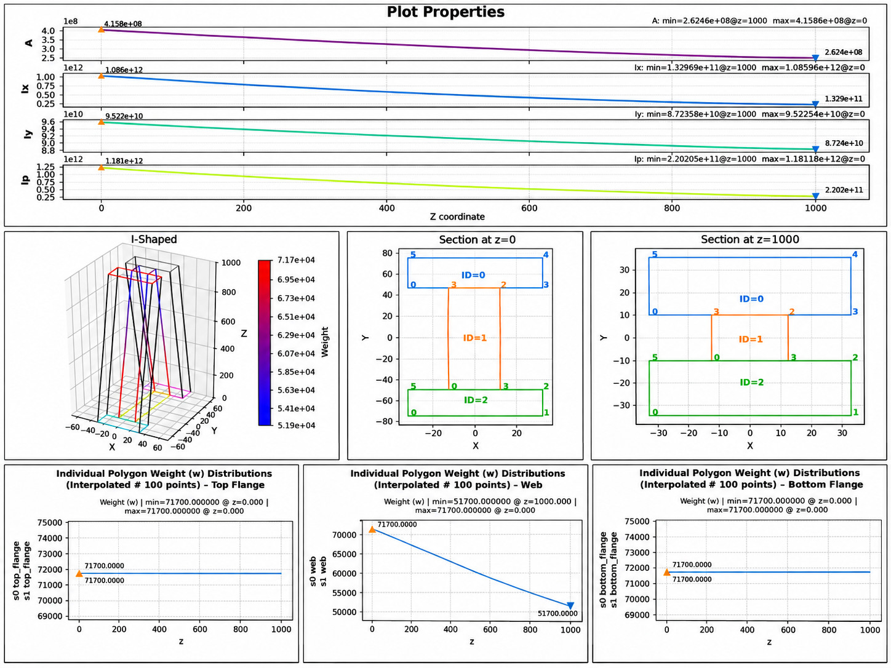
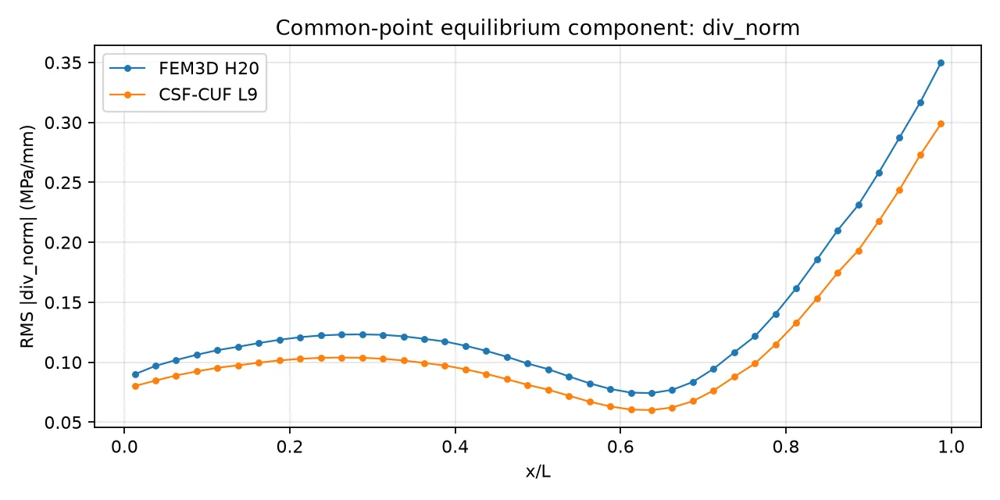
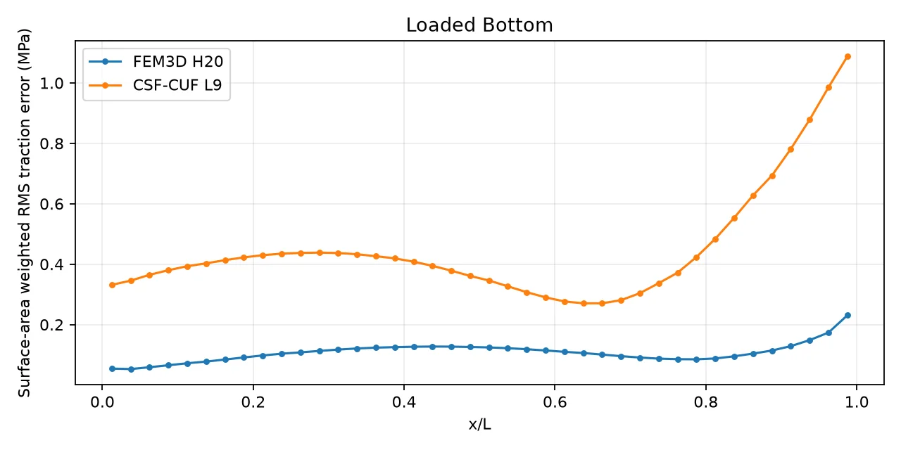
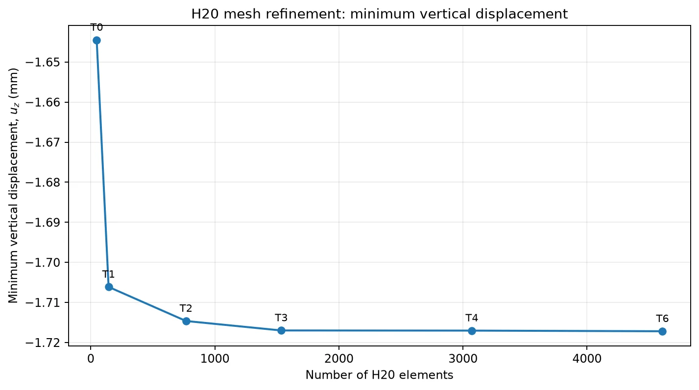

# A Tapered I-Shaped Member
## A reproducible study with a three-dimensional H20 model and CSF-CUF

This chapter studies the elastic response of a beam whose cross-section and material properties change along its length. Two numerical methods solve the same physical problem: a three-dimensional model made of twenty-node solid elements and a beam model based on the Carrera Unified Formulation (CUF) and the Continuous Section Field (CSF). Their solutions are examined through displacement, stress equilibrium inside the body, and the forces transmitted across its surfaces.

### Glossary: the terms used in this study

| Term | Meaning in this chapter |
|---|---|
| **Cross-section** | The shape obtained by cutting the member perpendicular to its length. |
| **Taper** | A gradual change of the cross-sectional geometry along the beam. |
| **CSF (Continuous Section Field)** | The physical description of the cross-section, including geometry and material properties at any longitudinal position. |
| **CUF (Carrera Unified Formulation)** | A beam formulation that represents three-dimensional displacement through chosen functions over the cross-section. |
| **FEM3D H20** | A three-dimensional finite-element model using twenty-node quadratic solid elements. |
| **L9 expansion** | A nine-node interpolation over each quadrilateral CSF domain; neighboring domains share displacement nodes. |
| **Checkpoint** | A saved numerical solution that can be read without rerunning the structural analysis. |
| **Mesh convergence** | A study of how a computed result changes when the finite-element mesh is refined. |
| **Strong equilibrium** | The local balance of the spatial derivatives of stress, expressed by the equation $\nabla\cdot\boldsymbol\sigma=\mathbf 0$ in the absence of body forces. |
| **Traction** | Force per unit area transmitted through a surface, calculated as $\mathbf t=\boldsymbol\sigma\mathbf n$. |
| **RMS** | Root-mean-square, a weighted measure of the typical magnitude of a collection of numerical values. |
| **Physical interface** | A shared surface between two material regions, here the junction between web and flange. |

All dimensions are in **mm**, forces in **N**, stresses and elastic moduli in **MPa**. Longitudinal position is denoted by $x$; $y$ and $z$ lie in the cross-sectional plane. The full length is $L=1000$ mm.

## 1. The physical problem

An I-shaped beam consists of a vertical web connecting two horizontal flanges. The flanges remain unchanged along the member, but the clear height of the web decreases linearly. This geometry provides a simple way to investigate a demanding feature of structural analysis: an elastic member can change both shape and stiffness without having a sudden geometric step.

*Figure 1. Geometry and longitudinal variation of the cross-sectional properties. The lower panels show the three-dimensional member and the end sections, including the material distribution.*

### 1.1 Geometry

| Dimension | At $x=0$ | At $x=L$ |
|---|---:|---:|
| Flange width | 66 | 66 |
| Thickness of each flange | 25 | 25 |
| Web thickness | 25 | 25 |
| Clear web height | 100 | 20 |
| Total section height | 150 | 70 |
| Sectional area | 5,800 mm² | 3,800 mm² |

Only the web's clear height changes. Writing $\xi=x/L$, its height is

$$
h_{\mathrm{web}}(x)=100-80\xi\quad\mathrm{mm}.
$$

The total height is therefore $H(x)=150-80\xi$ mm. Because the area varies linearly from 5,800 to 3,800 mm$^2$, the physical volume is

$$
V=\int_0^L A(x)\,dx=4{,}800{,}000\quad\mathrm{mm}^3.
$$

The physical geometry is defined in [`models/carrera_i_shaped_taper80.yaml`](models/carrera_i_shaped_taper80.yaml). The corresponding nine-domain representation for CUF is given in [`models/carrera_i_shaped_taper80_l9_web3.yaml`](models/carrera_i_shaped_taper80_l9_web3.yaml). The two YAML files describe the same solid member; their divisions serve different numerical purposes.

### 1.2 Material

All three physical regions are isotropic and linearly elastic, with Poisson ratio $\nu=0.3$. The two flanges have constant Young's modulus, whereas the web becomes progressively less stiff:

$$
\begin{aligned}
E_{\mathrm{flanges}}(x)&=71{,}700\ \mathrm{MPa},\\
E_{\mathrm{web}}(x)&=71{,}700-20{,}000\,\frac{x}{L}\ \mathrm{MPa}.
\end{aligned}
$$

Thus the web modulus decreases from 71,700 to 51,700 MPa. In CSF-CUF this law is evaluated continuously as the section is integrated. In the present H20 discretization, each three-dimensional element receives the modulus evaluated at its longitudinal midpoint. The physical law is the same; the finite numerical representations are not identical.

### 1.3 Supports and load

Both end sections are supported against displacement in the transverse directions:

$$u_y(0,y,z)=u_z(0,y,z)=u_y(L,y,z)=u_z(L,y,z)=0.$$

Axial displacement $u_x$ remains free apart from the removal of the rigid axial translation. The solutions use a common axial gauge so that displacement comparisons have a consistent reference.

A distributed traction is applied to the **actual bottom surface**, pointing in the fixed global $z$ direction. Its intensity follows a half sine wave:

$$
\overline{\mathbf t}(x)=\left(0,0,-\sin\frac{\pi x}{L}\right)\ \mathrm{MPa}.
$$

The traction vanishes at the ends and reaches its largest magnitude at midspan. Integration over the inclined physical surface gives a total applied force of approximately **$F_z=-42{,}050.505$ N**, independently recovered by the H20 load assembly on each mesh.

The CUF surface loading is defined in [`problems/taper_table9_l9_web3.yaml`](problems/taper_table9_l9_web3.yaml). Its three named lower edges together form the single loaded bottom face.

## 2. Two numerical descriptions of the same beam

### 2.1 The three-dimensional H20 model

The H20 model subdivides the beam volume into conforming quadratic bricks. Each brick has eight corner nodes and twelve nodes at edge midpoints. The displacement field is interpolated within each element; strain follows from its spatial derivatives, and stress follows from the isotropic elastic law.

The finite-element stiffness uses **3 x 3 x 3 Gauss integration**. The distributed bottom load is converted into equivalent nodal forces by integration over quadratic surface faces. The reported solution uses the **SciPy sparse linear solver**.

The selected reference is **mesh T4**, containing **3,072 H20 elements and 16,081 nodes**. The full mesh sequence and the criterion used to select this reference are developed in [the mesh-convergence chapter](FEM3Dmesh-convergence-criterion.md).

### 2.2 The CSF-CUF L9 model

In this model, the CSF supplies the geometry and material properties of any requested cross-section. CUF approximates three-dimensional displacement using functions over that section, coupled to unknown quantities varying along the longitudinal axis. The section is divided into **nine quadrilateral domains**: three in the upper flange, three in the web, and three in the lower flange.

The nine-node L9 expansion is shared across neighboring domains. Its common nodes impose continuity of displacement at the numerical domain boundaries. The chosen discretization has **57 transverse functions**, with **10 longitudinal finite elements of polynomial order 6**. The longitudinal integration uses Gauss order 15, the section integration Gauss order 12, and the solver enables the MITC correction.

The CSF domain boundaries within a single material are numerical subdivisions. They must not be confused with the two physical web-to-flange interfaces.

The input case is [`cases/taper/carrera_i_shaped_taper80_lagrangeL9_v4_E10_web3.yaml`](cases/taper/carrera_i_shaped_taper80_lagrangeL9_v4_E10_web3.yaml). It defines five solver-equilibration checkpoints. **The comparison presented here uses `eq1`.** These checkpoints are solver settings, not a sequence of refined meshes.

### 2.3 Model correspondence

| Feature | FEM3D H20 | CSF-CUF L9 |
|---|---|---|
| Spatial representation | 3D solid elements | Longitudinal elements plus sectional functions |
| Reference discretization | T4: 3,072 elements, 16,081 nodes | 10 longitudinal elements, order 6; nine L9 domains |
| Geometry | Quadratic solid-element mapping | Continuous CSF geometry at each station |
| Web material | Modulus fixed at element midpoint | Continuous modulus evaluated during reconstruction |
| Displacements | Three components at solid nodes | Three components reconstructed through CUF |
| Loading | Integrated on quadratic bottom faces | Integrated on the three bottom CSF edges |
| Saved reference | `T4_h20.npz` | `eq1.cuf.npz` |

The two file conventions use different internal coordinate labels. In the physical comparison, the translation is: **CSF longitudinal $z$ becomes FEM $x$; CSF cross-sectional point coordinates become FEM $(y,z)$.** Every reported comparison is made in the common physical $(x,y,z)$ frame.

## 3. How the solutions are examined

A global displacement is a useful first check, but it cannot describe every local difference between two numerical methods. This study therefore separates three questions.

**Displacement:** Do the two models predict essentially the same deformation of the member? This is measured at identical points in the physical volume.

**Interior equilibrium:** Do the reconstructed stresses satisfy the differential equations of static balance inside the material? With no body force, the residual is $\mathbf r=\nabla\cdot\boldsymbol\sigma$. A smaller residual indicates better local balance under the stated sampling rule.

**Surface and interface equilibrium:** On an externally loaded surface, does $\boldsymbol\sigma\mathbf n$ match the prescribed traction? On a free surface, does it approach zero? Across the physical web-flange interfaces, do the two sides transmit the same traction?

The interior residual has units **MPa/mm**, while traction error has units **MPa**. These are different physical measurements and are interpreted separately.

## 4. Displacement agreement

For the selected T4 / `eq1` pair, both saved fields are evaluated at **24,576 identical physical points**, located at eight interior integration points in every H20 element. The root-mean-square differences are:

| Component | RMS difference between H20 and CUF |
|---|---:|
| Axial displacement $u_x$ | 0.00002830 mm |
| Transverse displacement $u_y$ | 0.000004742 mm |
| Vertical displacement $u_z$ | **0.00036839 mm** |

On these common interior points, the minimum sampled $u_z$ is **-1.71644178 mm** for H20 and **-1.71585071 mm** for CUF. These sampled minima are not the extrema over every point in the two solved fields.

The displacement agreement is close despite the substantially different numerical descriptions of the cross-section and longitudinal material variation.

## 5. Interior equilibrium

The strongest interior comparison uses the same 24,576 points and identical physical-volume weights. Each row reports the RMS magnitude of one equilibrium equation. A residual of zero would mean that equation is satisfied exactly at every sampled interior point.

| Volume-weighted interior RMS | H20 (MPa/mm) | CSF-CUF (MPa/mm) | Lower RMS |
|---|---:|---:|---|
| $r_x$ | 0.13127148 | 0.11150557 | CSF-CUF, 15.1% |
| $r_y$ | 0.04039661 | 0.03615182 | CSF-CUF, 10.5% |
| $r_z$ | 0.03909369 | 0.02734043 | CSF-CUF, 30.1% |
| $\|\mathbf r\|$ | **0.14280197** | **0.12036588** | **CSF-CUF, 15.7%** |

CSF-CUF has the smaller *total* volume-weighted RMS in all **40 longitudinal intervals** used by this comparison. The result describes interior equilibrium. It does not include the stresses transmitted across material interfaces or the imposed tractions on the outer surfaces.

An additional statistic reveals why more than one indicator is useful: the weighted median of the *total residual magnitude* is **0.028999 MPa/mm for H20** and **0.046390 MPa/mm for CUF**. H20 has the smaller median, while CUF has the smaller RMS. This means the distributions differ: CUF better limits large contributions to the RMS, whereas H20 has a smaller typical residual at the median.

The method, equations, spatial curves and numerical output are developed in [the equilibrium chapter](FEM3D-H20-CUF-equilibrium.md), Part I.

## 6. Equilibrium on physical surfaces

The second equilibrium test evaluates the forces transmitted across the real boundary of the member and the two physical web-to-flange interfaces. The same physical surface points and area weights are used for both models.

| Surface or interface test | H20 RMS (MPa) | CSF-CUF RMS (MPa) |
|---|---:|---:|
| Prescribed traction on the lower surface | **0.111526** | 0.485354 |
| Zero traction on free external surfaces | **0.940525** | 1.062006 |
| Continuity across physical material interfaces | 2.505574 | 2.516598 |

H20 has the lower external traction error in this test. The two models have nearly equal RMS jumps across the physical material interfaces. The supported end faces are treated separately because support reactions are permitted there.

The difference from the interior results is informative: a stress field can satisfy its differential equations well inside a region while approximating its boundary tractions less accurately. See [the equilibrium chapter](FEM3D-H20-CUF-equilibrium.md), Part II, for the definitions and complete results.

## 7. What has converged

The FEM3D H20 convergence study refines the beam from 48 to 4,608 elements. The last two levels give minimum displacements of **-1.717022 mm** (T4) and **-1.717182 mm** (T6), a change of **0.00933%**. Both T4 and T6 meet the specified **0.1% successive-change criterion**.

This verifies stabilization of a particular global displacement at the chosen transverse resolution. The interior stress-divergence indicators do not show the same convergence pattern; a separate refinement study is needed to establish their asymptotic behavior. The criteria, the exact meshes and the evidence are presented in [FEM3D H20 mesh convergence](FEM3Dmesh-convergence-criterion.md).

## 8. Reading and reproducing the study

This chapter is the entry point to a small technical book. Each following chapter deals with one part of the calculation.

| Chapter | Purpose |
|---|---|
| [Reproducibility](reproducibility.md) | Run the case and reconstruct the figures and numerical comparisons using command-line tools. |
| [H20 mesh convergence](FEM3Dmesh-convergence-criterion.md) | Understand the refinement sequence, threshold, results and limitations. |
| [Equilibrium inside the member and on its boundaries](FEM3D-H20-CUF-equilibrium.md) | Study stress divergence, external traction errors and physical material-interface continuity. |
| [Plots and numerical fields](plot_results/README.md) | Understand the longitudinal plots, cross-sectional maps and perimeter diagrams. |
| [The H20 implementation](fem3d/README_H20.md) | Read how the independent solid solver and its tests are organized. |

The numerical results are also available as generated Markdown reports: [H20 convergence table](fem3d/output/h20_convergence/convergence.md), [interior equilibrium summary](diagnostics/h20_vs_cuf_T4_v3/summary.md), and [surface and interface equilibrium summary](diagnostics/h20_vs_cuf_T4_surfaces/summary.md).

The reference inputs are saved under [`fem3d/output/h20_convergence/`](fem3d/output/h20_convergence/) and [`output/taper/`](output/taper/). The comparison statistics are recorded in `diagnostics/h20_vs_cuf_T4_v3/summary.json` and `diagnostics/h20_vs_cuf_T4_surfaces/summary.json`.

## 9. Closing interpretation

The two methods give almost identical displacement fields for an I-section whose geometry and web stiffness both vary significantly. In the selected reference pair, CSF-CUF has a **15.7% lower volume-weighted RMS of interior stress divergence**, while H20 reproduces the external traction conditions more accurately. Their physical-interface traction jumps are nearly equal.

The principal value of the benchmark is the separation of these observations. Displacement, interior balance and surface-force transmission describe different properties of an approximate elastic solution. Taken together, they provide a more complete and reproducible numerical assessment than any single global quantity.
