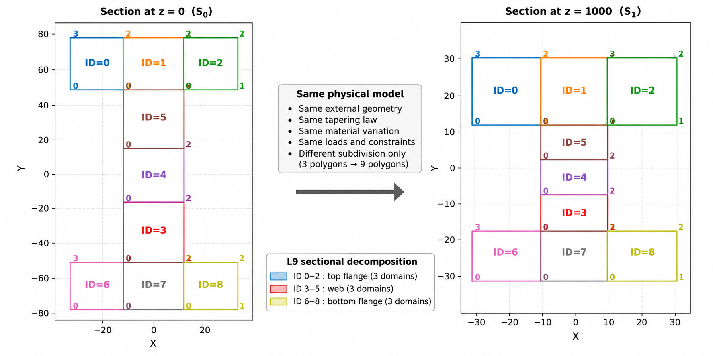

# DRAFT

# CSF-CUF / FEM3D Comparison for a Tapered I-Shaped Member

## 1. Purpose of this scenario

This scenario compares two independent numerical descriptions of the same structural problem:

- a **CSF-CUF beam model**, in which the physical cross-section and material field are supplied by CSF and the structural approximation is constructed with Carrera Unified Formulation (CUF);
- a **three-dimensional finite-element model (FEM3D)**, built with OpenSees `stdBrick` elements and used as an independent numerical reference.

The comparison is intentionally organized around a common physical problem. Geometry, material variation, loading, and support conditions are defined first. Only after the structural problem is clear are the two numerical models introduced.

### Supporting documentation

The complete execution sequence is documented in [`reproducibility.md`](reproducibility.md).

Additional benchmark documentation is available in the following files:

- [`FEM3Dmesh-convergence-criterion.md`](FEM3Dmesh-convergence-criterion.md) - FEM3D mesh-refinement and mesh-selection procedure.
- [`FEM3D-CUF-equilibrium-report.md`](FEM3D%E2%80%93CUF-equilibrium-report.md) - detailed strong-equilibrium comparison between FEM3D and CSF-CUF.
- [`plot_results/README.md`](plot_results/README.md) - graphical post-processing workflow and comparison plots.


---

### Geometric and material variation along the tapered I-section

The following figure summarizes the geometric and material evolution of the tapered I-shaped beam along the longitudinal coordinate \(z\).

The upper plots show the variation of the main sectional geometric properties, including the cross-sectional area \(A\), the second moments of area \(I_x\) and \(I_y\), and the polar quantity \(I_p\). These quantities decrease along the beam as a direct consequence of the prescribed tapering between the initial section at \(z=0\) and the final section at \(z=1000\).

The three-dimensional view shows how the physical cross-section evolves continuously between the two end stations. The color scale represents the longitudinal variation of the material property assigned to the polygons: the flange material remains constant, whereas the web property decreases linearly from \(71700\) at \(z=0\) to \(51700\) at \(z=1000\).

The two sectional views explicitly show the geometry prescribed at the end stations:

- **\(S_0\), \(z=0\)**: initial I-shaped section;
- **\(S_1\), \(z=1000\)**: tapered final section.

The lower plots report the material-property evolution separately for the three physical polygons. The top and bottom flanges remain constant at \(71700\), while the web varies linearly from \(71700\) to \(51700\). Therefore, both the geometric tapering and the material variation are prescribed continuously along the same structural member.


[Open the full-size figure](https://github.com/giovanniboscu/continuous-section-field/blob/main/cuf/I-Shape_L/img/I-SectionPlotPropertiesComposite.jpg)


### Equivalent cross-sectional representations

The two geometric YAML files used in this benchmark describe the **same physical tapered I-shaped beam**.

They differ only in the way the cross-section is partitioned for numerical purposes.

The compact model,

[`models/carrera_i_shaped_taper80.yaml`](models/carrera_i_shaped_taper80.yaml),

uses the three natural physical regions of the section:

- top flange,
- web,
- bottom flange.

This representation is used as the geometric input for the FEM3D model. It provides the most direct description of the physical cross-section and therefore minimizes unnecessary intermediate geometric subdivisions when generating the three-dimensional finite-element mesh.

The second model,

[`models/carrera_i_shaped_taper80_l9_web3.yaml`](models/carrera_i_shaped_taper80_l9_web3.yaml),

represents the **same geometry, tapering law, and material distribution**, but subdivides the section into nine domains in order to support the Lagrange L9 transverse representation adopted in the CSF-CUF model.

In particular, the three physical regions are repartitioned as:

- 3 domains in the top flange,
- 3 domains in the web,
- 3 domains in the bottom flange.

This repartition does not define a different structural model. The external geometry, end sections, longitudinal tapering, material variation, loads, and boundary conditions remain unchanged.

The distinction is therefore purely numerical:

```text
same physical I-shaped beam
        |
        +-- 3-domain representation  -> FEM3D
        |
        +-- 9-domain representation  -> CSF-CUF Lagrange L9
```

The following two views show the nine-domain representation at the two end stations:




The subdivision changes the internal representation of the cross-section, not the physical element being analysed.


### Visualizing the two geometric representations

From the `models` directory, the compact three-domain geometry can be inspected with:

```bash
csf-actions carrera_i_shaped_taper80.yaml action.yaml
```

The L9-compatible nine-domain representation can be inspected with:

```bash
csf-actions carrera_i_shaped_taper80_l9_web3.yaml action.yaml
```

The first command displays the compact physical representation used as the geometric basis for the FEM3D model, while the second displays the equivalent nine-domain decomposition adopted for the CSF-CUF Lagrange L9 representation.


## 2. Structural problem

The benchmark is a tapered I-shaped member of length

$$
L = 1000\ \mathrm{mm}.
$$

The section varies continuously between two end stations. At the first station, the clear web height is `100 mm`; at the second station it is reduced to `20 mm`, corresponding to an 80% reduction. The flange width and flange thickness remain constant.

The structural problem combines three ingredients that must be kept distinct:

1. the continuously varying **physical geometry**;
2. the continuously varying **material field**;
3. the **static scheme**, consisting of the applied surface traction and the end constraints.

These ingredients are common to the CSF-CUF and FEM3D analyses.

### Boundary conditions

The same transverse end-section restraint is imposed in the CSF-CUF and FEM3D models. At both beam ends, the transverse displacements are constrained over the complete end section,

$$
u_y = 0, \qquad u_z = 0,
$$

while the longitudinal displacement $u_x$ remains physically free. This boundary condition is a full transverse restraint of the end sections and should not be interpreted as a classical point- or line-supported simple support. Because the transverse motion of the complete end sections is suppressed, localized three-dimensional end effects may develop near the restrained sections. In the CSF-CUF formulation, the remaining rigid-body translation along the beam axis is removed directly through the mean axial gauge condition

$$
\frac{1}{L}\int_{x_0}^{x_1} u_x(x,0,0)\,dx = 0.
$$

In the FEM3D OpenSees implementation, the same physical condition is reproduced in two steps. First, all nodes belonging to the two end sections are constrained only in the transverse directions, so that $u_y=u_z=0$ while $u_x$ remains free. Since this leaves a rigid axial translation mode and would make the linear system singular, a single temporary constraint on $u_x$ is applied to one node on the beam centerline, selected near the mid-span. This constraint is purely numerical and does not represent an additional physical support. After the OpenSees solution is obtained, the corresponding arbitrary axial reference is removed by computing the mean longitudinal displacement along the centerline and subtracting it from the complete $u_x$ field. The final FEM3D displacement field therefore satisfies the same mean axial gauge used in the CSF-CUF model,

$$
\frac{1}{L}\int_{x_0}^{x_1} u_x(x,0,0)\,dx = 0,
$$

while preserving free axial deformation of the member. The CSF-CUF implementation is defined in [`surface_halfwave_multi.py`](https://github.com/giovanniboscu/continuous-section-field/blob/main/cuf/I-Shape_L/validation/surface_halfwave_multi.py).


### 2.1 Coordinate convention

The CSF geometry files use the CSF longitudinal coordinate stored in the section station variable `z`. In the FEM3D driver this coordinate is mapped to the FEM longitudinal coordinate `x`:

```text
CSF longitudinal z  -> FEM x
CSF section Pt.x    -> FEM y
CSF section Pt.y    -> FEM z
```

Accordingly, the beam axis is denoted by `x` in the FEM3D and comparison post-processing, while the CSF source geometry stores the end stations as `z = 0` and `z = 1000`.

### 2.2 Static scheme: supports

Both end sections are subject to a transverse end-section restraint,

$$
u_y = 0,
\qquad
u_z = 0,
$$

applied over the complete end sections. The longitudinal displacement remains free. This restraint differs from a classical point- or line-supported simple support because the transverse deformation of the entire end section is suppressed.

A single axial gauge condition is introduced only to remove the remaining rigid longitudinal translation. In the CSF-CUF implementation this is imposed through the mean axial gauge defined by the problem adapter; the FEM3D model applies the equivalent treatment and subsequently shifts the axial displacement field so that the same gauge is satisfied.

Because the complete end sections are transversely restrained, localized three-dimensional stress gradients may develop near the beam ends. These end effects are relevant when interpreting stress derivatives and strong-equilibrium residuals evaluated close to the restrained sections.

### 2.3 Static scheme: load

A distributed half-wave surface traction is applied to the bottom face of the member in the global transverse `z` direction.

Its longitudinal law is

$$
t_z(x) = A\sin\left(\pi\frac{x-x_0}{L}\right),
$$

with the benchmark amplitude set to

```text
A = -1.0
```

in the problem definition.

In the CSF-CUF problem, the traction is applied to the three bottom-flange subdomains that together form the complete bottom physical face. In FEM3D, the same law is integrated consistently over the actual three-dimensional bottom surface using the real surface measure. The traction direction remains the global `z` direction and is not rotated with the inclined tapered surface.

The structural comparison therefore refers to the same geometry, the same varying material field, the same half-wave transverse surface load, and the same end support conditions.

---

## 3. Physical geometry and material field

Two CSF geometry files are present for this scenario:

- [`models/carrera_i_shaped_taper80.yaml`](models/carrera_i_shaped_taper80.yaml)
- [`models/carrera_i_shaped_taper80_l9_web3.yaml`](models/carrera_i_shaped_taper80_l9_web3.yaml)

They represent **the same physical tapered member**. The difference between them is the polygonal decomposition used to describe the same cross-section.

This distinction is important: the passage from three polygons to nine polygons is not a change of structural geometry. It is a change of sectional decomposition introduced to support the Lagrange L9 transverse representation used by the CSF-CUF model.

### 3.1 Compact three-polygon representation

[`models/carrera_i_shaped_taper80.yaml`](models/carrera_i_shaped_taper80.yaml) represents each section with three physical regions:

```text
top flange
web
bottom flange
```

At the first station (`z = 0`):

- flange width: approximately `66 mm`, from `-33 mm` to `+33 mm`;
- flange thickness: `25 mm`;
- web thickness: `25 mm`, from `-12.5 mm` to `+12.5 mm`;
- clear web height: `100 mm`, from `-50 mm` to `+50 mm`;
- total outer section height: `150 mm`, from `-75 mm` to `+75 mm`.

At the second station (`z = 1000 mm`):

- the flange width remains unchanged;
- the flange thickness remains `25 mm`;
- the web thickness remains `25 mm`;
- the clear web height becomes `20 mm`, from `-10 mm` to `+10 mm`;
- the total outer section height becomes `70 mm`, from `-35 mm` to `+35 mm`.

The geometry between these two stations is generated continuously by CSF.

### 3.2 Material variation

The Young's modulus is stored in the CSF polygon `weight` field.

At the first station:

$$
E = 71700\ \mathrm{MPa}
$$

for the flanges and the web.

At the second station the flanges remain at

$$
E_{\mathrm{flange}} = 71700\ \mathrm{MPa},
$$

while the web is reduced to

$$
E_{\mathrm{web}} = 51700\ \mathrm{MPa}.
$$

The constitutive field therefore varies longitudinally together with the geometry. The isotropic shear relation is defined with

$$
\nu = 0.3.
$$

### 3.3 Nine-polygon representation for Lagrange L9

[`models/carrera_i_shaped_taper80_l9_web3.yaml`](models/carrera_i_shaped_taper80_l9_web3.yaml) describes the same physical section with nine non-overlapping four-vertex CSF domains:

```text
3 top-flange domains
3 web domains
3 bottom-flange domains
```

The top flange is divided into left, centre, and right domains. The web is divided into bottom, middle, and top domains. The bottom flange is again divided into left, centre, and right domains.

The end-section outline, the taper law, the flange dimensions, and the material variation are unchanged. The three web subdomains all inherit the same web material variation.

The purpose of this second representation is numerical rather than physical: it provides a sectional partition compatible with the Lagrange L9 transverse expansion and its shared connectivity.

The conceptual sequence is therefore:

```text
one physical tapered I-section
        |
        +-- compact CSF representation: 3 polygons
        |
        +-- L9-oriented CSF representation: 9 polygons
```

---

## 4. Role of the YAML files

The scenario separates the physical definition of the member from the numerical configuration of the CUF solution.

### 4.1 Geometry model

The CSF-CUF benchmark uses

[`models/carrera_i_shaped_taper80_l9_web3.yaml`](models/carrera_i_shaped_taper80_l9_web3.yaml).

This file defines the continuously varying physical geometry and material distribution using the nine-domain decomposition described above.

The FEM3D driver instead reads

[`models/carrera_i_shaped_taper80.yaml`](models/carrera_i_shaped_taper80.yaml),

which contains the same physical member in the compact three-region form required by the current structured I-section FEM3D mesher.

The two files must therefore be read as two representations of the same physical benchmark, not as two different structural models.

### 4.2 Physical problem

The CSF-CUF problem is defined in

[`problems/taper_table9_l9_web3.yaml`](problems/taper_table9_l9_web3.yaml).

It links the nine-domain CSF geometry to the physical loading definition and identifies the three lower flange edges that together form the loaded bottom surface:

```text
bottom_flange_left
bottom_flange_center
bottom_flange_right
```

The common traction amplitude is `-1.0`.

The corresponding problem adapter is

[`validation/surface_halfwave_multi.py`](validation/surface_halfwave_multi.py).

It provides the half-wave surface traction, its projection onto the CUF transverse functions, and the end constraints described in Section 2.

The custom adapter [`validation/surface_halfwave_multi.py`](validation/surface_halfwave_multi.py) defines the complete CSF-CUF physical problem, including surface loads and boundary conditions. The FEM3D model reproduces the same static scheme.

| Component | Physical definition |
|---|---|
| **Load** | Half-wave surface traction, \(t_z(x)=A\sin(\pi(x-x_0)/L)\), with \(A=-1.0\) |
| **Loaded surface** | Entire bottom flange (3 independent edges in CSF-CUF; corresponding bottom faces in FEM3D) |
| **End constraints** | \(u_y=u_z=0\) at both ends; axial displacement \(u_x\) remains free |
| **Axial gauge** | \(\frac{1}{L}\int_{x_0}^{x_1}u_x(x,0,0)\,dx=0\), eliminating rigid axial translation |

Both formulations implement the same physical loads and constraints, using their respective numerical discretizations.

For the complete adapter formulation, load integration, constraint implementation, and CUF–FEM3D correspondence, see **[Surface Half-Wave: CSF-CUF and FEM3D Reference](I-Shape_L_surface_halfwave_CUF_FEM3D_reference.md)**.


### 4.3 CSF-CUF case

The comparison case is

[`cases/taper/carrera_i_shaped_taper80_lagrangeL9_v4_E10_web3.yaml`](cases/taper/carrera_i_shaped_taper80_lagrangeL9_v4_E10_web3.yaml).

Its main numerical settings are:

| Item | Setting |
|---|---|
| Transverse basis | `lagrangeL9` |
| Domain source | `csf_polygons` |
| Transverse mapping | `isoparametric` |
| Connectivity | `shared_points` |
| Longitudinal method | `finite_element` |
| Longitudinal intervals | 10 |
| Longitudinal basis | `lagrange` |
| Longitudinal order | 6 |
| Longitudinal Gauss order | 15 |
| Material polynomial degree | 1 |
| Section integration | `fixed_gauss_polygon` |
| Section Gauss order | 12 |
| MITC correction | enabled |
| MITC assembly verification | enabled |

The case therefore combines a high-order Lagrange description in the section with a high-order finite-element approximation along the member axis.

---

## 5. FEM3D reference model

The independent three-dimensional model is contained in [`fem3d/`](fem3d/).

Its main driver is

[`fem3d/run_bending_fem3d_v2.py`](fem3d/run_bending_fem3d_v2.py).

The FEM3D layer does not create an independent approximation of the taper or material law. Instead, geometry and material data are obtained through the CSF Python API. The FEM3D code then provides:

- the structured three-dimensional mesh;
- the OpenSees `stdBrick` discretization;
- the corresponding elastic isotropic material assignment;
- the same bottom-surface half-wave loading;
- the same transverse end constraints;
- the OpenSees solution and numerical output.

This is an important part of the comparison strategy. The physical geometry and constitutive field come from CSF in both branches, while the structural discretization and solution procedures are independent.

### 5.1 FEM3D mesh convergence

The FEM3D mesh is qualified before it is used for stress and equilibrium comparisons. The complete refinement study is documented in

[`FEM3Dmesh-convergence-criterion.md`](FEM3Dmesh-convergence-criterion.md).

The study first refines the longitudinal mesh and then the cross-sectional mesh, using stabilization of the displacement solution as the convergence criterion.

For the cross-sectional refinement study, with `nx = 120`, the reported minimum vertical displacements are:

| Mesh | `stdBrick` elements | `min uz` [mm] | Change from previous mesh |
|---|---:|---:|---:|
| S1 | 11,520 | -1.711032 | - |
| S2 | 25,920 | -1.712507 | 0.086% |
| S3 | 49,920 | -1.713308 | 0.047% |
| S4 | 81,600 | -1.713663 | 0.021% |

The S3 mesh is adopted as the FEM3D reference mesh because the subsequent S4 refinement changes the minimum vertical displacement by only approximately `0.021%`.

The adopted S3 parameters are:

```text
nx        = 120
ny-left   = 4
ny-web    = 8
ny-right  = 4
nz-flange = 6
nz-web    = 28
```

corresponding to `49,920 stdBrick` elements.

The S4 mesh is retained as a convergence-verification mesh rather than as the production reference.

> **Reproducibility note**
>
> The results discussed in the convergence and equilibrium documents refer to the converged S3 FEM3D reference mesh above. The convenience launcher currently present in `fem3d/startfem_tap.sh` contains a lighter mesh setting. When reproducing the documented reference solution, the FEM3D mesh settings must be consistent with the S3 definition in [`FEM3Dmesh-convergence-criterion.md`](FEM3Dmesh-convergence-criterion.md).

---

## 6. What is compared

The comparison is not restricted to one scalar displacement. It examines the response at several levels.

### 6.1 Global and longitudinal response

Selected displacement, strain, and stress quantities are reconstructed along the beam axis to compare their longitudinal evolution.

### 6.2 Complete transverse-section fields

At selected stations, the CSF-CUF solution is reconstructed over the complete physical section. The post-processing includes:

- `ux`, `uy`, `uz`;
- `epsilon_xx`, `epsilon_yy`, `epsilon_zz`;
- `gamma_xy`, `gamma_xz`, `gamma_yz`;
- `sigma_xx`, `sigma_yy`, `sigma_zz`;
- `tau_xy`, `tau_xz`, `tau_yz`;
- the transverse shear-stress vector field.

A complete transverse reconstruction is available at `x = 500 mm`.

### 6.3 Polygon-boundary results

Selected quantities are also reconstructed along individual CSF polygon boundaries. This provides a local view of the solution and makes it possible to inspect how the reconstructed CUF fields compare with the native FEM3D values along the same physical boundaries.

The complete graphical organization is documented in

[`plot_results/README.md`](plot_results/README.md).

The FEM3D curves shown there use the raw element-wise results without nodal smoothing or stress/strain averaging. Multiple FEM3D traces can therefore occur at the same geometric boundary when adjacent solid elements return different native values. Those differences are intentionally preserved rather than hidden by post-processing.


### 6.4 Stress recovery and strong-form equilibrium methodology

The stress fields compared in this benchmark are reconstructed from the numerical displacement solutions using two independent kinematic descriptions: the Lagrange L9 CSF-CUF expansion and the three-dimensional H8 finite-element approximation.

The technical documentation traces both stress-recovery procedures, from the stored solution coefficients and nodal displacements to displacement gradients, strains, constitutive matrices, and stress components.

It also distinguishes the stress evaluation used for graphical visualization from the pointwise reconstruction employed in the strong-form equilibrium assessment. In the latter, both formulations are evaluated at the same physical sampling coordinates before computing stress derivatives and equilibrium residuals.

The complete methodology, source-code references, and verification plan are documented in:

**[Stress Recovery and Strong-Form Equilibrium Assessment](stress_recovery_equilibrium_outline.md)**.


---

## 7. Results obtained

The scenario produces two complementary classes of results:

1. **field comparisons**, documented graphically in [`plot_results/README.md`](plot_results/README.md);
2. **local strong-equilibrium diagnostics**, documented quantitatively in [`FEM3D-CUF-equilibrium-report.md`](FEM3D%E2%80%93CUF-equilibrium-report.md).

### 7.1 FEM3D displacement convergence

The FEM3D convergence study shows a regular stabilization of the minimum vertical displacement. The adopted S3 solution gives

$$
\min(u_z) = -1.713308\ \mathrm{mm},
$$

while the finer S4 mesh gives

$$
\min(u_z) = -1.713663\ \mathrm{mm}.
$$

The relative difference is approximately `0.021%`. This establishes the discretization level used for the subsequent FEM3D reference comparisons.

### 7.2 Field reconstruction and local comparisons

The generated plots show the solution in several complementary forms:

- longitudinal boundary histories;
- full cross-sectional maps at `x = 500 mm`;
- selected polygon-perimeter results near the beam end;
- a complete strain and stress perimeter analysis for `polygon_008` at `x = 500 mm`.

These plots are intended to be read as spatial comparisons rather than as a single scalar validation metric. They expose both the smooth reconstructed CSF-CUF fields and the native element-wise FEM3D response on the same physical geometry.

See [`plot_results/README.md`](plot_results/README.md) for the complete collection of generated figures.

### 7.3 Strong-equilibrium comparison

In the absence of body forces, the local equilibrium equation is $\nabla \cdot \boldsymbol{\sigma} = \mathbf{0}$. The local equilibrium comparison evaluates the three components of the stress-divergence residual over 40 longitudinal sections.

The strong-equilibrium diagnostic uses 40 nominally equally spaced longitudinal target locations over the interval $0.01 \leq x/L \leq 0.99$. Each target is mapped to the nearest available native H8 Gauss-point $x$-plane, so the actual sampled section coordinates are determined by the FEM3D Gauss-point locations. In addition to the statistics over all 40 sections, an interior subset is evaluated by excluding sections located within one local total section height of either restrained end. This criterion excludes 9 sections and retains 31 interior sections.


$$
r_x =
\frac{\partial \sigma_{xx}}{\partial x}
+
\frac{\partial \tau_{xy}}{\partial y}
+
\frac{\partial \tau_{xz}}{\partial z},
$$

$$
r_y =
\frac{\partial \tau_{xy}}{\partial x}
+
\frac{\partial \sigma_{yy}}{\partial y}
+
\frac{\partial \tau_{yz}}{\partial z},
$$

$$
r_z =
\frac{\partial \tau_{xz}}{\partial x}
+
\frac{\partial \tau_{yz}}{\partial y}
+
\frac{\partial \sigma_{zz}}{\partial z}.
$$

The reported median residuals over all 40 sections are:

| Residual | FEM3D | CSF-CUF | CSF-CUF / FEM3D |
|---|---:|---:|---:|
| `div_x` | 4.7321e-02 | 4.1532e-02 | 0.878 |
| `div_y` | 5.7134e-03 | 5.5446e-03 | 0.970 |
| `div_z` | 4.3244e-01 | 6.5551e-03 | 0.0152 |
| `div_norm` | 4.3578e-01 | 4.3871e-02 | 0.1007 |

Over the 31-section interior subset, the median residuals are:

| Residual | FEM3D | CSF-CUF | CSF-CUF / FEM3D |
|---|---:|---:|---:|
| `div_x` | 7.5565e-02 | 3.9108e-02 | 0.518 |
| `div_y` | 6.2716e-03 | 6.4693e-03 | 1.032 |
| `div_z` | 5.1961e-01 | 6.7962e-03 | 0.0131 |
| `div_norm` | 5.2101e-01 | 4.4786e-02 | 0.0860 |

The first two equilibrium components remain of comparable order between the two formulations, although the interior subset gives a lower median `div_x` for CSF-CUF and nearly equal median `div_y` values.

The third equilibrium component shows the largest separation. CSF-CUF gives the lower `div_z` residual in all 40 analyzed sections and in all 31 interior sections.

Considering the complete residual norm, CSF-CUF gives the lower value in 38 of the 40 analyzed sections and in all 31 interior sections. The median CSF-CUF/FEM3D ratio is approximately `0.1007` over all sections and `0.0860` over the interior subset.

The interior-section results strengthen the same trend observed over the full set of sampled sections. Away from the restrained end regions, the CSF-CUF reconstruction gives the lower total strong-equilibrium residual in all 31 interior sections, with a median CSF-CUF/FEM3D ratio of approximately `0.086`. This indicates a closer local satisfaction of the differential equilibrium equations by the CSF-CUF stress reconstruction in the smooth interior region of the member.

The full component-by-component analysis, including the longitudinal evolution of each residual, is given in

[`FEM3D-CUF-equilibrium-report.md`](FEM3D%E2%80%93CUF-equilibrium-report.md).

---

## 8. Interpretation of the comparison

This scenario is designed as a direct numerical comparison, not as a comparison between unrelated geometries or loading models.

The common physical definition is preserved throughout:

```text
same tapered I-shaped member
same longitudinal material variation
same half-wave surface traction
same transverse end supports
```

The two solution paths then differ in their numerical representation:

```text
CSF physical field
   |
   +-- 9-domain sectional decomposition -> Lagrange L9 -> CUF solution
   |
   +-- 3-region structured 3D mesh      -> stdBrick    -> FEM3D solution
```

The field plots provide the direct spatial comparison, while the strong-equilibrium analysis adds an independent diagnostic based on the reconstructed stress divergence.

The two formulations are constructed to represent the same physical structural problem while retaining different numerical approximations. The strong-equilibrium analysis provides an additional diagnostic of the reconstructed stress fields: the first two equilibrium components are of comparable order, while the third component and the total stress-divergence residual are substantially lower for the CSF-CUF reconstruction over most of the analyzed sections. These residuals are absolute and not normalized by a characteristic stress or length scale; therefore, they should be interpreted as measures of how closely the reconstructed stress fields satisfy the local differential equilibrium equations, rather than as standalone indicators of overall solution accuracy.

---

## 9. Reproducing the scenario

A command-by-command reproduction guide is provided in

[`reproducibility.md`](reproducibility.md).

The documented workflow is:

```text
1. install the project and dependencies
2. run the CSF-CUF tapered I-section case
3. generate the FEM3D solution
4. generate the comparison plots
5. run the multi-section equilibrium diagnostic
```

The CSF-CUF case is launched with:

```bash
csf-cuf cases/taper/carrera_i_shaped_taper80_lagrangeL9_v4_E10_web3.yaml
```

The graphical comparison workflow and all available figures are documented in

[`plot_results/README.md`](plot_results/README.md).

The FEM3D convergence study should be consulted whenever the reference mesh is regenerated:

[`FEM3Dmesh-convergence-criterion.md`](FEM3Dmesh-convergence-criterion.md).

The strong-equilibrium results and their quantitative interpretation are documented in

[`FEM3D-CUF-equilibrium-report.md`](FEM3D%E2%80%93CUF-equilibrium-report.md).

---

## 10. Scenario map

| Role | File or directory |
|---|---|
| Compact physical CSF geometry | [`models/carrera_i_shaped_taper80.yaml`](models/carrera_i_shaped_taper80.yaml) |
| L9-oriented CSF geometry | [`models/carrera_i_shaped_taper80_l9_web3.yaml`](models/carrera_i_shaped_taper80_l9_web3.yaml) |
| Physical CSF-CUF problem | [`problems/taper_table9_l9_web3.yaml`](problems/taper_table9_l9_web3.yaml) |
| Surface-load / support adapter | [`validation/surface_halfwave_multi.py`](validation/surface_halfwave_multi.py) |
| CSF-CUF case | [`cases/taper/carrera_i_shaped_taper80_lagrangeL9_v4_E10_web3.yaml`](cases/taper/carrera_i_shaped_taper80_lagrangeL9_v4_E10_web3.yaml) |
| FEM3D implementation | [`fem3d/`](fem3d/) |
| FEM3D driver | [`fem3d/run_bending_fem3d_v2.py`](fem3d/run_bending_fem3d_v2.py) |
| FEM3D mesh convergence | [`FEM3Dmesh-convergence-criterion.md`](FEM3Dmesh-convergence-criterion.md) |
| Plot documentation | [`plot_results/README.md`](plot_results/README.md) |
| Strong-equilibrium report | [`FEM3D-CUF-equilibrium-report.md`](FEM3D%E2%80%93CUF-equilibrium-report.md) |
| Reproducibility guide | [`reproducibility.md`](reproducibility.md) |

---

## 11. Main takeaway

The purpose of this benchmark is to compare **CSF-CUF and FEM3D on one explicitly shared structural model**.

The three-polygon and nine-polygon CSF files describe the same tapered I-shaped member and the same longitudinal material variation. The compact model provides the natural physical representation used by the current FEM3D mesher, while the nine-domain model provides the sectional partition required by the Lagrange L9 CSF-CUF discretization.

Once the common geometry, material field, load, and supports are established, the two formulations are solved independently and compared through displacements, reconstructed strain and stress fields, boundary distributions, and local strong-equilibrium residuals.

The FEM3D displacement solution is first qualified by mesh convergence. The subsequent strong-equilibrium analysis shows comparable behavior in the first two local equilibrium components, while the CSF-CUF stress reconstruction satisfies the third local equilibrium equation more closely than the H8 reconstruction. The median total stress-divergence residual of the CSF-CUF reconstruction is approximately one tenth of the FEM3D value. However, these residuals are absolute and unnormalized; they quantify how closely the reconstructed stress fields satisfy the local differential equilibrium equations and should not be interpreted as a direct measure of overall solution accuracy.
