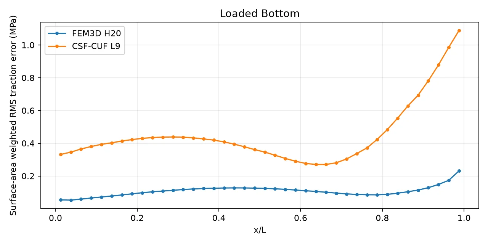
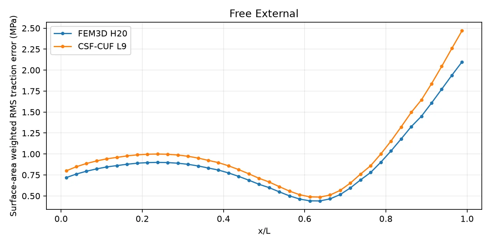
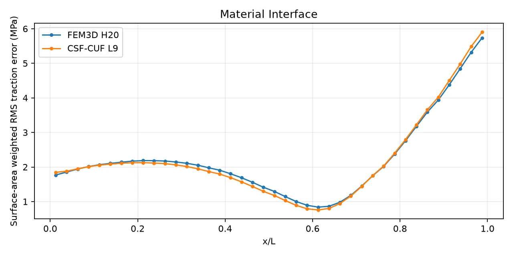
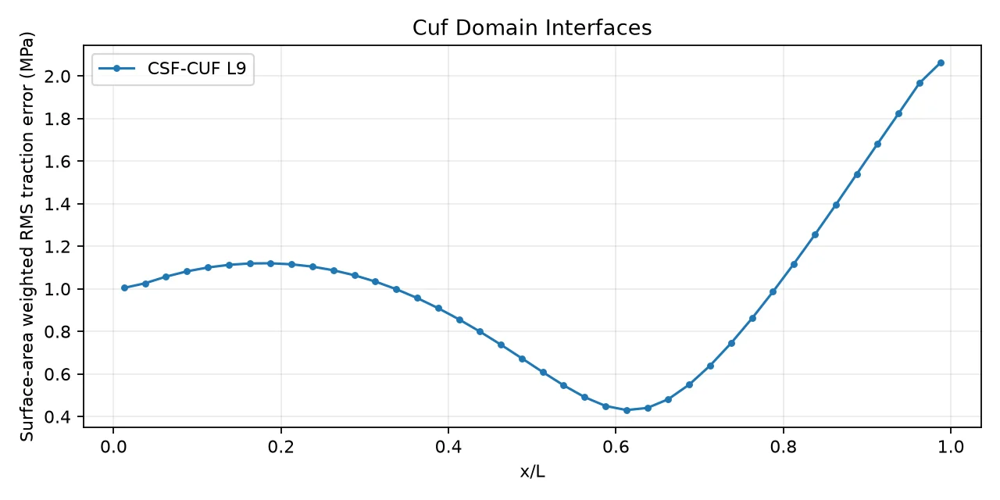

# FEM3D H20 vs CSF-CUF: traction and interface equilibrium

All quantities are evaluated on the same *physical surface quadrature points*
for the matched H20 boundary and material interfaces. Units: traction MPa, area mm².
Normals are the outward FEM face normals in global coordinates (x,y,z).

| Surface class | Points | FEM RMS (MPa) | CUF RMS (MPa) | CUF reduction |
|---|---:|---:|---:|---:|
| loaded_bottom | 1536 | 0.111526043 | 0.485354362 | -335.194% |
| free_external | 7680 | 0.940525469 | 1.06200635 | -12.916% |
| material_interface | 1536 | 2.50557364 | 2.51659846 | -0.440% |

## Variation along the beam

Each physical surface point belongs to exactly one of the requested longitudinal bins.
The plots below show the RMS by axial interval (not stress on a flat cross-sectional cut).

**Different diagnostics, not directly rankable:**
- cuf_domain_interfaces: 1280 samples, RMS jump=1.07677606 MPa (single-model diagnostic).

**Supported end faces:** no zero-traction error is assigned because transverse reactions are allowed.

External faces 2432; true FEM region interfaces 384;
CUF domain edges 8 (including same-material L9 subdivisions).

FEM file SHA256: `525444c97c7614ded0263c7475372f3c7a564127e1418912b424bb4e421251c1`
CUF file SHA256: `67b2b69b6522e52d37dc1dbb505b6381e69f435a24d22fae5e7b54971a438705`
CSF YAML SHA256: `66ef4fc835f426a645f949f41d28e2225dd0a2556b9b84a1446f954ca0a300b5`

## Scope

- This checks boundary and interface tractions, **not** interior stress divergence.
- A positive reduction means lower CUF area-weighted RMS only in that surface class.
- H20 has three physical regions; CUF has nine L9 domains. Extra same-material CUF seams are reported separately.
- The CUF one-sided stress is evaluated epsilon inside each domain. Check epsilon sensitivity before publication.
- H20 E is constant per element; CUF E varies continuously in x.
- For material interfaces, FEM and CUF are sampled on exactly the same H20 surfaces; no extrapolation of FEM stress between elements.
- At the supported ends, the unknown reaction tractions cannot be prescribed as zero.
- Do not combine surface RMS (MPa) with interior equilibrium RMS (MPa/mm).

## Documentation

- [Scenario overview](../../README.md)
- [FEM3D H20 vs CSF-CUF equilibrium analysis](../../FEM3D-H20-CUF-equilibrium.md)
