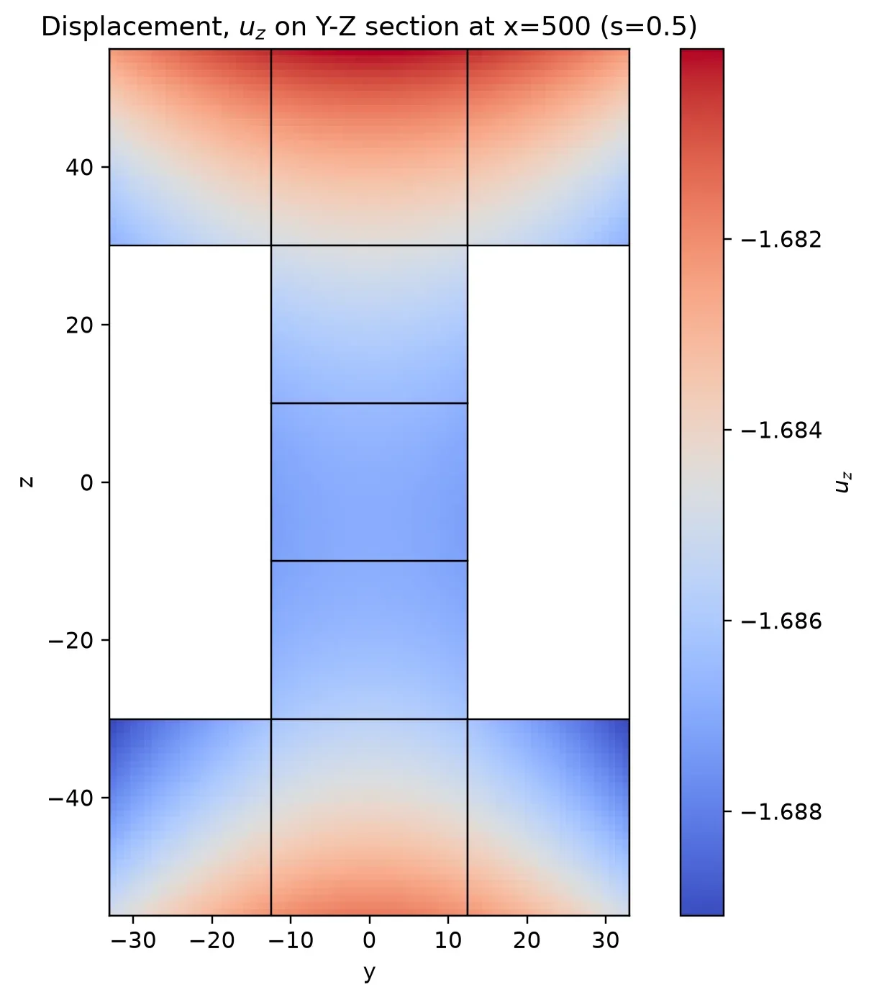
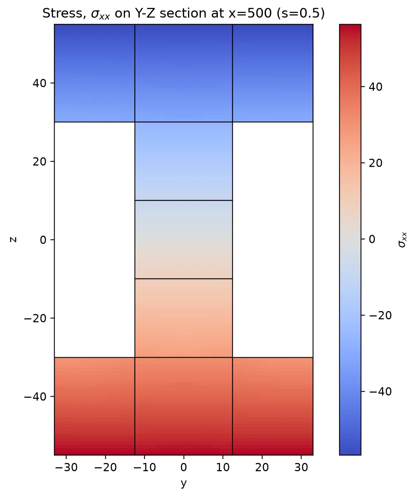
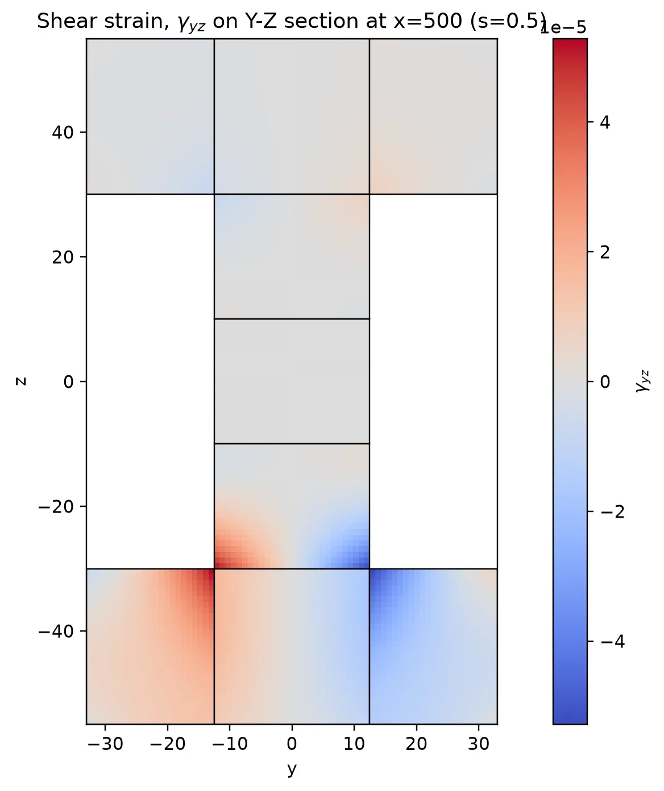
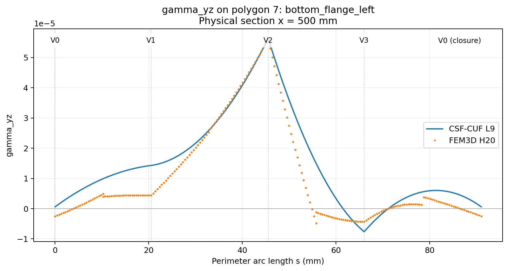

# Chapter VI - Reading the Numerical Fields and Figures
## Longitudinal curves, cross-sectional maps and polygon perimeters

A numerical solution is a three-dimensional displacement field. To examine it, we must select both a physical quantity and a geometric path or surface on which to display it. This chapter introduces three complementary ways of viewing the saved H20 and CSF-CUF solutions, and explains how the PNG figures relate to the numerical NPZ and CSV data.

### Glossary

| Term | Meaning |
|---|---|
| **Longitudinal curve** | A quantity plotted while moving along the beam, usually at one selected cross-sectional point. |
| **Cross-sectional map** | A quantity shown across the whole section at one fixed longitudinal position. |
| **Polygon perimeter** | The closed outline of one of the nine CUF sectional domains. |
| **Arc length $s$** | Distance measured along that outline, starting from the first polygon vertex. |
| **Engineering shear strain $\gamma_{yz}$** | The sum $\partial u_y/\partial z+\partial u_z/\partial y$, measuring shear deformation in the section plane. |
| **Inward offset** | A second contour displaced a small distance inside its original polygon. |
| **Figure CSV** | The numerical data underlying one plotted PNG, with the same base filename. |

## 1. Three ways to view the same field

The first view follows a **line along the beam**. The longitudinal coordinate $x$ runs from 0 to $L=1000$ mm. At each position, the chosen vertex moves with the tapered section. This view reveals how displacement, strain or stress changes from one end to the other.

The second view holds **$x$ fixed** and displays a field over the whole cross-section. A color map makes sectional patterns, symmetry and concentration regions visible. The maps supplied by the section plotter represent **CSF-CUF fields**.

The third view also holds **$x$ fixed**, but travels along a single polygon's **closed perimeter** rather than over its area. It supports direct H20-CUF overlays at shared physical positions. Every corner can be identified, which makes local differences easier to interpret.

These views are slices through a common three-dimensional problem, not three independent analyses.

## 2. The nine polygon domains

The CUF section uses nine non-overlapping quadrilaterals. Their order is fixed by the model YAML.

| Polygon | Name | Physical region |
|---|---|---|
| 1 | `top_flange_left` | Upper flange |
| 2 | `top_flange_center` | Upper flange |
| 3 | `top_flange_right` | Upper flange |
| 4 | `web_bottom` | Web |
| 5 | `web_middle` | Web |
| 6 | `web_top` | Web |
| 7 | `bottom_flange_left` | Lower flange |
| 8 | `bottom_flange_center` | Lower flange |
| 9 | `bottom_flange_right` | Lower flange |

The physical material interfaces lie where the web connects to the flanges. The other boundaries separate mathematical interpolation domains within the same material.

## 3. Cross-sectional maps at $x=500$ mm

The middle section corresponds to $x/L=0.5$. At that position the beam has total height 110 mm, while the web's clear height is 60 mm.

### Vertical displacement



This map displays $u_z$ across the physical section. The section is not taken from a separate two-dimensional solve: the values are reconstructed from the saved longitudinal and sectional CUF solution.

### Axial normal stress



The map of $\sigma_{xx}$ shows the stress acting in the beam's longitudinal direction. Its distribution is influenced by the changing geometry and load, and can be examined separately from the transverse shear stresses.

### Section-plane shear strain and shear stress




The engineering shear strain $\gamma_{yz}$ is computed from derivatives of the transverse displacement components. The associated isotropic shear stress is $\tau_{yz}=G\gamma_{yz}$, where $G=E/[2(1+\nu)]$. Local differences in strain can therefore appear in a corresponding stress component, provided both values are evaluated on the same material side.

**These four example maps contain CUF data.** Direct H20-CUF comparisons are made with the longitudinal and perimeter plots described next.

## 4. Reading a closed perimeter diagram

A quadrilateral is traversed in the order **V0 -> V1 -> V2 -> V3 -> V0**. The horizontal axis is distance $s$ along that closed path. The left and right endpoints of the graph therefore represent **the same physical vertex**, not two different locations.

At $x=500$ mm, polygon 7 is the left part of the lower flange. Its first vertex is located at $(y,z)=(-33,-55)$ mm.



For this point, the stored H20 and CUF perimeter NPZ files give

$$
\gamma_{yz}^{\mathrm{CUF}}=+5.86922\times10^{-7},
\qquad
\gamma_{yz}^{\mathrm{H20}}=-2.49421\times10^{-6}.
$$

The small sign difference appears at both $s=0$ and at the perimeter closure. It is the **same point repeated**. Elsewhere around the perimeter the two curves may be close or may differ in amplitude; these local features should be read using their physical coordinates and the size of the values, not their signs alone.

The H20 sampler retains separate element-side values where more than one element touches a point. Consequently, several H20 records may share the same physical coordinates. They are not silently averaged into a single stress or strain value.

## 5. Original boundary and inward contours

The boundary plots follow the polygon outline itself. A second set of plots can evaluate a contour **0.1 mm inside the polygon**. The inward samples provide a useful distinction between values reconstructed exactly on a domain boundary and those reconstructed just inside it.

The offset is measured **within the transverse section**. It is different from the longitudinal position $x$, which remains fixed for a perimeter plot. For example, the source archive contains boundary and inward samples at $x=500$ mm under separate `boundary/` and `inward_0p1/` directories.

## 6. Generate the complete H20-CUF figure collection

From `cuf/I-Shape_L`:

```bash
bash generate_all_plots_H20_CUF.sh
```

The launcher uses the saved H20 T4 and CUF `eq1` checkpoints. It generates longitudinal curves and the selected cross-sectional and perimeter plots at **250, 500 and 750 mm**. The default root is:

```text
plot_results/all_H20_CUF/
```

For one section only:

```bash
STATIONS='500' OUT='plot_results/H20_x500' \
  bash generate_all_plots_H20_CUF.sh
```

The launcher checks that the model and both checkpoints exist, that the saved FEM elements have twenty nodes, and that the plotting module is available before starting. A new structural solve is not required.

### 6.1 Direct longitudinal command

```bash
python3 -m csf.cuf.tools.plot_strain_stress_boundary_v10 \
  --csf-yaml models/carrera_i_shaped_taper80_l9_web3.yaml \
  --checkpoint output/taper/carrera_i_shaped_taper80_lagrangeL9_v4_web3/carrera_i_shaped_taper80_lagrangeL9_v4_web3_eq1.cuf.npz \
  --fem3d fem3d/output/h20_convergence/T4_h20.npz \
  --stress-mode boundary \
  --fem-stress-from-element \
  --points 201 \
  --vertices all \
  --inward-offset 0.1 \
  --output-dir plot_results/longitudinal_H20_CUF
```

The horizontal axis of these curves is the normalized beam position $x/L$. At the midpoint, $x/L=0.5$ corresponds to $x=500$ mm.

### 6.2 Direct transverse perimeter command

```bash
python3 -m csf.cuf.tools.plot_strain_stress_boundary_v10 \
  --csf-yaml models/carrera_i_shaped_taper80_l9_web3.yaml \
  --checkpoint output/taper/carrera_i_shaped_taper80_lagrangeL9_v4_web3/carrera_i_shaped_taper80_lagrangeL9_v4_web3_eq1.cuf.npz \
  --fem3d fem3d/output/h20_convergence/T4_h20.npz \
  --fem-stress-from-element \
  --transverse-x 500 \
  --transverse-perimeter-only \
  --transverse-perimeter-points 201 \
  --transverse-inward-offset 0.1 \
  --output-dir plot_results/transverse_perimeter_H20_x500
```

In this mode, the program generates **perimeter diagrams only**; it does not spend time producing full-section color maps. The plot for polygon 7 is written under a directory ending in

```text
transverse_x_500/perimeter/boundary/polygon_007/
  gamma_yz_along_perimeter.png
```

The original PNG has a companion numerical file named `figure_csv/gamma_yz_along_perimeter.csv`. The script also saves sampled-field NPZ archives. The PNG and CSV share the same sampled quantity and physical location.

## 7. Plot directly from NPZ when the CSV files are absent

Compact archives may retain the numerical NPZ fields while omitting large intermediate CSV files and plot images. The supplied helper reads the **already sampled perimeter NPZ files** and creates a single PNG without rerunning either structural solver or the full field sampler.

For polygon 7 and $\gamma_{yz}$ at $x=500$ mm:

```bash
python3 plot_results/plot_perimeter_from_npz.py \
  --polygon 7 \
  --component gamma_yz
```

Its default inputs are the two files in the retained `plot_results/transverse_H20/.../transverse_x_500/perimeter/boundary/` directory. Its output is `plot_results/examples/gamma_yz_polygon_007_x500.png`.

For a different saved perimeter directory or field, use `--perimeter-dir`, `--polygon`, `--component` and `--output`. This helper **plots existing samples**; it does not extrapolate to unrecorded cross-sections.

## 8. Interpreting missing PNG and CSV files

A PNG image is not the numerical solution. The H20 and CUF displacement checkpoints are the main reusable outputs of the structural analyses. The field sampler may additionally save arrays as NPZ and pointwise CSV files.

If an NPZ exists but its PNG is missing, there are two appropriate procedures: regenerate the complete figure collection using the plotting module, or use the dedicated NPZ perimeter helper for an already sampled contour. If a requested cross-section has not been sampled, run the plotting module for that physical $x$ position.

The plotting module supports `--no-plots`, which intentionally suppresses PNG generation. For the opposite requirement - a compact figure directory without one CSV per PNG - it supports `--no-figure-csv`. That second option affects the per-figure CSV companions; other numerical exports may still be written.

## 9. The scientific role of the plots

The plots describe where the two approximate fields agree and where they differ. The consistency of a longitudinal curve and a transverse perimeter can be checked at their intersection: **the same $x$, $y$, $z$ and the same polygon side must give the same reconstructed quantity**. This is a useful validation of post-processing, while the equilibrium chapters provide independent measurements of the physical quality of the stresses.

Return to the [main study](../README.md), the [reproduction sequence](../reproducibility.md), or the [interior equilibrium chapter](../FEM3D-H20-CUF-equilibrium.md).

## 10. Complete WebP figure galleries

All **87 WebP figures included in this archive** are directly visible in the following Markdown galleries, organised by plot group. Click a gallery to browse its figures inline on GitHub.

| Group | Figures | Open gallery |
|---|---:|---|
| Longitudinal curves - H20 and CSF–CUF | 42 | [View all figures](galleries/longitudinal.md) |
| Cross-sectional maps at x = 500 mm | 16 | [View all figures](galleries/transverse_x500.md) |
| Perimeter plots - polygon 001 at x = 500 mm | 12 | [View all figures](galleries/perimeter_polygon_001.md) |
| Perimeter plots - polygon 005 at x = 500 mm | 12 | [View all figures](galleries/perimeter_polygon_005.md) |
| Selected figures and examples | 5 | [View all figures](galleries/examples.md) |
| **Total** | **87** | |

The archived figures use `.webp`; the CLI plotting commands above may generate `.png` files. The original figure filenames and directory structure are retained in this archive.

Each gallery includes a return link to this chapter.
