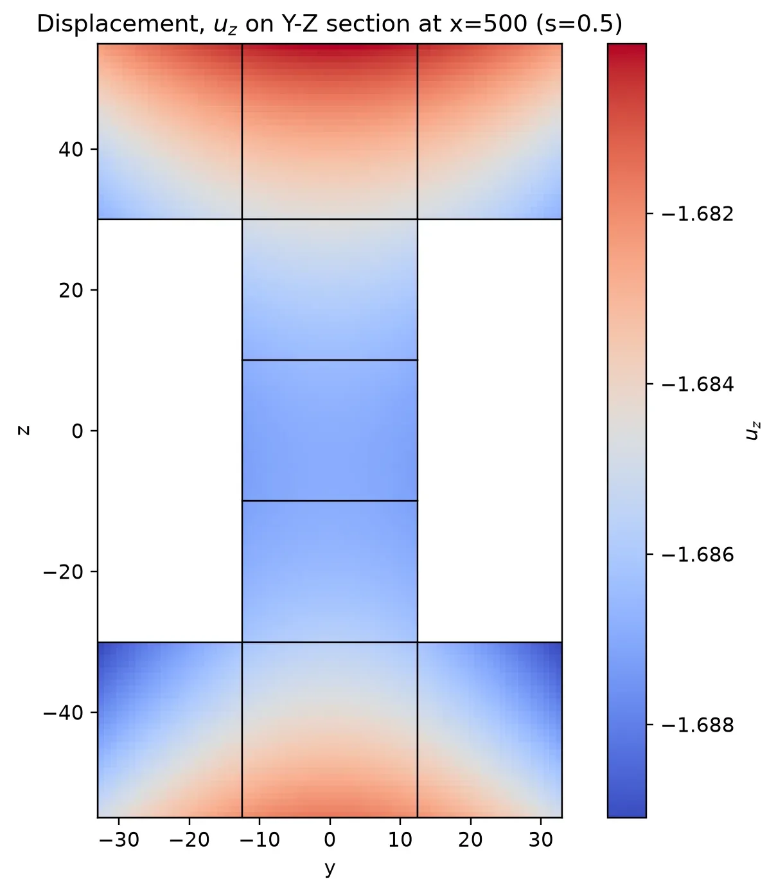
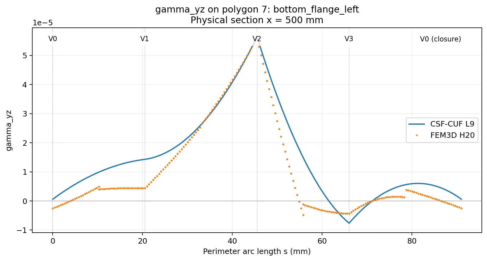
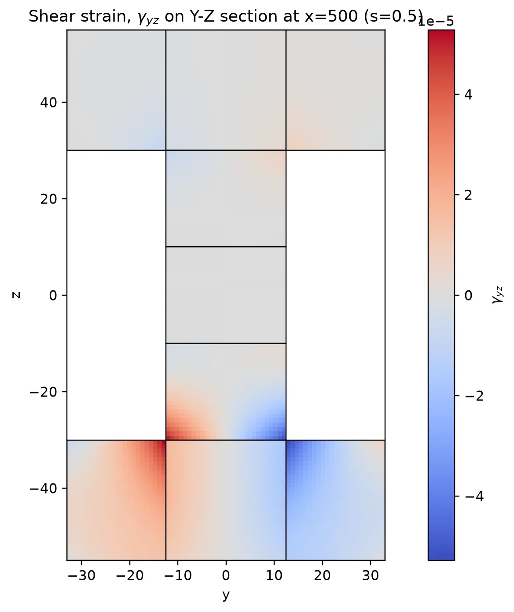
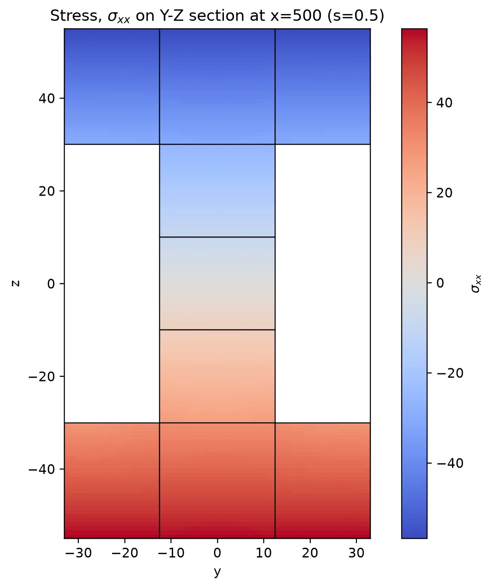
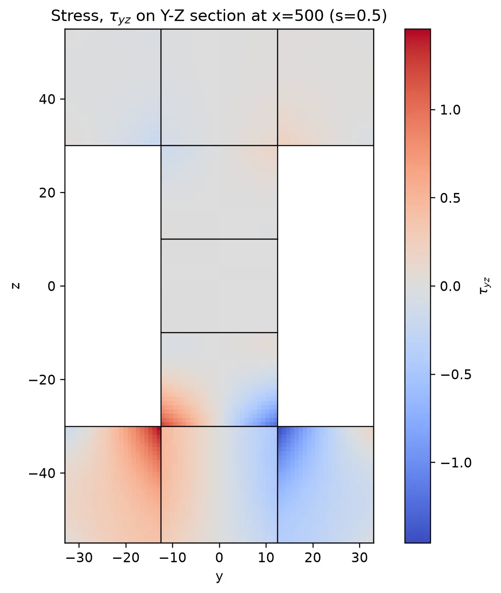

# Selected figures and examples

> [Back to Chapter VI — Figures and numerical fields](../README.md)

The five illustrations reproduced in Chapter VI. These files are kept separately from the full H20–CUF figure collections and are all embedded below.

**Figures in this gallery: 5.** Every image below is a WebP file included in the ZIP and displayed inline.

## Displacements

### $u_z$

## Normal and shear strains

### $\gamma_{yz}$

## Normal stresses

### $\sigma_{xx}$

## Shear stresses

### $\tau_{yz}$

---

[Back to the figures index](../README.md#10-complete-webp-figure-galleries)
