# Perimeter plots — polygon 005 at x = 500 mm

> [Back to Chapter VI — Figures and numerical fields](../README.md)

Field components sampled along the closed boundary of polygon 005 (web_middle) at $x=500$ mm. The horizontal coordinate is arc length along the polygon perimeter.

**Figures in this gallery: 12.** Every image below is a WebP file included in the ZIP and displayed inline.

## Normal and shear strains

### $\varepsilon_{xx}$

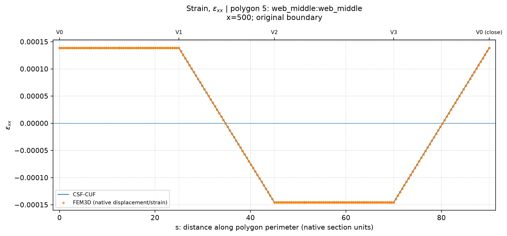

### $\varepsilon_{yy}$

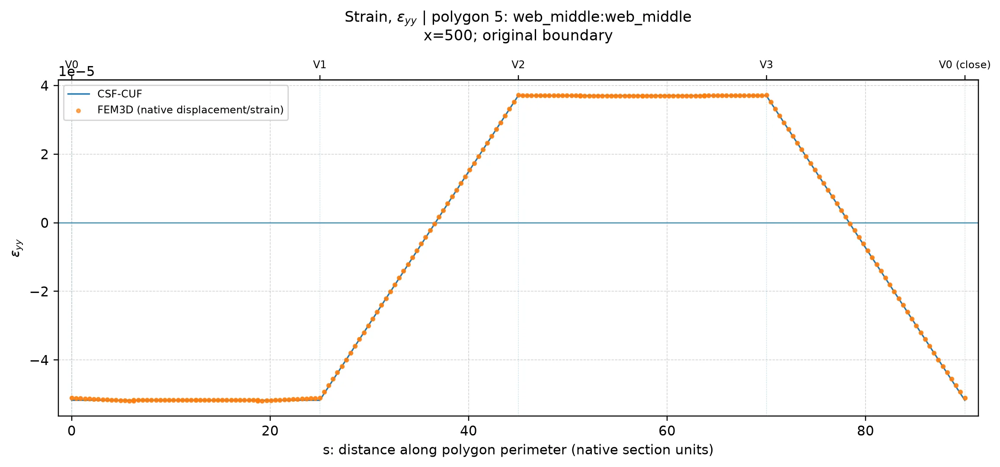

### $\varepsilon_{zz}$

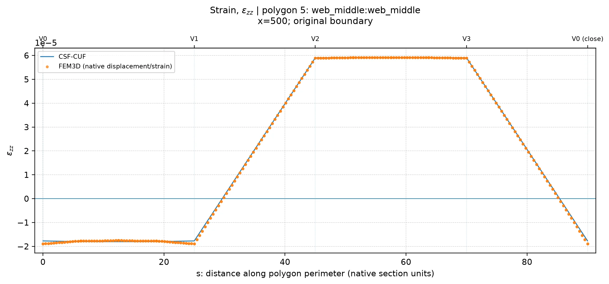

### $\gamma_{xy}$

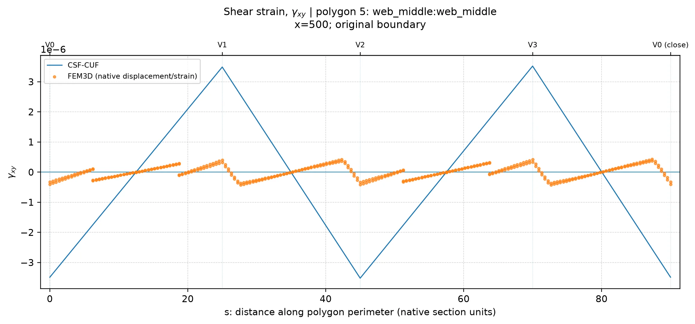

### $\gamma_{xz}$

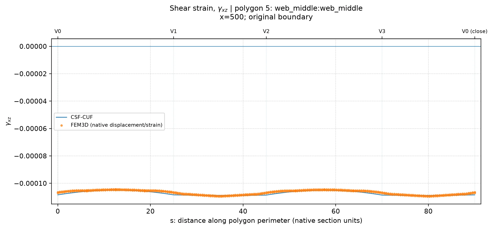

### $\gamma_{yz}$

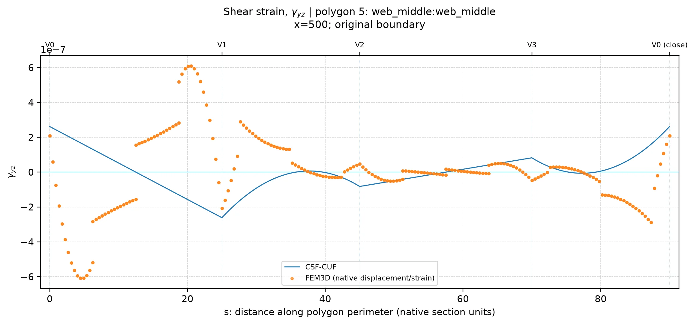

## Normal stresses

### $\sigma_{xx}$

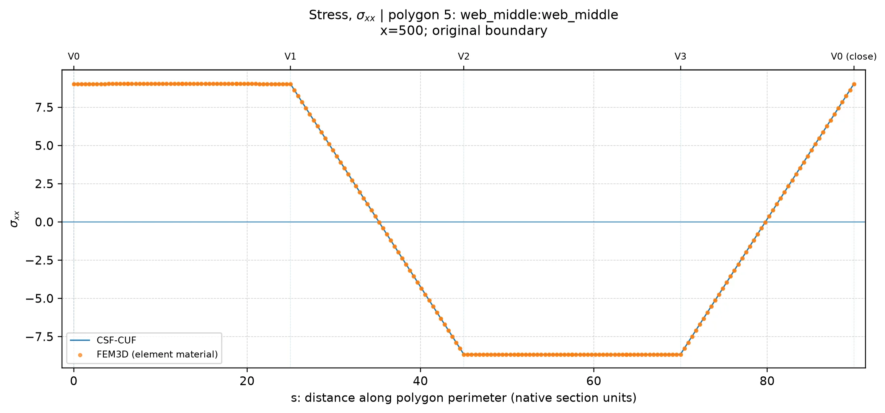

### $\sigma_{yy}$

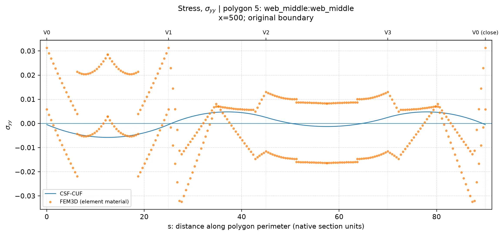

### $\sigma_{zz}$

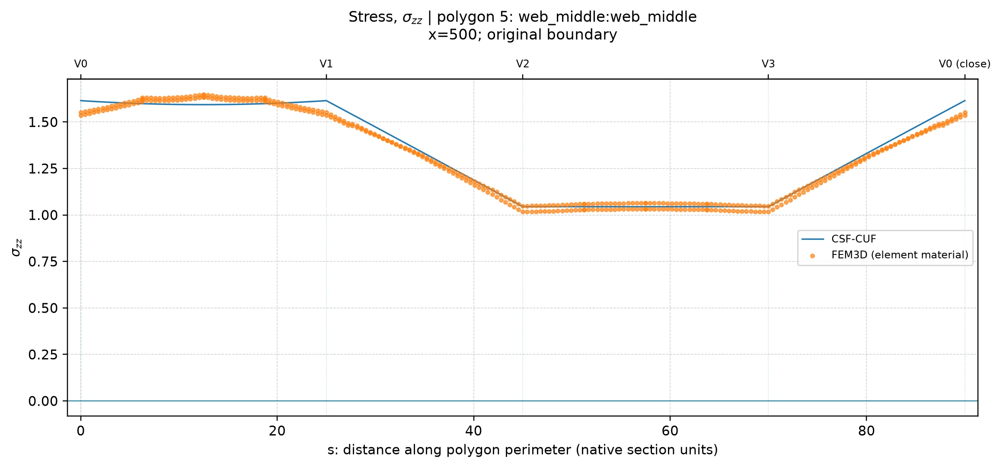

## Shear stresses

### $\tau_{xy}$

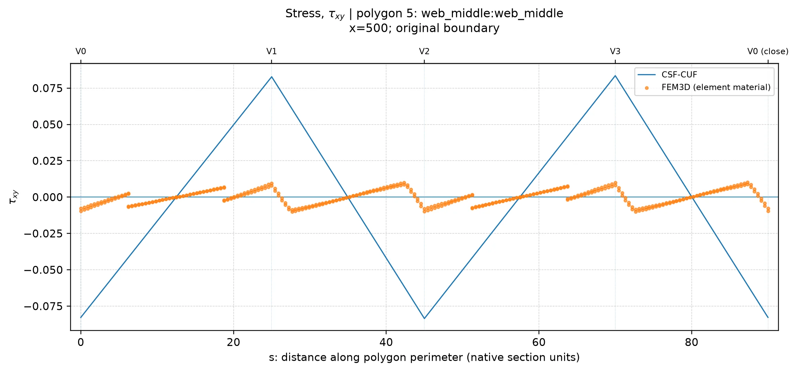

### $\tau_{xz}$

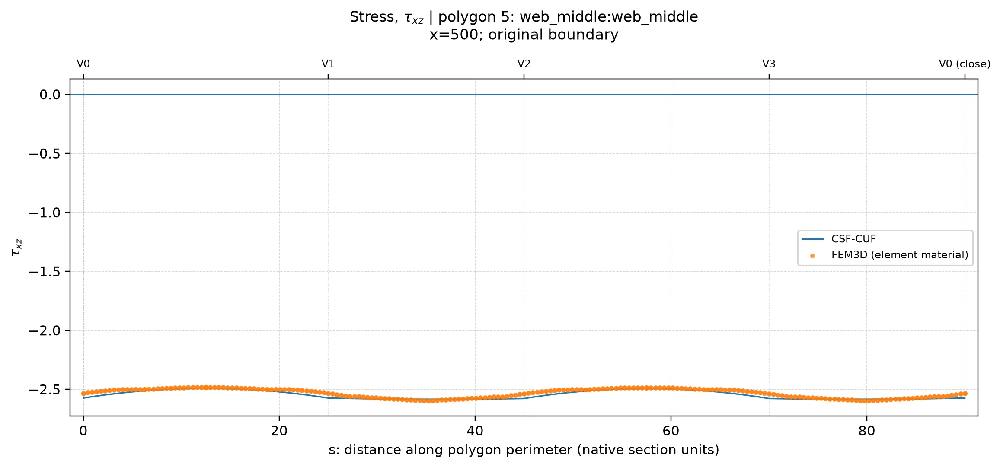

### $\tau_{yz}$

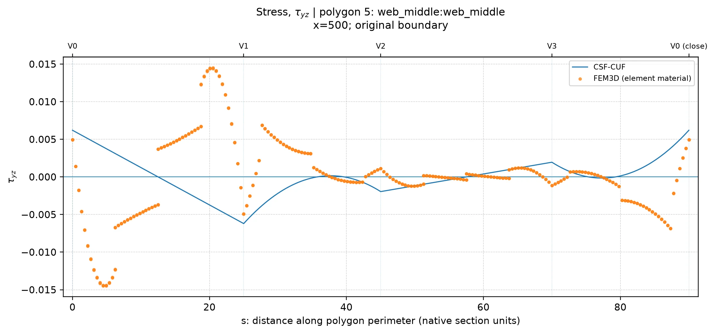

---

[Back to the figures index](../README.md#10-complete-webp-figure-galleries)
