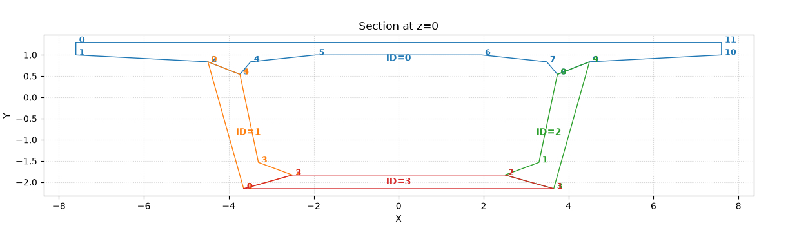
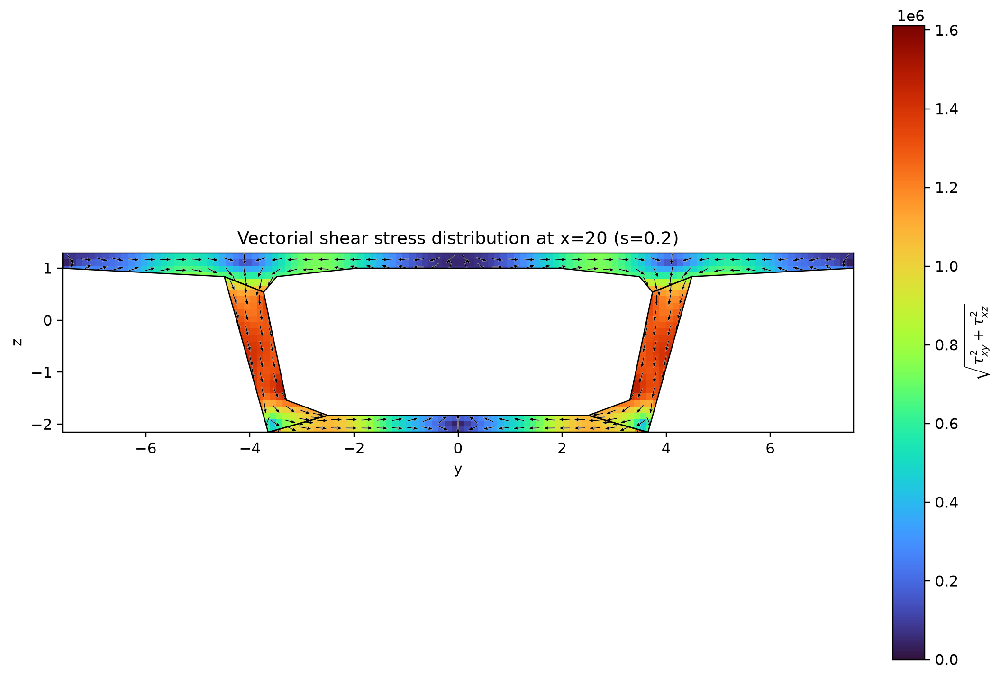

# Bridge-like Beam - Bending and Torsion

## Introduction

This example studies a **100 m long, bridge-like beam** under two different loading conditions: bending and torsion. The aim is to show how a beam can be described once, analysed under different loads, and checked using increasingly detailed numerical approximations.

The cross-section resembles a simplified bridge deck: a wide top slab, two inclined webs, and a lower slab. The same section is used along the entire length, so the beam is **prismatic**. This is a numerical example, not a design or safety assessment of a real bridge.

The example is **inspired by the bridge-like beam study** in Carrera, Petrolo and Zappino (2012), which examines bending, torsion and stress distributions in a bridge-shaped section. The present files provide a separate numerical implementation and convergence study; they should not be understood as an exact reproduction of the paper's discretization or published results. See [Reference](#reference) below.


## Model architecture and computational workflow

The bridge-like example follows the separation of responsibilities adopted by the CSF–CUF framework.

**CSF (Continuous Section Field)** defines the physical model: cross-sectional geometry, longitudinal stations, and material properties. This description is independent of the structural approximation and can be inspected separately using `csf-actions`.

**CUF (Carrera Unified Formulation)** defines the structural approximation and equilibrium problem. The solver uses the geometric and material information supplied by CSF together with the selected transverse expansion, longitudinal finite elements, loads, and constraints.

The analysis is organized through three distinct YAML configuration levels:

| Configuration | Responsibility |
|---|---|
| **Model** - `models/bridge_geometry.yaml` | Physical geometry and material properties |
| **Problem** - `problems/bending.yaml` or `problems/torsion.yaml` | Applied loads and boundary conditions |
| **Case** - `cases/*.yaml` | Model/problem selection, transverse approximation, longitudinal discretization, and numerical solution settings |

The computational workflow follows this sequence:

1. The case selects the CSF model and the structural problem.
2. CSF provides the section geometry and material properties at the required integration locations.
3. The CUF transverse expansion and longitudinal finite elements define the displacement approximation.
4. The solver evaluates the sectional contributions, assembles the structural equations, and imposes loads and constraints.
5. The numerical solution is used to reconstruct displacements, strains, and stresses.

This organization allows the same physical model to be reused for bending and torsion without redefining its geometry or materials. Different numerical approximations can also be selected without changing the underlying physical description.

**The CSF–CUF coupling does not introduce a new structural formulation:** the CUF kinematics and fundamental nuclei are retained, while CSF provides the physical geometric and material information required for their numerical evaluation.

For a more detailed architectural discussion, see [Part I – Models and organization of the computation](../c-shape/readme.md#part-i---models-and-organization-of-the-computation).


## Geometry and material

The physical description is in [`models/bridge_geometry.yaml`](models/bridge_geometry.yaml). It contains four connected regions:

- `top_flange` - the broad deck at the top;
- `left_web` and `right_web` - the two inclined sides;
- `bottom_flange` - the lower slab.

The initial and final sections are identical (at longitudinal positions 0 and 100). The example uses a linear elastic material with Young's modulus **210 GPa** and Poisson's ratio **0.30**. The input values are consistent with metres, newtons and pascals; all quantities must remain in the same unit system.

### Coordinate systems: CSF and CUF

**CSF and the CUF solver use different coordinate labels for the same physical directions.** In the CSF model, **`(X, Y)`** are the transverse section coordinates and **`Z`** is the longitudinal beam coordinate. In the CUF solver, **`x`** is longitudinal and **`(y, z)`** are transverse. Their correspondence is:

| Physical direction | CSF | CUF solver |
|---|---|---|
| Longitudinal | `Z` | `x` |
| First transverse | `X` | `y` |
| Second transverse | `Y` | `z` |

Thus **`(x, y, z)_CUF = (Z, X, Y)_CSF`**, with the same ordering correspondence for displacements: **`(u_x, u_y, u_z)_CUF = (u_Z, u_X, u_Y)_CSF`**. This mapping changes labels and component ordering; it does **not** reverse the physical directions. For this 100 m prismatic beam, longitudinal positions satisfy `x = Z`.

When interpreting the `csf-actions` sectional report, note that **`SECTION SELECTED ANALYSIS @ z = 0.0`** identifies a longitudinal station in the CSF model (rendered as lowercase `z` by the reporting tool); it must not be mistaken for the **transverse** `z` coordinate of the CUF solver. Sectional quantities such as `Cx`, `Cy`, `Ix` and `Iy` refer to the CSF section axes.

See the authoritative **[Coordinate Systems and Displacement Conventions](../docs/coordinate_systems.md)** for the complete definitions and displacement-evaluation convention. The [model verification documentation](models/README.md) explains how these axes apply to the `csf-actions` report.

### Cross-section visualization



*CSF representation of the bridge-like cross-section defined in `models/bridge_geometry.yaml`.* This image illustrates the sectional layout; it does not replace verification of the geometry and material properties from the model input.

### Inspecting and checking the section model

Before executing the bending and torsion cases, the model can be inspected independently of the CUF solution. From `cuf/bridge-like/models/`, run:

```bash
csf-actions bridge_geometry.yaml action.yaml
```

The `csf-actions` workflow generates a visualization and reports section-level homogenized properties, including the section centroid, second moments, principal moments, radii of gyration and elastic section moduli. The numbers depend on the geometry, material weighting and configuration. Do not treat material-weighted values as purely geometric quantities without checking the tool's conventions.


## Two loading problems

Both analyses use the same geometry and the same **fully fixed conditions at the two beam ends**. What changes is the applied load.

| Analysis | Description | Input |
|---|---|---|
| **Bending** | A downward, uniformly distributed surface load on an edge of the top slab | [`problems/bending.yaml`](problems/bending.yaml) |
| **Torsion** | Two opposing, uniformly distributed longitudinal line loads acting at the outer top corners, creating a twisting action | [`problems/torsion.yaml`](problems/torsion.yaml) |

The associated load and support rules are implemented in [`adapters/`](adapters/). Their parameters are selected through the YAML files, so using the existing examples does not require writing Python code.

For the **configuration contract** of `bending.yaml` and `torsion.yaml`, see the [problem definitions and YAML documentation](problems/README.md). For the **Python implementation contract**, see the [adapter overview](adapters/README.md), [load adapters](adapters/loads/README.md), and [constraint adapters](adapters/constraints/README.md).

## How the example is organized

```text
bridge-like/
├── README.md                 # Model overview and documentation entry point
├── models/                   # Cross-section, material, section checks and README.md
├── img/                      # Cross-section illustration
├── problems/                 # Bending and torsion YAMLs, plus README.md
├── adapters/                 # Reusable load and support rules, plus README.md
│   ├── loads/                # Load adapters and their README.md
│   └── constraints/          # Constraint adapters and their README.md
├── cases/                    # Numerical settings for each run
├── output/                   # Saved numerical solutions (selected runs)
├── strain_stress_boundary/   # Displacement, strain and stress figures
├── run_both.sh               # Run all available cases
└── bridge_reproducibility.md
```

Each **case** selects a loading problem, an approximation order, the longitudinal elements and the solver settings. The cross-section and loads do not need to be rewritten for each run.


### Documentation hierarchy

The documentation separates **the section model and its independent checks**, **the physical example**, **the YAML problem declarations**, and **the Python adapter implementations**. Follow the links in either direction; the specialized README files link back to the problem configuration and this overview.

| Documentation | Responsibility |
|---|---|
| **This README** | Physical setup, analyses, numerical cases, running and viewing the results |
| [`models/README.md`](models/README.md) | Geometry, material definition, csf-actions visualization and homogenized section properties |
| [`problems/README.md`](problems/README.md) | Bending and torsion YAMLs: what is configured and how adapters are referenced |
| [`adapters/README.md`](adapters/README.md) | Adapter architecture and separation from the CUF formulation |
| [`adapters/loads/README.md`](adapters/loads/README.md) | Programming and verification guidance for load adapters |
| [`adapters/constraints/README.md`](adapters/constraints/README.md) | Programming and verification guidance for support/constraint adapters |

The problem documentation specifies **what** is requested by the YAML configuration. The adapter documentation specifies **how** the Python implementation handles those requests. Do not duplicate the Python contract in the problem README or the YAML schema in adapter README files.

## Checking convergence and numerical stability

The cases use a `scaled_lagrange` approximation over the cross-section. The number **N** in a filename identifies its selected order, not the number of elements along the beam.

- **Bending:** `N04`, followed by `N10` through `N15`.
- **Torsion:** `N10` through `N15`.

All the supplied case configurations use **10 longitudinal elements**, with a Lagrange polynomial of order **6** along each element. This allows the influence of the transverse approximation order to be examined without changing the longitudinal discretization.

Each case also requests **five equilibration settings**, identified as `eq1` to `eq5`. These give a second check: results from different equilibration settings should be compared to see whether the computed physical response is sensitive to the numerical solution procedure.

**The two checks answer different questions:** changing `N` tests convergence with approximation order; comparing `eq1`–`eq5` tests sensitivity to equilibration. Neither check alone proves that every stress value is accurate.

## Running an analysis

With the package installed and the `csf-cuf` command available, change to `cuf/bridge-like` and run, for example:

```bash
csf-cuf cases/bending_scaled_lagrange_N15_FEM10.yaml
csf-cuf cases/torsion_scaled_lagrange_N15_FEM10.yaml
```

To run every YAML case in the `cases/` directory on Linux or macOS:

```bash
bash run_both.sh
```

Each run writes its results to the `output/` directory specified in the corresponding case file. For a bending N15 run, the files include:

```text
output/bending_scaled_lagrange_N15/
├── carrera_bridge_bending_scaled_lagrange_N15_eq1.cuf.npz
├── ... eq2, eq3, eq4, eq5 ...
├── response_eq1.txt
└── ... response_eq2, eq3, eq4, eq5 ...
```

The `.cuf.npz` files preserve the numerical solution for subsequent evaluation and plotting. The `response_eq*.txt` files contain the text reports. The supplied archive includes selected N04 and N15 bending outputs; other case outputs can be generated by running their YAML files.

For installation and full execution instructions, see the [reproducibility guide](bridge_reproducibility.md).

## Viewing the results

The plotting tool reconstructs the displacements, strains and stresses from a saved solution. For bending N15, the provided script can be run from `cuf/bridge-like`:

```bash
sh plot_traverse.sh
```

It produces plots along the beam at cross-section boundary points, as well as **cross-section maps at x = 20 m**. The figures supplied with this example correspond to the first equilibration (`eq1`).

#### Transverse Shear Stress Distribution

[](strain_stress_boundary/carrera_bridge_bending_scaled_lagrange_N15_eq1/transverse_x_20/shear_stress_vector_transverse.webp)


**[Open the complete results gallery](strain_stress_boundary/README.md)** - transverse maps first, followed by graphs along the beam. Each figure can be viewed individually.

## Understanding the Result

The main questions are straightforward: **Do the results change less as N increases?** **Do the five equilibration settings give nearly the same displacements and stresses?** **Where do bending and torsion produce different stress patterns?**

This example is intended to make those comparisons reproducible. The saved outputs and plots are evidence to inspect, not a substitute for a documented convergence study or an independent reference calculation.

## Reference

E. Carrera, M. Petrolo and E. Zappino (2012), **“Performance of CUF Approach to Analyze the Structural Behavior of Slender Bodies,”** *Journal of Structural Engineering*, **138**(2), 285–297. [https://doi.org/10.1061/(ASCE)ST.1943-541X.0000402](https://doi.org/10.1061/%28ASCE%29ST.1943-541X.0000402).

The bridge-like example is discussed in the paper's **“Bridge-Like Section”** section (geometry in Figure 7; bending and torsion loads in Figure 8).
