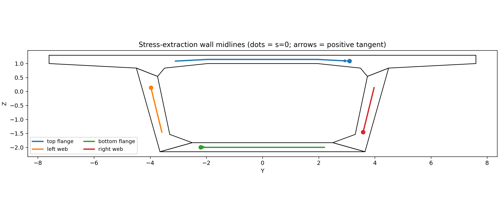
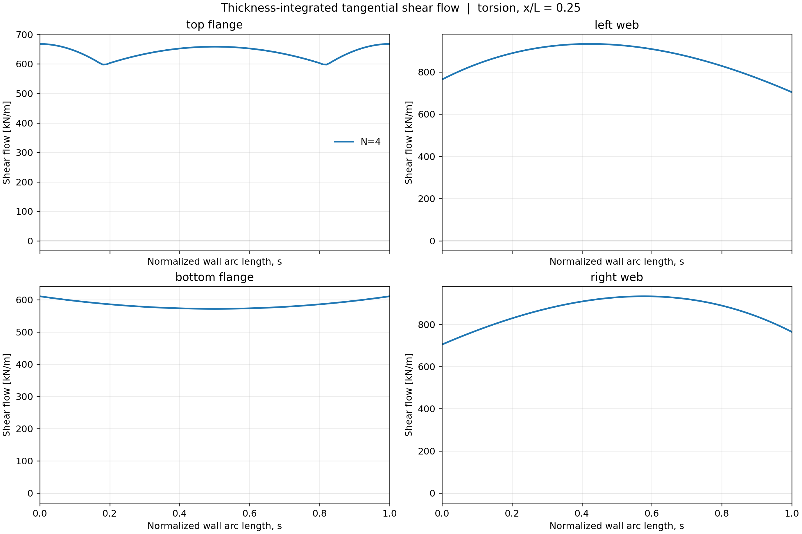

# Bridge-like Beam - Bending and Torsion

## Introduction

This example studies a **100 m long, bridge-like beam** under two different loading conditions: bending and torsion. The aim is to show how a beam can be described once, analysed under different loads, and checked using increasingly detailed numerical approximations.

The cross-section resembles a simplified bridge deck: a wide top slab, two inclined webs, and a lower slab. The same section is used along the entire length, so the beam is **prismatic**. This is a numerical example, not a design or safety assessment of a real bridge.

The example is **inspired by the bridge-like beam study** in Carrera, Petrolo and Zappino (2012), which examines bending, torsion and stress distributions in a bridge-shaped section. The present files provide a separate numerical implementation and convergence study; they should not be understood as an exact reproduction of the paper’s discretization or published results. See [Reference](#reference) below.



*Sampling lines used to inspect the webs. Open the image for a closer view.*

## Geometry and material

The physical description is in [`models/bridge_geometry.yaml`](models/bridge_geometry.yaml). It contains four connected regions:

- `top_flange` - the broad deck at the top;
- `left_web` and `right_web` - the two inclined sides;
- `bottom_flange` - the lower slab.

The initial and final sections are identical (at longitudinal positions 0 and 100). The example uses a linear elastic material with Young's modulus **210 GPa** and Poisson's ratio **0.30**. The input values are consistent with metres, newtons and pascals; all quantities must remain in the same unit system.

The beam axis is **x**; **y** and **z** describe positions within the cross-section. For the coordinate conventions used by the solver, see the [coordinate guide](../docs/coordinate_systems.md).

## Two loading problems

Both analyses use the same geometry and the same **fully fixed conditions at the two beam ends**. What changes is the applied load.

| Analysis | Description | Input |
|---|---|---|
| **Bending** | A downward, uniformly distributed surface load on an edge of the top slab | [`problems/bending.yaml`](problems/bending.yaml) |
| **Torsion** | Two opposing, uniformly distributed longitudinal line loads acting at the outer top corners, creating a twisting action | [`problems/torsion.yaml`](problems/torsion.yaml) |

The associated load and support rules are implemented in [`adapters/`](adapters/). Their parameters are selected through the YAML files, so using the existing examples does not require writing Python code.

## How the example is organized

```text
bridge-like/
├── models/                  # Cross-section and material
├── problems/                # Bending and torsion loads
├── adapters/                # Reusable load and support rules
├── cases/                   # Numerical settings for each run
├── output/                  # Saved numerical solutions (selected runs)
├── strain_stress_boundary/  # Displacement, strain and stress figures
├── shear_wall_comparison/   # Web shear results and sampled values
├── run_both.sh              # Run all available cases
└── bridge_reproducibility.md
```

Each **case** selects a loading problem, an approximation order, the longitudinal elements and the solver settings. The cross-section and loads do not need to be rewritten for each run.

## Checking convergence and numerical stability

The cases use a `scaled_lagrange` approximation over the cross-section. The number **N** in a filename identifies its selected order, not the number of elements along the beam.

- **Bending:** `N04`, followed by `N10` through `N15`.
- **Torsion:** `N10` through `N15`.

All the supplied case configurations use **10 longitudinal elements**, with a Lagrange polynomial of order **6** along each element. This allows the influence of the transverse approximation order to be examined without changing the longitudinal discretization.

Each case also requests **five equilibration settings**, identified as `eq1` to `eq5`. These give a second check: results from different equilibration settings should be compared to see whether the computed physical response is sensitive to the numerical solution procedure.

**The two checks answer different questions:** changing `N` tests convergence with approximation order; comparing `eq1`–`eq5` tests sensitivity to equilibration. Neither check alone proves that every stress value is accurate.

## Running an analysis

With the package installed and the `csf-cuf` command available, change to `cuf/bridge-like` and run, for example:

```bash
csf-cuf cases/bending_scaled_lagrange_N15_FEM10.yaml
csf-cuf cases/torsion_scaled_lagrange_N15_FEM10.yaml
```

To run every YAML case in the `cases/` directory on Linux or macOS:

```bash
bash run_both.sh
```

Each run writes its results to the `output/` directory specified in the corresponding case file. For a bending N15 run, the files include:

```text
output/bending_scaled_lagrange_N15/
├── carrera_bridge_bending_scaled_lagrange_N15_eq1.cuf.npz
├── ... eq2, eq3, eq4, eq5 ...
├── response_eq1.txt
└── ... response_eq2, eq3, eq4, eq5 ...
```

The `.cuf.npz` files preserve the numerical solution for subsequent evaluation and plotting. The `response_eq*.txt` files contain the text reports. The supplied archive includes selected N04 and N15 bending outputs; other case outputs can be generated by running their YAML files.

For installation and full execution instructions, see the [reproducibility guide](bridge_reproducibility.md).

## Viewing the results

The plotting tool reconstructs the displacements, strains and stresses from a saved solution. For bending N15, the provided script can be run from `cuf/bridge-like`:

```bash
sh plot_traverse.sh
```

It produces plots along the beam at cross-section boundary points, as well as **cross-section maps at x = 20 m**. The figures supplied with this example correspond to the first equilibration (`eq1`).

**[Open the complete results gallery](strain_stress_boundary/README.md)** - transverse maps first, followed by graphs along the beam. Each figure can be viewed individually.

The [`shear_wall_comparison/`](shear_wall_comparison/) folder also contains graphs and tabulated values for examining shear along the webs. For example:

[](shear_wall_comparison/shear_flow_profiles.png)

*Click to open the full-resolution shear-flow plot.*

## What to look for

The main questions are straightforward: **Do the results change less as N increases?** **Do the five equilibration settings give nearly the same displacements and stresses?** **Where do bending and torsion produce different stress patterns?**

This example is intended to make those comparisons reproducible. The saved outputs and plots are evidence to inspect, not a substitute for a documented convergence study or an independent reference calculation.

## Reference

E. Carrera, M. Petrolo and E. Zappino (2012), **“Performance of CUF Approach to Analyze the Structural Behavior of Slender Bodies,”** *Journal of Structural Engineering*, **138**(2), 285–297. [https://doi.org/10.1061/(ASCE)ST.1943-541X.0000402](https://doi.org/10.1061/%28ASCE%29ST.1943-541X.0000402).

The bridge-like example is discussed in the paper’s **“Bridge-Like Section”** section (geometry in Figure 7; bending and torsion loads in Figure 8).
