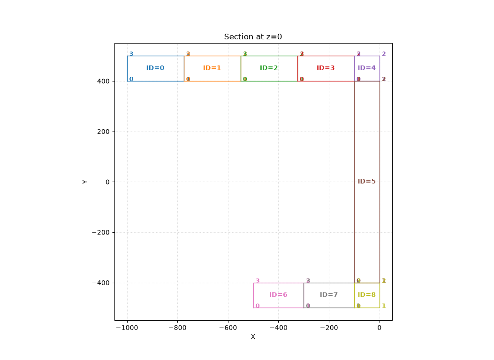

# C-section benchmark - CSF–CUF with polygon-wise L9 expansion

## Reference problem

This example revisits the open C-section beam described by **E. Carrera and M. Petrolo**, *Refined beam elements with only displacement variables and plate/shell capabilities*, Section 4.3, p. 12 (Figs. 12 and 13).

The objective is to reproduce the C-section geometry and the **nine-domain L9 transverse layout** of Fig. 13(b) within the CSF–CUF framework. The section is represented by nine adjacent quadrilateral polygons: five along the upper flange, one along the web, and three along the lower flange.

The main section dimensions follow the reference proportions: height $h = 1000\,\mathrm{mm}$, thickness $t = 100\,\mathrm{mm}$, upper-flange width $b_2 = 1000\,\mathrm{mm}$, lower-flange width $b_1 = 500\,\mathrm{mm}$. The prismatic beam length is $L = 20000\,\mathrm{mm}$. The isotropic material has $E = 75000\,\mathrm{MPa}$ and $\nu = 0.33$.

> The paper specifies the L9 subdivision graphically, but not the internal partition coordinates. The subdivisions used here are therefore reconstructed from Fig. 13(b), rather than taken from tabulated values.

## CSF section and transverse expansion

The **physical sectional description** is provided by CSF. Each CSF polygon identifies one local domain for the transverse CUF expansion; its vertices and material properties belong to the CSF model, not to the expansion law.

*Figure 1 - CSF section at the initial station, showing the nine polygonal domains used by the L9 expansion.*

The transverse approximation is supplied by the independent [`lagrangeL9_v4.py`](expansions/lagrangeL9_v4.py) basis. It defines a **nine-point Lagrange interpolation on each quadrilateral CSF polygon**, using an isoparametric mapping from the reference square to the physical domain. The local expansion functions are quadratic in each natural coordinate. Coincident interpolation points on neighbouring polygons are assembled as shared global transverse degrees of freedom, giving displacement continuity across their common edges.

Thus, the CSF geometry and the transverse approximation remain separate descriptions: the former provides the physical domains, while the latter defines how the displacement field is approximated over those domains.

## Reproducible input files

The example is configured through **three plain-text YAML files**, all kept in the [`cuf/c-shape`](./) directory tree:

1. **Model** - the CSF section geometry and material distribution ([`c_section_chapter9_5_3_9L9_csf.yaml`](models/c_section_chapter9_5_3_9L9_csf.yaml)).

2. **Problem** - the boundary-value problem and applied loading, with a reference to the model ([`c_section_cantilever_point_9L9.yaml`](problems/c_section_cantilever_point_9L9.yaml)).

3. **Case** - the CUF expansion, longitudinal finite-element discretization, numerical integration and solver/output settings ([`cases/`](cases/)).
The case file selects the separate Python transverse-basis implementation. In this way, the geometry/material model, transverse expansion, longitudinal approximation and problem definition can be specified without embedding them in the CUF solver core.

## Stress comparison with FEM3D

The comparison also examines the stress field along the longitudinal trajectories of the CSF polygon vertices.

The FEM3D results are obtained directly from the displacement derivatives of individual H8 elements, using the CSF constitutive law. At element boundaries, **the original element-side values are retained without averaging across adjacent elements**. Consequently, several FEM3D stress values may appear at the same longitudinal position.

The CSF–CUF stresses are instead evaluated directly from the derivatives of the continuous displacement representation and the corresponding constitutive law, without stress averaging or smoothing.

For the shear stress component $\tau_{xy}$, the CSF–CUF curves generally follow the **central trend of the FEM3D stress distribution**, particularly away from the beam ends, despite the considerable scatter of individual FEM3D values.

This agreement does not imply that CSF–CUF computes an average of the FEM3D stresses. The two fields are obtained independently, and the observed correspondence concerns their overall behaviour rather than pointwise agreement between individual element-side values.

Differences near the beam ends remain more pronounced and require separate consideration.

The complete displacement, strain and stress comparisons are available in the [strain and stress boundary results](strain_stress_boundary/).

## Repository

[C-section example](https://github.com/giovanniboscu/continuous-section-field/tree/main/cuf/c-shape)
