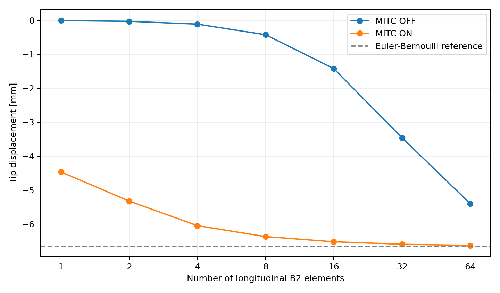

# CSF–CUF: MITC shear-locking benchmark - rectangular cantilever

This example compares an ordinary longitudinal two-node **B2** discretization (**MITC OFF**) with the MITC-corrected formulation (**MITC ON**). Both use the same physical geometry, load, transverse CUF expansion, and longitudinal mesh at each refinement level. Only the MITC assembly option and its companion diagnostic switch change.

**Start here:** this README explains *what is tested and what the measurements show*. For exact commands and file roles, see [reproducibility.md](reproducibility.md).

## 1. Physical problem

A prismatic cantilever has length **L = 5000 mm** and a **100 × 100 mm** rectangular section. The left end (`x=0`) is fully clamped; a point force **F_z = −100 N** is applied at the center of the free end (`x=5000 mm`, `y=z=0`). The material uses **E = 75,000 MPa** and **ν = 0.33**. The slenderness is **L/h = 50**.

The requested response is the free-end center displacement **u_z(L,0,0)**, read from each `response.txt`. All distances and displacements are in millimeters.

### Euler–Bernoulli comparison

For a 100 × 100 mm rectangle, the section second moment is **I = bh³/12 = 8,333,333.333 mm⁴**. The slender-beam prediction is

```text
u_EB = F_z L^3 / (3 E I) = -6.666666667 mm
```

Euler–Bernoulli neglects transverse shear deformation. It is a useful bending benchmark, **not the exact CSF–CUF or 3D elasticity solution**. Therefore, the difference relative to this reference is not an exact discretization error.

## 2. What is the locking test?

A coarse, slender B2 element can represent bending poorly when its numerical shear strain imposes an unintended stiffness. This effect is called **shear locking**: the calculated deflection is too small in magnitude. MITC (*mixed interpolation of tensorial components*) modifies the interpolation of selected strain components to reduce this numerical constraint.

Here, **MITC OFF** uses `correctionMITC: false`, while **MITC ON** uses `correctionMITC: true`. The ON cases also enable `verifyMITCAssembly`, a diagnostic switch; this is not a separate physical load or material change.

In CSF–CUF, **CSF** supplies the actual section geometry and material fields at each longitudinal position. **CUF** represents the displacement with a transverse expansion; the numerical solver assembles its sectional coefficients and longitudinal finite elements. This test refines only the **longitudinal** B2 mesh. The same transverse **L9 expansion** (`lagrangeL9_v4.py`, `cuf.order: 2`) is retained throughout.

## 3. Inputs fixed across runs

| Item | Configuration |
|---|---|
| Physical geometry | CSF rectangle, 100 × 100 mm, length 5000 mm |
| Material | E = 75,000 MPa, ν = 0.33 (the CSF constitutive law specifies the shear response) |
| Load and boundary condition | Point force F_z = −100 N at free-end center; full clamp at x=0 |
| Transverse expansion | Custom L9 basis; same `cuf.order: 2` in every case |
| Longitudinal interpolation | `lagrange`, order 1 = B2 (two nodes per element) |
| Element counts | 1, 2, 4, 8, 16, 32, 64 (uniform partitions) |
| Numerical quadrature | 9 section Gauss points; 15 longitudinal points per element |
| Solver | 5 equilibration iterations |
| Output location | `response.txt`, free-end center `(5000,0,0)` |

Configuration files are in [`models/`](models/), [`problems/`](problems/), and [`cases/`](cases/); their roles and links are explained in [the reproducibility guide](reproducibility.md#4-understand-the-three-yaml-layers).

## 4. Results - 14 archived solver runs

| B2 elements | OFF u_z [mm] | ON u_z [mm] | OFF vs EB [%] | ON vs EB [%] |
|---:|---:|---:|---:|---:|
| 1 | -0.00708710 | -4.46440963 | 99.8937 | 33.0339 |
| 2 | -0.02823923 | -5.32304167 | 99.5764 | 20.1544 |
| 4 | -0.11144445 | -6.04742888 | 98.3283 | 9.2886 |
| 8 | -0.42380388 | -6.36966283 | 93.6429 | 4.4551 |
| 16 | -1.42006314 | -6.52174394 | 78.6991 | 2.1738 |
| 32 | -3.45574606 | -6.59488122 | 48.1638 | 1.0768 |
| 64 | -5.39772621 | -6.62980268 | 19.0341 | 0.5530 |


Relative reference difference = `100 × |u_z − u_EB| / |u_EB|`.



**Observation:** with one element, OFF yields `−0.00708710 mm`, while ON gives `−4.46440963 mm`. With 64 elements, OFF reaches `−5.39772621 mm` (19.03% from Euler–Bernoulli) and ON reaches `−6.62980268 mm` (0.553% from Euler–Bernoulli). At every tested resolution, ON is closer to the slender-beam reference; this is strong **benchmark evidence of reduced shear locking**.

## 5. Mesh-refinement indicator

For three meshes with successive halving of the element length (`h`, `h/2`, `h/4`), compute the observable

```text
p_delta = log2( |u_h - u_(h/2)| / |u_(h/2) - u_(h/4)| )
```

Here `u_h` means the computed tip displacement for mesh size `h`. The quantity depends only on successive solutions, **not** on the Euler–Bernoulli value. It estimates an asymptotic convergence order **only if the three meshes are already in the asymptotic regime**.

| Three element counts | OFF p_delta | ON p_delta |
|---|---:|---:|
| 1, 2, 4 | -1.9759 | 0.2453 |
| 2, 4, 8 | -1.9085 | 1.1687 |
| 4, 8, 16 | -1.6733 | 1.0833 |
| 8, 16, 32 | -1.0309 | 1.0562 |
| 16, 32, 64 | 0.0680 | 1.0665 |

The ON values for the finest triples remain around 1.06–1.08: the successive displacement differences decrease approximately by a factor of two. This is an *observed refinement trend*, not a general theoretical order for MITC. The OFF values change sign near the last triple, consistent with the locking-contaminated coarse-mesh regime transitioning toward refinement; this indicator alone is not a proof of its asymptotic limit.

## 6. Archived numerical checks

- **14/14 cases:** the archived logs report successful completion; the tip sample is present in each corresponding response file.
- **Global assembled-stiffness symmetry:** all reported relative symmetry errors are below the configured `1e-10` threshold. See the exact per-run values in [`mitc_B2_full_audit.json`](mitc_tests/reports/mitc_B2_full_audit.json).
- **KKT solve residuals:** logged residual metrics are included in the same audit. Small reported residuals indicate algebraic solve consistency, not the physical correctness of the model.
- **MITC assembly checks:** {allchecks} reported `PASS` comparisons across all ON longitudinal elements, all for the **single CUF pair `(1,1)`**. They do **not** cover every CUF pair or establish an independent MITC patch test.
- **Paired-input check:** matching OFF/ON cases have equal geometry references, material/problem references, transverse basis, longitudinal mesh, integration and sampling configurations; only case identity, output path, and MITC/diagnostic switches differ.

These checks are performed on the **archived logs and results**, not by re-running the solver in this package preparation step.

## 7. What is and is not established

**Supported:** a reproducible, internally consistent fourteen-run longitudinal-mesh benchmark displaying a much smaller locking-associated stiffness effect with MITC ON; a smooth ON refinement trend and close agreement to a slender-beam reference on the finest mesh.

**Not established:** exact 3D elasticity convergence, an independent MITC patch test, complete verification of all CUF-pair stiffness blocks, absence of spurious zero-energy modes, and energy/reaction equilibrium checks. These need independent additional data or dedicated tests; no displacement convergence PASS threshold is imposed.

## 8. Reproduce

Follow [reproducibility.md](reproducibility.md) for archive verification, all command lines, expected files, solver installation requirements, and the distinction between rechecking stored outputs and rerunning finite-element analyses.
