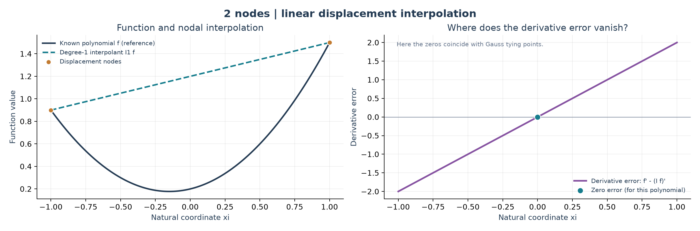
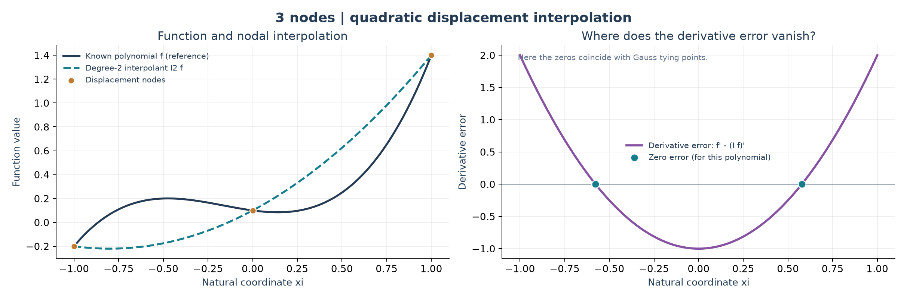
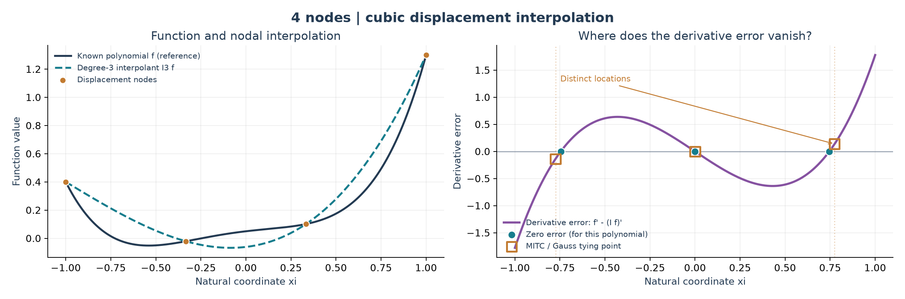
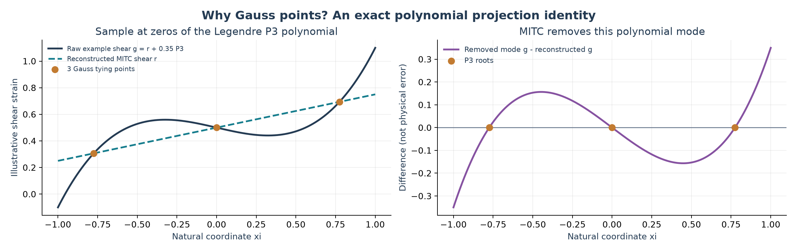

# Why these tying points? From interpolation error to MITC

*A self-contained teaching note for the [CSF–CUF MITC paper §4.1 benchmark](README.md).*

**The question.** A finite element computes displacements approximately and obtains strains by differentiating that approximation. How can we choose special sampling positions **before solving** the structural problem? And why does MITC use those positions to reconstruct the transverse shear strain?

This note deliberately keeps three ideas separate: (1) mathematical points of improved derivative accuracy, (2) the *chosen* tying-point interpolation in MITC, and (3) its realization in CSF–CUF. The plots use known illustrative polynomials-not an exact elasticity solution or measured beam stresses.

## 1. Where did the ideas come from?

**Barlow (1976)** studied *optimal stress locations* inside finite elements. The broader numerical-analysis idea is that differentiation of an interpolated field may be more accurate at some interior points than at others. This observation predates the beam MITC formulation; **Barlow did not introduce the MITC beam elements called B2, B3 and B4**.

**Dvorkin and Bathe (1984), and Bathe and Dvorkin (1985–1986)** developed mixed-interpolation techniques for shell and plate elements. The method subsequently known as *Mixed Interpolation of Tensorial Components* (MITC) was therefore in use long before the beam paper we reproduce. It uses a specifically constructed approximation of selected strain components to overcome locking, rather than modifying the material modulus.

**Carrera, de Miguel and Pagani (2017)** extended MITC to higher-order *beam* formulations within CUF. Their Equations (23)–(28) introduce the beam shear interpolation, Equations (31)–(34) connect it to virtual work and stiffness, and §4.1 compares beam elements with two, three and four longitudinal nodes. The paper calls its tying points “Barlow points” and, **for its stated B2/B3/B4 constructions**, chooses the Gauss locations in Equations (25)–(27). That is the paper's modeling choice; it should not be read as a theorem that every Barlow-type optimal-stress point in every element equals a Gauss point.

**Primary sources:** [Barlow 1976, DOI](https://doi.org/10.1002/nme.1620100202) · [Dvorkin & Bathe 1984, as listed in MIT's course references](https://ocw.mit.edu/courses/res-2-002-finite-element-procedures-for-solids-and-structures-spring-2010/resources/lecture-20/) · [Bathe & Dvorkin 1985, DOI](https://doi.org/10.1002/nme.1620210213) · [Bathe & Dvorkin 1986, DOI](https://doi.org/10.1002/nme.1620220312) · [Carrera et al. 2017, open-access manuscript](https://iris.polito.it/retrieve/handle/11583/2693672/179282/MITC.pdf), [DOI](https://doi.org/10.1002/nme.5588).

## 2. Discover a special point without knowing the solution

Work on the **reference element** $\xi\in[-1,1]$. This is a mathematical coordinate, not a physical distance along the beam. Pick $p+1$ distinct displacement nodes $\xi_0,\ldots,\xi_p$, and let $I_p f$ be the degree-$p$ polynomial that interpolates a smooth function $f$ at those nodes.

To expose the mechanism exactly, take **a known test polynomial of degree $p+1$**, with leading coefficient $a\ne0$. Because $f-I_p f$ is degree $p+1$ and vanishes at every interpolation node, necessarily

$$
f(\xi)-I_p f(\xi)=a\,\omega_{p+1}(\xi),\qquad
\omega_{p+1}(\xi)=\prod_{i=0}^{p}(\xi-\xi_i).
$$

Differentiate both sides:

$$
\boxed{\;f'(\xi)-(I_p f)'(\xi)=a\,\omega_{p+1}'(\xi)\;}. \tag{1}
$$

**The key discovery:** for this polynomial test, the derivative error vanishes at the roots of $\omega'_{p+1}$. Those roots depend only on the **positions of the interpolation nodes**; they do not depend on the unknown coefficient $a$ or the lower-order terms in $f$. We can calculate their locations *before solving a beam*.

This identity is an instructive model of the mechanism behind special stress/derivative sampling points. It is **not by itself a proof of finite-element stress superconvergence for an arbitrary PDE, mesh, load or constitutive law**. Such a claim requires additional assumptions and error analysis.

## 3. See the error with two, three, then four nodes

### 3.1 Two displacement nodes: linear interpolation

Put nodes at $-1,+1$, and take $f(\xi)=\xi^2+0.30\xi+0.20$. Its straight-line interpolant is $I_1f=1.20+0.30\xi$. The derivative error is

$$
f'-(I_1 f)'=2\xi.
$$

It is exactly zero at **$\xi=0$**. The graph shows both the imperfect fit to the parabola and the *exact coincidence of derivatives* at its center.



### 3.2 Three displacement nodes: quadratic interpolation

Put nodes at $-1,0,+1$. Independently of the lower-order terms of any cubic $f$ with leading coefficient $a$,

$$
\omega_3(\xi)=\xi(\xi^2-1),\qquad
f'-(I_2f)'=a(3\xi^2-1).
$$

The derivative error vanishes at **$\xi=\pm1/\sqrt3$**. In this elementary case the locations happen to equal the **two-point Gauss–Legendre nodes**.



### 3.3 Four displacement nodes: cubic interpolation - the crucial distinction

The four-node longitudinal displacement interpolation used in Carrera's beam paper places nodes at $\xi=-1,-1/3,+1/3,+1$. For a degree-four test polynomial,

$$
\begin{aligned}
\omega_4(\xi)&=(\xi^2-1)(\xi^2-1/9),\\
f'-(I_3f)'&=a\left(4\xi^3-\frac{20}{9}\xi\right).
\end{aligned}
$$

The **zeros of this illustrative derivative error** are

$$
\boxed{\xi=0,\quad \xi=\pm\frac{\sqrt5}{3}\approx\pm0.745356.}
$$

The **three Gauss–Legendre locations used for MITC tying**, on the other hand, are

$$
\boxed{\xi=0,\quad\xi=\pm\sqrt{\frac35}\approx\pm0.774597.}
$$



They differ by about **0.029241 in the reference coordinate** on either side. This is not a disagreement with the numerical benchmark: it shows that a demonstration about exact *nodal interpolation derivative error* must not be passed off as an all-purpose derivation of the **MITC Gauss tying-point choice**. The two principles are connected historically and conceptually, but they are **not identical mathematical statements**. Changing the interpolation nodes changes the roots of Equation (1).

## 4. Then why does MITC select Gauss points?

We now change questions. Instead of locating zeros of the derivative error of a **known test polynomial**, we want a rule for constructing a **lower-degree shear-strain field** from the displacement-derived one.

Suppose the *ordinary discrete shear strain*, at a fixed point in the section, is polynomial in $\xi$ of degree at most $p$. This follows for the simple prismatic beam setting with longitudinal degree-$p$ displacement functions and transverse basis functions independent of the beam axis. Any such polynomial can be written uniquely as

$$
\gamma_h(\xi)=r_{p-1}(\xi)+a_pP_p(\xi),
$$

where $P_p$ is the **Legendre polynomial** of degree $p$ and $r_{p-1}$ has degree at most $p-1$. Legendre polynomials form an orthogonal family on $[-1,1]$; here we need only the fact that $P_p$ has exactly $p$ distinct interior roots.

Choose the $p$ **Gauss–Legendre roots** $\xi_m^T$ of $P_p$ as tying points. Evaluate $\gamma_h$ there. Since $P_p(\xi_m^T)=0$, each sample satisfies

$$
\gamma_h(\xi_m^T)=r_{p-1}(\xi_m^T).
$$

Now interpolate these $p$ samples with the unique degree-$p-1$ Lagrange polynomial. It follows **exactly** that

$$
\boxed{\bar\gamma_h(\xi)=r_{p-1}(\xi),\qquad
\gamma_h(\xi)-\bar\gamma_h(\xi)=a_pP_p(\xi).} \tag{2}
$$

This supplies a concrete, *a-priori algebraic reason* for the Gauss choice: the reconstruction **preserves all lower-degree polynomial components and removes precisely the highest Legendre mode**. It is not because the shear force is greatest at those points or because we have secretly calculated the exact physical shear.



In the plot, a known example shear polynomial is split into a lower-order part and a $P_3$ mode. Reconstruction from three Gauss points recovers the lower-order part exactly. **The purple difference curve is not labeled “physical error”:** the identity by itself does **not** prove that every removed contribution is spurious in every physical problem. The reduction of shear locking is established through the strain formulation, stability considerations and numerical tests.

### When the element names finally become useful

Only at this point do we need names. **B2, B3 and B4** denote beam elements with **two, three and four longitudinal displacement nodes**, so their displacement-interpolation degrees are $p=1,2,3$. In the formulation used in Carrera et al. (2017), the number of shear tying points is $p$, and the reconstructed shear degree is $p-1$:

| Longitudinal element | Displacement degree $p$ | Gauss tying points | Reconstructed shear degree |
|---|---:|---|---:|
| B2 (2 nodes) | 1 | $0$ | 0 (constant) |
| B3 (3 nodes) | 2 | $\pm1/\sqrt3$ | 1 (linear) |
| B4 (4 nodes) | 3 | $0,\ \pm\sqrt{3/5}$ | 2 (quadratic) |

**L9 is a different axis of approximation:** it denotes nine-node quadratic Lagrange functions over the **cross-section**, not a longitudinal B9 element or a tying-point rule. See the [main benchmark explanation of CUF and L9](README.md#3-cuf-from-the-section-to-structural-unknowns).

## 5. From a shear reconstruction to a beam stiffness

An ordinary CUF beam uses longitudinal shape functions $N_i$ and their physical derivatives $dN_i/dx$. MITC first constructs **assumed longitudinal shear factors** at a longitudinal Gauss integration coordinate $\xi_g$:

$$
\begin{aligned}
\widehat N_i(\xi_g)&=\sum_m H_m(\xi_g)\,N_i(\xi_m^T),\\
\widehat{N_i'}(\xi_g)&=\sum_m H_m(\xi_g)\,\frac{dN_i}{dx}(\xi_m^T),
\end{aligned}
\tag{3}
$$

where $H_m$ are the cardinal interpolation polynomials **defined on the tying points**. These are two independently interpolated factors: in general $\widehat{N_i'}\ne d\widehat N_i/dx$. Equation (3) is the factorized form of the paper's Equation (28).

For a transverse CUF basis $F_\tau(y,z)$ independent of the axial coordinate, the ordinary shear operator becomes $\bar B_S$ by using the factors in Equation (3). The remaining strain operator $B_B$ is unchanged. Thus the stiffness contribution has the schematic form

$$
K=\int_0^L\int_{\Omega(x)}
\begin{bmatrix}B_B\\\bar B_S\end{bmatrix}^{\!T}
C(x,y,z)
\begin{bmatrix}B_B\\\bar B_S\end{bmatrix}
\,d\Omega\,dx.
$$

The matrix $C$, the physical sectional geometry $\Omega(x)$ and the sectional coefficients $J(x)$ are **not softened or replaced** by MITC. In CSF–CUF, `solver/element.py` uses corrected *longitudinal kinematic factors* on the shear sides of the corresponding fundamental-nucleus terms; `J_batch(x_g)` still evaluates the current section at the **ordinary longitudinal Gauss integration point**. The tying points sample strains; they are not substitutes for the stiffness integration points.

This matches the intent of the 2017 paper's Equations (24), (28), (31)–(34) for the stated setting. It also prevents a common misconception: MITC does **not** blindly multiply the shear stiffness by a reduction factor.

## 6. What is shown, and what remains to be established?

**The exact algebraic results here:** Equations (1) and (2) for the stated polynomial assumptions; the plotted interpolation errors; and the correspondence of B2/B3/B4 Gauss tying-point coordinates with the 2017 paper's Equations (25)–(27).

**What these examples do not prove:** pointwise accuracy for arbitrary exact elasticity solutions; optimality for every element geometry; stability or absence of spurious zero-energy modes; arbitrary anisotropic constitutive coupling; or full equivalence of a factorized reconstruction when $F_\tau$ itself depends on the longitudinal coordinate.

**The CSF–CUF numerical evidence** is kept in the [benchmark README](README.md#6-tip-displacement-comparison-with-table-1), including the published displacement/stress comparisons. Execution and archive details remain in [`reproducibility.md`](reproducibility.md). Orders beyond the explicitly demonstrated B2/B3/B4 construction must be described as extensions and tested separately.

### Recreate the figures

From the `paper41/` directory, with Python, NumPy and Matplotlib installed:

```bash
python figures/generate_figures.py
```

The script reconstructs all four plots in PNG and SVG formats, checks the nodal interpolation identities numerically, and verifies the exact Legendre-mode elimination to floating-point accuracy. No CSF–CUF solver run is needed for these **didactic illustrations**.
