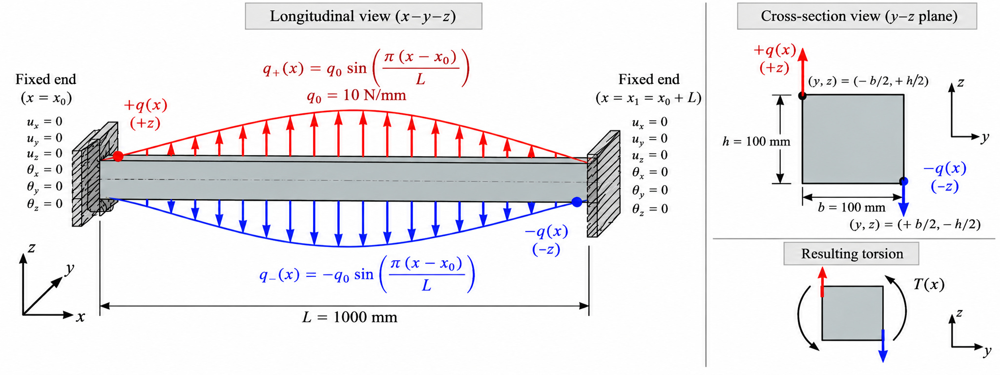

# CSF-CUF quick start


### Static scheme and loading configuration



*Fixed-fixed rectangular beam subjected to a sinusoidal torsional line-load pair. Two opposite distributed line loads act in the global z direction at diagonally opposite section vertices. Their intensity follows a longitudinal half-wave, with an amplitude of 10 N/mm.*


This Quick Start considers a **single one-dimensional beam member**. General assemblies of multiple connected members are outside the present implementation scope.

The three elements introduced in this Quick Start - **the model**, **the problem**, and **the case** - form a **component composition** and should not be understood as consecutive steps in a processing pipeline. They are three distinct objects that are composed together to define a single analysis.

The **model** describes the physical system, the **problem** defines how that system is constrained and loaded, and the **case** specifies how the CUF formulation and the numerical approximations are applied to the analysis.

The solver uses these objects together. None of them is an intermediate result produced by another: they are independent descriptions of different aspects of the same problem.

## Glossary (read this first if you are new to CUF)

| Term | One-line definition |
|---|---|
| **CSF** (Continuous Section Field) | Continuous description of cross-section geometry and material along the axis, independent of the CUF approximation. |
| **CUF** (Carrera Unified Formulation) | Hierarchical framework that generates structural theories of arbitrary order for beams, plates and shells. |
| **Model / Problem / Case** | Three independent descriptions (physics, constraints+loads, numerical approximation) composed by the solver, not a pipeline. |
| **Adapter** | Module implementing loads and constraints of a specific problem (e.g. `torsion_halfwave`), separate from the CUF core. |
| **Transverse expansion** | Approximation of the displacement field *over the cross-section* (or through the thickness), controlled by `cuf.basis` and `cuf.order`. |
| **Longitudinal approximation** | Approximation of the field *along the axis*, controlled by `longitudinal.method`, `basis`, `order`, `element_boundaries`. |
| **Order N** | Free parameter fixing the number of transverse expansion terms; higher = more degrees of freedom and more local detail. |
| **TE / LE / Legendre** | Families of transverse expansion functions: Taylor (simple polynomials), Lagrange (interpolation on sub-domains), Legendre (orthogonal polynomials, often "scaled"). |
| **Scaled Legendre** | Rescaled Legendre variant on the section domain; used in the Quick Start with N=8. Difference from pure Legendre to be checked in the repo. |
| **Lagrange (longitudinal)** | Nodal C0 basis used by `finite_element`; with order 6, one element has 7 nodes. |
| **Half-wave** | Sinusoidal load along the axis: zero at both ends, maximum at mid-span. |
| **Fundamental nucleus** | Compact CUF matrix expression independent of geometry, order N or mesh: the solver queries the model through the nuclei. |
| **ESL / LW / component-wise** | Through-thickness detail levels: Equivalent Single Layer (one field), Layer-Wise (one per layer), component-wise (one per structural component). |
| **Station response** | Table evaluating the continuous CUF field at selected axial and cross-section points. |
| **Convergence analysis** | Systematic increase of N and/or mesh until a quantity of interest stabilizes within tolerance. |

---
>## Try it interactively in Google Colab
>
>You can run this Quick Start directly in Google Colab, without installing
>CSF-CUF locally or writing Python code.
>
>[**Open the Interactive CSF-CUF Quick Start in Google Colab**](https://colab.research.google.com/github/giovanniboscu/continuous-section-field/blob/main/cuf/quickstart/quickstart_colab_interactive.ipynb)
>
>The notebook provides an interactive form to change the transverse CUF
>order, longitudinal approximation order, material properties and
>cross-section dimensions.
>
>It automatically runs the analysis and displays the CSF model,
>section properties, CUF stress maps and structural response.

>
>The Colab notebook is a convenience layer; the repository remains the reference environment. If the Colab runtime changes, run the quickstart locally
>
---

The original YAML files remain unchanged.


```text
.
├── models
│   └── rectangular_prismatic_csf.yaml
├── problems
│   └── torsion_halfwave.yaml
└── cases
    └── torsion_halfwave_legendre_N08.yaml
```

The complete YAML files used in this Quick Start are available directly in the repository:

- [`models/rectangular_prismatic_csf.yaml`](https://github.com/giovanniboscu/continuous-section-field/blob/main/cuf/quickstart/models/rectangular_prismatic_csf.yaml) - CSF description of the beam geometry and sectional material data.
- [`problems/torsion_halfwave.yaml`](https://github.com/giovanniboscu/continuous-section-field/blob/main/cuf/quickstart/problems/torsion_halfwave.yaml) - structural problem definition, linking the CSF model to the predefined torsional loading and boundary-condition scheme.
- [`cases/torsion_halfwave_legendre_N08.yaml`](https://github.com/giovanniboscu/continuous-section-field/blob/main/cuf/quickstart/cases/torsion_halfwave_legendre_N08.yaml) - numerical CSF-CUF case, defining the transverse expansion, longitudinal approximation, integration, sampling, and output settings.

> For coordinate systems and displacement conventions, see [Coordinate Systems and Displacement Conventions](https://github.com/giovanniboscu/continuous-section-field/blob/main/cuf/docs/coordinate_systems.md).

## Model

The physical beam model used in this example is defined in:

[`models/rectangular_prismatic_csf.yaml`](https://github.com/giovanniboscu/continuous-section-field/blob/main/cuf/quickstart/models/rectangular_prismatic_csf.yaml)

This is a standard **CSF model file**. It describes the geometry and sectional material information independently of the CUF approximation and independently of the applied structural problem.

The file defines a prismatic rectangular beam with:

- length: `1000`
- section: `100 x 100`
- one physical polygon: `rectangle`
- constant elastic weight: `71700`
- isotropic Poisson ratio: `0.3`

The section is prismatic because the two CSF stations `S0` and `S1` contain identical geometry and material data.

The complete model definition can be inspected directly in the repository:

[`rectangular_prismatic_csf.yaml`](https://github.com/giovanniboscu/continuous-section-field/blob/main/cuf/quickstart/models/rectangular_prismatic_csf.yaml)

This same CSF model can in principle be reused by different structural problems or different CUF numerical cases without redefining the geometry.

## Problem

The structural problem used in this example is defined in:

[`problems/torsion_halfwave.yaml`](https://github.com/giovanniboscu/continuous-section-field/blob/main/cuf/quickstart/problems/torsion_halfwave.yaml)

The YAML is intentionally small because it composes an existing CSF model with a predefined structural problem:

```yaml
model:
  csf_yaml: ../models/rectangular_prismatic_csf.yaml

problem:
  type: torsion_halfwave
  amplitude: 10.0
```

The first block selects the physical model:

```yaml
model:
  csf_yaml: ../models/rectangular_prismatic_csf.yaml
```

while the second selects the predefined `torsion_halfwave` structural problem and its load amplitude:

```yaml
problem:
  type: torsion_halfwave
  amplitude: 10.0
```

The complete file is available here:

[`torsion_halfwave.yaml`](https://github.com/giovanniboscu/continuous-section-field/blob/main/cuf/quickstart/problems/torsion_halfwave.yaml)

The problem definition includes both the applied torsional loading and the associated boundary conditions.

The torsional action is generated by two opposite loads acting in the global `z` direction. Their magnitude varies along the beam according to a single sinusoidal half-wave. The loads are therefore zero at the two beam ends and reach their maximum magnitude at mid-span.

### Boundary conditions

The `torsion_halfwave` problem uses fixed-fixed boundary conditions.

Both end cross-sections are fully clamped. Therefore, over the complete cross-section at both longitudinal ends,

```text
u_x = 0
u_y = 0
u_z = 0
```

That is, all three displacement components are constrained at:

```text
x = 0
x = L
```

No additional boundary conditions need to be specified in the problem YAML because they are already part of the predefined `torsion_halfwave` problem adapter.


> **Loads and constraints:** implemented in problem adapters, separate from the CUF core. To modify them or select a different adapter, see the [adapter concept and interface](https://github.com/giovanniboscu/continuous-section-field/blob/main/cuf/docs/csf_problem.md) and the [adapter reference](https://github.com/giovanniboscu/continuous-section-field/blob/main/cuf/docs/problem-adapters-reference.md).


## Case

The numerical analysis case is defined in:

[`cases/torsion_halfwave_legendre_N08.yaml`](https://github.com/giovanniboscu/continuous-section-field/blob/main/cuf/quickstart/cases/torsion_halfwave_legendre_N08.yaml)

This is the file passed directly to the `csf-cuf` command. It connects the structural problem to the numerical approximation used for the analysis.

In particular, the case file references:

```yaml
problem:
  yaml: ../problems/torsion_halfwave.yaml
  adapter: csf.cuf.adapters.problem.torsion_halfwave
```

and then specifies both the transverse CUF expansion and the longitudinal finite-element approximation:

- transverse CUF basis: `scaled_legendre`
- transverse CUF order: `N = 8`
- longitudinal method: `finite_element`
- one longitudinal finite element over the complete beam
- longitudinal basis: `lagrange`
- longitudinal polynomial order: `6`
- fixed polygon Gauss integration

The complete numerical case can be inspected here:

[`torsion_halfwave_legendre_N08.yaml`](https://github.com/giovanniboscu/continuous-section-field/blob/main/cuf/quickstart/cases/torsion_halfwave_legendre_N08.yaml)

The relevant part of the case is:

```yaml
cuf:
  basis: scaled_legendre
  order: 8

longitudinal:
  method: finite_element
  element_boundaries: [0.00, 1.00]
  basis: lagrange
  order: 6
```

These are two independent approximation choices.

The CUF basis

```yaml
cuf:
  basis: scaled_legendre
  order: 8
```

defines the **transverse expansion over the cross-section**.

The longitudinal block

```yaml
longitudinal:
  method: finite_element
  element_boundaries: [0.00, 1.00]
  basis: lagrange
  order: 6
```

defines the approximation **along the beam axis**.

The longitudinal finite-element topology accepts nodal C0 longitudinal bases. The longitudinal basis currently implemented and available in the solver is **Lagrange**.

For a Lagrange basis, the expansion coefficients are associated with the longitudinal FEM nodes. With polynomial order `6`, a single element has `7` longitudinal nodes.

The entry

```yaml
element_boundaries: [0.00, 1.00]
```

therefore defines one finite element extending over the complete normalized beam domain.

The transverse CUF expansion and the longitudinal FEM approximation are independent: in this example, the cross-section uses a scaled Legendre expansion of order `8`, while the longitudinal direction uses a Lagrange finite-element basis of order `6`.


## Units of Measure

CSF-CUF does not impose a fixed system of units. All quantities must be defined using a **consistent unit system** throughout the model.

For example, the rectangular prismatic model used in the torsion examples adopts:

- length: **mm**
- force: **N**
- stress and Young's modulus: **MPa = N/mm²**
- line-load intensity: **N/mm**

Therefore,

```yaml
weight: 71700.0
```

represents

$$
E = 71700\ \text{MPa} = 71.7\ \text{GPa}
$$

and

```yaml
amplitude: 10.0
```

for `torsion_halfwave` represents a line-load intensity of

$$
q_0 = 10\ \text{N/mm}
$$

The same CSF-CUF formulation can be used with another unit system, provided that geometry, material properties, loads, and resulting quantities are all expressed consistently.

## Run

Install `csf-cuf`:

```bash
python3 -m venv venv
source venv/bin/activate
 git clone --depth 1 https://github.com/giovanniboscu/continuous-section-field.git
cd continuous-section-field
pip install --upgrade pip
pip install -e .
pip install pypardiso
cd cuf/quickstart/
```

From this directory:

```bash
csf-cuf cases/torsion_halfwave_legendre_N08.yaml
```

The command therefore starts from the **case YAML**. The case references the **problem YAML**, and the problem in turn references the **CSF model YAML**:

```text
cases/torsion_halfwave_legendre_N08.yaml
              │
              ▼
problems/torsion_halfwave.yaml
              │
              ▼
models/rectangular_prismatic_csf.yaml
```

This dependency should not be interpreted as a processing pipeline. The three files remain descriptions of different aspects of the same analysis: numerical approximation, structural problem, and physical model respectively.

The solver writes the results below:

```text
output/torsion_halfwave_legendre_N08
```

## Common errors and troubleshooting

| Symptom / message | Likely cause | Fix |
|---|---|---|
| YAML not parsed, indentation error | Mixed spaces/tabs, wrongly nested keys | Use spaces only, check indentation of `model:`, `problem:`, `cuf:`, `longitudinal:` blocks |
| `FileNotFoundError` on model or problem | Wrong relative path | Paths in YAML are relative to their location: run from `cuf/quickstart/` or fix `csf_yaml`/`yaml` |
| Solver fails because `pypardiso` is missing | Optional dependency not installed | `pip install pypardiso` as in the Quick Start |
| Same results when changing N | Editing the wrong file, or not passing the right case | The command starts from the case: `csf-cuf cases/....yaml`; check you saved the case actually used |
| Displacements explode / no convergence | N too high for the mesh, or BC not as you think | Lower N, verify the `torsion_halfwave` adapter is the expected one (fixed-fixed) |
| Anomalous shear stresses on the section | Too coarse transverse sampling in post-processing | Increase `--transverse-grid` in the post-processing command |
| Inconsistent units (wrong orders of magnitude) | Mixing mm/N/MPa with other units | Adopt a consistent system: mm, N, MPa=N/mm², N/mm for line loads |
| Longitudinal order not supported | Longitudinal basis other than Lagrange | The Quick Start declares Lagrange as the only implemented C0 longitudinal basis: use it |
| Colab case gives different results from local | Colab runtime changed, or different repo version | The repo is the reference environment: re-run locally with the same version |

**Note**: this table is built on behaviours documented in the Quick Start and on typical YAML+Python framework errors. Exact messages should be verified by running the repo.


## Next step

To understand how these components fit together within the overall CSF-CUF architecture, continue with:

[**Inside the CSF-CUF architecture**](https://github.com/giovanniboscu/continuous-section-field/blob/main/cuf/readme.md)

## Understanding the response output

At the end of the analysis, the solver prints a compact summary of the displacement field at a number of selected longitudinal stations and physical points of the cross-section.

A typical output begins with:

```text
CSF-CUF RESPONSE
======================
problem.type = torsion_halfwave
```

This identifies the structural problem that has been solved.

### Station responses

The `STATION RESPONSES` table evaluates the continuous CUF displacement field at selected positions along the beam.

```text
x/L       x [mm]      y [mm]      z [mm]      point      ux [mm]      uy [mm]      uz [mm]
```

The columns have the following meaning:

- `x/L` is the normalized longitudinal coordinate, from `0` at the first end to `1` at the second end;
- `x [mm]` is the corresponding physical longitudinal coordinate;
- `y [mm]` and `z [mm]` identify the physical point inside the cross-section;
- `point` is a convenient label assigned to that sampling point;
- `ux`, `uy`, and `uz` are the three global displacement components evaluated at that physical position.

For this rectangular example, four representative points are sampled at each station:

```text
center       y =   0     z =   0
plus         y = -50     z =  50
minus        y =  50     z = -50
bottom_mid_
```

## Stress maps and CSV post-processing

After the CUF analysis has been completed, the stress field can be evaluated on a selected transverse section and exported as both graphical maps and CSV data.

From the `cuf/quickstart/` directory, for example, the following command evaluates the section at `x = 500 mm`:

```bash
python -m csf.cuf.tools.plot_strain_stress_boundary_v10 \
  --csf-yaml models/rectangular_prismatic_csf.yaml \
  --cuf-output-root output/torsion_halfwave_legendre_N08/ \
  --transverse-x 500 \
  --transverse-grid 50 \
  --output-dir stress_maps \
  --dpi 100
```

The main options are:

- `--csf-yaml`: CSF model used for the analysis;
- `--cuf-output-root`: directory containing the CUF results to post-process;
- `--transverse-x`: physical longitudinal coordinate of the section to evaluate;
- `--transverse-grid`: sampling resolution used over the cross-section;
- `--output-dir`: destination directory for the generated post-processing results;
- `--dpi`: resolution of the generated figures.

The command reconstructs the strain and stress fields on the selected cross-section and writes the resulting stress maps together with the corresponding CSV data in the selected output directory.

For the complete description of the available post-processing options, generated files, stress components, CSV structure, and advanced usage, see:

[**CSF-CUF CLI Post-processing Guide**](https://github.com/giovanniboscu/continuous-section-field/blob/main/cuf/docs/CSF-CUF-CLI-Post-processingGuide.md)

## Theory to code bridge

| Concept (theory) | Where it lives in the Quick Start | What to look at |
|---|---|---|
| Independent physical model | `models/rectangular_prismatic_csf.yaml` | length, 100x100 section, rectangle polygon, weight: 71700, Poisson 0.3 |
| Problem = constraints + loads | `problems/torsion_halfwave.yaml` | type: torsion_halfwave, amplitude: 10.0, fixed-fixed BC in the adapter |
| Adapter separate from core | `adapter: csf.cuf.adapters.problem.torsion_halfwave` in the case | See `csf_problem.md` and `problem-adapters-reference.md` |
| Transverse expansion | `cuf:` block in the case | basis: scaled_legendre, order: 8 |
| Longitudinal approximation | `longitudinal:` block in the case | method: finite_element, element_boundaries: [0.00, 1.00], basis: lagrange, order: 6 |
| Composition (not a pipeline) | Quick Start README | case -> problem -> model chain, with the explicit note that it is not a pipeline |
| Continuous field evaluated at points | STATION RESPONSES output | Columns x/L, x[mm], y, z, point, ux, uy, uz |
| Sampling points | Rectangular case output | center (0,0), plus (-50,50), minus (50,-50), bottom_mid |
| Stress post-processing | `python -m csf.cuf.tools.plot_strain_stress_boundary_v10` command | --transverse-x 500, --transverse-grid 50, --output-dir stress_maps |
| Theoretical basis | Carrera & Giunta (2010) | Canonical reference for expansion order and section functions |
| Validation against 3D FEM | `cuf/I-Shape` case | CSF-CUF vs 3D FEM for prismatic and tapered I-beams |
| Increasing-order benchmarks | `cuf/refined_beam_theories_tables_9_10` | Reproduction of Carrera & Giunta results as N varies |

**Bridge phrase to remember**: theory tells you why order N matters; the code tells you where it is set (`cuf.order`) and where its effect is seen (station responses and stress maps). Without the bridge, neither is enough.


## Further Reading and Useful Links

This quick start is intentionally minimal. The following resources are useful if you want to explore the CSF-CUF workflow in more detail, without turning this guide into a theoretical manual.

### Repository resources

- **CSF-CUF repository**  
  Main entry point for the code, examples, and documentation:  
  https://github.com/giovanniboscu/continuous-section-field

- **Quick start README**  
  The reference document for this guide, including installation, YAML input files, and the first torsion example:  
  https://github.com/giovanniboscu/continuous-section-field/blob/main/cuf/quickstart/README.md

- **CUF framework documentation**  
  Overview of the CSF-CUF architecture, the separation between physical model, transverse expansion, longitudinal approximation, and numerical solution:  
  https://github.com/giovanniboscu/continuous-section-field/tree/main/cuf

- **Tutorial: variable-material T-section**  
  Step-by-step example showing how a continuous section field can describe non-prismatic geometry and spatially varying material properties:  
  https://github.com/giovanniboscu/continuous-section-field/tree/main/cuf/tutorials/variable_material_t_section

- **I-shape validation case**  
  Comparison between CSF-CUF and 3D FEM results for prismatic and tapered I-beams:  
  https://github.com/giovanniboscu/continuous-section-field/tree/main/cuf/I-Shape

- **Refined beam theories benchmark tables**  
  Reproduction of the Carrera & Giunta benchmark results for bending and torsion, with increasing CUF expansion orders:  
  https://github.com/giovanniboscu/continuous-section-field/tree/main/cuf/refined_beam_theories_tables_9_10

- **Coordinate systems and displacement conventions**  
  Reference for the coordinate systems, sign conventions, and displacement components used in the examples:  
  https://github.com/giovanniboscu/continuous-section-field/blob/main/cuf/docs/coordinate_systems.md

### Theoretical background

- **Carrera, E., & Giunta, G. (2010).**  
  *Refined Beam Theories Based on a Unified Formulation.*  
  International Journal of Applied Mechanics, 2(1), 117-143.  
  https://doi.org/10.1142/S1758825110000500

  This is the canonical reference for the Carrera Unified Formulation (CUF). It is cited by the repository and is useful for understanding the mathematical basis behind the transverse expansion order and the choice of cross-sectional functions used in the `cases/*.yaml` files.

### Suggested reading path

1. Run the quick start example and inspect the three YAML files.
2. Change only the transverse CUF order in the `cases/*.yaml` file and compare the results.
3. Follow the variable-material T-section tutorial to see how the continuous section field is used in a more general setting.
4. Compare with the I-shape validation case to see how CSF-CUF results relate to 3D FEM solutions.
5. Consult Carrera & Giunta (2010) for the theoretical formulation.

> If any repository link changes, browse from the main repository page and follow the `cuf/` directory structure.
