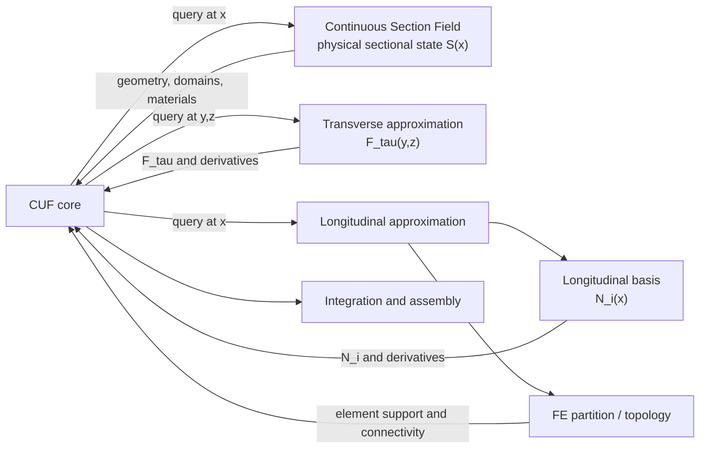

# What is CSF–CUF?

Consider a structural beam with an I-shaped cross-section. In a conventional beam model, the structure is represented mainly through its longitudinal axis and a limited set of cross-sectional properties, such as area and bending stiffness. This approach is effective for describing the overall structural behavior, but it may not capture how individual parts of the cross-section deform.

A three-dimensional finite-element model can describe these local effects in greater detail, but requires a discretization of the entire volume.

The **Carrera Unified Formulation (CUF)** provides another approach. The structure is still modeled as a beam along its longitudinal direction, but its displacement field is described through mathematical functions defined over the cross-section.

By choosing different functions and approximation orders, the same formulation can represent anything from simple beam behavior to more refined deformation patterns. CUF is therefore not a single beam theory, but a general framework for constructing beam models with different levels of refinement.

This is where the **Continuous Section Field (CSF)** comes into play.

CSF describes the actual physical cross-section of the beam: its geometry, its constituent regions, and its material properties. Unlike a description based only on a fixed set of sectional parameters, this information remains available at any position along the beam, even when its geometry or material distribution changes continuously.

**CSF–CUF brings these two concepts together:**

- **CSF** describes what the beam physically is.
- **CUF** defines how its displacement field is approximated.
- **The numerical solver** combines these descriptions to calculate displacements, strains, and stresses.

The central idea is that the physical description of the beam and the mathematical approximation used to analyse it are two distinct things. They can be defined, modified, and refined independently.
e transverse CUF expansion functions and the longitudinal finite-element shape functions remain symbolically defined, but become independent, reusable components rather than being embedded in the CUF core.

In this way the solver  operates on independent descriptions of:

* the physical sectional state;
* the transverse approximation;
* the longitudinal approximation;
* the longitudinal discretization.

## An open implementation

This repository is open for a reason: it is meant to be explored, questioned, tested, and challenged.

If you are a student, a researcher, or simply curious about how and why the method works, use it, experiment with it, and ask questions.

The goal is not to impose a way of doing things, but to propose one. If something is unclear, if you think something could be improved, or if you have an idea for a different implementation, that is exactly the kind of interaction this project is meant to encourage.

> **Note:** For a general description of the CSF–CUF architecture, formulation, and solver workflow, see the [CUF solver documentation](https://github.com/giovanniboscu/continuous-section-field/blob/main/docs/cuf/readme.md).

## Documentation

The following resources provide an introduction to CSF-CUF, its configuration, and its internal architecture.

- **[Architecture](https://github.com/giovanniboscu/continuous-section-field/tree/main/cuf/docs/architecture)** - The internal organization of CSF-CUF and the separation between the physical model, CUF formulation, and numerical solver.
- **[Quick Start](https://github.com/giovanniboscu/continuous-section-field/tree/main/cuf/quickstart)** - A practical introduction with ready-to-run examples.
- **[What is YAML?](https://github.com/giovanniboscu/continuous-section-field/blob/main/cuf/docs/whatIsYAML.md)** - An introduction to YAML files and how they are used to describe and configure a CSF-CUF analysis.
- **[YAML Configuration Reference](https://github.com/giovanniboscu/continuous-section-field/tree/main/cuf/docs/yaml_reference)** - How to define geometry, materials, loads, boundary conditions, CUF expansions, and solver settings.

---

- **[Tutorials](https://github.com/giovanniboscu/continuous-section-field/tree/main/cuf/tutorials/variable_material_t_section)**  
  Step-by-step examples covering geometry, material distribution, transverse expansions, loads, and boundary conditions.

- **[I-Shape](https://github.com/giovanniboscu/continuous-section-field/tree/main/cuf/I-Shape)**  
  Numerical validation case comparing CSF-CUF and 3D FEM solutions for both prismatic and continuously tapered I-shaped beams, using the same CUF formulation and solver settings while changing only the continuous cross-section geometry.

- **[C-Shape](https://github.com/giovanniboscu/continuous-section-field/tree/main/cuf/c-shape)**  
  C-section benchmark based on the work of Carrera and Petrolo, demonstrating custom polygon-specific transverse expansions, Lagrange L9 approximation, and FEM3D comparisons.

- **[Bridge-like](https://github.com/giovanniboscu/continuous-section-field/tree/main/cuf/bridge-like)**  
  Bridge-like beam example inspired by Carrera, Petrolo, and Zappino, illustrating the use of CSF as an independent library supplying geometry and material properties to a CUF-based structural solver. Bending and torsion analyses explore higher-order transverse approximations, numerical convergence, and stress distributions.

### Mathematical Formulation of the CSF–CUF Coupling

* [Formulation for Directly Prescribed Variable Sections](https://github.com/giovanniboscu/continuous-section-field/blob/main/docs/model/csf_cuf_formal_variable_section_extension.md)
* [CUF displacement expansion for CSF coupling](https://github.com/giovanniboscu/continuous-section-field/blob/main/docs/model/csf_cuf_displacement_expansionf_coupling.md)
* [Numerical validation against Carrera & Giunta](https://github.com/giovanniboscu/continuous-section-field/blob/main/docs/model/csf_cuf_numerical_validation_carrera_giunta.md)
* [CSF–CUF sectional constitutive interface](https://github.com/giovanniboscu/continuous-section-field/blob/main/docs/model/csf_cuf_sectional_constitutive_interface.md)

### References

* E. Carrera, G. Giunta, **“Refined Beam Theories Based on a Unified Formulation”**, *International Journal of Applied Mechanics*, 2(1) (2010), 117–143. [DOI](https://doi.org/10.1142/S1758825110000500).

* G. Giunta, S. Belouettar, E. Carrera, **“Analysis of FGM Beams by Means of Classical and Advanced Theories”**, *Mechanics of Advanced Materials and Structures*, 17 (2010), 622-635.

* S. O. Ojo, P. M. Weaver, **“Efficient strong Unified Formulation for stress analysis of non-prismatic beam structures”**, 2021.
