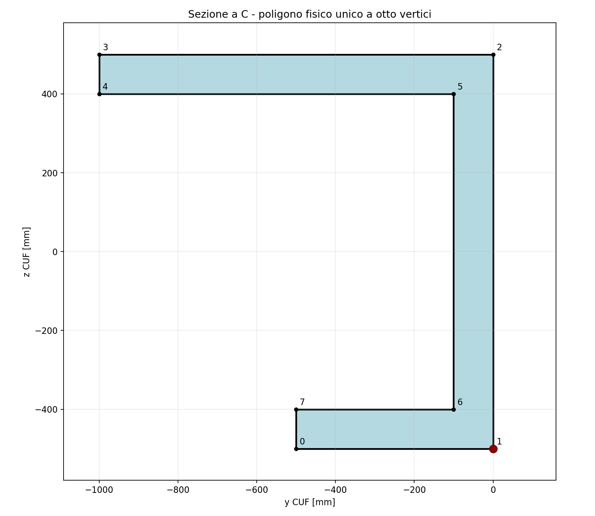
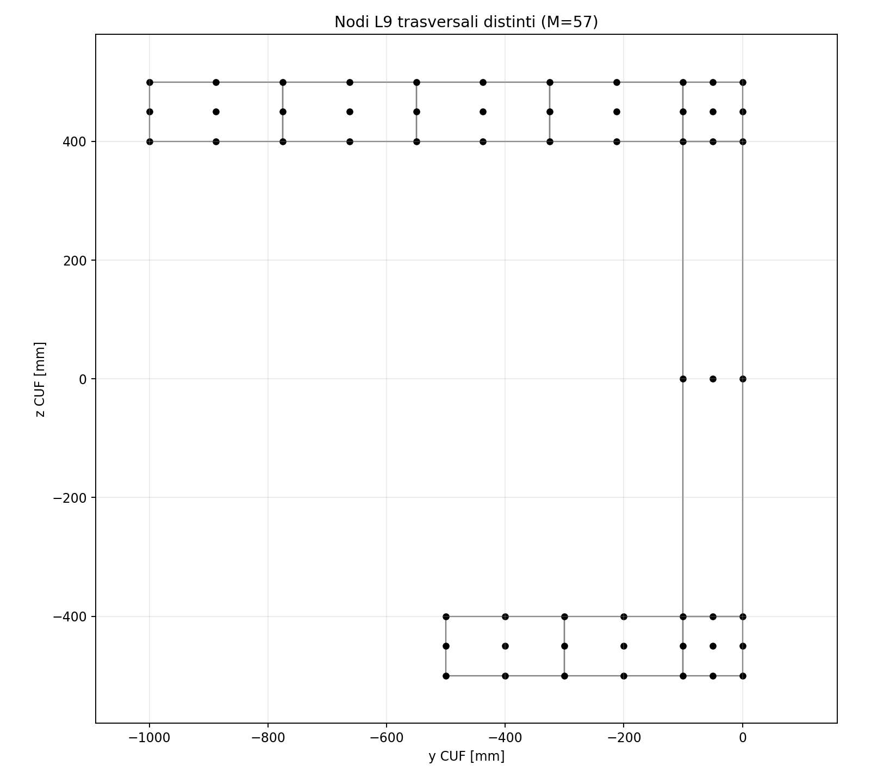

# CSF–CUF: dall'idea della sezione continua a un framework generale
## Origine del progetto

Il punto di partenza è stato un problema di implementazione: come costruire un software CUF sufficientemente generale da trattare geometrie e materiali differenti, anche variabili lungo l'asse, senza dover sviluppare una formulazione specifica per ogni nuovo caso?
La scelta che ha orientato il lavoro è stata **mantenere la sezione come oggetto continuo lungo l'asse della trave e portarne la dipendenza longitudinale fino ai nuclei CUF**. In altre parole, considerare esplicitamente una sezione `S(x)` e le proprietà costitutive associate alla posizione `x`, anziché fissarle preliminarmente in una descrizione sezionale specializzata.
L'obiettivo non era modificare i principi della formulazione CUF, ma trovare un'organizzazione matematica e computazionale che ne consentisse uan'implementazione riutilizzabile.
## 1. La scelta fondamentale: conservare S(x) fino ai nuclei

Nella rappresentazione CUF, il campo di spostamento è approssimato mediante funzioni trasversali e funzioni di forma longitudinali. I contributi alla rigidezza dipendono inoltre dalla geometria e dalle proprietà del materiale.
L'idea è stata mantenere esplicita la dipendenza della sezione dalla coordinata longitudinale anche nel momento in cui vengono valutati i contributi sezionali dei nuclei CUF. In forma schematica, un contributo può essere rappresentato come

```math
\mathcal{K}(x) = \int_{S(x)} \mathcal{B}^{T}(x,y,z)\,\mathbf{C}(x,y,z)\,\mathcal{B}(x,y,z)\,\mathrm{d}S.
```
Questa espressione ha un significato illustrativo: la definizione completa degli operatori, degli indici e dei nuclei adottati va ricercata nella trattazione matematica specifica, non dedotta da questa sintesi.

**Conservare `S(x)` fino a questo livello è stata la decisione determinante.** La geometria e la distribuzione dei materiali restano informazioni valutabili nel punto e nella sezione richiesti dal procedimento numerico.

La derivazione formale è presentata nel documento:
**[Estensione formale CSF–CUF alle sezioni variabili](https://github.com/giovanniboscu/continuous-section-field/blob/main/docs/model/csf_cuf_formal_variable_section_extension.md)**.
## 2. La conseguenza immediata: valutare numericamente i contributi sezionali

Da questa impostazione è derivata una conseguenza operativa importante: **non è più necessario ricavare e integrare simbolicamente, caso per caso, le espressioni dipendenti dalla geometria e dai materiali**.
La descrizione fisica della sezione viene interrogata durante la valutazione numerica dei contributi richiesti dalla formulazione. La complessità della geometria e della sua variazione longitudinale viene così gestita dal modello sezionale, mentre il procedimento di costruzione dei nuclei conserva un'organizzazione generale.

Questo passaggio non equivale a eliminare ogni operazione simbolica: riguarda specificamente il trattamento delle quantità geometriche e costitutive nelle integrazioni sezionali.
## 3. Il passo successivo: mantenere le approssimazioni in Python

Una volta separata la geometria dalla valutazione dei nuclei, il passo successivo è stato organizzare le **espansioni trasversali** e le **funzioni di forma longitudinali** come componenti matematici implementati in Python.
Le rispettive espressioni e derivate rimangono definite attraverso i componenti dedicati, mentre geometria e materiali sono forniti autonomamente dal CSF. Le famiglie già implementate possono essere selezionate e riutilizzate; una nuova famiglia richiede lo sviluppo di un componente Python conforme all'interfaccia prevista.

Questa separazione consente di combinare scelte di approssimazione differenti con lo stesso modello fisico, senza riscrivere ogni volta il procedimento generale di assemblaggio.
## 4. La costruzione di CSF–CUF

L'architettura risultante distingue tre responsabilità:
| Componente | Responsabilità |
| --- | --- |
| **CSF** | Descrizione della geometria sezionale e dei materiali, comprese le variazioni lungo l'asse. |
| **Componenti Python di CUF** | Espansioni trasversali, funzioni di forma longitudinali, operatori, valutazione numerica e assemblaggio. |
| **Configurazione YAML** | Collegamento fra modello, problema e scelte di analisi tramite file testuali leggibili e modificabili. |
I file YAML permettono di dichiarare il modello fisico, i carichi e i vincoli, le approssimazioni selezionate e i parametri numerici dell'analisi. Non sono la formulazione matematica: sono lo strumento attraverso il quale si configurano e si combinano i componenti disponibili.

Documentazione di riferimento:
- [Presentazione CSF–CUF per Carrera](https://github.com/giovanniboscu/continuous-section-field/blob/main/docs/cuf/CSF_CUF_Continuous_Section_Field_Carrera.md)
- [Riferimento alla configurazione YAML](https://github.com/giovanniboscu/continuous-section-field/blob/main/cuf/docs/yaml_reference/readme.md)
- [Documentazione del framework CUF](https://github.com/giovanniboscu/continuous-section-field/blob/main/cuf/readme.md)
## 5. Il principio architetturale

Il principio che ha guidato l'implementazione è **mantenere il nucleo generale CUF indipendente dai dettagli di una specifica geometria, distribuzione dei materiali, famiglia di approssimazioni o condizione di carico**.
Questi elementi vengono forniti attraverso componenti e interfacce dedicate. Il riuso diventa quindi una proprietà dell'architettura: un nuovo caso può essere costruito ricombinando elementi esistenti, mentre le estensioni necessarie vengono sviluppate nei componenti appropriati.
L'aspirazione alla generalità non implica che ogni possibile modello sia già disponibile. Il perimetro operativo dipende dalle famiglie di espansione, dai carichi, dai vincoli e dalle funzionalità effettivamente implementati e verificati.
## 6. Dal principio generale a un caso riproducibile: la sezione a C asimmetrica

**L'idea iniziale era semplice: portare la sezione continua `S(x)` fino ai nuclei CUF.** Il passo successivo è mostrare come questa scelta si traduca in un'analisi effettiva, seguendo senza salti la descrizione fisica, l'espansione trasversale, la configurazione CUF e il problema strutturale.
Il caso scelto è la **sezione a C asimmetrica** del riferimento Carrera–Petrolo, descritta nella [pagina introduttiva del caso](https://github.com/giovanniboscu/continuous-section-field/blob/main/cuf/c-shape/readme.md). La sua utilità, qui, è mostrare il collegamento tra oggetti separati dell'architettura, non proporre una nuova formulazione per questa geometria.

### 6.1. Oggetto dell'analisi e riferimento bibliografico

L'esempio utilizza la sezione a C aperta e asimmetrica analizzata da **E. Carrera e M. Petrolo**, *Refined beam elements with only displacement variables and plate/shell capabilities*, §4.3, «Open cross-sections», con richiamo alle figure 12 e 13 e alle tabelle 13 e 14. La figura 13(b) del lavoro illustra la discretizzazione in nove domini L9. Il presente documento non attribuisce alla pubblicazione le coordinate delle partizioni interne ricostruite numericamente: sono una scelta esplicita di questo modello.

L'obiettivo del confronto non è ottenere un'identità tra due discretizzazioni, ma documentare una **stessa configurazione fisica** calcolata con due approssimazioni differenti: CSF–CUF con espansioni L9 trasversali ed elementi finiti longitudinali, e un modello 3D indipendente OpenSeesPy con elementi solidi esaedrici H8.

| Grandezza | Valore | Osservazione |
| --- | ---: | --- |
| Altezza totale della sezione, $h$ | 1000 mm | Da $z=-500$ a $z=500$ |
| Spessore delle ali e dell'anima, $t$ | 100 mm | |
| Larghezza ala superiore, $b_2$ | 1000 mm | Da $y=-1000$ a $y=0$ |
| Larghezza ala inferiore, $b_1$ | 500 mm | Da $y=-500$ a $y=0$ |
| Lunghezza della trave, $L$ | 20000 mm | $L/h=20$ |
| Modulo elastico, $E$ | 75000 MPa | $75$ GPa |
| Coefficiente di Poisson, $\nu$ | 0,33 | Isotropia |
| Forza concentrata | $F_z=-1$ N | All'estremo libero |
| Posizione del carico | $(x,y,z)=(20000,0,-500)$ mm | Coordinate CUF/FEM3D |
| Vincolo | Incastro completo, $x=0$ | Sezione iniziale |

L'ala superiore è a sinistra più estesa dell'ala inferiore, mentre l'anima è a destra della figura sezionale. Il punto caricato si trova nel vertice esterno inferiore destro della sezione. Gli assi CUF/FEM3D sono: $x$ longitudinale, $y$ orizzontale sul piano sezionale, $z$ verticale sul piano sezionale. Le unità coerenti sono **mm, N, MPa = N/mm²**.


*Figura 1 — Contorno fisico e partizione sezionale nei nove domini CSF usati dall'espansione L9. Figura ricostruita direttamente dalle coordinate YAML riportate in questo documento, non riproduzione della figura del paper.*

Le larghezze libere delle ali sono state divise come segue: la porzione superiore di $900$ mm è ripartita in quattro domini da $225$ mm, mentre la porzione inferiore di $400$ mm è divisa in due domini da $200$ mm; i raccordi all'anima, larghi $100$ mm, costituiscono domini autonomi. La sezione comprende pertanto **cinque domini superiori, un dominio d'anima e tre domini inferiori**.

La scelta di **nove domini** serve a definire l'approssimazione L9, non significa che CSF sia limitato a geometrie rettangolari. CSF descrive domini poligonali; in questo specifico test ciascuno dei nove domini è un quadrilatero per costruire in maniera conforme la base trasversale.

Per assicurare tracciabilità, nelle sezioni seguenti sono riportati **tutti i file YAML operativi**: due geometrie alternative ma fisicamente equivalenti, due definizioni di problema con identico carico e vincolo, e il case CUF. Nessun elenco di vertici viene abbreviato.

### 6.2. Modello fisico CSF con nove quadrilateri: rappresentazione integrale

Il CSF (*Continuous Section Field*) definisce le sezioni terminali `S0` e `S1` mediante liste di poligoni. La coordinata `z` di una sezione è la **stazione longitudinale nel sistema CSF** e coincide qui con la coordinata longitudinale fisica `x` del CUF. Le coppie di coordinate nei `vertices` sono invece coordinate nel piano sezionale: la prima corrisponde a $y_{CUF}$, la seconda a $z_{CUF}$. Non si deve confondere la coordinata `z` della stazione con la seconda coordinata del singolo vertice.

Per ogni poligono, `weight: 75000.0` fornisce il parametro elastico che, in questo modello isotropo, corrisponde al modulo $E$ in MPa. La legge `shear_weight_laws: ['iso(0.33)']` completa la specificazione dell'isotropia con $\nu=0{,}33$. In tale caso il modulo di taglio è

```math
G=\frac{E}{2(1+\nu)}=\frac{75000}{2(1.33)}\simeq 28195.49\ \mathrm{MPa}.
```

Tutti i poligoni sono non sovrapposti negli interni; le interfacce geometriche coincidono sui bordi e possono essere utilizzate dall'espansione trasversale per identificare nodi in comune. La ripetizione degli stessi domini e degli stessi vertici alle due estremità implica che $\mathcal{S}(x)$ sia **costante** in questo benchmark. Il framework non richiede di trasformare il problema fisico in una tabella di proprietà concentrate: il provider CSF restituisce le entità e le proprietà del dominio alla stazione richiesta.

**File sorgente:** `cuf/c-shape/models/c_section_chapter9_5_3_9L9_csf.yaml`.

Segue il YAML **integrale per tutte le chiavi e i valori operativi**, con entrambi i gruppi di poligoni `S0` e `S1`, senza abbreviazioni. I commenti in italiano sono editoriali; il contenuto funzionale è quello del repository consultato.

```yaml
# Modello fisico CSF, nove domini quadrilateri L9.
CSF:
  sections:
    S0:
      z: 0.0
      polygons:
        - name: top_1
          weight: 75000.0
          vertices:
            - [-1000.0, 400.0]
            - [-775.0, 400.0]
            - [-775.0, 500.0]
            - [-1000.0, 500.0]
        - name: top_2
          weight: 75000.0
          vertices:
            - [-775.0, 400.0]
            - [-550.0, 400.0]
            - [-550.0, 500.0]
            - [-775.0, 500.0]
        - name: top_3
          weight: 75000.0
          vertices:
            - [-550.0, 400.0]
            - [-325.0, 400.0]
            - [-325.0, 500.0]
            - [-550.0, 500.0]
        - name: top_4
          weight: 75000.0
          vertices:
            - [-325.0, 400.0]
            - [-100.0, 400.0]
            - [-100.0, 500.0]
            - [-325.0, 500.0]
        - name: top_web_corner
          weight: 75000.0
          vertices:
            - [-100.0, 400.0]
            - [0.0, 400.0]
            - [0.0, 500.0]
            - [-100.0, 500.0]
        - name: web
          weight: 75000.0
          vertices:
            - [-100.0, -400.0]
            - [0.0, -400.0]
            - [0.0, 400.0]
            - [-100.0, 400.0]
        - name: bottom_1
          weight: 75000.0
          vertices:
            - [-500.0, -500.0]
            - [-300.0, -500.0]
            - [-300.0, -400.0]
            - [-500.0, -400.0]
        - name: bottom_2
          weight: 75000.0
          vertices:
            - [-300.0, -500.0]
            - [-100.0, -500.0]
            - [-100.0, -400.0]
            - [-300.0, -400.0]
        - name: bottom_web_corner
          weight: 75000.0
          vertices:
            - [-100.0, -500.0]
            - [0.0, -500.0]
            - [0.0, -400.0]
            - [-100.0, -400.0]
    S1:
      z: 20000.0
      polygons:
        - name: top_1
          weight: 75000.0
          vertices:
            - [-1000.0, 400.0]
            - [-775.0, 400.0]
            - [-775.0, 500.0]
            - [-1000.0, 500.0]
        - name: top_2
          weight: 75000.0
          vertices:
            - [-775.0, 400.0]
            - [-550.0, 400.0]
            - [-550.0, 500.0]
            - [-775.0, 500.0]
        - name: top_3
          weight: 75000.0
          vertices:
            - [-550.0, 400.0]
            - [-325.0, 400.0]
            - [-325.0, 500.0]
            - [-550.0, 500.0]
        - name: top_4
          weight: 75000.0
          vertices:
            - [-325.0, 400.0]
            - [-100.0, 400.0]
            - [-100.0, 500.0]
            - [-325.0, 500.0]
        - name: top_web_corner
          weight: 75000.0
          vertices:
            - [-100.0, 400.0]
            - [0.0, 400.0]
            - [0.0, 500.0]
            - [-100.0, 500.0]
        - name: web
          weight: 75000.0
          vertices:
            - [-100.0, -400.0]
            - [0.0, -400.0]
            - [0.0, 400.0]
            - [-100.0, 400.0]
        - name: bottom_1
          weight: 75000.0
          vertices:
            - [-500.0, -500.0]
            - [-300.0, -500.0]
            - [-300.0, -400.0]
            - [-500.0, -400.0]
        - name: bottom_2
          weight: 75000.0
          vertices:
            - [-300.0, -500.0]
            - [-100.0, -500.0]
            - [-100.0, -400.0]
            - [-300.0, -400.0]
        - name: bottom_web_corner
          weight: 75000.0
          vertices:
            - [-100.0, -500.0]
            - [0.0, -500.0]
            - [0.0, -400.0]
            - [-100.0, -400.0]
  shear_weight_laws:
    - 'iso(0.33)'
```

L'ordine di ciascuna quadrupla è: angolo inferiore sinistro, inferiore destro, superiore destro, superiore sinistro nel piano $y,z$. Ogni poligono è pertanto orientato in senso antiorario. Il dominio d'anima è esteso verticalmente da $z=-400$ a $z=400$, mentre i due domini di raccordo coprono le fasce sezionali da $400$ a $500$ e da $-500$ a $-400$.

Il file di geometria **non** decide quanti elementi longitudinali saranno impiegati, né implementa esso stesso le funzioni L9, né impone i vincoli della trave: tutte queste responsabilità appartengono a componenti distinti.

La ricostruzione delle partizioni interne dalle immagini dell'articolo costituisce una **scelta geometrica dichiarata** dell'esempio; non va presentata come una tabella di coordinate pubblicata da Carrera e Petrolo.

### 6.3. Una seconda descrizione CSF della stessa sezione fisica

Il driver FEM3D opera sulla medesima sezione a C, rappresentata però da un unico poligono concavo a otto vertici. La sua area fisica è esattamente l'unione dei nove quadrilateri del precedente modello; sono identici il contorno, $E$, $\nu$ e le stazioni longitudinali. La differenza è **topologica nella descrizione di input**, non una modifica di geometria, materiale o problema meccanico. I nove domini sono richiesti dalla particolare base trasversale L9 del case CUF, mentre il driver H8 costruisce autonomamente le proprie suddivisioni 3D.

**File sorgente:** `cuf/c-shape/models/c_section_chapter9_5_3_csf.yaml`.



*Figura 2 — Stessa geometria fisica, descritta con un poligono unico a otto vertici, come input del modello OpenSees.*

YAML completo:

```yaml
# Modello fisico CSF equivalente, contorno unico di otto vertici.
CSF:
  sections:
    S0:
      z: 0.0
      polygons:
        - name: c_section
          weight: 75000.0
          vertices:
            - [-500.0, -500.0]
            - [0.0, -500.0]
            - [0.0, 500.0]
            - [-1000.0, 500.0]
            - [-1000.0, 400.0]
            - [-100.0, 400.0]
            - [-100.0, -400.0]
            - [-500.0, -400.0]
    S1:
      z: 20000.0
      polygons:
        - name: c_section
          weight: 75000.0
          vertices:
            - [-500.0, -500.0]
            - [0.0, -500.0]
            - [0.0, 500.0]
            - [-1000.0, 500.0]
            - [-1000.0, 400.0]
            - [-100.0, 400.0]
            - [-100.0, -400.0]
            - [-500.0, -400.0]
  shear_weight_laws:
    - 'iso(0.33)'
```

### 6.4. Espansione trasversale L9: definizione matematica e realizzazione Python

L'approssimazione trasversale viene caricata da un file Python esterno:

[`cuf/c-shape/expansions/lagrangeL9_v4.py`](https://github.com/giovanniboscu/continuous-section-field/blob/main/cuf/c-shape/expansions/lagrangeL9_v4.py).

**Il nome del file è `lagrangeL9_v4.py`, ma l'intestazione del codice esaminato dichiara una revisione interna `v7` (10 ottobre 2026).** La descrizione seguente si riferisce al comportamento del sorgente effettivo, non a un'eventuale vecchia versione del plugin.

#### 6.4.1. Funzioni unidimensionali di Lagrange di grado due

Nel quadrato naturale $(\alpha,\beta)\in[-1,1]^2$ si adottano i tre punti nodali $-1,0,+1$. Le funzioni interpolanti unidimensionali sono

```math
\ell_{-1}(q)=\tfrac12q(q-1),\qquad
\ell_0(q)=1-q^2,\qquad
\ell_{+1}(q)=\tfrac12q(q+1).
```

I nove prodotti tensoriali formano la base di ciascun dominio:

```math
L_{ab}(\alpha,\beta)=\ell_a(\alpha)\ell_b(\beta),
\qquad a,b\in\{-1,0,+1\}.
```

I valori sono interpolanti sui nove punti nodali, cioè $L_i(P_j)=\delta_{ij}$; la loro somma è unitaria in ogni punto del quadrato di riferimento. La funzione è di ordine due **in ciascuna coordinata naturale**, quindi lo spazio locale completo è $Q_2$, comprendente termini $\alpha^i\beta^j$, con $0\le i,j\le2$.

La convenzione nodale effettiva del plugin riproduce:

```text
        7 -------- 6 -------- 5
        |                     |
        8          9          4
        |                     |
        1 -------- 2 -------- 3

    alpha cresce verso destra; beta cresce verso l'alto.
```

#### 6.4.2. Mappatura geometrica dei quadrilateri

I quattro vertici di ciascun quadrilatero sono forniti dal CSF. Il plugin usa l'interpolazione geometrica isoparametrica bilineare Q4, distinta dalla legge quadratica L9 del campo di spostamento:

```math
\begin{aligned}
Q_1&=\tfrac14(1-\alpha)(1-\beta), &Q_2&=\tfrac14(1+\alpha)(1-\beta),\\
Q_3&=\tfrac14(1+\alpha)(1+\beta), &Q_4&=\tfrac14(1-\alpha)(1+\beta),\\
y(\alpha,\beta)&=\sum_{a=1}^{4}Q_a y_a,
&z(\alpha,\beta)&=\sum_{a=1}^{4}Q_a z_a.
\end{aligned}
```

La matrice Jacobiana locale della trasformazione naturale–fisica è

```math
\mathbf J=\begin{bmatrix}
\partial y/\partial\alpha & \partial y/\partial\beta\\
\partial z/\partial\alpha & \partial z/\partial\beta
\end{bmatrix};\qquad
\begin{bmatrix}\partial L/\partial y\\\partial L/\partial z\end{bmatrix}
=\mathbf J^{-T}
\begin{bmatrix}\partial L/\partial\alpha\\\partial L/\partial\beta\end{bmatrix}.
```

Per i nove domini rettangolari dell'esempio, la mappatura è affine e il determinante della Jacobiana è costante sul singolo dominio. L'algoritmo resta invece formulato per quadrilateri isoparametrici ammissibili, con controllo della singolarità della Jacobiana.

#### 6.4.3. Dai nove domini alle funzioni trasversali globali

Ciascuno dei nove quadrilateri porta nove funzioni locali, per un totale di $9\times9=81$ occorrenze nodali locali. I punti geometricamente coincidenti ai bordi condivisi sono identificati tramite `connectivity: shared_points` e una tolleranza di riconoscimento. Dalle coordinate esatte di questo esempio risultano **57 punti trasversali globali distinti**, ossia $M=57$ funzioni globali $F_\tau$.

Questa conta è ricavata dal reticolo delle nove partizioni, non corrisponde al numero di domini. L'espansione fornisce continuità $C^0$ degli spostamenti attraverso le interfacce: lo stesso coefficiente trasversale globale compare nelle parti locali dei domini adiacenti. **Le derivate trasversali, invece, sono grandezze di lato e non sono necessariamente continue attraverso l'interfaccia.** La versione Python lo rende esplicito e, se una derivata viene richiesta esattamente su un'interfaccia non univoca, non sceglie arbitrariamente un dominio.

La funzione globale vale zero al di fuori dei domini in cui il punto trasversale è attivo. Quando un punto appartiene al contorno condiviso da più quadrilateri, il valore continuo viene verificato per concordanza fra le rappresentazioni di lato; non si sommano erroneamente due valori di uno stesso punto globale.



*Figura 3 — Posizione dei 57 nodi trasversali globali, dedotta dalla mappatura L9 dei nove poligoni CSF.*

#### 6.4.4. Interfaccia software, dipendenza dalla stazione e limiti effettivi

Il plugin realizza un componente conforme alla base CUF (`CUFBasis` e interfaccia plugin). Espone il numero delle funzioni e il loro ordine, la connettività, la valutazione dei valori $F_\tau$ e delle derivate fisiche $\partial F_\tau/\partial y$, $\partial F_\tau/\partial z$. La sorgente CSF è interrogata alle coordinate longitudinali richieste durante la valutazione numerica.

Nel file YAML appare `require_prismatic: true`: **nel codice esaminato questa è un'opzione legacy ricevuta e registrata, ma esplicitamente non imposta come condizione di validità**. Il sorgente più recente dispone anche di interrogazione geometrica dipendente da $x$ e della derivata longitudinale della base quando la geometria dei domini varia. Per il benchmark qui considerato $\partial_x F_\tau=0$, essendo la sezione prismatica. Questa precisazione evita di attribuire al plugin corrente una limitazione di prismaticità che il codice non applica.

Il plugin controlla che il numero e l'identità dei domini CSF restino coerenti con la connettività costruita, e che i punti globali associati continuino a coincidere. Questi sono controlli di consistenza della *specifica implementazione* e non nuovi assiomi della formulazione CUF.

Il listato Python completo non è incluso perché supera il necessario spazio documentale ed è un componente software di oltre mille righe. Sono invece riportate le sue leggi matematiche essenziali e le conseguenze sul numero dei gradi di libertà. Il sorgente rimane consultabile e versionabile tramite il collegamento indicato.

### 6.5. Approssimazione longitudinale e campo di spostamento CUF

La rappresentazione del campo di spostamento nel caso prismatico è

```math
\mathbf u(x,y,z)\approx \sum_{\tau=1}^{M}F_\tau(y,z)\,\mathbf u_\tau(x),
\qquad M=57.
```

Sull'elemento longitudinale $e$ ogni ampiezza $\mathbf u_\tau(x)$ viene approssimata mediante funzioni di forma di Lagrange $N_i^{(e)}(x)$:

```math
\mathbf u(x,y,z)\approx
\sum_{e}\sum_{i=1}^{p+1}\sum_{\tau=1}^{M}
N_i^{(e)}(x)F_\tau(y,z)\,\mathbf q_{i\tau}^{(e)},\qquad p=12,
```

intendendo il contributo di ciascun elemento soltanto sul proprio supporto e assemblando i nodi longitudinali condivisi. Il vettore $\mathbf q_{i\tau}$ ha le tre componenti di spostamento $q_x,q_y,q_z$.

Il case definisce **dieci elementi longitudinali**, separati dagli undici estremi normalizzati

```text
0.0   0.1   0.2   0.3   0.4   0.5   0.6   0.7   0.8   0.9   1.0
```

la cui coordinata fisica, qui con $x_0=0$, è $x=L\,\xi$. La lunghezza fisica di ciascun elemento è dunque $2000$ mm. `longitudinal.order: 12` rappresenta **il grado dell'interpolazione per ciascun elemento**, non il numero degli elementi. `gauss_order: 15` controlla la quadratura longitudinale; `material_polynomial_degree: 0` segnala la costanza della legge di materiale nell'analisi corrente.

Con continuità nodale standard di Lagrange, dieci elementi di grado 12 portano $10\times12+1=121$ posizioni longitudinali globali. Con $57$ funzioni trasversali e tre componenti, la conta cinetica corrispondente è $121\times57\times3=20691$ ampiezze di spostamento **prima delle condizioni vincolari**. Si tratta di una conta **dedotta dalla topologia dichiarata**, non della dimensione di un'eventuale matrice KKT inclusiva di moltiplicatori, variabili aggiuntive o procedure di riequilibratura: quella dimensione va letta dal log dell'esecuzione.

È fondamentale distinguere: il modello fisico CSF ha due sezioni terminali che definiscono un campo continuo; il solver sceglie dieci elementi finiti longitudinali per approssimare gli spostamenti; la trasversalità è approssimata da 57 funzioni globali risultanti dai nove domini L9. Le tre strutture **non coincidono e non devono essere confuse**.

#### 6.5.1. Dal principio dei lavori virtuali alla rigidezza

Nell'elasticità lineare per piccoli spostamenti, l'operatore deformativo applicato alla rappresentazione CUF fornisce le componenti

```math
\begin{aligned}
\varepsilon_{xx}&=\partial_x u_x, &
\varepsilon_{yy}&=\partial_y u_y, &
\varepsilon_{zz}&=\partial_z u_z,\\
\gamma_{xy}&=\partial_y u_x+\partial_x u_y,&
\gamma_{xz}&=\partial_z u_x+\partial_x u_z,&
\gamma_{yz}&=\partial_z u_y+\partial_y u_z.
\end{aligned}
```

Usando il vettore delle deformazioni ingegneristiche e la matrice costitutiva tridimensionale $\mathbf C$ si ottiene $\boldsymbol\sigma=\mathbf C\boldsymbol\varepsilon$ e

```math
\delta W_{int}=\int_0^L\sum_{k=1}^{9}
\int_{\Omega^k(x)}\delta\boldsymbol\varepsilon^T
\mathbf C^k(x,y,z)\boldsymbol\varepsilon\,\mathrm d\Omega\,\mathrm dx.
```

Il blocco di rigidezza del generico elemento $e$ risulta dalla forma bilineare

```math
\mathbf K^{(e)} =\int_{x_e^-}^{x_e^+}\sum_{k=1}^{9}
\int_{\Omega^k(x)}(\mathbf B^{(e)})^T
\mathbf C^k(x,y,z)\mathbf B^{(e)}\,\mathrm d\Omega\,\mathrm dx.
```

Il simbolo $\mathbf B^{(e)}$ è qui l'operatore che combina le derivate delle due famiglie di funzioni $N_i$ e $F_\tau$ con gli operatori cinematici; non rappresenta una matrice ottenuta da un particolare meshatore FEM 3D. Per una sezione non prismatica la dipendenza $x\mapsto\Omega^k(x)$ viene richiesta al CSF durante l'integrazione; nel test attuale la sezione è costante.

Un coefficiente sezionale elementare significativo si può scrivere, per indici costitutivi $m,n$ e selettori di derivata trasversale $\phi,\xi\in\{\varnothing,y,z\}$, come

```math
J^{mn,k}_{\tau,\phi\,s,\xi}(x)=
\int_{\Omega^k(x)}
C^k_{mn}(x,y,z)\,F_{\tau,\phi}(y,z)\,F_{s,\xi}(y,z)
\,\mathrm d\Omega.
```

Il simbolo $\varnothing$ indica che non viene effettuata una derivata trasversale. Questi contributi sono valutati numericamente e poi combinati con le funzioni longitudinali secondo l'operatore CUF. La **parte simbolica delle leggi cinematiche e di approssimazione rimane definita**, ma non è necessario integrare simbolicamente, per ogni nuova sezione, tutti i coefficienti geometrici e costitutivi.

#### 6.5.2. Quadrature distinte

La selezione `section_integration.method: fixed_gauss_polygon` e `gauss_order: 9` governa l'integrazione sui poligoni; `longitudinal.gauss_order: 15` governa l'integrazione lungo ogni elemento. Il valore «9» della quadratura sezionale **non** identifica il numero di nodi L9 né il numero dei domini, e «15» non identifica il grado dell'interpolazione. Sono risoluzioni numeriche distinte da $M$, $p$ e dal numero di elementi.

Il carattere numerico della valutazione si esprime come doppio ciclo: a un punto di Gauss longitudinale il core richiede $\mathcal{S}(x_g)$ al CSF, integra sul dominio sezionale corrente le combinazioni di funzioni e proprietà, e accumula i contributi nella matrice dell'elemento longitudinale. Questa separazione è il meccanismo concreto che rende riutilizzabile la formulazione con descrizioni fisiche differenti.

### 6.6. Problema strutturale: forza concentrata e vincolo alla sezione iniziale

La configurazione fisica è una trave a mensola con $\mathbf u(0,y,z)=\mathbf 0$ sulla **intera** sezione iniziale. È applicata una sola forza concentrata diretta secondo l'asse fisico $z$, di intensità $-1$ N, nel punto $(x,y,z)=(20000,0,-500)$ mm.

Il problema viene letto dal case attraverso un adapter Python esterno `csf.cuf.adapters.problem.c_section_cantilever_point_load`. Tale adapter costruisce un oggetto che contiene **separatamente** il carico e il vincolo. Il parametro `force.type: point` seleziona esplicitamente la variante puntuale; nel modulo sono previste anche altre modalità, ma il presente caso impiega soltanto quella puntuale.

Le condizioni vincolari CUF non sono una scorciatoia su pochi vertici della sezione: l'adapter `FullStartSectionClamp` azzera tutte le ampiezze $q_{i\tau}^{(c)}$ associate al primo nodo longitudinale, per ogni $\tau=1,\ldots,M$ e per ciascuna delle tre componenti $c=x,y,z$. La matrice dei vincoli omogenei ha per questo caso $3M=171$ righe. È così imposto il campo nullo sull'intera sezione iniziale ricostruita dall'approssimazione CUF.

**File Python del problem adapter:** [`c_section_cantilever_point_load.py`](https://github.com/giovanniboscu/continuous-section-field/blob/main/src/csf/cuf/adapters/problem/c_section_cantilever_point_load.py). **File Python del vincolo:** [`full_start_section_clamp.py`](https://github.com/giovanniboscu/continuous-section-field/blob/main/src/csf/cuf/adapters/problem/constraints/full_start_section_clamp.py).

#### 6.6.1. YAML integrale del problema CUF L9

Percorso: `cuf/c-shape/problems/c_section_cantilever_point_9L9.yaml`. Il problema richiama il modello con nove quadrilateri e definisce carico e tipo di problema.

```yaml
# Problema del case CUF L9: geometria nove quadrilateri.
model:
  csf_yaml: ../models/c_section_chapter9_5_3_9L9_csf.yaml

problem:
  type: c_section_cantilever
  force:
    type: point
    amplitude: -1.0
    x: 20000.0
    y: 0.0
    z: -500.0
```

L'intensità è una **forza N**, non una pressione MPa né un carico lineare N/mm. L'attributo `amplitude` contiene il segno: il valore negativo produce una forza secondo $-z$. Gli attributi `x`, `y` e `z` sono le **coordinate fisiche CUF** del punto d'applicazione. In questa configurazione il punto è esattamente un vertice del contorno e non richiede ripartizioni arbitrarie fra più punti distinti.

L'adapter del vincolo non è indicato come elenco di nodi nel YAML; è il componente Python associato a `problem.type` che esplicita l'incastro. Per interpretare un modello riproducibile, pertanto, **il solo YAML senza il suo adapter non basta**: qui si descrive la semantica rilevante e si identifica il codice che la realizza.

#### 6.6.2. YAML integrale del problema FEM3D usato dalla baseline

Il lancio della baseline OpenSees fa riferimento a un secondo file di problema, `cuf/c-shape/problems/c_section_table_9_13.yaml`, i cui carico e vincolo sono equivalenti a quelli appena descritti, ma il cui modello è il poligono unico. È una differenza di **selezione della rappresentazione CSF**, da rendere esplicita anziché nasconderla sotto la formula generica «stesso YAML».

```yaml
# Problema del riferimento FEM3D: stesso problema, geometria a poligono unico.
model:
  csf_yaml: ../models/c_section_chapter9_5_3_csf.yaml

problem:
  type: c_section_cantilever
  force:
    type: point
    amplitude: -1.0
    x: 20000.0
    y: 0.0
    z: -500.0
```

Comparando le due versioni, sono identici `type`, `force.type`, `amplitude`, `x`, `y` e `z`; differisce soltanto `model.csf_yaml`. Entrambe le rappresentazioni CSF descrivono esattamente la medesima sezione fisica. La corrispondenza delle condizioni di carico e vincolo non è perciò affidata a una nuova immissione manuale di coordinate nel driver FEM3D: il driver legge e interpreta il file di problema passato come argomento.

### 6.7. Il case CUF: configurazione completa e interpretazione dei parametri

Il file `cuf/c-shape/cases/c_section_table_9_13_lagrangeL9_E10.yaml` definisce le scelte per questa esecuzione. **Non è la descrizione geometrica e non è il problema fisico**: indica come combinare le componenti e con quali parametri approssimare e risolvere l'analisi.

YAML completo, senza ellissi né sezioni omesse:

```yaml
# Configurazione del caso CSF-CUF: valori operativi attuali.
case:
  name: c_section_table_9_13_lagrangeL9_v4_E10

problem:
  yaml: ../problems/c_section_cantilever_point_9L9.yaml
  adapter: csf.cuf.adapters.problem.c_section_cantilever_point_load

cuf:
  basis: ../expansions/lagrangeL9_v4.py
  order: 2
  basis_options:
    domain_source: csf_polygons
    mapping: isoparametric
    connectivity: shared_points
    boundary_tolerance: 1.0e-10
    require_prismatic: true

longitudinal:
  method: finite_element
  element_boundaries: [0.0, 0.1, 0.2, 0.3, 0.4, 0.5, 0.6, 0.7, 0.8, 0.9, 1.0]
  basis: lagrange
  order: 12
  gauss_order: 15
  material_polynomial_degree: 0

section_integration:
  method: fixed_gauss_polygon
  gauss_order: 9

solver:
  correctionMITC: true
  verifyMITCAssembly: true
  equilibration:
    iterations: [1,2,3,4,5]

sampling:
  stations: [0.0, 0.1, 1.0]
  displacement_samples: 201
  stress_grid: 41

output:
  adapter: csf.cuf.adapters.output.post
  directory: ../output/c_section_table_9_13_lagrangeL9_v4_E10
```

#### 6.7.1. Interpretazione in ordine di comparsa

| Campo YAML | Significato nel caso |
| --- | --- |
| `case.name` | Etichetta descrittiva dell'esecuzione; non dato fisico |
| `problem.yaml` | Collegamento al file del problema L9, che richiama a sua volta il CSF |
| `problem.adapter` | Modulo Python che costruisce carico e vincolo |
| `cuf.basis` | File Python esterno dell'espansione L9 effettivamente usata |
| `cuf.order` | Ordine della base trasversale: 2 |
| `domain_source` | I domini L9 provengono dai poligoni CSF |
| `mapping` | Trasformazione isoparametrica naturale–fisica |
| `connectivity` | Identificazione dei punti trasversali comuni |
| `boundary_tolerance` | Tolleranza relativa di base utilizzata nei controlli geometrici e di connettività |
| `require_prismatic` | Opzione legacy: nel plugin Python corrente è accettata ma non imposta |
| `longitudinal.method` | Discretizzazione agli elementi finiti lungo $x$ |
| `element_boundaries` | Estremi normalizzati dei dieci elementi |
| `longitudinal.basis` | Famiglia Lagrange lungo $x$ |
| `longitudinal.order` | Grado 12 su ciascun elemento |
| `longitudinal.gauss_order` | Quadratura lungo gli elementi: 15 |
| `material_polynomial_degree` | Grado materiale configurato pari a 0 |
| `section_integration.method` | Quadratura numerica su poligoni sezionali |
| `section_integration.gauss_order` | Ordine di Gauss sezionale richiesto: 9 |
| `solver.correctionMITC` | Abilita la correzione MITC dell'assemblaggio prevista dal solver |
| `solver.verifyMITCAssembly` | Richiede la verifica dell'assemblaggio MITC |
| `solver.equilibration.iterations` | Sequenza di iterazioni richiesta al procedimento di riequilibratura configurato |
| `sampling.stations` | Posizioni normalizzate di campionamento 0, 0,1 e 1 |
| `sampling.displacement_samples` | Risoluzione di campionamento degli spostamenti (201) |
| `sampling.stress_grid` | Risoluzione della griglia tensionale (41) |
| `output.adapter` | Componente che gestisce i risultati di calcolo |
| `output.directory` | Cartella relativa di output del case |

L'opzione `correctionMITC: true` è presente nel sorgente. **Dalla sola presenza di questo flag non si deducono né i dettagli dell'operatore correttivo né l'effettivo miglioramento di una specifica componente tensionale**: ciò richiede l'esame del corrispondente codice di assemblaggio e prove dedicate. Analogamente le cinque voci di `equilibration.iterations` non devono essere confuse con cinque elementi, con cinque schemi deformativi o con una procedura di stress recovery già dimostrata.

**Nota sul commento storico del case.** Il file originale conserva nell'intestazione un commento riguardante una versione iniziale `lagrangeL9_v1` nella quale le funzioni erano ancora incomplete. Il riferimento operativo corrente del caso è tuttavia `lagrangeL9_v4.py`, il cui sorgente contiene le implementazioni delle funzioni e delle derivate. Il commento storico non è una caratteristica della configurazione eseguita.

#### 6.7.2. Percorso concreto dei file

```text
cuf/c-shape/
├── cases/
│   └── c_section_table_9_13_lagrangeL9_E10.yaml
├── problems/
│   ├── c_section_cantilever_point_9L9.yaml
│   └── c_section_table_9_13.yaml
├── models/
│   ├── c_section_chapter9_5_3_9L9_csf.yaml
│   └── c_section_chapter9_5_3_csf.yaml
├── expansions/
│   └── lagrangeL9_v4.py
├── fem3d/
│   └── run_c_section_table_9_13_fem3d.py
└── fem3dbaseline.sh
```

Il percorso `case → problem → modello fisico` è esplicito. La base trasversale e l'adapter di problema sono componenti Python esterni al file YAML. Il driver FEM3D legge un modello CSF diverso soltanto nella partizione del contorno, e legge il problema meccanico attraverso gli stessi componenti di caricamento e vincolo.

### 6.8. Modello FEM3D indipendente con OpenSeesPy

Il confronto usa il codice Python [`cuf/c-shape/fem3d/run_c_section_table_9_13_fem3d.py`](https://github.com/giovanniboscu/continuous-section-field/blob/main/cuf/c-shape/fem3d/run_c_section_table_9_13_fem3d.py). Il modello è un **continuo 3D lineare elastico** discretizzato in elementi `stdBrick` a otto nodi (H8). Ogni nodo porta tre gradi di libertà traslazionali. Non si impiegano qui elementi trave CUF e non si definisce una legge cinematica a espansione trasversale: la soluzione FEM3D deriva direttamente dai gradi di libertà nodali 3D del volume.

#### 6.8.1. Sorgenti della geometria, delle proprietà e del problema

Il driver costruisce il CSF dalla lettura del modello a poligono unico mediante `CSFReader`, controlla che il contorno possieda la topologia prevista e interroga il CSF per ottenere la sezione fisica alle stazioni richieste. Non dispone quindi di una geometria alternativa definita tramite quote indipendenti dalle sezioni YAML.

Il driver ricava il problema con il builder `c_section_cantilever_point_load.py`. Accetta l'oggetto di carico globale $z$ puntuale e l'oggetto `FullStartSectionClamp`; rifiuta gli adapter non supportati, senza reinterpretazioni implicite. Nel modello OpenSees, l'incastro è tradotto nell'imposizione $u_x=u_y=u_z=0$ per **tutti i nodi della sezione iniziale**. Il carico viene applicato a **un unico nodo** che coincide geometricamente con la posizione richiesta; il driver inserisce, se occorre, le coordinate di griglia per garantire la coincidenza e segnala casi non validi.

Il materiale è trattato mediante `nDMaterial('ElasticIsotropic', E, nu)` e assegnato ai solidi `stdBrick`. Nel driver vengono interrogate le proprietà CSF al centro longitudinale di ciascun elemento; la coerenza fra $E,G,\nu$ è controllata mediante $G=E/[2(1+\nu)]$. Non vi è una conversione nascosta di unità: mm per le coordinate, MPa per le rigidezze elastiche, N per le forze, spostamenti risultanti in mm.

#### 6.8.2. Mesh 3D: tre bande e connettività conforme

Il driver non utilizza i nove domini L9 come griglia di elementi H8. Suddivide l'intera C in tre regioni strutturate trasversalmente — ala inferiore, anima, ala superiore — con nodi geometricamente condivisi lungo le interfacce. A ogni stazione $x$ costruisce una sezione discretizzata, poi collega le stazioni longitudinali con solidi esaedrici. Le coordinate del carico possono essere introdotte nella griglia, senza spostare quelle esistenti. Questa è una **terza discretizzazione distinta** tanto dal contorno di input CSF quanto dalla partizione L9.

| Parametro | Default nel driver | Valore nello script `fem3dbaseline.sh` | Significato |
| --- | ---: | ---: | --- |
| `--nx` | 80 | **200** | Suddivisioni longitudinali |
| `--ny-top-free` | 18 | 18 | Suddivisioni lungo l'ala superiore libera |
| `--ny-bottom-free` | 8 | 8 | Suddivisioni lungo l'ala inferiore libera |
| `--ny-web` | 2 | 2 | Suddivisioni lungo lo spessore dell'anima |
| `--nz-flange` | 2 | 2 | Suddivisioni negli spessori delle ali |
| `--nz-web` | 16 | 16 | Suddivisioni verticali sull'altezza libera dell'anima |

È essenziale distinguere i **parametri di default della classe Python** dalla discretizzazione effettivamente richiesta dallo **script di lancio**: per l'esecuzione baseline è previsto `--nx 200`, non `--nx 80`. Il numero preciso di elementi e nodi si accerta dal log di costruzione, poiché il driver può anche introdurre nodi/coordinate supplementari in funzione della posizione di carico. Nel caso dato, il punto di carico è già sul bordo estremo e non richiede un nuovo taglio interno.

#### 6.8.3. Elementi, vincoli, forze e soluzione

L'assemblaggio OpenSees usa `model('basic', '-ndm', 3, '-ndf', 3)` per il dominio volumetrico, assegna i nodi e gli elementi H8 e vincola i nodi della sezione $x=0$. La forza `F_z=-1` N è assegnata con `ops.load()` all'esatto nodo identificato. L'analisi è statica lineare, con serie di tempo `Linear`, pattern `Plain`, algoritmo `Linear` e un passo `LoadControl(1.0)`.

La soluzione tenta dapprima il sistema `UmfPack` e prevede, in caso di mancata convergenza della procedura, un secondo tentativo `SparseGeneral -piv`. Non è corretto dire che l'applicazione si affidi indistintamente a un qualsiasi risolutore: la sequenza è definita nel driver. I campi risultanti sono gli spostamenti nodali ed eventualmente le reazioni, oltre alla mesh e ai dati dei materiali.

Il file `.npz` contiene coordinate dei nodi, connettività degli elementi, spostamenti nodali, distribuzione delle forze, identificazione delle sezioni vincolata e libera e metadati su materiali e riferimento geometrico, fra cui rigidezze $E$, $G$, coefficiente $\nu$ e stazione centrale degli elementi. Il flag `--mesh-only` genera una base dati di mesh senza eseguire l'analisi meccanica: **un file ottenuto con `--mesh-only` non va scambiato per una soluzione FEM3D**.

#### 6.8.4. Script di lancio reale della baseline

Lo script del repository `fem3dbaseline.sh`, riportato integralmente nelle sue tre righe, è:

```sh
#!/bin/sh

python3 fem3d/run_c_section_table_9_13_fem3d.py   models/c_section_chapter9_5_3_csf.yaml   problems/c_section_table_9_13.yaml   fem3d/c_section_table_9_13_a.npz  --nx 200   --ny-top-free 18   --ny-bottom-free 8   --ny-web 2   --nz-flange 2   --nz-web 16
```

Il comando va eseguito dalla directory `cuf/c-shape`, come implicano i suoi percorsi relativi. Lo script usa quindi esplicitamente la geometria a poligono unico e il relativo problema YAML, pur applicando **lo stesso stato fisico** dell'analisi CUF L9.

#### 6.8.5. Coordinate di riferimento senza ambiguità

| Significato | Coordinate dell'articolo | CSF | CUF e FEM3D |
| --- | --- | --- | --- |
| Asse trave | longitudinale $y$ nel riferimento citato | stazione `Section.z` | $x$ |
| Primo asse sezionale | $x$ dell'articolo | `Pt.x` | $y$ |
| Secondo asse sezionale | $z$ dell'articolo | `Pt.y` | $z$ |

La trasformazione è una **corrispondenza dei nomi degli assi** adottata dal driver, non una modifica del problema meccanico. Quando si confrontano spostamenti $u_x,u_y,u_z$ o tensioni $\tau_{xy}$, è necessario verificare che la componente sia espressa nel sistema CUF/FEM3D, anziché leggere le etichette secondo un sistema diverso. Il file `.npz` è dichiarato dal driver in coordinate fisiche CUF.

### 6.9. Come sono prodotti e interpretati i risultati del confronto

Il primo livello di confronto riguarda il **campo degli spostamenti**: entrambi i modelli approssimano la stessa soluzione elastica, ma uno con la rappresentazione CUF e l'altro con le interpolazioni H8 del volume. I confronti devono essere eseguiti alle **stesse coordinate fisiche**, sulle stesse componenti e in unità coerenti. Nel caso delle curve longitudinali ai vertici del contorno, i vertici CSF individuano i percorsi geometrici da campionare e non sono necessariamente i vertici di un'unica mesh trasversale FEM3D.

Il secondo livello riguarda le **deformazioni** derivate dagli spostamenti. L'accordo in $\mathbf u$ non obbliga ad avere lo stesso scarto nelle sue derivate, poiché la derivazione amplifica le differenze locali tra rappresentazioni finite. In presenza di continuità degli spostamenti soltanto $C^0$, le derivate devono essere interpretate in modo coerente con il lato dell'elemento o del dominio da cui provengono.

Il terzo livello riguarda le **tensioni**, ottenute nel presente confronto direttamente dalla deformazione attraverso il legame costitutivo. È importante chiarire precisamente che:

- Per il **FEM3D H8** le tensioni derivano dalle derivate degli spostamenti all'interno dei singoli elementi solidi; ai bordi di elemento vengono mantenuti i valori di lato, senza mediare artificialmente valori vicini. Si possono quindi osservare più valori di tensione alla stessa ascissa longitudinale.
- Per il **CSF–CUF** le tensioni derivano dalla differenziazione della rappresentazione di spostamento CUF e dall'applicazione della legge costitutiva della sezione. Non sono medie a posteriori delle tensioni FEM3D e non devono essere rappresentate come tali.

Nel `cuf/c-shape/readme.md` disponibile nel repository, le curve $\tau_{xy}$ CUF sono descritte come generalmente coerenti con **l'andamento centrale** della distribuzione FEM3D lontano dalle estremità, pur con una notevole dispersione dei valori element-side dei solidi. Lo stesso testo rileva differenze maggiori in prossimità delle estremità. È una **osservazione documentata qualitativa**, non un nuovo risultato numerico calcolato per questo documento.

Questa distinzione impedisce due conclusioni improprie: non si può dedurre l'uguaglianza punto per punto di tutte le componenti tensionali dalla buona sovrapposizione di parte degli spostamenti; non si può neppure attribuire il comportamento delle tensioni FEM3D a un filtraggio che il postprocessore dichiara di non eseguire.

#### 6.9.1. Criteri espliciti per il successivo inserimento delle figure numeriche

Per ciascun grafico di confronto occorre riportare con chiarezza la coordinata longitudinale $x$ e la posizione sezionale $(y,z)$, la componente fisica ($u_i$, $\varepsilon_{ij}$ o $\sigma_{ij}$), le unità, il modello numerico di origine, la discretizzazione adottata e se il risultato è un valore di lato o continuo. Il confronto può poi comprendere indicatori puntuali e normati, purché definiti insieme all'intervallo e ai punti di campionamento.

**Stato documentale:** in questa stesura sono state verificate le descrizioni disponibili nei README e i sorgenti dei modelli, ma **non sono stati letti gli array numerici `.npz` né acquisiti i file binari dei grafici pubblicati nella sottocartella dei risultati**. Di conseguenza non vengono inventati valori di scarto, tavole numeriche o curve FEM/CUF. La cartella dei confronti indicata dal README è [`cuf/c-shape/strain_stress_boundary/`](https://github.com/giovanniboscu/continuous-section-field/tree/main/cuf/c-shape/strain_stress_boundary): tali grafici dovranno essere incorporati come immagini nella versione finale destinata alla lettura senza navigazione esterna.

#### 6.9.2. Significato dei risultati pubblicati da Carrera e Petrolo

Le tabelle 13 e 14 del riferimento originale appartengono al lavoro Carrera–Petrolo e vanno richiamate distinguendo la configurazione del paper dai due calcoli qui esposti. Gli spostamenti e le tensioni ottenuti da OpenSees non sono automaticamente i valori della pubblicazione; costituiscono un **riferimento numerico tridimensionale indipendente**, ottenuto sotto le medesime condizioni fisiche del case CSF–CUF. Se si aggiungono numeri del paper occorre esplicitare i punti di valutazione, gli assi e le convenzioni di segno.

### 6.10. Reproducibilità operativa e controlli di consistenza

Per chi desideri rieseguire i calcoli, i comandi sotto sono raccolti come indicazioni operative, **non come sostituti delle spiegazioni contenute nelle sezioni precedenti**. Si assumono l'installazione del pacchetto CSF–CUF e, per la baseline, la disponibilità di `openseespy` nell'ambiente Python di esecuzione.

Dalla directory `cuf/c-shape`, il case CUF si richiama mediante il file YAML completo:

```sh
csf-cuf cases/c_section_table_9_13_lagrangeL9_E10.yaml
```

Dalla stessa directory, la baseline FEM3D può essere avviata con:

```sh
sh fem3dbaseline.sh
```

I file YAML, riprodotti in questo documento e presenti anche nella cartella allegata, consentono di verificare prima dell'esecuzione i punti seguenti:

1. **Unità fisiche:** $E$ in N/mm², geometria in mm, carico in N, nessuna conversione intermedia.
2. **Geometria:** identità dell'unione dei nove quadrilateri e del contorno a poligono unico, comprese le stazioni $S0,S1$.
3. **Partizioni:** i domini L9 e la mesh tridimensionale non devono essere confusi fra loro.
4. **Carico:** un solo punto $(20000,0,-500)$ e componente $F_z=-1$ N.
5. **Vincolo:** sezione iniziale interamente bloccata in tutte le traslazioni.
6. **Approssimazione CUF:** base L9 del plugin corrente, 57 funzioni globali; dieci elementi longitudinali di grado 12.
7. **Baseline FEM3D:** `stdBrick` H8, suddivisioni effettive della riga di comando e controllo dei nodi caricati/vincolati.
8. **Postprocessamento:** stesse coordinate, stessi assi e distinzione tra valori di tensione di lato e valutazioni continue.

**Riproducibilità non equivale a certificazione di tutte le uscite.** Un'analisi riproducibile specifica esattamente gli ingressi, l'algoritmo, i controlli, la provenienza delle grandezze e il processo di confronto. La validità numerica va poi argomentata sui risultati effettivi, eventualmente mediante prove di convergenza delle discretizzazioni e audit sull'equilibrio e sulla regolarità delle tensioni.

### 7. Considerazioni conclusive: portata dell'esempio e delimitazione del risultato

Il caso a C è significativo perché attraversa tutte le interfacce principali dell'implementazione: **sezione fisica CSF; espansione trasversale L9 implementata in Python; discretizzazione longitudinale Lagrange; problema meccanico separato con carico e vincolo; integrazione e soluzione CUF; baseline indipendente OpenSees su solidi H8**. Questo permette di verificare la capacità di combinare i componenti senza scrivere un nucleo CUF specializzato per una sezione a C.

La sua portata deve tuttavia essere espressa rigorosamente. **Il benchmark è prismatico**, benché sia modellato attraverso l'interfaccia CSF generale $\mathcal S(x)$; non dimostra da solo la validazione di tutte le sezioni variabili. La discretizzazione trasversale L9 descrive una specifica partizione di quadrilateri; non implica che ogni poligono CSF arbitrario sia rappresentabile con lo stesso plugin senza condizioni. La buona corrispondenza degli spostamenti riportata nel materiale disponibile non sostituisce la verifica puntuale delle tensioni, che mostrano differenze e richiedono esame specifico.

Il risultato architetturale illustrato dall'esempio è più preciso: gli oggetti **geometria/materiali**, **approssimazione trasversale**, **approssimazione longitudinale** e **topologia FEM longitudinale** sono definiti distintamente e si incontrano nella valutazione numerica dei contributi della formulazione. Questo consente il riuso del nucleo CUF nei casi per cui i rispettivi componenti siano disponibili e verificati.

#### Riferimenti al codice e alla letteratura

- E. Carrera e M. Petrolo, *Refined beam elements with only displacement variables and plate/shell capabilities*, §4.3, figure 12–13, tabelle 13–14.
- [Presentazione del caso a C](https://github.com/giovanniboscu/continuous-section-field/blob/main/cuf/c-shape/readme.md).
- [Documento introduttivo CSF–CUF da cui sono mantenute inalterate le sezioni iniziali](https://github.com/giovanniboscu/continuous-section-field/blob/main/docs/cuf/incipit.md).
- [Formulazione formale per sezioni variabili](https://github.com/giovanniboscu/continuous-section-field/blob/main/docs/model/csf_cuf_formal_variable_section_extension.md).
- [Documentazione generale dell'approssimazione CUF](https://github.com/giovanniboscu/continuous-section-field/blob/main/docs/cuf/readme.md).
- [Plugin L9 Python](https://github.com/giovanniboscu/continuous-section-field/blob/main/cuf/c-shape/expansions/lagrangeL9_v4.py).
- [Problem adapter e vincoli](https://github.com/giovanniboscu/continuous-section-field/blob/main/src/csf/cuf/adapters/problem/c_section_cantilever_point_load.py).
- [Driver OpenSeesPy H8](https://github.com/giovanniboscu/continuous-section-field/blob/main/cuf/c-shape/fem3d/run_c_section_table_9_13_fem3d.py).

---


