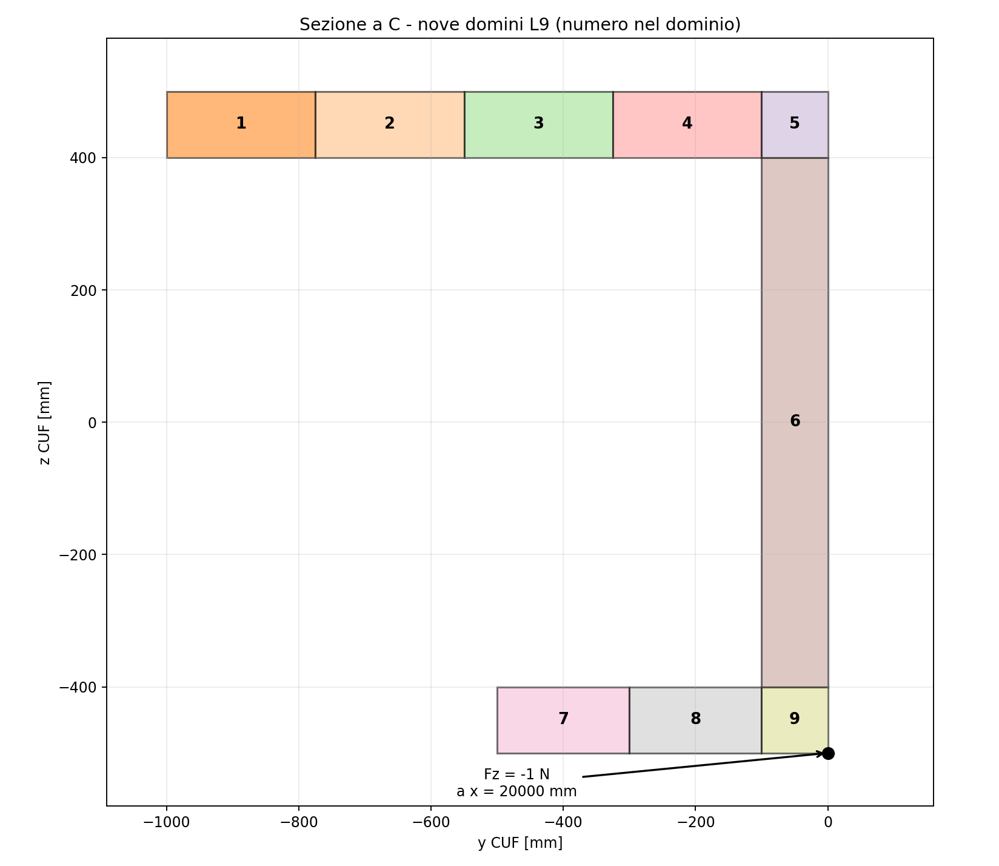

# Analisi di una mensola a sezione C mediante CSF–CUF e FEM tridimensionale

**Rapporto tecnico - descrizione del problema fisico, dei modelli e del confronto numerico**  
**Autore:** Giovanni Boscu  
**Data:** 16 ottobre 2026  


## 1. I tre modelli: che cosa sono e come si collegano

La domanda preliminare è: **che cosa rappresentano CSF, CSF–CUF il l'uso del FEM3D, e quale relazione esiste tra loro?** 


### 1.1 La distinzione fondamentale

| Oggetto | Che cosa rappresenta | Che cosa riceve | Che cosa produce | Che cosa NON è |
|---|---|---|---|---|
| **CSF - Continuous Section Field** | Il **modello fisico della sezione** lungo l'asse: domini geometrici, coordinate e proprietà materiali | Descrizione della geometria, lunghezza, stazioni e materiali | Modello autonomo per la descrizione continua di geometria e materiali lungo l'asse longitudinale. Utilizzabile come generatore di geometrie e materiali, per il calcolo delle proprietà sezionali classiche e l'integrazione con sectionproperties. Accessibile tramite interfaccia grafica, CLI e libreria Python.| Non risolve l'equilibrio elastico e non è una discretizzazione FEM solida |
| **CSF–CUF** | Il **modello strutturale** che utilizza la formulazione CUF e interroga CSF per geometria e materiali | CSF + funzioni trasversali CUF + elementi longitudinali + carichi e vincoli | Sistema generale non vincolato a specifiche geometrie e cinematiche, assemblaggio della matrice di rigidezza e del vettore dei carichi, soluzione delle incognite generalizzate CUF, ricostruzione del campo tridimensionale degli spostamenti, delle deformazioni e delle tensioni. | Non è una seconda teoria costitutiva, né un FEM3D costruito per sezioni solide |
| **FEM3D** | Modello tridimensionale indipendente di riferimento | Geometria, materiali, carichi, vincoli e mesh volumetrica | Spostamenti, deformazioni e tensioni | Riferimento per la validazione numerica di CSF–CUF |


Il nome **CSF–CUF** indica quindi un *accoppiamento*: **CSF descrive il dominio fisico** e **CUF definisce l'approssimazione degli spostamenti e le equazioni di equilibrio**. FEM3D rappresenta, in questo documento, una **seconda soluzione numerica dello stesso problema fisico**, ottenuta mediante incognite e discretizzazione differenti rispetto a CSF–CUF.

### 1.2 Schema logico dell'esperimento

                      PROBLEMA FISICO COMUNE
                   geometria, materiali,
                       carichi e vincoli
                              |
                              v
                     MODELLO FISICO CSF
                    geometria e materiali
                     continui lungo l'asse
                              |
               +--------------+--------------+
               |                             |
               v                             v
      MODELLO STRUTTURALE                MODELLO FEM3D
           CSF–CUF                     mesh volumetrica H8
      - espansione L9                  - elementi solidi
      - elementi lungo x               - discretizzazione 3D
      - integrazioni numeriche         - assemblaggio/equilibrio
      - assemblaggio/equilibrio              |
               |                             |
               v                             v
      spostamenti u(x,y,z)             spostamenti u(x,y,z)
      e tensioni CSF–CUF               e tensioni FEM3D
               |                             |
               +-------------+---------------+
                             |
                             v
                     CONFRONTO NUMERICO
                stessi punti e componenti fisiche


**CSF alimenta entrambi i solutori**, CSF–CUF e FEM3D, fornendo una descrizione fisica comune e continua della geometria e dei materiali. I due solutori mantengono formulazioni strutturali e discretizzazioni numeriche indipendenti.

### 1.3 CSF: un modello fisico, non una soluzione

CSF è il **livello di rappresentazione della realtà fisica**. A una stazione longitudinale richiesta, restituisce il dominio della sezione, la sua geometria e le proprietà dei materiali. non sceglie la cinematica, non costruisce da solo una matrice di rigidezza e non risolve il problema di equilibrio.


```
      MODELLO CSF (descrizione fisica)
      ┌──────────────────────────────────────┐
      │ Stazioni lungo l'asse                │
      │  └─ domini della sezione             │
      │      ├─ vertici e contorni           │
      │      ├─ materiali                    │
      │      └─ variazioni longitudinali     │
      └──────────────────┬───────────────────┘
                         │ interrogazioni
                         ▼
            Geometria e materiali locali
            disponibili al modello CUF
```

In questo caso CSF descrive una sezione prismatica a C suddivisa in nove quadrilateri fisici. **I quadrilateri non sono elementi solidi FEM3D**: costituiscono il supporto geometrico e materiale su cui CSF–CUF valuta la base L9 e gli integrali sezionali. La suddivisione in nove domini risponde alla particolare rappresentazione trasversale selezionata per questo benchmark; CSF, in sé, non impone L9.


### 1.4 CSF–CUF: come viene utilizzata l'infrastruttura CSF nella CUF

La configurazione di un'analisi CSF–CUF è organizzata in tre file YAML distinti, che separano la descrizione fisica, la definizione del problema strutturale e le scelte di discretizzazione e soluzione numerica.

| File YAML | Funzione |
|---|---|
| **`model`** | Definisce il modello fisico CSF: geometria, stazioni longitudinali e proprietà dei materiali. |
| **`problem`** | Definisce il problema strutturale, inclusi carichi e condizioni al contorno. |
| **`case`** | Collega modello e problema, seleziona le espansioni trasversali, la discretizzazione longitudinale e i parametri di integrazione e soluzione. |

Questa organizzazione permette di combinare differenti modelli fisici, problemi strutturali e approssimazioni numeriche senza modificare il nucleo della formulazione CUF.


Nel caso numerico esaminato, i tre file di configurazione sono:

| Configurazione | File YAML | Riferimento |
|---|---|---|
| **Model** | `c_section_chapter9_5_3_9L9_`<br>`csf.yaml` | Appendice A |
| **Problem** | `c_section_cantilever_`<br>`point_9L9.yaml` | Appendice B |
| **Case** | `c_section_table_9_13_`<br>`lagrangeL9_v4_E10.yaml` | Appendice C |

I tre file sono riportati integralmente nelle rispettive appendici e descritti nelle sezioni successive.


La **formulazione strutturale rimane CUF**. La specificità dell'implementazione CSF–CUF è l'organizzazione del calcolo: geometria/materiale, espansione trasversale e discretizzazione longitudinale sono definiti in componenti distinti e collegati durante l'assemblaggio. La descrizione continua della sezione fornita da CSF entra direttamente nella rappresentazione dei nuclei sezionali CUF, senza richiedere la derivazione di espressioni specializzate per la specifica geometria, come nel caso della sezione a C.


>Le espansioni trasversali CUF e le funzioni di forma longitudinali sono implementate come componenti Python indipendenti dalla descrizione fisica della sezione. Le rispettive funzioni e derivate vengono definite una sola volta e possono essere riutilizzate in differenti modelli geometrici e materiali, senza modificare la formulazione generale né il nucleo di assemblaggio CUF.


```
  CSF: geometria + materiali        MODULO CUF: espansione trasversale
  ┌────────────────────────┐        ┌───────────────────────────────┐
  │ 9 domini quadrilateri  │        │ L9: funzioni e derivate       │
  │ coordinate e materiale │        │ connettività shared_points    │
  └───────────┬────────────┘        └───────────────┬───────────────┘
              │                                     │
              └─────────────────┬───────────────────┘
                                ▼
                   VALUTAZIONE SEZIONALE
                   ┌───────────────────────────────┐
                   │ Punti di quadratura fisici    │
                   │ mappe e jacobiani             │
                   │ funzioni/derivate L9          │
                   │ proprietà elastiche locali    │
                   │ nuclei/contributi CUF         │
                   └───────────────┬───────────────┘
                                   │
        ELEMENTI LONGITUDINALI     │
        ┌────────────────────────┐ │
        │ E10, ordine 12         ├─┤
        │ quadratura lungo x     │ │
        └────────────────────────┘ ▼
                       ASSEMBLAGGIO CUF
                   ┌───────────────────────────────┐
                   │ rigidezza + carichi + vincoli │
                   │ soluzione incognite CUF       │
                   └───────────────┬───────────────┘
                                   ▼
                         POSTPROCESSING
                    spostamenti e tensioni
                    ricostruiti nello spazio

```
L'ordine operativo è il seguente:

1. Il caso CUF seleziona un **modello CSF** e un **problema** (carichi e vincoli).
2. Il plugin trasversale esterno seleziona la famiglia **L9**, senza contenere le dimensioni della C.
3. Il calcolo sezionale interroga CSF ai punti d'integrazione e valuta le funzioni L9 sui domini ottenuti.
4. I contributi sezionali vengono combinati con gli elementi longitudinali; si assemblano e si risolvono le equazioni CUF.
5. Gli spostamenti sono ricostruiti dal campo delle incognite generalizzate CUF; le deformazioni e le tensioni sono successivamente calcolate mediante le relazioni cinematiche e costitutive, per il confronto con il modello volumetrico FEM3D.

**Separazione delle responsabilità:** CSF dice *dove è il materiale e quali proprietà ha*; l'espansione CUF dice *come viene rappresentato il campo trasversale*; l'elemento longitudinale dice *come varia lungo la trave*; il motore CUF applica *equilibrio, assemblaggio e soluzione*. 


Per consentire l'impiego diretto della descrizione continua della sezione fornita da CSF, è stata introdotta una dipendenza esplicita dei nuclei sezionali dalla coordinata longitudinale. L'impiego  della descrizione continua mantiene invariati la cinematica, il principio dei lavori virtuali e la struttura generale della formulazione CUF originaria.


Per una trattazione formale si rimanda al documento [CSF–CUF: Formulation for Directly Prescribed Variable Sections](https://github.com/giovanniboscu/continuous-section-field/blob/main/docs/model/csf_cuf_formal_variable_section_extension.md).

### 1.5 FEM3D: stesso problema, soluzione strutturale indipendente

FEM3D è un **secondo modello di soluzione**, costruito con elementi solidi tridimensionali H8 in OpenSees, nel quale gli spostamenti nodali costituiscono le incognite della discretizzazione volumetrica.


```text
       STESSO PROBLEMA FISICO
                 │
                 ▼
       SEZIONE C COME CONTORNO
       poligono unico a 8 vertici
                 │
                 ▼
       MESH VOLUMETRICA H8
       (discretizzazione di tutto il volume)
                 │
                 ▼
       OpenSees: assemblaggio e soluzione
                 │
                 ▼
       Spostamenti nodali 3D
       + tensioni derivate negli elementi
                 │
                 ▼
       CONFRONTO CON CSF–CUF
```

Il contorno unico a otto vertici è usato **solo per comodità di generazione della mesh FEM3D**; descrive la stessa sezione a C che CSF–CUF suddivide in nove domini. Il confronto è indipendente rispetto alla discretizzazione degli spostamenti, non rispetto al problema fisico condiviso. 

### 1.6 Che cosa viene verificato in questo benchmark

Questo caso mette alla prova **due questioni distinte**:

- **Architettura del modello:** è possibile applicare la medesima espansione CUF L9 a una geometria costruita esternamente in CSF, senza derivare e programmare nuclei sezionali specifici per la sezione a C.
- **Accuratezza della soluzione:** con quella particolare espansione L9, la discretizzazione longitudinale scelta e le quadrature impiegate, quali differenze si ottengono rispetto a un riferimento FEM3D solido.


### 1.7 Stato delle evidenze disponibili

Le configurazioni permettono di documentare problema fisico, CSF, L9, discretizzazione longitudinale e impostazioni del riferimento solido. 

**La geometria fisica della sezione a C è la medesima nei due modelli.** Per CSF–CUF è suddivisa in nove domini quadrilateri su cui opera l’espansione L9; per agevolare la costruzione della mesh solida in OpenSees, il modello FEM3D usa invece un unico poligono di contorno a otto vertici. Le due descrizioni geometriche hanno finalità numeriche differenti e non rappresentano due problemi strutturali diversi.

## 2. Problema strutturale

### 2.1 Geometria e sistema di riferimento

La trave è prismatica, con asse longitudinale identificato dalla coordinata fisica **x** del modello CUF/FEM3D, nell'intervallo `0 ≤ x ≤ 20000 mm`. Il piano della sezione usa le coordinate fisiche **(y,z)**. Nel file CSF, per motivi legati all'interfaccia della libreria, la stazione longitudinale è indicata anch'essa come `z` del campo: questa **non** va confusa con la coordinata fisica trasversale `z`.

| Grandezza | Valore |
|---|---:|
| Lunghezza della mensola, L | 20.000 mm |
| Altezza complessiva, h | 1.000 mm |
| Spessore, t | 100 mm |
| Ala superiore, b₂ | 1.000 mm |
| Ala inferiore, b₁ | 500 mm |
| Sezione iniziale/finale | identiche (trave prismatica) |

Nel piano `(y,z)` la sezione ha l'anima a destra e l'apertura rivolta verso sinistra. I limiti sono: ala superiore `−1000 ≤ y ≤ 0`, `400 ≤ z ≤ 500`; anima `−100 ≤ y ≤ 0`, `−400 ≤ z ≤ 400`; ala inferiore `−500 ≤ y ≤ 0`, `−500 ≤ z ≤ −400`. L'unione dei tre rettangoli è senza sovrapposizioni di area.

Una rappresentazione  è:




*Figura 1 - Contorno fisico e partizione sezionale nei nove domini CSF usati dall'espansione L9. Figura ricostruita direttamente dalle coordinate YAML riportate in questo documento, non riproduzione della figura del paper.*


Le divisioni interne dei nove domini sono specificate al §3.2. Nel lavoro di riferimento la topologia 9-L9 è mostrata graficamente, **senza tabella delle coordinate dei tagli interni**: le suddivisioni riportate qui sono una ricostruzione geometrica e non numeri attribuiti agli autori.

### 2.2 Materiale

Si adotta elasticità lineare isotropa, con `E = 75000 MPa` e `ν = 0.33`. Il modulo di taglio corrispondente è circa **28.195,49 MPa**.

Le unità sono coerentemente **mm, N, MPa**. Nel file CSF il valore `weight: 75000.0` compare in ciascun poligono e l'indicazione `shear_weight_laws: ['iso(0.33)']` specifica la legge isotropa con il coefficiente di Poisson adottato. Questi parametri sono interpretati dal collegamento CSF–CUF per il materiale di questo esperimento; `weight` non è una densità volumica.

### 2.3 Vincolo e forza

La sezione iniziale `x = 0` è completamente incastrata. Nel modello solido il vincolo è tradotto in `u_x = u_y = u_z = 0` per tutti i nodi appartenenti alla sezione iniziale; nel modello CUF esso agisce sui gradi di libertà generalizzati coerenti con l'annullamento del campo degli spostamenti alla sezione d'incastro.

Il carico dichiarato dal problema è una **forza concentrata di ampiezza −1 N in direzione globale z**, applicata in `(x,y,z) = (20000,0,−500) mm`. L'azione è dunque localizzata all'estremità libera, in corrispondenza di un punto della sezione. La rappresentazione di una forza puntuale può produrre campi di tensione fortemente localizzati e dipendenti dalla discretizzazione in prossimità del punto di applicazione. In tali zone il confronto diretto di massimi puntuali di tensione va trattato con cautela.

## 3. Modello CSF: descrizione fisica indipendente dall'espansione

### 3.1 Funzione del Continuous Section Field

CSF descrive, stazione per stazione lungo la trave, **domini fisici** di sezione, vertici e caratteristiche materiali. Nell'esempio corrente le sezioni alle estremità `S0` e `S1` sono uguali; quindi non vi è variazione geometrica lungo l'asse. Il fatto di usare CSF per una trave prismatica è intenzionale: permette di testare l'accoppiamento con CUF evitando di aggiungere la complessità di una geometria rastremata.

CSF **non sostituisce** la teoria CUF, **non** rappresenta un modello FEM3D e **non** determina da solo le incognite dello spostamento. Fornisce il supporto geometrico/materiale sul quale un'espansione trasversale può essere valutata e integrata.

### 3.2 Nove domini quadrilateri

| Dominio CSF | Intervallo y (mm) | Intervallo z (mm) | Regione |
|---|---|---|---|
| `top_1` | −1000 … −775 | 400 … 500 | ala superiore |
| `top_2` | −775 … −550 | 400 … 500 | ala superiore |
| `top_3` | −550 … −325 | 400 … 500 | ala superiore |
| `top_4` | −325 … −100 | 400 … 500 | ala superiore |
| `top_web_corner` | −100 … 0 | 400 … 500 | raccordo superiore |
| `web` | −100 … 0 | −400 … 400 | anima |
| `bottom_1` | −500 … −300 | −500 … −400 | ala inferiore |
| `bottom_2` | −300 … −100 | −500 … −400 | ala inferiore |
| `bottom_web_corner` | −100 … 0 | −500 … −400 | raccordo inferiore |

La porzione libera dell'ala superiore, larga 900 mm, è ripartita in quattro segmenti da 225 mm; quella inferiore, larga 400 mm, in due segmenti da 200 mm. Le due zone di giunzione con l'anima occupano ciascuna 100 mm in direzione y. Ogni poligono è definito tramite vertici ordinati lungo il contorno e appare con la stessa identità in `S0` e `S1`.

### 3.3 Significato dell'indipendenza geometria–approssimazione

La descrizione della forma, delle dimensioni e del materiale resta nel campo CSF. La base trasversale si occupa invece di rappresentare gli spostamenti sul dominio dato. È questa separazione, più che il particolare caso della sezione C, il contenuto infrastrutturale dell'esperimento: una base L9 può essere selezionata esternamente al nucleo di assemblaggio senza codificare nella formulazione globale le dimensioni della C.

## 4. Modello CUF e sua discretizzazione

### 4.1 Organizzazione delle incognite CUF

Il campo tridimensionale è rappresentato tramite **funzioni trasversali** e **gradi di libertà generalizzati che evolvono lungo l'asse**. In questo caso non viene costruita una mesh di elementi solidi per determinare le incognite CUF.

```text
 Funzioni L9 sulla sezione      Elementi finiti lungo l'asse
           │                              │
           └──────────────┬───────────────┘
                          ▼
                Incognite generalizzate
                   del modello CUF
                          │
                          ▼
                Campo di spostamento 3D
                          │
                          ▼
                  Deformazioni / tensioni
```

L'approccio è quello standard CUF: la particolarità del lavoro è **da dove provengono geometria e proprietà sezionali**, non l'introduzione di nuove incognite o nuove leggi di equilibrio.

.

### 4.2 Espansione trasversale L9

Ogni quadrilatero fisico CSF viene associato a un dominio parametrico e riceve un'espansione **L9 con nove punti di interpolazione**, disposti su una griglia 3 × 3. Le funzioni e le loro derivate sono fornite dal modulo trasversale, mentre geometria e materiale provengono da CSF.

```text
 Dominio CSF quadrilatero        Interpolazione trasversale L9
 ┌──────────────────────┐          o────────o────────o
 │                      │          │        │        │
 │ geometria e materiale│  ───►    o────────o────────o
 │                      │          │        │        │
 └──────────────────────┘          o────────o────────o
                                 9 punti per dominio
```

I punti geometricamente coincidenti sui bordi dei domini adiacenti sono condivisi dalla connettività trasversale; quindi il numero globale di incognite **non** si ottiene moltiplicando semplicemente nove per nove. La base L9, in quanto modulo separato, non contiene valori codificati delle dimensioni della sezione C.

>L'espansione trasversale deve essere implementata in un modulo Python conforme a un'interfaccia prestabilita, che ne definisce le modalità di valutazione delle funzioni e delle relative derivate. Questa organizzazione consente di utilizzare la stessa espansione con differenti geometrie e distribuzioni materiali, indipendentemente dal modello fisico CSF.

Nella presente implementazione, il modulo L9 richiede che la sezione sia suddivisa in domini quadrilateri compatibili con la trasformazione isoparametrica adottata. Tale requisito è specifico dell'espansione trasversale utilizzata e non costituisce una limitazione generale della rappresentazione geometrica CSF o della formulazione CUF.

### 4.3 Dall'integrazione sezionale alla soluzione

Il motore utilizza i contributi ottenuti sui punti di quadratura della sezione per assemblare il problema CUF, assieme alle informazioni degli elementi longitudinali. Dopo la soluzione, tensioni e deformazioni sono ricavate dal campo di spostamento ricostruito e dalla legge elastica del materiale.

```text
 coordinate fisiche + materiale (CSF)
                  +
 funzioni, derivate e connettività (L9)
                  │
                  ▼
           QUADRATURA SEZIONALE
       valutazione numerica dei nuclei CUF
                  │
                  + elementi lungo l'asse
                  │
                  ▼
       ASSEMBLAGGIO + VINCOLI + CARICHI
                  │
                  ▼
          SOLUZIONE DEL MODELLO CUF
                  │
                  ▼
     CAMPI 3D RICOSTRUITI E TENSIONI
```

Il beneficio architetturale è evitare espressioni integrate o routine sezionali **specifiche per ogni nuova geometria**, mantenendo invariata la formulazione CUF. Le impostazioni MITC sono riportate nel file di caso, senza attribuire loro effetti numerici non verificati.

### 4.4 Discretizzazione longitudinale e integrazione del caso E10

Il file di caso seleziona dieci intervalli con confini longitudinali normalizzati:

`[0.0, 0.1, 0.2, 0.3, 0.4, 0.5, 0.6, 0.7, 0.8, 0.9, 1.0]`.

I confini corrispondono a `x = 0,2000,…,20000 mm`. Per ciascun elemento è dichiarata una base di Lagrange di **ordine 12** e una quadratura longitudinale di **ordine 15**. L'integrazione sezionale è `fixed_gauss_polygon` con `gauss_order: 9`. Il modello è prismatico e il materiale non presenta variazione polinomiale lungo l'asse (`material_polynomial_degree: 0`).


In questo caso viene utilizzata una funzione di forma longitudinale di Lagrange già disponibile nella libreria Python. Come per le espansioni trasversali, è comunque possibile sviluppare nuove funzioni di forma in Python, purché rispettino l'interfaccia e le regole di implementazione previste dal modello CSF–CUF. Le funzioni così definite rimangono indipendenti dal modello fisico e sono riutilizzabili con differenti geometrie e materiali.


### 4.5 Scelte operative del caso

L'espansione esterna è caricata da `lagrangeL9_v4.py`; la selezione dei domini avviene con `domain_source: csf_polygons`; la mappa è `isoparametric`; la connettività è `shared_points`; la tolleranza geometrica dichiarata è `1.0e-10`; `require_prismatic: true` impedisce l'uso inconsapevole con un caso non prismatico. Sono attivi i controlli/correzioni `correctionMITC: true` e `verifyMITCAssembly: true`, con iterazioni di equilibratura richieste `[1,2,3,4,5]`. Non si attribuisce qui a queste opzioni un effetto numerico specifico non verificato mediante i risultati del solutore.

Le stazioni di campionamento del file sono `[0.0,0.1,1.0]`, interpretate nel contesto dell'interfaccia come parametri longitudinali da verificare con il postprocessore; `displacement_samples: 201` e `stress_grid: 41` regolano il campionamento di uscita. Una griglia più densa di visualizzazione **non** equivale a una discretizzazione CUF più fine.

## 5. Riferimento FEM3D

### 5.1 Che cosa significa FEM3D in questo studio

**Sì: FEM3D indica un modello tridimensionale con elementi solidi.** Lo script di riferimento consultato impiega il solutore OpenSees con elementi esaedrici a **otto nodi** `stdBrick` (H8). Si tratta di una discretizzazione volumetrica fisica della sezione e dell'asse, diversa dal modello CUF a espansione trasversale e approssimazione unidimensionale lungo la trave.

Il driver dichiara, come impostazioni di default, `nx=80` ripartizioni longitudinali, `ny_top_free=18`, `ny_bottom_free=8`, `ny_web=2`, `nz_flange=2`, `nz_web=16`. Si tratta delle **impostazioni predefinite nello script**, non di una certificazione dei parametri usati per uno specifico file di risultati: eventuali override da linea di comando devono essere recuperati dall'esecuzione originale. Il carico e il vincolo sono letti attraverso l'adattatore del problema CSF–CUF, e non reinseriti indipendentemente nello script, per limitare incoerenze.

### 5.2 Confronto delle tensioni

Per il confronto delle tensioni, la documentazione del benchmark indica che le tensioni FEM3D sono ricavate dalle **derivate del campo di spostamento del singolo elemento H8**, con le proprietà costitutive dichiarate. Ai confini di elementi adiacenti sono conservati i valori dei due lati **senza media o smoothing**. Perciò possono esistere più valori di tensione alla stessa stazione longitudinale. Nel modello CUF le tensioni sono analogamente ricavate dalla deformazione del campo di spostamento approssimato e dalla legge costitutiva, senza media rispetto al FEM3D.

L'osservazione qualitativa riportata nella documentazione disponibile è che la componente `τ_xy` del modello CSF–CUF segue spesso l'andamento centrale della dispersione FEM3D, soprattutto lontano dalle estremità. Ciò **non** significa che CUF calcoli una media delle tensioni FEM3D, né sostituisce un'analisi quantitativa degli scarti.

### 5.3 Stessa sezione fisica, due rappresentazioni geometriche

**La sezione a C del modello FEM3D è la stessa sezione fisica utilizzata in CSF–CUF.** Cambia soltanto il modo di rappresentarla per le esigenze delle due discretizzazioni:

- **CSF–CUF:** il dominio della sezione è ripartito in **nove quadrilateri**, che costituiscono i domini di supporto dell'espansione trasversale L9 e dell'integrazione numerica sezionale.
- **FEM3D in OpenSees:** la sezione a C è descritta, **per comodità di generazione della mesh volumetrica**, mediante **un unico poligono di contorno a otto vertici**. Su tale dominio si costruisce la discretizzazione con elementi solidi H8.

Non c'è dunque un'incongruenza tra i modelli e non è necessario che il driver FEM3D accetti lo YAML a nove quadrilateri: i **domini L9 non sono la mesh FEM3D**. I nove quadrilateri e il poligono unico sono rappresentazioni diverse dello stesso dominio materiale. Questa equivalenza geometrica deve essere mantenuta in tutte le dimensioni, nelle proprietà materiali e nella posizione fisica di carichi e vincoli.

La riproducibilità dei risultati richiede comunque di dichiarare, per ciascuna esecuzione, il file geometrico effettivamente usato, le opzioni della mesh e il file di output, senza confondere tale tracciabilità con un dubbio sull'identità della sezione.

## 6. Criteri per un confronto scientificamente significativo

Il confronto non deve essere ridotto al solo confronto grafico. Per ogni posizione o traiettoria campionata occorre dichiarare: punto fisico e sistema di coordinate, componente di spostamento/tensione, eventuale media impiegata, campionamento FEM3D (nodo, centro elemento o punto di integrazione), dato CUF, riferimento pubblicato se esistente e definizione dell'errore.

Per il confronto si distinguono **scarto assoluto**, **scarto percentuale** (quando il riferimento non è prossimo allo zero) e differenze tra curve campionate. La scelta del denominatore e dei punti confrontati deve essere dichiarata.

Vicino a valori di riferimento quasi nulli è preferibile riportare un errore assoluto o una normalizzazione globale appropriata, per evitare percentuali artificialmente elevate. Per le tensioni occorre distinguere **regioni interne regolari**, **bordo dell'incastro**, **estremità libera** e **intorno del carico puntuale**. Un picco vicino a una forza idealmente concentrata non è un indicatore affidabile, da solo, della convergenza del campo tensionale.


### 6.1 Presentazione dei risultati 

I risultati del confronto CSF–CUF/FEM3D sono presentati mediante rappresentazioni grafiche degli spostamenti, delle deformazioni e delle tensioni, valutati in corrispondenza dei vertici di ciascun poligono della sezione CSF. Il campionamento comprende quindi numerosi punti distribuiti sull'intera sezione, mantenendo per entrambi i modelli le medesime posizioni fisiche e convenzioni di riferimento.

Le rappresentazioni consentono di esaminare la corrispondenza tra le due soluzioni, evidenziando sia l'andamento complessivo dei campi sia le eventuali differenze locali.

**Il modello CSF–CUF registra inoltre la soluzione come funzione continua dello spazio**, interrogabile per la valutazione puntuale degli spostamenti, delle deformazioni e delle tensioni in qualsiasi posizione del dominio fisico. Questa caratteristica consente verifiche numeriche mirate e confronti con FEM3D indipendentemente dalle griglie utilizzate per la rappresentazione grafica.

I risultati sono organizzati per componente fisica e posizione di campionamento, distinguendo gli spostamenti dalle grandezze derivate.


## 7. Conclusioni

L'esperimento distingue tre oggetti: (i) **il problema fisico** della mensola a sezione C; (ii) **la sua soluzione CUF**, in cui una espansione L9 opera su nove domini di sezione forniti da CSF; (iii) **un riferimento FEM3D** volumetrico basato su elementi solidi H8 in OpenSees. CSF è il livello di descrizione della geometria e del materiale e di valutazione sezionale, non un'alternativa alla formulazione strutturale CUF.

Il contributo che questo caso mette alla prova è la **separazione fra geometria/materiale, espansione trasversale e discretizzazione longitudinale**, con valutazione numerica dei contributi sezionali. 

# Selezione dei diagrammi CSF–CUF / FEM3D per il rapporto tecnico

**Caso:** `c_section_table_9_13_lagrangeL9_v4_E10_eq1`  
**Fonte:** [Galleria originale dei 75 grafici](https://github.com/giovanniboscu/continuous-section-field/blob/main/cuf/c-shape/strain_stress_boundary/README.md)

## Scopo della selezione

Presentare un confronto leggibile tra CSF–CUF e FEM3D lungo la trave, sui punti campionati ai vertici dei poligoni CSF, senza riprodurre indiscriminatamente l'intera galleria.

La galleria organizza i grafici per componente e in cinque parti (`part01`–`part05`). La selezione sotto, con **immagini incorporate**, è una **proposta editoriale**, fondata sull'inventario verificato dei file; non implica ancora una valutazione quantitativa delle sovrapposizioni o degli scarti delle curve. Prima dell'impaginazione definitiva occorre verificare, in ogni figura, quali vertici siano effettivamente contenuti in ciascuna parte.


**10 diagrammi**

### 1. Spostamento trasversale `u_z`

Componente direttamente connessa alla direzione del carico; primo confronto del campo di spostamento.


[Apri il PNG originale](https://raw.githubusercontent.com/giovanniboscu/continuous-section-field/main/cuf/c-shape/strain_stress_boundary/c_section_table_9_13_lagrangeL9_v4_E10_eq1/uz_along_boundary_part01.png)

### 2. Spostamento trasversale `u_z`

Estensione del confronto a un altro gruppo di vertici.


[Apri il PNG originale](https://raw.githubusercontent.com/giovanniboscu/continuous-section-field/main/cuf/c-shape/strain_stress_boundary/c_section_table_9_13_lagrangeL9_v4_E10_eq1/uz_along_boundary_part03.png)

### 3. Spostamento trasversale `u_z`

Ulteriore gruppo di vertici: verifica della rappresentatività della sezione.


[Apri il PNG originale](https://raw.githubusercontent.com/giovanniboscu/continuous-section-field/main/cuf/c-shape/strain_stress_boundary/c_section_table_9_13_lagrangeL9_v4_E10_eq1/uz_along_boundary_part05.png)

### 4. Spostamento longitudinale `u_x`

Mostrare anche la componente assiale, distinta dalla flessione trasversale.


[Apri il PNG originale](https://raw.githubusercontent.com/giovanniboscu/continuous-section-field/main/cuf/c-shape/strain_stress_boundary/c_section_table_9_13_lagrangeL9_v4_E10_eq1/ux_along_boundary_part03.png)

### 5. Spostamento `u_y`

Completare il controllo delle tre componenti cinematiche.


[Apri il PNG originale](https://raw.githubusercontent.com/giovanniboscu/continuous-section-field/main/cuf/c-shape/strain_stress_boundary/c_section_table_9_13_lagrangeL9_v4_E10_eq1/uy_along_boundary_part03.png)

### 6. Tensione normale `σ_xx`

Avviare il confronto delle tensioni normali longitudinali.


[Apri il PNG originale](https://raw.githubusercontent.com/giovanniboscu/continuous-section-field/main/cuf/c-shape/strain_stress_boundary/c_section_table_9_13_lagrangeL9_v4_E10_eq1/sigma_xx_along_boundary_part01.png)

### 7. Tensione normale `σ_xx`

Estendere il confronto a un secondo gruppo di vertici.


[Apri il PNG originale](https://raw.githubusercontent.com/giovanniboscu/continuous-section-field/main/cuf/c-shape/strain_stress_boundary/c_section_table_9_13_lagrangeL9_v4_E10_eq1/sigma_xx_along_boundary_part03.png)

### 8. Taglio `τ_xz`

Considerare la componente tangenziale associata al piano longitudinale–trasversale del carico.


[Apri il PNG originale](https://raw.githubusercontent.com/giovanniboscu/continuous-section-field/main/cuf/c-shape/strain_stress_boundary/c_section_table_9_13_lagrangeL9_v4_E10_eq1/tau_xz_along_boundary_part03.png)

### 9. Taglio `τ_xy`

Affiancare l'altra componente di taglio longitudinale, utile per evidenziare la risposta tridimensionale.


[Apri il PNG originale](https://raw.githubusercontent.com/giovanniboscu/continuous-section-field/main/cuf/c-shape/strain_stress_boundary/c_section_table_9_13_lagrangeL9_v4_E10_eq1/tau_xy_along_boundary_part03.png)

### 10. Deformazione `ε_xx`

Controllo cinematico derivato, da confrontare qualitativamente con `σ_xx`.


[Apri il PNG originale](https://raw.githubusercontent.com/giovanniboscu/continuous-section-field/main/cuf/c-shape/strain_stress_boundary/c_section_table_9_13_lagrangeL9_v4_E10_eq1/epsilon_xx_along_boundary_part03.png)


### Taglio τ_xz 


[Apri il PNG originale](https://raw.githubusercontent.com/giovanniboscu/continuous-section-field/main/cuf/c-shape/strain_stress_boundary/c_section_table_9_13_lagrangeL9_v4_E10_eq1/tau_xz_along_boundary_part05.png)

### Tensione normale σ_zz


[Apri il PNG originale](https://raw.githubusercontent.com/giovanniboscu/continuous-section-field/main/cuf/c-shape/strain_stress_boundary/c_section_table_9_13_lagrangeL9_v4_E10_eq1/sigma_zz_along_boundary_part03.png)

### Deformazione γ_xz


[Apri il PNG originale](https://raw.githubusercontent.com/giovanniboscu/continuous-section-field/main/cuf/c-shape/strain_stress_boundary/c_section_table_9_13_lagrangeL9_v4_E10_eq1/gamma_xz_along_boundary_part03.png)

## Organizzazione proposta nel §6.1

1. **Spostamenti:** `u_z` su più gruppi di vertici, poi `u_x` e `u_y`.
2. **Tensioni:** `σ_xx`, `τ_xz` e `τ_xy`, con un testo che descriva le differenze effettivamente osservabili.
3. **Deformazioni:** almeno `ε_xx`, eventualmente `γ_xz` se il confronto aggiunge informazione.

I grafici rimanenti possono restare accessibili attraverso il README originale, evitando di sovraccaricare il rapporto principale.


# Appendice A - Configurazione completa del modello CSF

Questo file è il modello fisico `c_section_chapter9_5_3_9L9_csf.yaml`. I commenti originali sono conservati. Le coordinate delle sezioni `S0` e `S1` definiscono due rappresentazioni identiche della stessa sezione, quindi la geometria è prismatica. La ripetizione completa è intenzionale: il lettore può verificare le nove corrispondenze senza dipendere da file esterni.

```yaml
# CSF model for the Carrera-Petrolo C-section benchmark.
# Transverse partition reproduces the 9-L9 layout shown in Fig. 13(b).
#
# Version: v1 - 2026-10-10
#
# Changelog:
# - Preserved the original C-section geometry and material.
# - Replaced the single C-shaped polygon with 9 non-overlapping quadrilateral
#   CSF polygons arranged as the 9 transverse L9 domains of Fig. 13(b).
# - The internal flange split coordinates are reconstructed from the figure by
#   equally subdividing the free flange portions:
#       top free flange:    900 mm / 4 = 225 mm
#       bottom free flange: 400 mm / 2 = 200 mm
#   The 100 mm web-width corner domains are kept as separate polygons.
#
# Units: mm, N, MPa.
#
# Geometry:
#   h = 1000 mm
#   t = 100 mm
#   long flange b2 = 1000 mm
#   short flange b1 = 500 mm
#   L = 20000 mm
#
# Material:
#   E  = 75 GPa = 75000 MPa
#   nu = 0.33
#
# Coordinate mapping:
#   paper y (beam axis) -> CSF section station z
#   paper x             -> CSF section y
#   paper z             -> CSF section z-coordinate inside each polygon
#
# Section orientation:
#   paper/section x positive to the right
#   paper/section z positive upward
#   web on the right
#   opening toward the left
#   long flange on top
#
# 9-L9 transverse partition (CSF y coordinates):
#   top flange:    [-1000,-775], [-775,-550], [-550,-325], [-325,-100], [-100,0]
#   web:           [-100,0] x z[-400,400]
#   bottom flange: [-500,-300], [-300,-100], [-100,0]
#
# NOTE:
# The paper shows the 9-L9 topology graphically but does not tabulate the
# internal split coordinates. The equal subdivisions above are therefore a
# geometric reconstruction of Fig. 13(b), not quoted numerical data.
CSF:
  sections:
    S0:
      z: 0.0
      polygons:
        # --- Top flange: 5 transverse domains ---
        - name: top_1
          weight: 75000.0
          vertices:
            - [-1000.0, 400.0]
            - [-775.0,  400.0]
            - [-775.0,  500.0]
            - [-1000.0, 500.0]

        - name: top_2
          weight: 75000.0
          vertices:
            - [-775.0, 400.0]
            - [-550.0, 400.0]
            - [-550.0, 500.0]
            - [-775.0, 500.0]

        - name: top_3
          weight: 75000.0
          vertices:
            - [-550.0, 400.0]
            - [-325.0, 400.0]
            - [-325.0, 500.0]
            - [-550.0, 500.0]

        - name: top_4
          weight: 75000.0
          vertices:
            - [-325.0, 400.0]
            - [-100.0, 400.0]
            - [-100.0, 500.0]
            - [-325.0, 500.0]

        - name: top_web_corner
          weight: 75000.0
          vertices:
            - [-100.0, 400.0]
            - [0.0,    400.0]
            - [0.0,    500.0]
            - [-100.0, 500.0]

        # --- Web: 1 transverse domain ---
        - name: web
          weight: 75000.0
          vertices:
            - [-100.0, -400.0]
            - [0.0,    -400.0]
            - [0.0,     400.0]
            - [-100.0,  400.0]

        # --- Bottom flange: 3 transverse domains ---
        - name: bottom_1
          weight: 75000.0
          vertices:
            - [-500.0, -500.0]
            - [-300.0, -500.0]
            - [-300.0, -400.0]
            - [-500.0, -400.0]

        - name: bottom_2
          weight: 75000.0
          vertices:
            - [-300.0, -500.0]
            - [-100.0, -500.0]
            - [-100.0, -400.0]
            - [-300.0, -400.0]

        - name: bottom_web_corner
          weight: 75000.0
          vertices:
            - [-100.0, -500.0]
            - [0.0,    -500.0]
            - [0.0,    -400.0]
            - [-100.0, -400.0]

    S1:
      z: 20000.0
      polygons:
        # Same 9-domain partition: prismatic section.
        - name: top_1
          weight: 75000.0
          vertices:
            - [-1000.0, 400.0]
            - [-775.0,  400.0]
            - [-775.0,  500.0]
            - [-1000.0, 500.0]

        - name: top_2
          weight: 75000.0
          vertices:
            - [-775.0, 400.0]
            - [-550.0, 400.0]
            - [-550.0, 500.0]
            - [-775.0, 500.0]

        - name: top_3
          weight: 75000.0
          vertices:
            - [-550.0, 400.0]
            - [-325.0, 400.0]
            - [-325.0, 500.0]
            - [-550.0, 500.0]

        - name: top_4
          weight: 75000.0
          vertices:
            - [-325.0, 400.0]
            - [-100.0, 400.0]
            - [-100.0, 500.0]
            - [-325.0, 500.0]

        - name: top_web_corner
          weight: 75000.0
          vertices:
            - [-100.0, 400.0]
            - [0.0,    400.0]
            - [0.0,    500.0]
            - [-100.0, 500.0]

        - name: web
          weight: 75000.0
          vertices:
            - [-100.0, -400.0]
            - [0.0,    -400.0]
            - [0.0,     400.0]
            - [-100.0,  400.0]

        - name: bottom_1
          weight: 75000.0
          vertices:
            - [-500.0, -500.0]
            - [-300.0, -500.0]
            - [-300.0, -400.0]
            - [-500.0, -400.0]

        - name: bottom_2
          weight: 75000.0
          vertices:
            - [-300.0, -500.0]
            - [-100.0, -500.0]
            - [-100.0, -400.0]
            - [-300.0, -400.0]

        - name: bottom_web_corner
          weight: 75000.0
          vertices:
            - [-100.0, -500.0]
            - [0.0,    -500.0]
            - [0.0,    -400.0]
            - [-100.0, -400.0]

  shear_weight_laws:
    - 'iso(0.33)'
```

## Lettura dei parametri del modello

`CSF.sections.S0/S1` identifica le due sezioni fisiche di estremità; `z` è la **stazione lungo l'asse CSF**. `polygons` elenca le porzioni reali di materiale, `name` mantiene l'identità di ciascuna regione, `vertices` contiene coordinate 2D di sezione e `weight` fornisce il valore materiale impiegato dal modello. `shear_weight_laws` descrive il trattamento isotropo associato a `ν=0.33`. I domini non sono elementi solidi tridimensionali: rappresentano i supporti geometrici dell'espansione trasversale CUF.

# Appendice B - Configurazione completa del problema

```yaml
# Version: Carrera Table 9.13 L9 problem v1 - 2026-10-10
#
# Changelog:
# - Uses the 9-polygon CSF model reproducing the transverse partition of
#   Carrera & Petrolo's 9-L9 C-section benchmark.
# - Keeps the physical point load separated from the CUF case definition.
#
# Units: mm, N, MPa.

model:
  csf_yaml: ../models/c_section_chapter9_5_3_9L9_csf.yaml

problem:
  type: c_section_cantilever
  force:
    type: point
    amplitude: -1.0
    x: 20000.0
    y: 0.0
    z: -500.0
```

## Lettura dei parametri del problema

`model.csf_yaml` identifica la descrizione geometrica e materiale riprodotta nell'appendice A. `problem.type: c_section_cantilever` seleziona l'adattatore che definisce la mensola e il suo incastro; `force.type: point` specifica un carico concentrato; `amplitude: -1.0` fornisce il valore con segno, in N; `x,y,z` sono **coordinate fisiche del punto di applicazione** in mm e non stazioni di interpolazione YAML. Il segno negativo si riferisce alla direzione della forza associata all'adattatore, qui globale z.

# Appendice C - Configurazione completa del caso CUF E10

```yaml
# CSF-CUF C-section cantilever benchmark
#
# PURPOSE
# Geometry and materials come from CSF via the problem YAML.
# The external L9 Python module defines the transverse approximation.
# Longitudinal finite elements and numerical integration are selected here.
# The nine quadrilateral CSF domains are specific to this L9 benchmark;
# they are not three-dimensional finite elements or a general CSF restriction.
# Units in the physical model: mm, N, MPa (= N/mm^2).

# Case identifier (descriptive; discretization is configured below).
case:
  name: c_section_table_9_13_lagrangeL9_v4_E10

# Structural problem: separate physical model, loading and constraints.
problem:
  # Relative path to the physical problem configuration.
  yaml: ../problems/c_section_cantilever_point_9L9.yaml
  # Python adapter interpreting the problem's loading and boundary conditions.
  adapter: csf.cuf.adapters.problem.c_section_cantilever_point_load

# CUF transverse approximation, independent of the longitudinal FE basis.
cuf:
  # External Python implementation of the nine-node Lagrange expansion.
  # The module provides transverse functions, derivatives and connectivity.
  basis: ../expansions/lagrangeL9_v4.py
  # Quadratic polynomial interpolation in each natural coordinate (L9).
  order: 2
  basis_options:
    # Build transverse L9 domains from CSF polygons (nine quadrilaterals here).
    domain_source: csf_polygons
    # Map each reference quadrilateral to its physical CSF quadrilateral.
    # The mapping Jacobian transforms derivatives and sectional measures;
    # it is a numerical mapping, not a new term in the CUF nuclei.
    mapping: isoparametric
    # Share coincident interpolation points across adjacent domain edges.
    connectivity: shared_points
    # Geometric tolerance for boundary/connectivity comparisons;
    # not a linear solver tolerance or a convergence criterion.
    boundary_tolerance: 1.0e-10
    # Require the prismatic geometry supported by this L9 configuration.
    # Both CSF stations describe the same section in this benchmark.
    require_prismatic: true

# One-dimensional finite-element approximation along the beam axis.
longitudinal:
  # Generalized CUF displacement variables use longitudinal finite elements.
  method: finite_element
  # Ten elements in normalized axial coordinates [0, 1].
  # For L = 20000 mm each interval is 2000 mm long.
  element_boundaries: [0.0, 0.1, 0.2, 0.3, 0.4, 0.5, 0.6, 0.7, 0.8, 0.9, 1.0]
  # Lagrange interpolation along the axis; distinct from transverse L9.
  basis: lagrange
  # Polynomial degree 12 for each longitudinal finite element.
  order: 12
  # Requested Gauss integration order along the beam axis.
  gauss_order: 15
  # Declared degree of longitudinal material variation (constant here).
  material_polynomial_degree: 0

# Sectional numerical integration of CUF contributions.
section_integration:
  # Numerical quadrature on the physical CSF polygon domains.
  method: fixed_gauss_polygon
  # Requested sectional quadrature order; not the number of L9 nodes.
  gauss_order: 9

# Solver-specific options; numerical effects require run diagnostics.
solver:
  # Request MITC treatment of the strain terms handled by the implementation.
  # Enabling it does not itself establish the presence/removal of locking.
  correctionMITC: true
  # Request the solver's MITC assembly verification procedure.
  # The precise checks are determined by the solver implementation.
  verifyMITCAssembly: true
  equilibration:
    # Requested solver equilibration iteration settings.
    # Not a stress-recovery procedure or a convergence certificate.
    iterations: [1,2,3,4,5]

# Postprocessing sampling; does not change the solution discretization.
sampling:
  # Normalized longitudinal stations: x = 0, 2000, 20000 mm.
  stations: [0.0, 0.1, 1.0]
  # Requested displacement output sampling resolution.
  displacement_samples: 201
  # Requested stress sampling-grid resolution (not a CUF FE mesh).
  stress_grid: 41

# Output handling, separate from the structural problem adapter.
output:
  # Python postprocessing/output adapter.
  adapter: csf.cuf.adapters.output.post
  # Relative destination; actual generated files depend on execution.
  directory: ../output/c_section_table_9_13_lagrangeL9_v4_E10
```

## Lettura analitica dei parametri del caso

| Percorso YAML | Funzione nel modello |
|---|---|
| `case.name` | identificatore descrittivo della configurazione |
| `problem.yaml` | scelta del problema fisico dell'appendice B |
| `problem.adapter` | codice che traduce la descrizione del problema in carico e vincoli |
| `cuf.basis` | percorso del modulo indipendente dell'espansione L9 |
| `cuf.order` | ordine polinomiale trasversale dichiarato: 2 |
| `cuf.basis_options.domain_source` | costruzione dei domini L9 sui poligoni CSF |
| `cuf.basis_options.mapping` | trasformazione isoparametrica quadrilatero–dominio naturale |
| `cuf.basis_options.connectivity` | condivisione dei punti coincidenti fra domini |
| `cuf.basis_options.boundary_tolerance` | tolleranza numerica per controlli geometrici/connettività |
| `cuf.basis_options.require_prismatic` | richiede assenza di variazione sezionale lungo l'asse |
| `longitudinal.method` | approssimazione lungo trave mediante elementi finiti |
| `longitudinal.element_boundaries` | undici confini di dieci elementi, in coordinate normalizzate |
| `longitudinal.basis` | famiglia delle forme longitudinali: Lagrange |
| `longitudinal.order` | ordine longitudinale 12 |
| `longitudinal.gauss_order` | quadratura longitudinale, ordine 15 |
| `longitudinal.material_polynomial_degree` | grado di variazione longitudinale del materiale, zero |
| `section_integration.method` | integrazione numerica fissa sui poligoni |
| `section_integration.gauss_order` | parametro di quadratura sezionale, 9 |
| `solver.correctionMITC` | attivazione della correzione MITC prevista dal motore |
| `solver.verifyMITCAssembly` | richiesta di verifica dell'assemblaggio MITC |
| `solver.equilibration.iterations` | valori delle iterazioni di equilibratura richiesti |
| `sampling.stations` | stazioni di interrogazione/postprocessing |
| `sampling.displacement_samples` | numero di campioni di spostamento richiesti |
| `sampling.stress_grid` | risoluzione della griglia di campionamento delle tensioni |
| `output.adapter` | componente per la scrittura/postprocesso dei risultati |
| `output.directory` | directory destinazione dei dati numerici prodotti |


# Appendice D - Definizione del riferimento solido e controlli di tracciabilità

Il driver FEM3D consultato è identificato dalla dicitura `Driver v8 (2026-10-12)` e dichiara esplicitamente elementi **OpenSees `stdBrick` (H8)**. I suoi parametri predefiniti di discretizzazione sono:

```python
@dataclass(frozen=True)
class MeshSettings:
    nx: int = 80
    ny_top_free: int = 18
    ny_bottom_free: int = 8
    ny_web: int = 2
    nz_flange: int = 2
    nz_web: int = 16
```

La catena di tracciabilità richiesta per ogni risultato è: (1) geometria/materiale effettivamente letti dal driver, (2) problema e carico effettivamente acquisiti, (3) opzioni mesh e loro eventuali override, (4) versione del codice, (5) file di uscita, (6) routine usata per la valutazione di tensioni e spostamenti. La rappresentazione FEM3D utilizza intenzionalmente **un unico poligono di contorno a otto vertici** per generare agevolmente la mesh OpenSees, anziché i nove quadrilateri utilizzati per L9. 

# Riferimenti bibliografici e nota sulle fonti

1. E. Carrera e M. Petrolo, *Refined beam elements with only displacement variables and plate/shell capabilities*, §4.3, figure 12 e 13. Dati editoriali completi da controllare nell'edizione originale prima della distribuzione accademica.
2. G. Boscu, *Continuous Section Field (CSF)*, descrizione del quadro geometrico e dell'accoppiamento CUF. La presente versione del rapporto integra direttamente i parametri del caso e **non richiede collegamenti esterni per comprenderli**.

**Nota di metodo.** Le appendici A–C riportano il contenuto dei tre YAML pubblicati e verificati il 14 ottobre 2026. La descrizione FEM3D è derivata dal driver OpenSees disponibile alla medesima data. Le interpretazioni e le questioni aperte sono distinte espressamente dai dati presenti nei file, per non confondere una configurazione verificabile con una validazione numerica completata.
