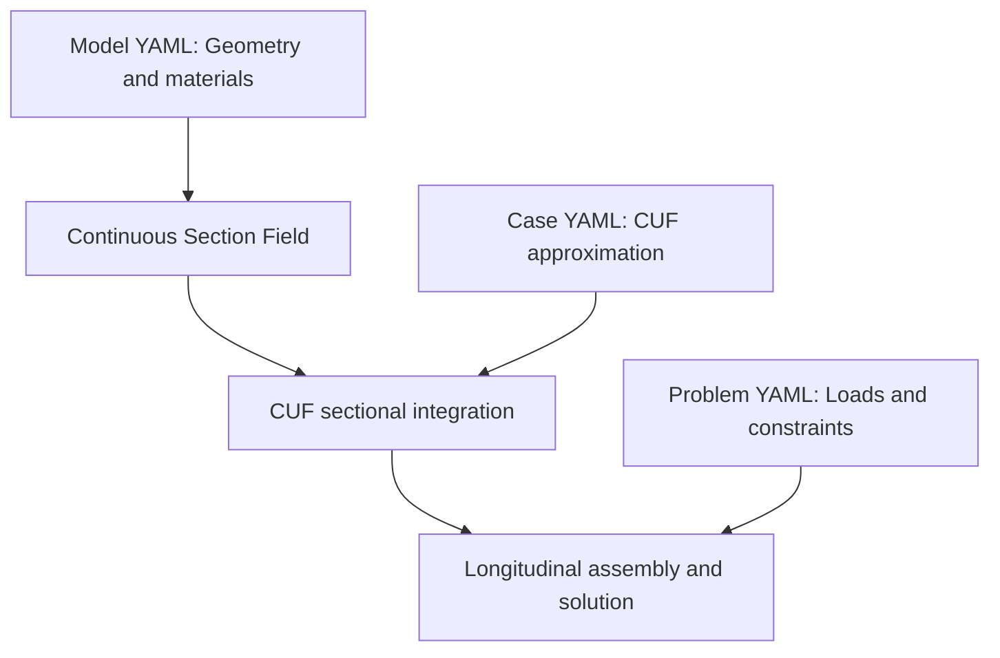

# DRAFT

# Continuous Section Field Coupling with the Carrera Unified Formulation: Mathematical Framework and Reproducible Open-Source Implementation

# Abstract

This paper presents an open-source, reproducible computational framework coupling the Continuous Section Field (CSF) with the Carrera Unified Formulation (CUF) for non-prismatic beams with variable constitutive properties. CSF is an autonomous, self-contained physical modelling infrastructure for a deliberately defined class of beam-like structures. Within this scope, it provides an integrated set of capabilities for defining, constructing, connecting, managing, visualizing, and verifying sectional geometries, material regions, and constitutive properties, including their longitudinal variation. The resulting physical description remains independent of the CUF transverse expansion and longitudinal discretization.

The contribution is twofold. First, the mathematical coupling is formalized through an explicit sequence connecting the continuous physical sectional field to the CUF operators:

$$
\mathcal{S}(x) \longrightarrow J(x) \longrightarrow \mathbf{H}(x) \longrightarrow \mathbf{K}.
$$

The continuous sectional field is queried at the longitudinal positions required by numerical integration, supplying the current physical domains and constitutive properties. These are combined with the CUF kinematic functions through sectional integration to construct the longitudinally dependent coefficients and operators, without modifying the CUF fundamental nucleus. Second, the coupling is realized in an open-source Python implementation covering the complete computational path from declarative physical-model configuration to numerical solution and field reconstruction. Reproducibility is incorporated into the architecture through documented and inspectable procedures for sectional evaluation, numerical integration, assembly, solution, verification, and reconstruction.

The implementation is examined using a tapered I-shaped beam with longitudinally varying material properties and an independently implemented three-dimensional finite-element reference model. The results show close agreement in displacements and characterize differences in interior equilibrium and surface traction recovery. The complete source code, model configurations, numerical procedures, and diagnostic tools are publicly available, enabling reconstruction and verification of the computational process rather than only reproduction of its reported results.

# 1. Introduction

The analysis of non-prismatic beam-like structures requires the description of cross-sectional geometry and constitutive properties as they vary along the longitudinal direction. Changes in sectional shape, material distribution, and stiffness affect both the structural response and the evaluation of the coefficients entering a refined beam formulation. These physical quantities must be available at the positions requested by the numerical analysis, which need not coincide with the stations used to prescribe the structural geometry or materials. This raises a question that is distinct from the choice of displacement approximation: how can the physical description of a member be defined, managed, and evaluated independently of the structural formulation that uses it?

The Carrera Unified Formulation (CUF) provides a general mathematical framework for refined one-dimensional structural models. The three-dimensional displacement field is represented through transverse expansion functions and longitudinal generalized displacement amplitudes, allowing different levels of kinematic refinement to be constructed within the same formulation. Extending such models to non-prismatic structures requires geometric and constitutive information that varies along the member. The literature has addressed this challenge through several approaches. Patni et al. [1] introduced an anisoparametric weak-form Unified Formulation in which the geometry is represented independently of the displacement approximation, using a three-dimensional geometric mapping to treat non-prismatic and curved beam-like structures. Ojo and Weaver [2] subsequently developed a strong-form approach for non-prismatic structures that evaluates sectional contributions efficiently, avoiding the full-volume quadrature required by the weak-form mapping-based approach they considered. These works establish significant results in the mathematical and numerical treatment of variable geometry within the Unified Formulation.

The present work considers a complementary problem: the construction of an autonomous physical modelling infrastructure that can supply a structural formulation with the sectional information it needs. Separating geometric and kinematic interpolation is an important step, but it does not by itself specify how sectional domains and boundaries are constructed, how material regions and constitutive properties are assigned and varied, how geometric connections are established, or how the consistency of the resulting physical model is checked. These operations belong to the physical modelling process and can be organized independently of the equations and degrees of freedom of a particular structural approximation.

The Continuous Section Field (CSF) is conceived as a self-contained infrastructure for defining, constructing, connecting, managing, visualizing, and verifying the physical description of a deliberately restricted class of beam-like structures. Within this scope, CSF supports sectional geometry, multiple physical and material regions, automatic geometric connections where supported by its modelling rules, longitudinal variation of geometry and constitutive properties, sectional-property evaluation, and consistency checks. Its purpose is not to replace a general-purpose three-dimensional solid modeller. Instead, it offers a complete modelling process within an explicit sectional representation: cross-sectional domains are prescribed at longitudinal stations and evaluated continuously between them, subject to the geometric and topological conditions of that representation. The restricted geometric scope is therefore a deliberate modelling choice, not a claim that only geometric interpolation is provided.

The defining mathematical object supplied by this infrastructure is a continuous sectional state: at any admissible longitudinal coordinate, CSF can provide the current physical domains, their boundaries, and the associated constitutive properties. The stations used to prescribe the physical model are independent of the longitudinal discretization employed for the structural solution. Moreover, physical material regions need not coincide with the numerical subdivisions chosen to approximate displacements over a cross-section. The same physical description can consequently support different admissible transverse approximations without being redefined as part of their kinematics.

In the CSF–CUF coupling developed here, this continuous representation is retained throughout the analysis. Rather than preprocessing the non-prismatic member into a geometry-specific set of CUF operators, the sectional integration layer queries CSF at the longitudinal positions requested by the numerical quadrature. CSF returns the current geometry and constitutive data; the chosen CUF transverse expansion supplies the kinematic functions and their derivatives. Sectional integration combines these inputs to form longitudinally dependent coefficients, which are then used to construct the CUF operators and assemble the structural system. The CUF fundamental nucleus does not need to interpret sectional geometry or material-region semantics, and its construction rule is not modified when an admissible physical field changes. Local mappings may still be used for sectional quadrature or for evaluating transverse basis functions; the present coupling does not require a beam-wide three-dimensional geometric mapping to communicate the evolving physical description to the nucleus.

The contribution of the present work is twofold. First, the mathematical coupling between the autonomous Continuous Section Field and the Carrera Unified Formulation is formalized by identifying the sectional coefficients and longitudinal operators through which the continuously varying physical description enters the CUF variational framework. Second, this coupling is realized in a self-contained, open-source Python implementation that integrates the CSF physical modelling infrastructure with CUF numerical analysis, while maintaining an explicit separation between geometry, constitutive properties, transverse kinematics, longitudinal discretization, integration, assembly, and solution. Reproducibility is incorporated as a design requirement of the complete computational process, with documented model definitions, numerical procedures, intermediate results, and verification tools.

The proposed implementation is examined on a tapered I-shaped beam with longitudinally varying material properties. An independently implemented three-dimensional finite-element model provides a numerical reference. The comparison addresses reconstructed displacements as well as interior-equilibrium and traction-related diagnostics, distinguishing agreement in the displacement field from the accuracy of stress recovery. The example is intended to verify the documented CSF–CUF computational path within the current scope of the physical representation; it does not establish geometric generality beyond that scope.

The remainder of the paper is organized as follows. Section 2 formalizes the continuous sectional state and derives its coupling to the CUF sectional coefficients and longitudinal operators. Section 3 describes the open-source implementation and the separation of physical, kinematic, and numerical responsibilities. Section 4 presents the tapered-member verification study and its reproducibility procedures. Section 5 summarizes the findings and the present limitations of the approach.

The mathematical development and the executable verification study are documented in the public repository:

- Mathematical formulation: https://github.com/giovanniboscu/continuous-section-field/blob/main/docs/model/CSF_CUF_Continuous_Geometry_and_Material_Field_Formulation.md
- Numerical study and reproducibility materials: https://github.com/giovanniboscu/continuous-section-field/tree/main/cuf/I-Shape_L

# 2. Mathematical Formulation of the CSF-CUF Coupling

This section establishes the mathematical connection between a prescribed Continuous Section Field (CSF) and the Carrera Unified Formulation (CUF). The objective is to identify the sectional information required by the CUF variational equations and the longitudinal operators that result from its integration. The physical field is independent of the displacement approximation and of the longitudinal numerical discretization. Small-strain linear elasticity is assumed.


## 2.1. Continuous Section Field as an autonomous physical model

The Continuous Section Field (CSF) is a physical model of a beam in which the cross-sectional geometry and constitutive properties are prescribed as continuous functions of the longitudinal position. It is defined independently of any structural displacement approximation, finite-element discretization or numerical integration scheme.

Consider a beam of length $L$, with longitudinal coordinate $x$ and transverse coordinates $(y,z)$, as introduced in Section 1. At each position $x$, the CSF defines the sectional state

```math
\mathcal S(x)=
\left\{\Omega(x),\mathbf C(x,y,z)\right\},
\qquad 0\leq x\leq L.
```

Here, $\Omega(x)$ denotes the physical cross-sectional domain, while $\mathbf C(x,y,z)$ is the local constitutive matrix defined at each material point of that domain. The sectional state therefore contains both the geometry occupied by the material and the constitutive properties assigned to it.

### Physical domains and material description

A cross-section may consist of several regions with distinct constitutive properties. Let $N_\Omega$ denote the number of physical sectional subdomains and let $k=1,\ldots,N_\Omega$ identify each subdomain. The CSF provides

```math
\mathcal S(x)\longmapsto
\left(
\Omega^k(x),
\partial\Omega^k(x),
\mathbf C^k(x,y,z)
\right)_{k=1}^{N_\Omega}.
```

The quantities supplied are:

- $\Omega^k(x)$: the physical area occupied by subdomain $k$ at position $x$;
- $\partial\Omega^k(x)$: the boundary of that subdomain;
- $\mathbf C^k(x,y,z)$: its local $6\times6$ constitutive matrix.

The physical section is the union of these subdomains:

```math
\Omega(x)=\bigcup_{k=1}^{N_\Omega}\Omega^k(x).
```

The interiors of distinct physical subdomains do not overlap. Adjacent subdomains may share boundaries, across which constitutive properties may be discontinuous.

The geometric and constitutive descriptions are independent components of the same physical field. A change in geometry does not require a change in material properties, and a change in material properties does not require a change in geometry. Both may vary simultaneously along the beam.

### Longitudinal continuity and sectional evaluation

The defining property of CSF is that the sectional state can be evaluated at an arbitrary longitudinal coordinate within the prescribed beam interval.

In the implemented geometric representation, the sectional boundaries are described through polygons specified at longitudinal stations. Corresponding geometric data are interpolated between stations to construct the intermediate physical sections. Constitutive properties are prescribed independently and evaluated at the requested longitudinal position and material point.

The longitudinal stations define the physical description; they are not finite-element nodes and do not prescribe the longitudinal approximation of the displacement field.

Consequently, the physical model can be queried at positions that do not coincide with its defining stations. The number and locations of these queries are determined by the subsequent calculation, not by the CSF itself.

Continuity is understood on the intervals over which the prescribed geometric and material fields are continuous. The representation also permits distinct material regions and piecewise-smooth longitudinal descriptions.

### Independence from the structural approximation

The CSF does not define displacement fields, strain approximations or structural degrees of freedom. It specifies the physical body and its constitutive properties before any particular structural approximation is introduced.

This distinction separates three concepts that would otherwise be coupled in a geometry-specific numerical model:

1. **Physical description:** the sectional domains and constitutive properties prescribed by CSF.
2. **Kinematic approximation:** the mathematical functions subsequently selected to represent the displacement field.
3. **Numerical discretization:** the integration and solution procedures used to determine the unknown displacement amplitudes.

In particular, the subdivision of a physical cross-section into material regions is not required to coincide with a subdivision introduced for numerical interpolation. A numerical approximation may employ additional sectional domains without introducing additional physical material interfaces.

The same CSF description may therefore be used with different admissible structural approximations, while a given structural formulation may operate on different CSF descriptions.

### Mathematical role of the autonomous field

The CSF is prescribed input to the structural problem, rather than an unknown determined by the structural solution. Its mathematical role is to provide the physical domains and constitutive coefficients needed to evaluate sectional quantities.

This establishes a distinction between the definition of the physical model and its subsequent use in a variational formulation. The CSF specifies **where material exists and how it behaves constitutively**; the structural formulation determines **how displacement, strain and equilibrium are approximated and solved**.

The coupling developed in the following sections uses the sectional information supplied by CSF within the Carrera Unified Formulation. The autonomy of the physical description is retained: changing the prescribed sectional geometry or constitutive field changes the values of the resulting sectional contributions, without changing the mathematical rule by which the structural operators are constructed.


## 2.2. CUF displacement approximation and strain operators

Let $M$ be the number of scalar transverse expansion functions $F_s(x,y,z)$, with $s=1,\ldots,M$. Let $\mathbf q_s(x)=[q_{xs}(x),q_{ys}(x),q_{zs}(x)]^T$ denote the corresponding three longitudinal displacement amplitudes. The CUF approximation is

```math
\mathbf u(x,y,z)=\sum_{s=1}^{M}F_s(x,y,z)\,\mathbf q_s(x).
```

The index $s$ labels a trial function; $\tau=1,\ldots,M$ will label a test function. Summation over these indices is explicit. A comma followed by $x$, $y$, or $z$ denotes partial differentiation with respect to the indicated physical coordinate; a prime denotes ordinary differentiation with respect to $x$.

The expansion functions may depend on $x$ if the selected basis follows an evolving physical section. Such dependence is a property of the chosen kinematic basis, not a necessary consequence of CSF: a basis fixed in physical transverse coordinates has $F_{s,x}=0$ even when the physical section varies.

Use the engineering strain ordering $[\varepsilon_{xx},\varepsilon_{yy},\varepsilon_{zz},\gamma_{yz},\gamma_{xz},\gamma_{xy}]^T$, where $\gamma$ denotes engineering shear strain. Define the following $6\times3$ matrices for any scalar basis function $F$:

```math
\mathbf B^{(0)}(F)=
\begin{bmatrix}
F_{,x}&0&0\\
0&F_{,y}&0\\
0&0&F_{,z}\\
0&F_{,z}&F_{,y}\\
F_{,z}&0&F_{,x}\\
F_{,y}&F_{,x}&0
\end{bmatrix},
\qquad
\mathbf B^{(1)}(F)=
\begin{bmatrix}
F&0&0\\
0&0&0\\
0&0&0\\
0&0&0\\
0&0&F\\
0&F&0
\end{bmatrix}.
```

The superscripts $(0)$ and $(1)$ identify the factors multiplying an amplitude and its longitudinal derivative, respectively. The strain field is therefore

```math
\boldsymbol\varepsilon=
\sum_{s=1}^{M}
\left[\mathbf B^{(0)}(F_s)\mathbf q_s+
\mathbf B^{(1)}(F_s)\mathbf q_s'\right].
```

The virtual strain $\delta\boldsymbol\varepsilon$ is obtained by replacing each amplitude with its admissible virtual variation $\delta\mathbf q_s$. This construction preserves any required $F_{s,x}$ terms.

## 2.3. Internal virtual work

Within subdomain $k$, the stress vector is $\boldsymbol\sigma^k=\mathbf C^k\boldsymbol\varepsilon$, using tensorial shear stresses paired with the engineering shear strains. The internal virtual work is

```math
\delta W_{\mathrm{int}}=
\int_0^L\sum_{k=1}^{N_\Omega}
\int_{\Omega^k(x)}
\delta\boldsymbol\varepsilon^T\mathbf C^k(x,y,z)
\boldsymbol\varepsilon\,d\Omega\,dx.
```

The CSF supplies the physical integration domains and constitutive matrices; the CUF expansion supplies the test and trial strain factors. Their coupling takes place inside these sectional integrals, without requiring a beam-wide reference-to-physical mapping of the non-prismatic solid.

## 2.4. Sectional coefficients and weak-form matrices

Let $m,n\in\{1,\ldots,6\}$ label entries of the constitutive matrix in the strain ordering above. Let $\alpha,\beta\in\{0,x,y,z\}$ identify a derivative of the test and trial sectional functions, respectively, where $F_{\tau,0}=F_\tau$ and $F_{s,0}=F_s$. For fixed expansion indices $\tau$ and $s$, define the sectional coefficients

```math
J^{mn}_{\tau,\alpha\,s,\beta}(x)=
\sum_{k=1}^{N_\Omega}
\int_{\Omega^k(x)}
C^k_{mn}(x,y,z)\,
F_{\tau,\alpha}(x,y,z)\,
F_{s,\beta}(x,y,z)\,d\Omega.
```

Each coefficient combines three independent inputs: the physical sectional domain, the constitutive weighting, and the CUF test/trial functions. In particular, $J(x)$ can vary with $x$ even when all sectional basis functions satisfy $F_{s,x}=0$.

For $a,b\in\{0,1\}$, define four $3\times3$ matrices for each pair $(\tau,s)$:

```math
\mathbf H^{ab}_{\tau s}(x)=
\sum_{k=1}^{N_\Omega}
\int_{\Omega^k(x)}
\left[\mathbf B^{(a)}(F_\tau)\right]^T
\mathbf C^k(x,y,z)
\mathbf B^{(b)}(F_s)\,d\Omega.
```


The first superscript indicates whether the test amplitude is differentiated longitudinally, and the second does the same for the trial amplitude. Each entry of $H_{\tau s}^{ab}$ is a linear combination of the sectional coefficients

$$
J_{\tau,\alpha;s,\beta}^{mn}.
$$

Substitution into the internal virtual work gives


```math
\begin{aligned}
\delta W_{\mathrm{int}}=\int_0^L\sum_{\tau=1}^{M}\sum_{s=1}^{M}
\bigl[&\delta\mathbf q_\tau^T\mathbf H^{00}_{\tau s}\mathbf q_s
+\delta\mathbf q_\tau^T\mathbf H^{01}_{\tau s}\mathbf q_s'\\
&+\delta\mathbf q_\tau'^T\mathbf H^{10}_{\tau s}\mathbf q_s
+\delta\mathbf q_\tau'^T\mathbf H^{11}_{\tau s}\mathbf q_s'\bigr]dx.
\end{aligned}
```

This weak form is the basis of the numerical assembly: the longitudinal integration requires evaluations of the sectional matrices at the selected integration stations.

## 2.5. Longitudinal fundamental operator

For a fixed test/trial expansion pair $(\tau,s)$, define the three-component longitudinal flux

```math
\mathbf g_{\tau s}(x)=
\mathbf H^{10}_{\tau s}(x)\mathbf q_s(x)
+\mathbf H^{11}_{\tau s}(x)\mathbf q_s'(x).
```


The two terms containing the derivative of the virtual amplitude can then be integrated by parts:

$$
\begin{aligned}
\int_0^L \delta\mathbf{q}_\tau'^{T}\mathbf{g}_{\tau s}\,dx
&=
\left[\delta\mathbf{q}_\tau^{T}\mathbf{g}_{\tau s}\right]_{x=0}^{x=L}\\
&\quad-
\int_0^L\delta\mathbf{q}_\tau^{T}
\frac{d\mathbf{g}_{\tau s}}{dx}\,dx.
\end{aligned}
$$


Here the boundary evaluation is defined by

$$
[h]_{x=0}^{x=L}=h(L)-h(0),
$$

for any quantity $h(x)$. Combining this identity with the undifferentiated virtual-amplitude terms identifies the matrix differential operator $\mathcal{K}_{\tau s}$ acting on the trial amplitude vector:


```math
\boxed{
\mathcal K_{\tau s}[\mathbf q_s]=
\mathbf H^{00}_{\tau s}\mathbf q_s
+\mathbf H^{01}_{\tau s}\mathbf q_s'
-\frac{d}{dx}\left(
\mathbf H^{10}_{\tau s}\mathbf q_s
+\mathbf H^{11}_{\tau s}\mathbf q_s'
\right).
}
```

The integration by parts also yields the generalized end action

```math
\left[
\delta\mathbf q_\tau^T
\sum_{s=1}^{M}
\left(\mathbf H^{10}_{\tau s}\mathbf q_s+
\mathbf H^{11}_{\tau s}\mathbf q_s'\right)
\right]_{x=0}^{x=L},
```

summed over $\tau$. To specify the corresponding external action, let $\mathbf b^k(x,y,z)$ be a prescribed body-force density in subdomain $k$. Let $\Gamma_t(x)$ be the traction-loaded portion of the sectional boundary, $\bar{\mathbf t}(x,y,z)$ the prescribed surface traction, $d\Gamma$ the physical line element along that boundary, and $\mu(x,y,z)$ the factor converting $d\Gamma\,dx$ to physical surface area. The generalized force per unit longitudinal length is

```math
\mathbf f_\tau(x)=
\sum_{k=1}^{N_\Omega}\int_{\Omega^k(x)}
F_\tau\,\mathbf b^k\,d\Omega
+\int_{\Gamma_t(x)}
F_\tau\,\bar{\mathbf t}\,\mu\,d\Gamma.
```

The surface term applies to lateral tractions; end-section tractions are represented by the generalized end actions. The interior equilibrium equations are

```math
\sum_{s=1}^{M}\mathcal K_{\tau s}[\mathbf q_s]
=\mathbf f_\tau(x),\qquad \tau=1,\ldots,M.
```

For the classical strong form, the coefficients and amplitudes must have the required differentiability on each smooth interval. The longitudinal derivative in $\mathcal K_{\tau s}$ acts on the **entire products**, including the variable sectional matrices. In contrast, weak-form finite-element assembly uses the preceding integral expression and need not explicitly differentiate $\mathbf H^{ab}_{\tau s}(x)$.

The mathematical path underlying the implementation is thus

```math
\mathcal S(x)\longrightarrow
J^{mn}_{\tau,\alpha\,s,\beta}(x)
\longrightarrow\mathbf H^{ab}_{\tau s}(x)
\longrightarrow\mathcal K_{\tau s}.
```

Changing an admissible physical geometry or constitutive field changes the sectional coefficients, but not the rule used to construct the CUF operator. This is the mathematical basis for a computational core that is independent of any particular geometric-material model.

---


# 3. Computational Implementation

The mathematical coupling established in Section 2 is implemented by separating the prescribed physical sectional description from the CUF displacement approximation and the longitudinal numerical solution. This section describes the computational responsibilities and their interaction. The numerical configuration and verification of the tapered I-shaped member are presented in Section 4.

## 3.1. Separation of computational responsibilities

The implementation distinguishes three inputs. First, the Continuous Section Field (CSF) supplies the physical sectional domains and material properties at a requested longitudinal position. Second, the CUF transverse expansion supplies the scalar displacement functions and their required spatial derivatives. Third, the longitudinal approximation represents the unknown displacement amplitudes along the member. These inputs are combined during numerical integration, rather than being embedded in a single geometry-specific solver.

The reference implementation and its documented input files are available in the [I-Shape_L study](https://github.com/giovanniboscu/continuous-section-field/tree/main/cuf/I-Shape_L) and its [reproducibility guide](https://github.com/giovanniboscu/continuous-section-field/blob/main/cuf/I-Shape_L/reproducibility.md).

## 3.2. Evaluation of the continuous sectional field

At a longitudinal integration station, the solver obtains the current physical sectional geometry and constitutive description from CSF. The sectional subdomains determine the regions over which integration is performed; the material field determines the constitutive coefficients used at sectional integration points. Consequently, a change in cross-sectional shape or material distribution is represented by a change in the data evaluated at those points, without redefining the CUF strain-displacement construction.

The CSF representation is independent of the transverse interpolation chosen for the displacement field. A physical section may be subdivided into numerical domains to support a particular CUF basis. Such subdivisions do not necessarily represent additional material interfaces. In the documented I-shaped example, the physical member has three material regions, whereas the CUF approximation uses nine quadrilateral domains: three in each flange/web group. The two descriptions represent the same solid, with different numerical partitions.

Sectional quadrature is performed over the current physical domains. Local coordinates and isoparametric mappings may be used to evaluate a sectional basis and its integration measure; this does not require a single reference-to-physical mapping of the complete non-prismatic beam.

## 3.3. Assembly of the CUF sectional contributions

At each longitudinal quadrature station, the transverse expansion provides the values and derivatives of the sectional functions. The solver combines these kinematic factors with the CSF geometry and constitutive data to evaluate the sectional coefficients and matrices defined in Section 2.4. The resulting matrices are functions of longitudinal position and enter the weak internal virtual work without requiring explicit longitudinal differentiation of their coefficients.

For a fixed test/trial expansion pair, the four sectional matrices distinguish terms involving the longitudinal amplitudes from those involving their first derivatives. Their construction is governed by the strain-displacement operators and the constitutive law; the particular physical section determines the values of the integrals. The same assembly rule therefore applies to different admissible CSF descriptions.

In the documented L9 case, neighboring quadrilateral domains share displacement nodes. The numerical configuration explicitly selects the CSF polygons as the domain source, an isoparametric sectional mapping and shared-point connectivity. The case also enables a mixed-interpolation-of-tensorial-components (MITC) correction; this is a numerical option of the selected approximation, not part of the defining CSF-to-CUF coupling. The [case configuration](https://github.com/giovanniboscu/continuous-section-field/blob/main/cuf/I-Shape_L/cases/taper/carrera_i_shaped_taper80_lagrangeL9_v4_E10_web3.yaml) records these choices.

## 3.4. Longitudinal discretization, solution and reconstruction

The longitudinal amplitudes introduced in Section 2.2 are approximated independently of the CSF description. In the finite-element realization, longitudinal shape functions interpolate these amplitudes within each longitudinal element. Numerical integration combines the longitudinal interpolation factors with the sectional matrices evaluated at the selected stations. The resulting algebraic system is assembled, the prescribed constraints are imposed, and the generalized displacement coefficients are solved.

The documented tapered I-shaped case uses ten longitudinal finite elements with polynomial order six, longitudinal Gauss order fifteen, and sectional Gauss order twelve. These values specify one reproducible numerical approximation; they are not requirements of the CSF description itself. The case is executed through the `csf-cuf` command and a YAML configuration, without a graphical modelling interface.

After solution, the displacement, strain and stress fields can be reconstructed at requested physical positions using the CUF expansion and the constitutive data supplied by CSF. The solved coefficients are stored in a reusable checkpoint. This separates the structural solution from subsequent evaluation, comparison and plotting. The [reproducibility guide](https://github.com/giovanniboscu/continuous-section-field/blob/main/cuf/I-Shape_L/reproducibility.md) documents the executable commands, checkpoints and independent post-processing stages.

## 3.5. Declarative model definition and reproducibility

The computational separation is also reflected in the YAML input organization. Three distinct descriptions are used: a **model** defines the physical sectional geometry and its material properties; a **problem** defines the applied loads and boundary conditions; and a **case** selects the CUF transverse expansion, longitudinal discretization, integration settings and solver options. The YAML files are declarative inputs to the implementation, not a replacement for the mathematical definitions in Section 2.

The relationship between these inputs and the numerical operations is summarized in Figure 1. The arrows indicate the flow of information, not a prescribed sequence of software calls. In particular, the physical model and the numerical case remain separate inputs to sectional integration.



*Figure 1. Conceptual information flow in the CSF-CUF implementation. The CSF provides the physical description; the CUF case specifies the approximation; the problem specifies the actions and constraints. Their contributions meet during numerical assembly.*

The diagram makes explicit a distinction that is important for interpreting the implementation: the CSF is not generated by the CUF basis, and the basis does not define the physical material. They are evaluated together only when the sectional contributions required by the variational formulation are computed.

This division permits a prescribed physical problem to be analyzed using different numerical approximations, or a different admissible sectional description to be supplied without rewriting the CUF assembly rules. Distinct YAML geometric partitions can represent the same physical solid when required by different numerical methods. It also makes the inputs of a reported analysis explicit and inspectable. For the tapered I-shaped study, the [physical geometry for the three-dimensional reference](https://github.com/giovanniboscu/continuous-section-field/blob/main/cuf/I-Shape_L/models/carrera_i_shaped_taper80.yaml) and the [nine-domain representation used by the CUF case](https://github.com/giovanniboscu/continuous-section-field/blob/main/cuf/I-Shape_L/models/carrera_i_shaped_taper80_l9_web3.yaml) describe the same member but serve different numerical purposes. The [CUF case file](https://github.com/giovanniboscu/continuous-section-field/blob/main/cuf/I-Shape_L/cases/taper/carrera_i_shaped_taper80_lagrangeL9_v4_E10_web3.yaml) records the selected approximation and integration settings.

The YAML representation is not itself a mathematical contribution. Its role is to expose, in a reproducible computational experiment, the separation between prescribed physical data and numerical approximation. Complete input files and execution instructions are retained in the repository rather than reproduced in this paper.

The implementation thus realizes the mathematical dependency established in Section 2: the prescribed sectional field supplies physical data, the CUF approximation supplies kinematic factors, and the longitudinal solver combines their sectional contributions. Section 4 evaluates this realization against an independent three-dimensional finite-element solution.


# 4. Numerical Verification and Reproducibility

The preceding sections introduced the continuous physical description, derived its coupling to CUF and described the computational implementation. This section tests that implementation on a single three-dimensional elasticity problem. The purpose is twofold: to compare the computed response with an independently implemented solid finite-element model, and to make the comparison reproducible from publicly available inputs and saved results. All lengths are expressed in mm, forces in N, and stresses and elastic moduli in MPa.

## 4.1. Physical problem: a tapered I-shaped member

The member has length $L=1000$ mm along the physical $x$ axis; $y$ and $z$ are transverse coordinates, as defined in Section 1. Its cross-section consists of two flanges joined by a web. The flange width (66 mm), flange thickness (25 mm) and web thickness (25 mm) are constant. The clear web height decreases linearly from 100 mm at $x=0$ to 20 mm at $x=L$. Consequently, the total section height decreases from 150 to 70 mm. The cross-sectional area decreases from 5800 to 3800 mm$^2$.

Let $h_w(x)$ denote the clear web height, and let $E_f(x)$ and $E_w(x)$ denote Young's moduli of the flanges and web, respectively. Their prescribed laws are

```math
h_w(x)=100-80\frac{x}{L}\quad\mathrm{mm},
```

```math
E_f(x)=71700\quad\mathrm{MPa},\qquad
E_w(x)=71700-20000\frac{x}{L}\quad\mathrm{MPa}.
```

All regions are isotropic, with Poisson ratio $\nu=0.3$. Thus the physical model combines a changing integration domain with a changing constitutive field, the two independent CSF inputs identified in Section 2.

At both ends the transverse displacements are constrained, $u_y=u_z=0$, while axial translation is removed by a common gauge condition. A traction acts on the *physical lower surface* in the fixed global $z$ direction. With $\bar{\mathbf t}(x)$ denoting the prescribed traction vector, its half-wave distribution is

```math
\bar{\mathbf t}(x)=
\begin{bmatrix}0\\0\\-\sin(\pi x/L)\end{bmatrix}
\quad\mathrm{MPa}.
```

The traction direction is not rotated with the taper. The documented integral of this load over the inclined physical surface is approximately $-42050.505$ N in the global $z$ direction. Both numerical models represent the same geometry, constitutive laws, support conditions and physical loading. The complete static scheme and geometric definitions are provided in the [benchmark description](https://github.com/giovanniboscu/continuous-section-field/blob/main/cuf/I-Shape_L/README.md).

## 4.2. Independent numerical representations

The reference solid model uses twenty-node hexahedral finite elements (H20). Its three-dimensional displacement interpolation is defined directly over the discretized volume, with $3\times3\times3$ Gauss integration for the stiffness. The bottom-surface traction is integrated over quadratic element faces. The reported H20 solutions use the SciPy sparse-solver backend. In this implementation the web modulus assigned to each solid element is evaluated at its longitudinal midpoint. This is a piecewise-constant elementwise approximation of the prescribed linear material law, whereas CSF-CUF evaluates the material at its sectional and longitudinal integration stations. The models share the same physical constitutive law but not an identical numerical sampling of that law.

The CSF-CUF model instead obtains the physical sectional domains and constitutive values from CSF at the requested integration stations. Its transverse displacement approximation uses nine-node Lagrange functions (L9) over nine connected quadrilateral domains: three for the upper flange, three for the web and three for the lower flange. The shared displacement nodes provide continuity across numerical domain boundaries. The documented configuration has 57 transverse functions and ten longitudinal finite elements of polynomial order six; it uses longitudinal Gauss order 15, sectional Gauss order 12 and a mixed-interpolation-of-tensorial-components (MITC) correction.

The two models use different geometric subdivisions of the *same physical solid*. In particular, the extra CUF domain boundaries are not additional material interfaces. The source descriptions are [the physical model used by H20](https://github.com/giovanniboscu/continuous-section-field/blob/main/cuf/I-Shape_L/models/carrera_i_shaped_taper80.yaml), [the nine-domain CUF model](https://github.com/giovanniboscu/continuous-section-field/blob/main/cuf/I-Shape_L/models/carrera_i_shaped_taper80_l9_web3.yaml) and [the CUF case configuration](https://github.com/giovanniboscu/continuous-section-field/blob/main/cuf/I-Shape_L/cases/taper/carrera_i_shaped_taper80_lagrangeL9_v4_E10_web3.yaml).

## 4.3. Selection of the numerical reference

A comparison between numerical methods is meaningful only when the selected solutions have been checked for discretization sensitivity. For H20, the repository documents a mesh-refinement sequence, with reported element counts ranging from 48 to 4,608; the exact list of level labels and meshes is retained in the repository report. Let $u_z^{\mathrm{T4}}$ and $u_z^{\mathrm{T6}}$ denote the reported minimum nodal transverse displacements for the two selected H20 meshes. The direct relative difference between these two results, using T4 as denominator, is

```math
\\delta_{\mathrm{T4,T6}}=100\frac{\left|u_z^{\mathrm{T6}}-u_z^{\mathrm{T4}}\right|}{\left|u_z^{\mathrm{T4}}\right|}.
```

The comparison is summarized below. The reported values are rounded; the relative difference computed from these rounded values is approximately 0.00932%.

| H20 mesh | Elements | Nodes | Minimum $u_z$ (mm) |
|---|---:|---:|---:|
| T4 | 3,072 | 16,081 | -1.717022 |
| T6 | 4,608 | 24,001 | -1.717182 |

The direct T4–T6 difference is below the stated 0.1% displacement criterion, supporting the selection of T4 as the H20 displacement reference. This comparison is **not** presented as a consecutive-level convergence ratio. The full refinement sequence, its exact labels and the level-to-level values should be taken from the [H20 mesh-convergence study](https://github.com/giovanniboscu/continuous-section-field/blob/main/cuf/I-Shape_L/FEM3Dmesh-convergence-criterion.md). Stabilization of a displacement extremum does not alone establish convergence of reconstructed stress gradients.

The CUF solution selected for comparison is the first solver-equilibration checkpoint, `eq1`. Its stability is documented by a direct comparison with the subsequent checkpoints `eq2`–`eq5`, rather than inferred from their mere existence. The [checkpoint-stability report](https://github.com/giovanniboscu/continuous-section-field/blob/main/cuf/I-Shape_L/diagnostics/cuf_eq_stability/summary.md) reports **PASS** for every tested comparison, both against `eq1` and between successive checkpoints. The acceptance rule is defined for each compared response component or saved coefficient array by

```math
\max |b-a|\leq 10^{-9}+10^{-8}\max(\max|a|,\max|b|),
```

where $a$ and $b$ denote the two arrays being compared, and the maxima are taken over their respective entries. The absolute term has the native units of the compared data (mm for the displacement and physical displacement-coefficient arrays). For each comparison with `eq1`, the maximum difference among the reconstructed displacement components is at most $2.000011\times10^{-12}$ mm; the maximum difference in the available `solved_nodal_domain_natural_coefficients` arrays is at most $7.565282\times10^{-12}$ in their reported native units. The report explicitly marks the separate DOF-coefficient comparison as **not evaluated**. These results establish stability, under the stated tolerance, for the **sampled displacements and available saved coefficient arrays**. They are not a transverse-basis or longitudinal-mesh convergence study.

| Comparison against `eq1` | Maximum sampled displacement difference (mm) | Maximum available saved-coefficient difference | Report result |
|---|---:|---:|---|
| `eq2` | $2.000011\times10^{-12}$ | $7.565282\times10^{-12}$ | PASS |
| `eq3` | $1.869707\times10^{-12}$ | $6.947110\times10^{-12}$ | PASS |
| `eq4` | $1.899980\times10^{-12}$ | $6.572298\times10^{-12}$ | PASS |
| `eq5` | $1.700029\times10^{-12}$ | $6.401546\times10^{-12}$ | PASS |

The numerical reference and the checkpoint comparison thus address different questions: H20 refinement checks sensitivity of a selected displacement extremum to the solid mesh, while the CUF checkpoint test checks the reported equilibration stability of a fixed numerical approximation.

## 4.4. Displacement and equilibrium comparisons

The two selected solutions, H20 T4 and CSF-CUF `eq1`, are reconstructed at the same 24,576 interior physical points: eight sample points in each of the 3,072 H20 elements. The diagnostic uses common Jacobian-weighted physical-volume contributions at these points; consequently, both methods are assessed with the same spatial sampling and weighting. The reported root-mean-square (RMS) displacement differences are $2.830\times10^{-5}$ mm for $u_x$, $4.742\times10^{-6}$ mm for $u_y$, and $3.6839\times10^{-4}$ mm for $u_z$. Thus the independently constructed models give closely matching displacement fields at the comparison points.

Three complementary tests are used. Displacement differences assess agreement in the reconstructed kinematic response. The interior divergence residual assesses local differential equilibrium within material regions. Surface traction errors and interface traction jumps assess boundary and transmission conditions. These quantities answer different mechanical questions and must be interpreted separately.

Displacement agreement is not, however, a complete test of the reconstructed stress field. Let $\boldsymbol\sigma$ be the symmetric three-dimensional Cauchy stress tensor, and define the interior equilibrium residual $\mathbf r$ in the absence of body forces by

```math
\mathbf r=\nabla\cdot\boldsymbol\sigma,
```

where $\nabla\cdot$ denotes spatial divergence. Its components have units MPa/mm. The volume-weighted RMS values computed at the same interior points are:

| Interior residual | H20 RMS (MPa/mm) | CSF-CUF RMS (MPa/mm) |
|---|---:|---:|
| $r_x$ | 0.13127148 | 0.11150557 |
| $r_y$ | 0.04039661 | 0.03615182 |
| $r_z$ | 0.03909369 | 0.02734043 |
| Magnitude $|\mathbf r|$ | 0.14280197 | 0.12036588 |

For this sampling and weighting, CSF-CUF has a 15.7% smaller RMS of the total interior residual. The corresponding weighted median of the residual magnitude is instead smaller for H20 (0.028999 MPa/mm, versus 0.046390 MPa/mm for CUF), showing that the two methods produce different residual distributions rather than a uniform advantage at every point.

A separate comparison tests the reconstructed traction $\mathbf t=\boldsymbol\sigma\mathbf n$, where $\mathbf n$ is the outward unit normal to a physical surface. On the loaded surface, $\mathbf t$ is compared with the prescribed traction; on free surfaces it is compared with zero. Across physical web–flange interfaces, the transmitted tractions are checked for continuity. The documented RMS errors use identical physical-surface quadrature locations and common physical-area weights for each corresponding diagnostic. For material interfaces, the reported error is the jump between tractions evaluated on the two sides of the same physical interface. The supported end faces are excluded from the zero-traction check because reaction tractions are permitted. The numbers of sampled points are 1,536 on the loaded lower surface, 7,680 on free external surfaces and 1,536 on the physical material interfaces. The errors are:

| Physical-surface diagnostic | H20 RMS (MPa) | CSF-CUF RMS (MPa) |
|---|---:|---:|
| Loaded lower-surface traction | 0.111526 | 0.485354 |
| Free external-surface traction | 0.940525 | 1.062006 |
| Physical material-interface traction jump | 2.505574 | 2.516598 |

H20 gives the smaller external traction errors in this test; the interface errors are nearly equal. A separate CUF-only check on 1,280 points along additional numerical-domain seams gives a traction-jump RMS of 1.07677606 MPa. This is not a fourth H20–CUF comparison: these seams include same-material subdivision boundaries and are reported separately. The distinction is mechanically important: the interior divergence residual measures local differential balance, whereas the surface diagnostic measures the approximation of transmitted forces. Their different units and sampling domains mean that the two RMS measures should not be combined into a single score. The one-sided CUF stress used for the interface diagnostics is evaluated a small distance inside each domain; sensitivity to that offset remains a targeted verification before publication. The full definitions, evaluation locations and additional statistics are provided in the [interior diagnostics](https://github.com/giovanniboscu/continuous-section-field/blob/main/cuf/I-Shape_L/diagnostics/h20_vs_cuf_T4_v3/summary.md), the [surface diagnostics](https://github.com/giovanniboscu/continuous-section-field/blob/main/cuf/I-Shape_L/diagnostics/h20_vs_cuf_T4_surfaces/summary.md) and the [equilibrium comparison](https://github.com/giovanniboscu/continuous-section-field/blob/main/cuf/I-Shape_L/FEM3D-H20-CUF-equilibrium.md).

## 4.5. Reproducibility of the numerical experiment

The benchmark is distributed as an executable study rather than as numerical tables alone. Its [reproducibility guide](https://github.com/giovanniboscu/continuous-section-field/blob/main/cuf/I-Shape_L/reproducibility.md) provides installation instructions and command-line procedures for the CUF solve, H20 mesh refinement, checkpoint selection, common-point comparison, surface and interface diagnostics, and plotting. The [benchmark directory](https://github.com/giovanniboscu/continuous-section-field/tree/main/cuf/I-Shape_L) also contains the physical and numerical YAML descriptions and the corresponding reports.

The comparison is organized around saved solution checkpoints: `T4_h20.npz` for the selected solid reference and `eq1.cuf.npz` for the CUF reference. Post-processing programs reconstruct both solutions at common physical points and write numerical tables and plots. The repository provides the commands, numerical settings and reference data needed to inspect the reported quantities and regenerate the diagnostics. The [surface-diagnostic report](https://github.com/giovanniboscu/continuous-section-field/blob/main/cuf/I-Shape_L/diagnostics/h20_vs_cuf_T4_surfaces/summary.md) also records SHA-256 checksums for the H20 checkpoint, CUF checkpoint and CSF YAML model. The [checkpoint-stability report](https://github.com/giovanniboscu/continuous-section-field/blob/main/cuf/I-Shape_L/diagnostics/cuf_eq_stability/summary.md) records the tested equilibration checkpoints and their acceptance criteria.

This single benchmark therefore demonstrates the computational use of a continuously varying physical sectional field in CUF and supplies an independently constructed three-dimensional comparison. Its principal numerical finding is the close agreement in displacement alongside distinct interior and surface-equilibrium characteristics-quantities that are evaluated and reported separately rather than conflated.
The numerical investigation is deliberately limited to one representative benchmark, since the purpose is to examine the CSF–CUF coupling rather than to catalogue different sectional geometries. Within the admissible scope of the CSF representation, alternative geometries and material distributions are specified through the physical model without changing the mathematical coupling or the CUF assembly rules.

---

# 5. Conclusions

This paper has presented a computational implementation of the Carrera Unified Formulation (CUF) in which the Continuous Section Field (CSF) is introduced as a primary, independently defined description of the physical sectional geometry and constitutive properties along a beam.

The principal contribution is the direct incorporation of this continuous physical description into the sectional integrals underlying the CUF fundamental nuclei. The resulting sectional coefficients depend on the longitudinal coordinate and enter the variational formulation without requiring a global reference-to-physical mapping of the non-prismatic beam. The longitudinal differential operator consequently accounts for the spatial variation of the sectional coefficients, while the weak-form numerical assembly retains the established CUF structure.

This formulation establishes a separation between three distinct mathematical responsibilities: the CSF prescribes the physical geometry and material field; the CUF transverse expansion defines the displacement kinematics; and the longitudinal discretization approximates the unknown displacement amplitudes. Their interaction occurs through sectional integration, allowing the physical description and numerical approximation to be defined and modified independently.

The computational realization has been examined through a tapered I-shaped member with longitudinally varying web stiffness, using an independently implemented three-dimensional H20 finite-element model as reference. The comparison shows close agreement in the reconstructed displacement fields and stability of the selected CUF solution across the documented solver-equilibration checkpoints. The equilibrium diagnostics reveal different characteristics: CSF–CUF produces a lower volume-weighted RMS interior equilibrium residual, whereas H20 provides smaller traction errors on the external surfaces. These complementary results characterize the numerical behavior of the two approximations.

The complete implementation, model definitions, numerical configurations, solution checkpoints and diagnostic procedures are publicly available. The resulting framework provides a compact, open-source and reproducible realization of CUF in which continuously varying sectional geometry and material properties are represented independently of the structural approximation.
Beyond reproducing the reported benchmark, users can modify the prescribed geometry or material distribution and rerun the documented analyses without changing the respective numerical formulations. The H20 FEM and CSF–CUF workflows can be executed independently: only the three-dimensional solution or only the CUF solution may be regenerated, according to the purpose of the study. Running both methods and their common-point diagnostics is necessary only when a new cross-method comparison is desired. Because the documented H20 and CUF cases use distinct geometric subdivisions of the same physical member, any change to the geometry must be reflected consistently in the corresponding YAML descriptions when both analyses are performed. These user-defined variants are reproducible experiments, not additional configurations validated by the benchmark reported here. The resulting framework provides a compact, open-source and reproducible realization of CUF in which continuously varying sectional geometry and material properties are represented independently of the structural approximation.


---

## Editorial integration notes - outstanding checks before submission

*Editorial notes only; not part of the scientific paper. The diagnostics supplied with this revision have been inspected directly. Confirmed results have been incorporated into Section 4 rather than left as unresolved requests.*

1. **H20 mesh sequence and convergence percentages (Section 4.3).** Verify the complete mesh-level names, counts and percentage denominators against `FEM3Dmesh-convergence-criterion.md`. The paper currently uses only the direct T4–T6 difference computable from the two stated extrema; no unverified consecutive-level percentage is asserted.
2. **CUF equilibration stability (Section 4.3): VERIFIED IN THE PROVIDED DIAGNOSTICS.** `diagnostics/cuf_eq_stability/summary.md` reports PASS for `eq1` versus `eq2`–`eq5`, and for consecutive pairs. Sampled displacement and available `solved_nodal_domain_natural_coefficients` checks are included in the text. DOF coefficient arrays are explicitly *not evaluated*; do not claim otherwise. No further stability note is required for these measured quantities.
3. **Interior comparison (Section 4.4): VERIFIED IN THE PROVIDED DIAGNOSTICS.** `diagnostics/h20_vs_cuf_T4_v3/summary.md` confirms 24,576 common physical points, Jacobian-weighted RMS, all three displacement differences and all four divergence RMS values. Keep the distinction between sampled extrema and global extrema.
4. **Physical-surface comparison (Section 4.4): VERIFIED IN THE PROVIDED DIAGNOSTICS.** `diagnostics/h20_vs_cuf_T4_surfaces/summary.md` confirms sample counts, surface and interface RMS values, area weighting, the CUF-only seam diagnostic and the exclusion of supported end faces from the free-traction test.
5. **Interface-offset sensitivity (Section 4.4): STILL REQUIRED.** The surface report states that CUF one-sided stress is sampled an epsilon distance inside each domain. Check how the interface RMS changes with that offset before submission.
6. **Physical load and support equivalence (Section 4.1): STILL REQUIRED FROM THE MODEL/DRIVERS.** Independently check the integrated inclined-face load, transverse supports and axial gauge in both implementations.
7. **Material evaluation (Section 4.2): REPORTED BY THE DIAGNOSTICS.** The interior and surface reports explicitly distinguish H20's elementwise-constant modulus from CUF's continuous longitudinal evaluation. For a full code audit, confirm the respective evaluation paths in the source drivers.
8. **Traceability (Section 4.5): PARTIALLY VERIFIED.** The supplied surface report includes SHA-256 identifiers for both solution files and the CSF YAML. Verify the actual checkpoint filenames and source revisions against the reproducibility guide when preparing the final archive.
9. **Figures and final consistency.** Select one geometry/material illustration, one H20 convergence plot and one concise equilibrium/displacement comparison. Check that the case YAML agrees with the nine L9 domains, 57 transverse functions, ten longitudinal elements, quadrature orders and MITC setting. Keep the detailed diagnostic plots linked in the repository.

**Evidence inspected for this revision:** the three supplied Markdown summaries in `diagnostics/cuf_eq_stability`, `diagnostics/h20_vs_cuf_T4_v3` and `diagnostics/h20_vs_cuf_T4_surfaces`. This is a review of the supplied numerical diagnostics, not a fresh run of the solvers.

---
**References**

[1] M. Patni, S. A. Minera Rebulla, P. M. Weaver, and A. Pirrera, “Efficient modelling of beam-like structures with general non-prismatic, curved geometry,” *Computers & Structures*, vol. 240, 106339, 2020. https://doi.org/10.1016/j.compstruc.2020.106339

[2] S. O. Ojo and P. M. Weaver, “Efficient strong Unified Formulation for stress analysis of non-prismatic beam structures,” *Composite Structures*, vol. 272, 114190, 2021. https://doi.org/10.1016/j.compstruct.2021.114190
