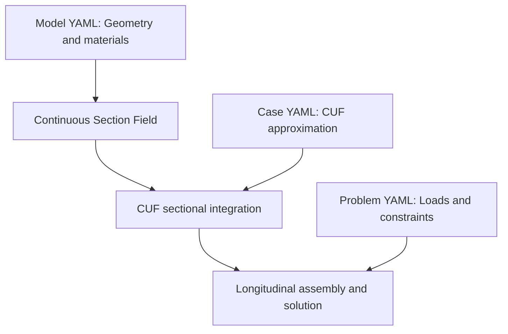

# DRAFT

**Abstract**

This paper presents a computational implementation of the Carrera Unified Formulation (CUF) based on the introduction of the Continuous Section Field (CSF) as a primary object describing the geometric and material state of a beam cross-section along its longitudinal axis.

The Continuous Section Field is represented as an independent computational object, providing the sectional geometry and constitutive description at any requested longitudinal coordinate, independently of the transverse displacement expansion, longitudinal finite-element discretization, and numerical quadrature.

Its integration into CUF is established through the sectional integrals, whose longitudinally varying coefficients enter the fundamental nuclei while preserving the underlying variational formulation.

This organization enables a CUF computational core that is independent of any specific geometric or material model, allowing different physical sectional descriptions to be used without modifying the core formulation.

The work establishes the mathematical connection between the continuous sectional description and CUF and presents its realization within a computational framework.

# 1. Introduction

The Carrera Unified Formulation (CUF) provides a general framework for constructing refined structural models through systematic expansions of the displacement field over the beam cross-section. The choice of transverse expansion and the longitudinal approximation determines the numerical representation of the displacement field. A distinct computational question is how to provide the solver with the physical cross-sectional geometry and material properties without embedding a particular geometric or constitutive model in its core.

This paper presents a computational implementation of CUF organized around the **Continuous Section Field (CSF)**. The central idea is to treat the physical sectional state as a primary, independently defined function of the longitudinal position. Let $x$ denote the longitudinal coordinate of a beam of length $L$, and let $(y,z)$ denote the transverse coordinates. The sectional state is written as

$$
\mathcal{S}(x) =
\lbrace \Omega(x), \mathbf{C}(x,y,z) \rbrace,
\qquad 0 \leq x \leq L.
$$

where $\Omega(x)$ is the physical cross-sectional domain and $\mathbf{C}(x,y,z)$ is the local constitutive matrix defined over that domain. This description accommodates both prismatic and non-prismatic members, as well as longitudinal and sectional variations of material properties. It is specified independently of the transverse displacement basis, longitudinal finite-element mesh, and numerical quadrature.

In the proposed implementation, $\mathcal{S}(x)$ is not merely a formal notation. It is realized as a computational object that can be evaluated at longitudinal positions requested by the solver. The object supplies the geometry and constitutive information required for sectional integration. The CUF computational core can consequently operate on different physical sectional descriptions without being specialized to any one of them. Independence here concerns the organization of the model and the solver; the numerical response necessarily remains dependent on the supplied geometry and material properties.

Establishing this organization requires an explicit mathematical connection between the continuous sectional description and CUF. The geometric domains and constitutive matrices supplied by CSF enter the sectional integrals, producing coefficients that vary along the beam and contribute to the CUF fundamental nuclei. The underlying variational formulation is retained. The theoretical section of this paper develops this connection; the implementation section then explains how the corresponding mathematical responsibilities are represented in the software.

The implementation is accompanied by a numerical study of a tapered I-shaped member, with an independent three-dimensional finite-element reference. The study is intended to demonstrate the computational realization of the proposed separation and to make its numerical behavior directly inspectable. The complete source code, physical model definitions, numerical configurations, execution procedures, and results are publicly available so that the reported analyses can be reproduced and checked.

The mathematical formulation is documented in the [CSF–CUF Continuous Geometry and Material Field Formulation](https://github.com/giovanniboscu/continuous-section-field/blob/main/docs/model/CSF_CUF_Continuous_Geometry_and_Material_Field_Formulation.md). The reproducible numerical case and its supporting materials are available in the [I-Shape_L repository directory](https://github.com/giovanniboscu/continuous-section-field/tree/main/cuf/I-Shape_L).

The contribution of the paper is therefore a computational realization of CUF in which a continuous physical sectional description is a first-class object, together with the mathematical coupling needed to use that object in the CUF formulation and a publicly reproducible numerical demonstration.


# 2. Mathematical Formulation of the CSF-CUF Coupling

This section establishes the mathematical connection between a prescribed Continuous Section Field (CSF) and the Carrera Unified Formulation (CUF). The objective is to identify the sectional information required by the CUF variational equations and the longitudinal operators that result from its integration. The physical field is independent of the displacement approximation and of the longitudinal numerical discretization. Small-strain linear elasticity is assumed.

## 2.1. Continuous sectional description

Using the longitudinal and transverse coordinates introduced in Section 1, let $N_\Omega$ denote the number of physical sectional subdomains. At each station $x$, the prescribed field $\mathcal S(x)$ provides their boundaries and constitutive descriptions:

```math
\mathcal S(x)\longmapsto
\bigl(\Omega^k(x),\,\partial\Omega^k(x),\,\mathbf C^k(x,y,z)\bigr)_{k=1}^{N_\Omega}.
```

Here $k$ identifies a sectional subdomain, $\Omega^k(x)$ is its physical area, $\partial\Omega^k(x)$ its boundary, and $\mathbf C^k(x,y,z)$ its $6\times6$ constitutive matrix. The union of the subdomains is the physical section $\Omega(x)$. The field $\mathcal S(x)$ is prescribed input, not an unknown of the structural problem. Geometry and constitutive properties may vary independently with $x$; material discontinuities between subdomains are permitted. The domains and coefficients are assumed sufficiently regular for the integrations below. Piecewise-smooth descriptions are treated on their respective longitudinal intervals.

The detailed construction and evaluation of the CSF geometric and material model are documented separately. Here only its role as a source of physical sectional data is required.

## 2.2. CUF displacement approximation and strain operators

Let $M$ be the number of scalar transverse expansion functions $F_s(x,y,z)$, with $s=1,\ldots,M$. Let $\mathbf q_s(x)=[q_{xs}(x),q_{ys}(x),q_{zs}(x)]^T$ denote the corresponding three longitudinal displacement amplitudes. The CUF approximation is

```math
\mathbf u(x,y,z)=\sum_{s=1}^{M}F_s(x,y,z)\,\mathbf q_s(x).
```

The index $s$ labels a trial function; $\tau=1,\ldots,M$ will label a test function. Summation over these indices is explicit. A comma followed by $x$, $y$, or $z$ denotes partial differentiation with respect to the indicated physical coordinate; a prime denotes ordinary differentiation with respect to $x$.

The expansion functions may depend on $x$ if the selected basis follows an evolving physical section. Such dependence is a property of the chosen kinematic basis, not a necessary consequence of CSF: a basis fixed in physical transverse coordinates has $F_{s,x}=0$ even when the physical section varies.

Use the engineering strain ordering $[\varepsilon_{xx},\varepsilon_{yy},\varepsilon_{zz},\gamma_{yz},\gamma_{xz},\gamma_{xy}]^T$, where $\gamma$ denotes engineering shear strain. Define the following $6\times3$ matrices for any scalar basis function $F$:

```math
\mathbf B^{(0)}(F)=
\begin{bmatrix}
F_{,x}&0&0\\
0&F_{,y}&0\\
0&0&F_{,z}\\
0&F_{,z}&F_{,y}\\
F_{,z}&0&F_{,x}\\
F_{,y}&F_{,x}&0
\end{bmatrix},
\qquad
\mathbf B^{(1)}(F)=
\begin{bmatrix}
F&0&0\\
0&0&0\\
0&0&0\\
0&0&0\\
0&0&F\\
0&F&0
\end{bmatrix}.
```

The superscripts $(0)$ and $(1)$ identify the factors multiplying an amplitude and its longitudinal derivative, respectively. The strain field is therefore

```math
\boldsymbol\varepsilon=
\sum_{s=1}^{M}
\left[\mathbf B^{(0)}(F_s)\mathbf q_s+
\mathbf B^{(1)}(F_s)\mathbf q_s'\right].
```

The virtual strain $\delta\boldsymbol\varepsilon$ is obtained by replacing each amplitude with its admissible virtual variation $\delta\mathbf q_s$. This construction preserves any required $F_{s,x}$ terms.

## 2.3. Internal virtual work

Within subdomain $k$, the stress vector is $\boldsymbol\sigma^k=\mathbf C^k\boldsymbol\varepsilon$, using tensorial shear stresses paired with the engineering shear strains. The internal virtual work is

```math
\delta W_{\mathrm{int}}=
\int_0^L\sum_{k=1}^{N_\Omega}
\int_{\Omega^k(x)}
\delta\boldsymbol\varepsilon^T\mathbf C^k(x,y,z)
\boldsymbol\varepsilon\,d\Omega\,dx.
```

The CSF supplies the physical integration domains and constitutive matrices; the CUF expansion supplies the test and trial strain factors. Their coupling takes place inside these sectional integrals, without requiring a beam-wide reference-to-physical mapping of the non-prismatic solid.

## 2.4. Sectional coefficients and weak-form matrices

Let $m,n\in\{1,\ldots,6\}$ label entries of the constitutive matrix in the strain ordering above. Let $\alpha,\beta\in\{0,x,y,z\}$ identify a derivative of the test and trial sectional functions, respectively, where $F_{\tau,0}=F_\tau$ and $F_{s,0}=F_s$. For fixed expansion indices $\tau$ and $s$, define the sectional coefficients

```math
J^{mn}_{\tau,\alpha\,s,\beta}(x)=
\sum_{k=1}^{N_\Omega}
\int_{\Omega^k(x)}
C^k_{mn}(x,y,z)\,
F_{\tau,\alpha}(x,y,z)\,
F_{s,\beta}(x,y,z)\,d\Omega.
```

Each coefficient combines three independent inputs: the physical sectional domain, the constitutive weighting, and the CUF test/trial functions. In particular, $J(x)$ can vary with $x$ even when all sectional basis functions satisfy $F_{s,x}=0$.

For $a,b\in\{0,1\}$, define four $3\times3$ matrices for each pair $(\tau,s)$:

```math
\mathbf H^{ab}_{\tau s}(x)=
\sum_{k=1}^{N_\Omega}
\int_{\Omega^k(x)}
\left[\mathbf B^{(a)}(F_\tau)\right]^T
\mathbf C^k(x,y,z)
\mathbf B^{(b)}(F_s)\,d\Omega.
```

The first superscript indicates whether the test amplitude is differentiated longitudinally, and the second does the same for the trial amplitude. Each entry of $\mathbf H^{ab}_{\tau s}$ is a linear combination of the sectional coefficients $J^{mn}_{\tau,\alpha\,s,\beta}$. Substitution into the internal virtual work gives

```math
\begin{aligned}
\delta W_{\mathrm{int}}=\int_0^L\sum_{\tau=1}^{M}\sum_{s=1}^{M}
\bigl[&\delta\mathbf q_\tau^T\mathbf H^{00}_{\tau s}\mathbf q_s
+\delta\mathbf q_\tau^T\mathbf H^{01}_{\tau s}\mathbf q_s'\\
&+\delta\mathbf q_\tau'^T\mathbf H^{10}_{\tau s}\mathbf q_s
+\delta\mathbf q_\tau'^T\mathbf H^{11}_{\tau s}\mathbf q_s'\bigr]dx.
\end{aligned}
```

This weak form is the basis of the numerical assembly: the longitudinal integration requires evaluations of the sectional matrices at the selected integration stations.

## 2.5. Longitudinal fundamental operator

For a fixed test/trial expansion pair $(\tau,s)$, define the three-component longitudinal flux

```math
\mathbf g_{\tau s}(x)=
\mathbf H^{10}_{\tau s}(x)\mathbf q_s(x)
+\mathbf H^{11}_{\tau s}(x)\mathbf q_s'(x).
```

The two terms containing the derivative of the virtual amplitude can then be integrated by parts:

```math
\int_0^L \delta\mathbf q_\tau'^T\mathbf g_{\tau s}\,dx
=\left[\delta\mathbf q_\tau^T\mathbf g_{\tau s}\right]_{x=0}^{x=L}
-\int_0^L\delta\mathbf q_\tau^T
\frac{d\mathbf g_{\tau s}}{dx}\,dx.
```

Here $[h]_{x=0}^{x=L}=h(L)-h(0)$ for any quantity $h(x)$. Combining this identity with the undifferentiated virtual-amplitude terms identifies the matrix differential operator $\mathcal K_{\tau s}$ acting on the trial amplitude vector:

```math
\boxed{
\mathcal K_{\tau s}[\mathbf q_s]=
\mathbf H^{00}_{\tau s}\mathbf q_s
+\mathbf H^{01}_{\tau s}\mathbf q_s'
-\frac{d}{dx}\left(
\mathbf H^{10}_{\tau s}\mathbf q_s
+\mathbf H^{11}_{\tau s}\mathbf q_s'
\right).
}
```

The integration by parts also yields the generalized end action

```math
\left[
\delta\mathbf q_\tau^T
\sum_{s=1}^{M}
\left(\mathbf H^{10}_{\tau s}\mathbf q_s+
\mathbf H^{11}_{\tau s}\mathbf q_s'\right)
\right]_{x=0}^{x=L},
```

summed over $\tau$. To specify the corresponding external action, let $\mathbf b^k(x,y,z)$ be a prescribed body-force density in subdomain $k$. Let $\Gamma_t(x)$ be the traction-loaded portion of the sectional boundary, $\bar{\mathbf t}(x,y,z)$ the prescribed surface traction, $d\Gamma$ the physical line element along that boundary, and $\mu(x,y,z)$ the factor converting $d\Gamma\,dx$ to physical surface area. The generalized force per unit longitudinal length is

```math
\mathbf f_\tau(x)=
\sum_{k=1}^{N_\Omega}\int_{\Omega^k(x)}
F_\tau\,\mathbf b^k\,d\Omega
+\int_{\Gamma_t(x)}
F_\tau\,\bar{\mathbf t}\,\mu\,d\Gamma.
```

The surface term applies to lateral tractions; end-section tractions are represented by the generalized end actions. The interior equilibrium equations are

```math
\sum_{s=1}^{M}\mathcal K_{\tau s}[\mathbf q_s]
=\mathbf f_\tau(x),\qquad \tau=1,\ldots,M.
```

For the classical strong form, the coefficients and amplitudes must have the required differentiability on each smooth interval. The longitudinal derivative in $\mathcal K_{\tau s}$ acts on the **entire products**, including the variable sectional matrices. In contrast, weak-form finite-element assembly uses the preceding integral expression and need not explicitly differentiate $\mathbf H^{ab}_{\tau s}(x)$.

The mathematical path underlying the implementation is thus

```math
\mathcal S(x)\longrightarrow
J^{mn}_{\tau,\alpha\,s,\beta}(x)
\longrightarrow\mathbf H^{ab}_{\tau s}(x)
\longrightarrow\mathcal K_{\tau s}.
```

Changing an admissible physical geometry or constitutive field changes the sectional coefficients, but not the rule used to construct the CUF operator. This is the mathematical basis for a computational core that is independent of any particular geometric-material model.

---


# 3. Computational Implementation

The mathematical coupling established in Section 2 is implemented by separating the prescribed physical sectional description from the CUF displacement approximation and the longitudinal numerical solution. This section describes the computational responsibilities and their interaction. The numerical configuration and verification of the tapered I-shaped member are presented in Section 4.

## 3.1. Separation of computational responsibilities

The implementation distinguishes three inputs. First, the Continuous Section Field (CSF) supplies the physical sectional domains and material properties at a requested longitudinal position. Second, the CUF transverse expansion supplies the scalar displacement functions and their required spatial derivatives. Third, the longitudinal approximation represents the unknown displacement amplitudes along the member. These inputs are combined during numerical integration, rather than being embedded in a single geometry-specific solver.

The reference implementation and its documented input files are available in the [I-Shape_L study](https://github.com/giovanniboscu/continuous-section-field/tree/main/cuf/I-Shape_L) and its [reproducibility guide](https://github.com/giovanniboscu/continuous-section-field/blob/main/cuf/I-Shape_L/reproducibility.md).

## 3.2. Evaluation of the continuous sectional field

At a longitudinal integration station, the solver obtains the current physical sectional geometry and constitutive description from CSF. The sectional subdomains determine the regions over which integration is performed; the material field determines the constitutive coefficients used at sectional integration points. Consequently, a change in cross-sectional shape or material distribution is represented by a change in the data evaluated at those points, without redefining the CUF strain-displacement construction.

The CSF representation is independent of the transverse interpolation chosen for the displacement field. A physical section may be subdivided into numerical domains to support a particular CUF basis. Such subdivisions do not necessarily represent additional material interfaces. In the documented I-shaped example, the physical member has three material regions, whereas the CUF approximation uses nine quadrilateral domains: three in each flange/web group. The two descriptions represent the same solid, with different numerical partitions.

Sectional quadrature is performed over the current physical domains. Local coordinates and isoparametric mappings may be used to evaluate a sectional basis and its integration measure; this does not require a single reference-to-physical mapping of the complete non-prismatic beam.

## 3.3. Assembly of the CUF sectional contributions

At each longitudinal quadrature station, the transverse expansion provides the values and derivatives of the sectional functions. The solver combines these kinematic factors with the CSF geometry and constitutive data to evaluate the sectional coefficients and matrices defined in Section 2.4. The resulting matrices are functions of longitudinal position and enter the weak internal virtual work without requiring explicit longitudinal differentiation of their coefficients.

For a fixed test/trial expansion pair, the four sectional matrices distinguish terms involving the longitudinal amplitudes from those involving their first derivatives. Their construction is governed by the strain-displacement operators and the constitutive law; the particular physical section determines the values of the integrals. The same assembly rule therefore applies to different admissible CSF descriptions.

In the documented L9 case, neighboring quadrilateral domains share displacement nodes. The numerical configuration explicitly selects the CSF polygons as the domain source, an isoparametric sectional mapping and shared-point connectivity. The case also enables a mixed-interpolation-of-tensorial-components (MITC) correction; this is a numerical option of the selected approximation, not part of the defining CSF-to-CUF coupling. The [case configuration](https://github.com/giovanniboscu/continuous-section-field/blob/main/cuf/I-Shape_L/cases/taper/carrera_i_shaped_taper80_lagrangeL9_v4_E10_web3.yaml) records these choices.

## 3.4. Longitudinal discretization, solution and reconstruction

The longitudinal amplitudes introduced in Section 2.2 are approximated independently of the CSF description. In the finite-element realization, longitudinal shape functions interpolate these amplitudes within each longitudinal element. Numerical integration combines the longitudinal interpolation factors with the sectional matrices evaluated at the selected stations. The resulting algebraic system is assembled, the prescribed constraints are imposed, and the generalized displacement coefficients are solved.

The documented tapered I-shaped case uses ten longitudinal finite elements with polynomial order six, longitudinal Gauss order fifteen, and sectional Gauss order twelve. These values specify one reproducible numerical approximation; they are not requirements of the CSF description itself. The case is executed through the `csf-cuf` command and a YAML configuration, without a graphical modelling interface.

After solution, the displacement, strain and stress fields can be reconstructed at requested physical positions using the CUF expansion and the constitutive data supplied by CSF. The solved coefficients are stored in a reusable checkpoint. This separates the structural solution from subsequent evaluation, comparison and plotting. The [reproducibility guide](https://github.com/giovanniboscu/continuous-section-field/blob/main/cuf/I-Shape_L/reproducibility.md) documents the executable commands, checkpoints and independent post-processing stages.

## 3.5. Declarative model definition and reproducibility

The computational separation is also reflected in the YAML input organization. Three distinct descriptions are used: a **model** defines the physical sectional geometry and its material properties; a **problem** defines the applied loads and boundary conditions; and a **case** selects the CUF transverse expansion, longitudinal discretization, integration settings and solver options. The YAML files are declarative inputs to the implementation, not a replacement for the mathematical definitions in Section 2.

The relationship between these inputs and the numerical operations is summarized in Figure 1. The arrows indicate the flow of information, not a prescribed sequence of software calls. In particular, the physical model and the numerical case remain separate inputs to sectional integration.



*Figure 1. Conceptual information flow in the CSF-CUF implementation. The CSF provides the physical description; the CUF case specifies the approximation; the problem specifies the actions and constraints. Their contributions meet during numerical assembly.*

The diagram makes explicit a distinction that is important for interpreting the implementation: the CSF is not generated by the CUF basis, and the basis does not define the physical material. They are evaluated together only when the sectional contributions required by the variational formulation are computed.

This division permits a prescribed physical problem to be analyzed using different numerical approximations, or a different admissible sectional description to be supplied without rewriting the CUF assembly rules. Distinct YAML geometric partitions can represent the same physical solid when required by different numerical methods. It also makes the inputs of a reported analysis explicit and inspectable. For the tapered I-shaped study, the [physical geometry for the three-dimensional reference](https://github.com/giovanniboscu/continuous-section-field/blob/main/cuf/I-Shape_L/models/carrera_i_shaped_taper80.yaml) and the [nine-domain representation used by the CUF case](https://github.com/giovanniboscu/continuous-section-field/blob/main/cuf/I-Shape_L/models/carrera_i_shaped_taper80_l9_web3.yaml) describe the same member but serve different numerical purposes. The [CUF case file](https://github.com/giovanniboscu/continuous-section-field/blob/main/cuf/I-Shape_L/cases/taper/carrera_i_shaped_taper80_lagrangeL9_v4_E10_web3.yaml) records the selected approximation and integration settings.

The YAML representation is not itself a mathematical contribution. Its role is to expose, in a reproducible computational experiment, the separation between prescribed physical data and numerical approximation. Complete input files and execution instructions are retained in the repository rather than reproduced in this paper.

The implementation thus realizes the mathematical dependency established in Section 2: the prescribed sectional field supplies physical data, the CUF approximation supplies kinematic factors, and the longitudinal solver combines their sectional contributions. Section 4 evaluates this realization against an independent three-dimensional finite-element solution.
