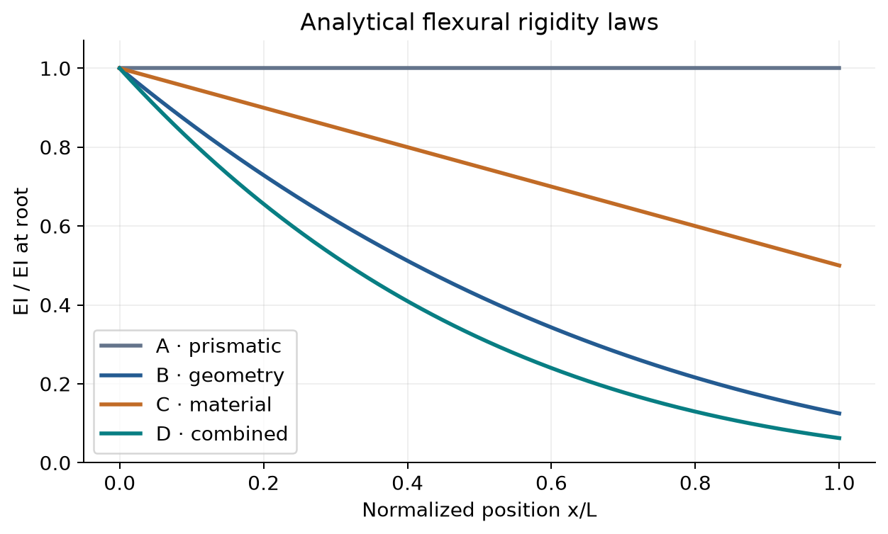

# Analysis of Non-Prismatic Beams with Variable Geometry and Material Properties Using PyCBA and CSF

**Version 0.1 - First review draft · 27 November 2026**

## Introduction and purpose

This tutorial combines Continuous Section Field (CSF) and PyCBA 1.0.2 to analyse beams with longitudinally varying geometry and material properties. Neither library is modified, CSF is not a mandatory PyCBA dependency, and CUF is not involved.

> **Short integration guide:** The [CSF–PyCBA Integration Guide](CSF-PyCBA-Integration-Guide.md) explains how to create a CSF YAML model from scratch and connect it to PyCBA through `SectionEI`. No prior knowledge of CSF or YAML is required.

### What is Continuous Section Field (CSF)?

[CSF](https://github.com/giovanniboscu/continuous-section-field) is an open-source library for describing the geometry and material distribution of structural members independently of the analysis method. A YAML model defines:

- The longitudinal domain and reference sections.
- The polygons forming each cross-section and their material weights, including automatic handling of nested material domains based on cross-sectional topology.
- The laws governing longitudinal geometry and material variation.

CSF evaluates the cross-sectional domain $\mathcal{S}(x)$ and its sectional properties (area, centroid and second moments of area) at any position $x$ along the member. Reference sections are not finite element nodes.

The dimensionless polygon `weight` is a homogenization coefficient, not physical weight, mass or density. In this tutorial it represents the ratio between the local Young's modulus and its reference value:

$$
E(x)=E_{\mathrm{ref}}w(x)
$$

Geometry and material weights can vary independently.

See [CSF Fundamentals](https://github.com/giovanniboscu/continuous-section-field/blob/main/docs/CSF_Fundamentals.md) and the [CSF – Longitudinally Varying Homogenization User Guide](https://github.com/giovanniboscu/continuous-section-field/blob/main/docs/CSFLongitudinally-varying-homogenization-user-guide.md).

### What is PyCBA?

[PyCBA](https://ccaprani.github.io/pycba/) is an open-source Python library for continuous beam analysis. Given member lengths, sectional stiffnesses, loads and boundary conditions, it calculates displacements, reactions and internal forces.

For the Euler–Bernoulli model considered here, with Young's modulus uniform within each cross-section, the relevant stiffness is $EI(x)=E(x)I(x)$, where $I(x)$ is the geometric second moment of area about the bending axis. The `SectionEI` interface supports variable flexural rigidity within a beam span.

### Why combine CSF and PyCBA?

A conventional midpoint approach divides a variable-section member into elements with constant stiffness. Refinement improves this approximation but increases the size of the structural model.

Alternatively, the CSF–PyCBA interface evaluates the CSF sectional properties through a Python callable, $x\mapsto EI(x)$. PyCBA constructs an internal polynomial representation of this function and uses it in the structural analysis, retaining stiffness variation within each element.

The four cantilever benchmarks below isolate geometry variation, material variation and their combined effect. Both approaches are compared against independent analytical reference solutions. The [theory](THEORY.md) and [numerical validation](VALIDATION.md) documents develop the mathematical formulation, flexibility and stiffness matrices, convergence and accuracy in detail.


## 1. Physical problem

A rectangular cantilever of length 5000 mm is clamped at x = 0 and loaded by a downward 10000 N point force at x = L. Width is 200 mm, root depth is 500 mm and root Young's modulus is 210000 MPa. The analysis is linear elastic, Euler-Bernoulli, with no shear deformation or self-weight. Material is uniform within each cross-section.

| Case | YAML file | Tip depth (mm) | Tip modulus (MPa) |
|---|---|---:|---:|
| A | `prismatic.yaml` | 500 | 210000 |
| B | `variable_geometry.yaml` | 250 | 210000 |
| C | `variable_material.yaml` | 500 | 105000 |
| D | `combined_variation.yaml` | 250 | 105000 |

Case B is the initial tapered-member tutorial; C and D extend it without changing the analysis workflow. Both depth and modulus vary linearly where applicable.


### 1.1 Example of a CSF physical model - Case D

Case D illustrates the CSF representation of a member with
both variable geometry and variable material properties.

The model is defined in
[`models/combined_variation.yaml`](models/combined_variation.yaml).

```yaml
CSF:
  sections:
    S0:
      z: 0.0
      polygons:
        - name: solid
          weight: 1.0
          vertices:
            - [-100.0, -250.0]
            - [100.0, -250.0]
            - [100.0, 250.0]
            - [-100.0, 250.0]
    S1:
      z: 5000.0
      polygons:
        - name: solid
          weight: 0.5
          vertices:
            - [-100.0, -125.0]
            - [100.0, -125.0]
            - [100.0, 125.0]
            - [-100.0, 125.0]
  weight_laws:
    - "solid,solid: w0 + (w1-w0)*(z/L)"
```

The two reference sections, `S0` and `S1`, define the
geometry and material weights at the member endpoints.

| Parameter | S0 | S1 |
|---|---:|---:|
| Longitudinal position (mm) | 0 | 5000 |
| Section width (mm) | 200 | 200 |
| Section depth (mm) | 500 | 250 |
| Material weight | 1.0 | 0.5 |
| Young's modulus (MPa) | 210000 | 105000 |

Linear interpolation of the corresponding polygon vertices
defines the continuous geometry:

$$
b(z)=200,\qquad
h(z)=500\left(1-\frac{z}{2L}\right)
$$

The `weight_laws` entry defines the longitudinal variation
of the material weight:

$$
w(z)=w_0+(w_1-w_0)\frac{z}{L}
=1-\frac{z}{2L}
$$

With $E(z)=E_{\mathrm{ref}}w(z)$, the resulting flexural
rigidity is:

$$
EI(z)=E_{\mathrm{ref}}\frac{bh_0^3}{12}
\left(1-\frac{z}{2L}\right)^4
$$

No shear weight law is required for the present
Euler–Bernoulli analysis.

The integration code converts the CSF sectional properties
into a flexural rigidity function for PyCBA’s `SectionEI` interface.

**All four benchmarks use the same CSF–PyCBA integration
code and analysis procedure. Only the input YAML model changes.**
The independent analytical references are case-specific and used only for validation.

> **Note:** `weight_laws` is optional in this example, as CSF
> interpolates material weights linearly by default.
> The explicit law is included to demonstrate how custom,
> including non-linear, material variations can be defined
> directly in the YAML model.
>
> See the [CSF – Longitudinally Varying Homogenization User Guide](https://github.com/giovanniboscu/continuous-section-field/blob/main/docs/CSFLongitudinally-varying-homogenization-user-guide.md).

## 2. Run and reproduce the example

**Requirements:** Git and Python 3.11 (the tested version). The review branch uses PyCBA 1.0.2.

### Installation

For a fresh local checkout:

```bash
git clone --branch feature/csf-pycba https://github.com/giovanniboscu/continuous-section-field.git
cd continuous-section-field
python3 -m venv .venv
source .venv/bin/activate
python3 -m pip install -e .
cd pycba/tapered_cantilever
python3 -m pip install -r requirements.txt
python3 -m pip check
python3 -c "from pycba import SectionEI; print(SectionEI)"
```

For an existing checkout or an extracted tutorial directory, activate the existing environment and adjust the paths as necessary.

### Visualize the physical models (optional)

From `tapered_cantilever/`, use the shared [action file](models/action.yaml):

```bash
csf-actions models/prismatic.yaml models/action.yaml
csf-actions models/variable_geometry.yaml models/action.yaml
csf-actions models/variable_material.yaml models/action.yaml
csf-actions models/combined_variation.yaml models/action.yaml
```

The actions display the 3D geometry, sections at z = 0, 2500 and 5000 mm, material weights and weighted sectional properties A, Ix and Iy. These visualizations use CSF alone. See the [CSF action syntax](https://github.com/giovanniboscu/continuous-section-field/blob/main/docs/csftutorial.md).

### Run the benchmarks

```bash
python3 main.py --help
python3 main.py --case all
```

Alternatively, run individual configurations:

```bash
python3 main.py --case prismatic
python3 main.py --case variable_geometry
python3 main.py --case variable_material
python3 main.py --case combined_variation
```

### Regenerate documentation figures

```bash
python3 generate_doc_figures.py
```

Numerical results are stored in `results/` and documentation figures in `img/`.

### Record the execution environment

```bash
git rev-parse HEAD
python3 --version
python3 -m pip show csfpy pycba
python3 -m pip freeze
```

## 3. Read the code in execution order


Start with `main.py`, specifically `run_case`. The following abridged excerpt preserves its order; output handling and tolerance checks are omitted here only for readability.

```python
field = load_csf_model(ROOT / 'models' / f'{case}.yaml')
sections = validate_section_properties(field, case, L, E0, output)
EI = create_ei_function(field, E0)
reference = reference_deflection(case)
continuous = solve_continuous(EI, L, P)
convergence = run_convergence_study(EI, L, P, reference,
                                   [1, 2, 4, 8, 16, 32, 64])
write_csv(output / 'convergence.csv', convergence)
write_csv(output / 'degree_sensitivity.csv', degree_study(EI, L, P, reference))
plot_results(sections, convergence, output)
```

| File | Responsibility |
|---|---|
| `models/` | Four physical models and the shared visualization action file |
| `main.py` | CLI, orchestration and acceptance checks |
| `csf_section.py` | Load CSF; expose sectional properties and EI callable |
| `pycba_analysis.py` | Continuous and midpoint beam analyses |
| `reference_solution.py` | Independent formulas and reference integration |
| `validation.py` | Section checks and CSV export |
| `convergence.py` | Element-count and degree sensitivity |
| `plotting.py` | Generated plots |

## 4. The coupling in a few lines

### Coordinate systems and displacement conventions

CSF uses $(X,Y,Z)$, with $Z$ longitudinal; PyCBA uses $(x,y)$ in the bending plane.

| Physical direction | CSF | PyCBA |
|---|---|---|
| Longitudinal | $Z$ | $x$ |
| Transverse depth | $Y$ | $y$ |
| Transverse width | $X$ | Out of plane |

Thus $x=Z$, $y=Y$ and $t=x/L=Z/L$. No reversal of physical directions is required. Bending occurs about the CSF $X$-axis, so the weighted centroidal inertia `Ix` is used:

```python
props = section_properties(field.section(x))
EI = E_ref * props['Ix']
```

The full callable in `csf_section.py` handles both scalar and array inputs. For this single homogeneous polygon only, geometric area and inertia are recovered by dividing weighted values by w. Do not multiply the weighted inertia by E(x) again.

```python
section = cba.SectionEI().add_segment('poly', [0.0, L], EI, degree=12)
beam = cba.BeamAnalysis([L], [section], R=[-1, -1, 0, 0], GAv=None)
beam.add_pl(1, P, L)
beam.analyze()
tip = -float(beam.beam_results.D[-2])
```

Here `EI` denotes the callable, rather than the scalar in the preceding illustration. The PyCBA 1.0.2 published source **fits a polynomial to callable samples internally**. Thus continuous means a spatially varying polynomial representation, not a direct callback at every integration point. For these benchmarks the underlying EI laws are polynomial of degree at most four. See [THEORY.md](THEORY.md) for the distinction and source links.

The midpoint comparison instead assigns one scalar EI per element. Neither approach changes the physical CSF model.



## 5. Outputs and results

Each run writes `results/<case>/` with `section_validation.csv`, `convergence.csv`, `degree_sensitivity.csv`, `summary.csv`, `rigidity.png` and `convergence.png`. Documentation figures in `img/` are generated separately from the CSVs and analytical laws, as described in Section 2.

| Case | Reference tip (mm) | Continuous tip (mm) | Relative error |
|---|---:|---:|---:|
| A | 0.952380952 | 0.952380952 | 1.166e-16 |
| B | 1.557649841 | 1.557649841 | 7.128e-16 |
| C | 1.103698175 | 1.103698175 | 6.035e-16 |
| D | 1.904761905 | 1.904761905 | 1.515e-15 |

For all four configurations, the continuous stiffness
representation achieves near-machine-precision agreement
with the analytical reference solutions using a single
beam element, including the case of simultaneous geometry
and material variation.

The relative errors range from approximately 1e-16 to 1e-15,
well below the acceptance thresholds implemented in the code:
1e-8 for sectional properties and 1e-6 for the single-element
tip displacement.

The reported values are preserved from the original local
runs; no new solver executions were performed for this
documentation revision.


- [THEORY.md - mathematical derivation and interface details](THEORY.md)
- [VALIDATION.md - numerical evidence, convergence and limitations](VALIDATION.md)

## 6. Scope

The tutorial demonstrates independent physical modelling and beam analysis for four rectangular cantilevers. It does not establish general accuracy for arbitrary non-polynomial rigidity, composite cross-sections, shear deformation, discontinuities or other load/support configurations. It is a draft for joint review, not an accepted PyCBA tutorial.

## 7. First review

See [REVIEW.md](REVIEW.md) for the review scope, provenance and open questions.
