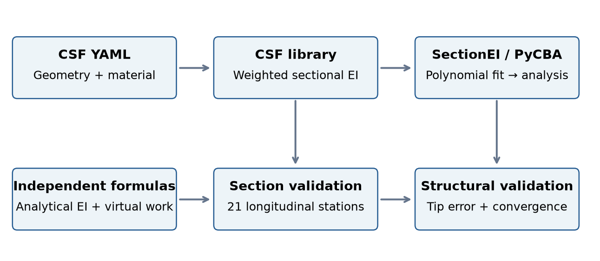

# Analysis of Non-Prismatic Beams with Variable Geometry and Material Properties Using PyCBA and CSF
##  Introduction and purpose

**Version 0.1 - First review draft · 27 November 2026**

>### Short integration guide
>
>For a step-by-step introduction to CSF–PyCBA integration, see the
>[CSF–PyCBA Integration Guide](CSF-PyCBA-Integration-Guide.md).
>
>The guide explains how to create a CSF YAML model from scratch,
>extract the continuous flexural rigidity from its geometry and
>material distribution, and integrate it with PyCBA through
>the `SectionEI` interface. No prior knowledge of CSF or YAML
>is required.

###  What is Continuous Section Field (CSF)?

Continuous Section Field (CSF) is an open-source library
developed to represent the geometry and material distribution
of structural members whose cross-section may vary along
their longitudinal axis.

The main idea is to describe the physical member independently
of the numerical method used for its structural analysis.

A CSF model defines:

- The longitudinal domain of the member.
- The geometry of the cross-section at selected reference
  stations.
- The polygons that compose each cross-section.
- The material weights associated with these polygons,
  including automatic handling of nested material domains
  based on the cross-sectional topology.
- The laws governing the longitudinal variation of geometry
  and material weights.

These data are defined in a YAML file.

The reference stations are used to construct a continuous
representation of the member. They are not finite element
nodes and do not define a structural discretisation.

Once the model has been loaded, the CSF field can be evaluated
at any longitudinal position within its domain.

Let $x$ be the longitudinal coordinate of the member and
$L$ its total length, with $0 \leq x \leq L$.

Let $\mathcal{S}(x)$ denote the cross-sectional domain at
position $x$.

The continuous geometric representation can therefore be
expressed as:

$$
x \longmapsto \mathcal{S}(x)
$$

This means that, for a given longitudinal coordinate, CSF provides the corresponding cross-sectional geometry, material distribution and associated sectional properties.
CSF associates a dimensionless
weight with each polygon. In the present tutorial, this
weight is used to represent the longitudinal variation
of Young's modulus. 
>For more information on material distribution, nested material
>domains and longitudinally varying homogenization, see the
>[CSF – Longitudinally Varying Homogenization User Guide](https://github.com/giovanniboscu/continuous-section-field/blob/main/docs/CSFLongitudinally-varying-homogenization-user-guide.md).

Let:

- $E_{\mathrm{ref}}$ be a reference Young's modulus.
- $w(x)$ be the dimensionless material weight at position $x$.
- $E(x)$ be the local Young's modulus.

The material representation adopted in this tutorial is:

$$
E(x)=E_{\mathrm{ref}}w(x)
$$

Geometry and material weights can vary independently along
the member.

CSF also provides functions for calculating sectional
properties directly from the cross-sectional representation,
such as area, centroid and second moments of area.

These properties can be evaluated at any longitudinal
position without defining additional reference stations
in the YAML model.

It is important to distinguish the physical representation
from its subsequent numerical use.

CSF describes the member and provides its sectional
properties. It does not define the structural discretisation,
boundary conditions or equilibrium equations used by PyCBA.

The same CSF model can therefore be used by different
structural analysis methods.

For more information, see the
[CSF repository](https://github.com/giovanniboscu/continuous-section-field).


### What is PyCBA?

PyCBA is an open-source Python library for the structural
analysis of continuous beams.

While CSF provides the physical representation of the
member, PyCBA provides the numerical formulation required
to calculate its structural response.

A beam analysis requires information about:

- Member lengths.
- Material and sectional stiffness properties.
- Boundary conditions.
- Applied loads.

From these data, PyCBA constructs and solves the structural
equilibrium equations and calculates the corresponding
displacements, reactions and internal forces.

For the Euler-Bernoulli beam model considered in this
tutorial, the relevant sectional property is the flexural
rigidity.

Let:

- $E(x)$ be the Young's modulus at position $x$.
- $I(x)$ be the geometric second moment of area about the
  relevant bending axis.
- $EI(x)$ be the corresponding flexural rigidity.

For a section with a uniform Young's modulus over its
cross-section:

$$
EI(x)=E(x)I(x)
$$

For a non-prismatic member, the flexural rigidity may
vary along the longitudinal axis.

PyCBA provides the `SectionEI` interface to represent
this variation within a single beam span.

This capability is particularly interesting in combination
with CSF, because the sectional properties are already
available as functions of the longitudinal coordinate.

For more information, see the
[PyCBA documentation](https://ccaprani.github.io/pycba/).


### Why combine CSF and PyCBA?

A common approach to the analysis of a member with variable
cross-section consists of dividing the member into a number
of segments and assigning constant sectional properties
to each segment.

The properties of each segment can, for example, be
evaluated at its midpoint.

In this approach, the continuous physical variation is
approximated by a sequence of constant stiffness values.

Increasing the number of segments generally improves
the representation of a smooth stiffness variation, but
also increases the size of the structural model.

An alternative approach is to retain the variation of
the sectional stiffness within each beam element.

The combination of CSF and PyCBA makes this possible
through the existing interfaces of both libraries:

1. CSF defines the continuous geometry and material weights.

2. CSF evaluates the sectional properties at the requested
   longitudinal positions.

3. A simple Python interface converts these properties
   into a flexural rigidity function.

4. PyCBA receives this function through its `SectionEI`
   interface and constructs an internal polynomial
   representation of the variable rigidity.

5. PyCBA uses this representation in the structural
   analysis.

The mathematical quantity connecting the two libraries is
therefore the flexural rigidity function:

$$
x \longmapsto EI(x)
$$

CSF does not need to know how PyCBA constructs its
structural stiffness matrix.

Similarly, PyCBA does not need to know how CSF represents
the geometry, evaluates material weights or integrates
the sectional properties.

The connection is established without modifications
to either library and without introducing CSF as a
required dependency of PyCBA.


### Purpose of this document

The purpose of this document is to explain, step by step,
how a continuous physical representation of a structural
member can be used in a PyCBA beam analysis.

A simple cantilever with a concentrated force applied
at its free end is selected as the reference structural
problem.

Four configurations are considered:

| Case | Geometry | Material |
|---|---|---|
| A | Constant | Constant |
| B | Variable | Constant |
| C | Constant | Variable |
| D | Variable | Variable |

The four configurations make it possible to study
separately the influence of geometric variation,
material variation and their combined effect.

For each configuration, the document develops:

- The mathematical description of the physical model.
- The calculation of the geometric sectional properties.
- The calculation of the flexural rigidity.
- An independent analytical solution for the tip displacement.
- The midpoint-based representation of the sectional stiffness.
- The variable-stiffness representation using PyCBA's SectionEI.
- The construction of the member flexibility and stiffness
  matrices.
- The interpretation of the convergence and accuracy results.

The objective is not only to demonstrate that CSF and
PyCBA can be used together, but also to understand how
the representation of the sectional stiffness influences
the accuracy of the structural solution.

Particular attention is given to the comparison between
the number of elements required by the midpoint approach
and the accuracy obtained using the non-prismatic
formulation available in PyCBA.

The analytical reference solutions are derived independently
of both libraries, providing a common reference for the
numerical validation.


###  Reading guide

The following sections introduce the physical problem
before discussing its numerical representation.

All mathematical symbols, assumptions and operators are
introduced before their use.

The derivations proceed from the physical geometry and
material description to the sectional properties, from
the sectional properties to the flexural rigidity, and
finally from the flexural rigidity to the structural
equilibrium equations.

The reader is not expected to have previous knowledge
of the internal implementation of either CSF or PyCBA.


# CSF-PyCBA: continuous sectional stiffness


This tutorial connects Continuous Section Field (CSF), which describes physical geometry and material variation, to PyCBA 1.0.2, which performs beam analysis. Neither solver is modified; CSF is not a mandatory PyCBA dependency. CUF is not involved.


## 1. Physical problem

A rectangular cantilever of length 5000 mm is clamped at x = 0 and loaded by a downward 10000 N point force at x = L. Width is 200 mm, root depth is 500 mm and root Young's modulus is 210000 MPa. The analysis is linear elastic, Euler-Bernoulli, with no shear deformation or self-weight. Material is uniform within each cross-section.

| Case | YAML file | Tip depth (mm) | Tip modulus (MPa) |
|---|---|---:|---:|
| A | `prismatic.yaml` | 500 | 210000 |
| B | `variable_geometry.yaml` | 250 | 210000 |
| C | `variable_material.yaml` | 500 | 105000 |
| D | `combined_variation.yaml` | 250 | 105000 |

Case B is the initial tapered-member tutorial; C and D extend it without changing the analysis workflow. Both depth and modulus vary linearly where applicable.

## 2. Run the example

Extract the entire `tapered_cantilever/` directory into the CSF repository under `pycba/` (or another location of your choice). From the CSF repository root, activate your existing virtual environment and install the local package:

```bash
python3 -m pip install -e .
cd pycba/tapered_cantilever
python3 -m pip install -r requirements.txt
python3 -c "from pycba import SectionEI; print(SectionEI)"
python3 main.py --help
python3 main.py --case prismatic
python3 main.py --case variable_geometry
python3 main.py --case variable_material
python3 main.py --case combined_variation
# Or run every case:
python3 main.py --case all
```

Adjust the directory path if the example is stored elsewhere. The reported local tests used Python 3.11 and PyCBA 1.0.2. Record the CSF Git revision and dependency versions when preparing the final shared tutorial:

```bash
git rev-parse HEAD
python3 -m pip show pycba csfpy
python3 -m pip freeze
```

### Visualize the physical models with CSF

After installing the local CSF package, and before running a structural analysis, inspect any of the four physical models using the same [action file](models/action.yaml). From the `tapered_cantilever/` directory with the virtual environment active:

```bash
csf-actions models/prismatic.yaml models/action.yaml
csf-actions models/variable_geometry.yaml models/action.yaml
csf-actions models/variable_material.yaml models/action.yaml
csf-actions models/combined_variation.yaml models/action.yaml
```

The actions display the 3D geometry, the sections at z = 0, 2500 and 5000 mm, the longitudinal material weight, and the sectional properties A, Ix and Iy. The weight is dimensionless, w = E/E_ref; the plotted sectional properties are weighted, not necessarily purely geometric. These visualizations use CSF alone and require no PyCBA analysis. The action file follows the [CSF action syntax](https://github.com/giovanniboscu/continuous-section-field/blob/main/docs/csftutorial.md); its execution should be checked locally before publication.

## 3. Read the code in execution order



Start with `main.py`, specifically `run_case`. The following abridged excerpt preserves its order; output handling and tolerance checks are omitted here only for readability.

```python
field = load_csf_model(ROOT / 'models' / f'{case}.yaml')
sections = validate_section_properties(field, case, L, E0, output)
EI = create_ei_function(field, E0)
reference = reference_deflection(case)
continuous = solve_continuous(EI, L, P)
convergence = run_convergence_study(EI, L, P, reference,
                                   [1, 2, 4, 8, 16, 32, 64])
write_csv(output / 'convergence.csv', convergence)
write_csv(output / 'degree_sensitivity.csv', degree_study(EI, L, P, reference))
plot_results(sections, convergence, output)
```

| File | Responsibility |
|---|---|
| `models/` | Four physical models and the shared visualization action file |
| `main.py` | CLI, orchestration and acceptance checks |
| `csf_section.py` | Load CSF; expose sectional properties and EI callable |
| `pycba_analysis.py` | Continuous and midpoint beam analyses |
| `reference_solution.py` | Independent formulas and reference integration |
| `validation.py` | Section checks and CSV export |
| `convergence.py` | Element-count and degree sensitivity |
| `plotting.py` | Generated plots |

## 4. The coupling in a few lines

CSF longitudinal z maps to PyCBA longitudinal x. The CSF transverse y coordinate is the bending-depth direction. CSF inertia `Ix` is weighted by the dimensionless material weight w = E/E_ref; the coupling is therefore:

### Coordinate systems and displacement conventions

CSF and PyCBA use different coordinate conventions.

CSF uses the coordinates $(X,Y,Z)$, where $X$ and $Y$
define the cross-sectional plane and $Z$ is the
longitudinal coordinate.

PyCBA uses a two-dimensional beam model in the $(x,y)$
plane, where $x$ is the longitudinal coordinate and
$y$ is the transverse bending direction.

The correspondence between the two coordinate systems is:

| Physical direction | CSF | PyCBA |
|---|---|---|
| Longitudinal | $Z$ | $x$ |
| Transverse depth | $Y$ | $y$ |
| Transverse width | $X$ | Out of plane |

Therefore:

$$
x=Z,\qquad y=Y
$$

Bending takes place in the CSF $(Z,Y)$ plane, about
the CSF transverse $X$-axis. This explains why the
sectional property `Ix` returned by CSF is used to
calculate the flexural rigidity supplied to PyCBA.

The transverse displacement calculated by PyCBA
corresponds to the CSF $Y$ direction.

For a member of length $L$ with its origin at the clamp,
the normalized longitudinal coordinate is:

$$
t=\frac{x}{L}=\frac{Z}{L}
$$

The coordinate correspondence does not require any
reversal of the physical directions.


```python
props = section_properties(field.section(x))
EI = E_ref * props['Ix']
```

The full callable in `csf_section.py` handles both scalar and array inputs. For this single homogeneous polygon only, geometric area and inertia are recovered by dividing weighted values by w. Do not multiply the weighted inertia by E(x) again.

```python
section = cba.SectionEI().add_segment('poly', [0.0, L], EI, degree=12)
beam = cba.BeamAnalysis([L], [section], R=[-1, -1, 0, 0], GAv=None)
beam.add_pl(1, P, L)
beam.analyze()
tip = -float(beam.beam_results.D[-2])
```

Here `EI` denotes the callable, rather than the scalar in the preceding illustration. The PyCBA 1.0.2 published source **fits a polynomial to callable samples internally**. Thus continuous means a spatially varying polynomial representation, not a direct callback at every integration point. For these benchmarks the underlying EI laws are polynomial of degree at most four. See [THEORY.md](THEORY.md) for the distinction and source links.

The midpoint comparison instead assigns one scalar EI per element. Neither approach changes the physical CSF model.


## 5. Outputs and results

Each run writes `results/<case>/` with `section_validation.csv`, `convergence.csv`, `degree_sensitivity.csv`, `summary.csv`, `rigidity.png` and `convergence.png`. The documentation figures in `img/` are separate, figures generated from the included CSVs and analytical laws. Rebuild them after running the cases with `python3 generate_doc_figures.py`.

| Case | Reference tip (mm) | Continuous tip (mm) | Relative error |
|---|---:|---:|---:|
| A | 0.952380952 | 0.952380952 | 1.166e-16 |
| B | 1.557649841 | 1.557649841 | 7.128e-16 |
| C | 1.103698175 | 1.103698175 | 6.035e-16 |
| D | 1.904761905 | 1.904761905 | 1.515e-15 |

For all four configurations, the continuous stiffness
representation achieves near-machine-precision agreement
with the analytical reference solutions using a single
beam element, including the case of simultaneous geometry
and material variation.

The relative errors range from approximately 1e-16 to 1e-15,
well below the acceptance thresholds implemented in the code:
1e-8 for sectional properties and 1e-6 for the single-element
tip displacement.

The reported values are preserved from the original local
runs; no new solver executions were performed for this
documentation revision.


- [THEORY.md - mathematical derivation and interface details](THEORY.md)
- [VALIDATION.md - numerical evidence, convergence and limitations](VALIDATION.md)

## 6. Scope

The tutorial demonstrates independent physical modelling and beam analysis for four rectangular cantilevers. It does not establish general accuracy for arbitrary non-polynomial rigidity, composite cross-sections, shear deformation, discontinuities or other load/support configurations. It is a draft for joint review, not an accepted PyCBA tutorial.

## 7. First review

See [REVIEW.md](REVIEW.md) for the review scope, provenance and open questions.


## Quick Start - Full reproducibility

The following commands reproduce all four benchmarks from a fresh environment.

**Requirements:** Git and Python 3.11 (the tested Python version).

### 1. Clone the repository and prepare the environment

```bash
git clone https://github.com/giovanniboscu/continuous-section-field.git
cd continuous-section-field

python3 -m venv venv
source venv/bin/activate

python3 -m pip install -e .
python3 -m pip install pycba==1.0.2

cd pycba/tapered_cantilever
python3 -m pip check
```

### 2. Visualize the physical model (optional)

```bash
csf-actions models/combined_variation.yaml models/action.yaml
```

### 3. Run all four benchmarks

```bash
python3 main.py --case all
```

Expected results:

| Case | Reference displacement (mm) |
|---|---:|
| Prismatic | 0.952380952 |
| Variable geometry | 1.557649841 |
| Variable material | 1.103698175 |
| Combined variation | 1.904761905 |

All four cases should pass the numerical validation checks. Relative errors may vary slightly across computing environments.

### 4. Regenerate the documentation figures

```bash
python3 generate_doc_figures.py
```

Numerical results are stored in `results/`, and documentation figures are stored in `img/`.

### 5. Record the execution environment

```bash
git rev-parse HEAD
python3 --version
python3 -m pip show csfpy pycba
python3 -m pip freeze
```

For the mathematical derivation and detailed numerical validation, see [THEORY.md](THEORY.md) and [VALIDATION.md](VALIDATION.md).
