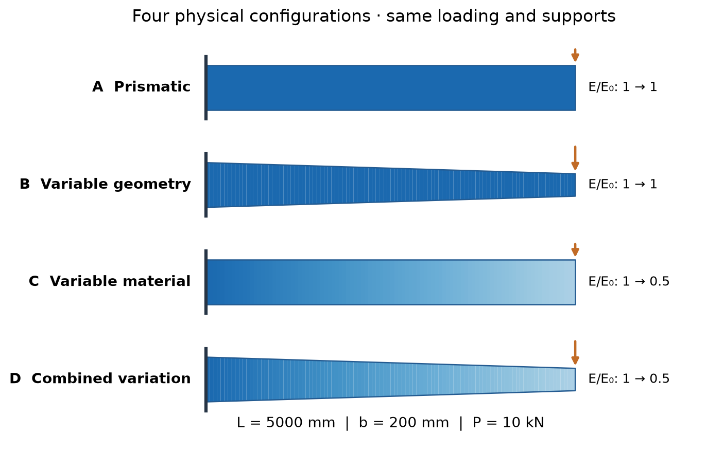

# CSF–PyCBA: continuous sectional stiffness

**Version 0.1 - First review draft · 26 November 2026**

This tutorial connects Continuous Section Field (CSF), which describes physical geometry and material variation, to PyCBA 1.0.2, which performs beam analysis. Neither solver is modified; CSF is not a mandatory PyCBA dependency. CUF is not involved.



## 1. Physical problem

A rectangular cantilever of length 5000 mm is clamped at x = 0 and loaded by a downward 10000 N point force at x = L. Width is 200 mm, root depth is 500 mm and root Young's modulus is 210000 MPa. The analysis is linear elastic, Euler–Bernoulli, with no shear deformation or self-weight. Material is uniform within each cross-section.

| Case | YAML file | Tip depth (mm) | Tip modulus (MPa) |
|---|---|---:|---:|
| A | `prismatic.yaml` | 500 | 210000 |
| B | `variable_geometry.yaml` | 250 | 210000 |
| C | `variable_material.yaml` | 500 | 105000 |
| D | `combined_variation.yaml` | 250 | 105000 |

Case B is the initial tapered-member tutorial; C and D extend it without changing the analysis workflow. Both depth and modulus vary linearly where applicable.

## 2. Run the example

Extract the entire `tapered_cantilever/` directory into the CSF repository under `pycba/` (or another location of your choice). From the CSF repository root, activate your existing virtual environment and install the local package:

```bash
python3 -m pip install -e .
cd pycba/tapered_cantilever
python3 -m pip install -r requirements.txt
python3 -c "from pycba import SectionEI; print(SectionEI)"
python3 main.py --help
python3 main.py --case prismatic
python3 main.py --case variable_geometry
python3 main.py --case variable_material
python3 main.py --case combined_variation
# Or run every case:
python3 main.py --case all
```

Adjust the directory path if the example is stored elsewhere. The reported local tests used Python 3.11 and PyCBA 1.0.2. Record the CSF Git revision and dependency versions when preparing the final shared tutorial:

```bash
git rev-parse HEAD
python3 -m pip show pycba csfpy
python3 -m pip freeze
```

### Visualize the physical models with CSF

After installing the local CSF package, and before running a structural analysis, inspect any of the four physical models using the same [action file](models/action.yaml). From the `tapered_cantilever/` directory with the virtual environment active:

```bash
csf-actions models/prismatic.yaml models/action.yaml
csf-actions models/variable_geometry.yaml models/action.yaml
csf-actions models/variable_material.yaml models/action.yaml
csf-actions models/combined_variation.yaml models/action.yaml
```

The actions display the 3D geometry, the sections at z = 0, 2500 and 5000 mm, the longitudinal material weight, and the sectional properties A, Ix and Iy. The weight is dimensionless, w = E/E_ref; the plotted sectional properties are weighted, not necessarily purely geometric. These visualizations use CSF alone and require no PyCBA analysis. The action file follows the [CSF action syntax](https://github.com/giovanniboscu/continuous-section-field#csf-accepts-two-input-files-geometryyaml-cross-section-definition-and-actionsyaml-post-processing-pipeline); its execution should be checked locally before publication.

## 3. Read the code in execution order


Start with `main.py`, specifically `run_case`. The following abridged excerpt preserves its order; output handling and tolerance checks are omitted here only for readability.

```python
field = load_csf_model(ROOT / 'models' / f'{case}.yaml')
sections = validate_section_properties(field, case, L, E0, output)
EI = create_ei_function(field, E0)
reference = reference_deflection(case)
continuous = solve_continuous(EI, L, P)
convergence = run_convergence_study(EI, L, P, reference,
                                   [1, 2, 4, 8, 16, 32, 64])
write_csv(output / 'convergence.csv', convergence)
write_csv(output / 'degree_sensitivity.csv', degree_study(EI, L, P, reference))
plot_results(sections, convergence, output)
```

| File | Responsibility |
|---|---|
| `models/` | Four physical models and the shared visualization action file |
| `main.py` | CLI, orchestration and acceptance checks |
| `csf_section.py` | Load CSF; expose sectional properties and EI callable |
| `pycba_analysis.py` | Continuous and midpoint beam analyses |
| `reference_solution.py` | Independent formulas and reference integration |
| `validation.py` | Section checks and CSV export |
| `convergence.py` | Element-count and degree sensitivity |
| `plotting.py` | Generated plots |

## 4. The coupling in a few lines

CSF longitudinal z maps to PyCBA longitudinal x. The CSF transverse y coordinate is the bending-depth direction. CSF inertia `Ix` is weighted by the dimensionless material weight w = E/E_ref; the coupling is therefore:

```python
props = section_properties(field.section(x))
EI = E_ref * props['Ix']
```

The full callable in `csf_section.py` handles both scalar and array inputs. For this single homogeneous polygon only, geometric area and inertia are recovered by dividing weighted values by w. Do not multiply the weighted inertia by E(x) again.

```python
section = cba.SectionEI().add_segment('poly', [0.0, L], EI, degree=12)
beam = cba.BeamAnalysis([L], [section], R=[-1, -1, 0, 0], GAv=None)
beam.add_pl(1, P, L)
beam.analyze()
tip = -float(beam.beam_results.D[-2])
```

Here `EI` denotes the callable, rather than the scalar in the preceding illustration. The PyCBA 1.0.2 published source **fits a polynomial to callable samples internally**. Thus continuous means a spatially varying polynomial representation, not a direct callback at every integration point. For these benchmarks the underlying EI laws are polynomial of degree at most four. See [THEORY.md](THEORY.md) for the distinction and source links.

The midpoint comparison instead assigns one scalar EI per element. Neither approach changes the physical CSF model.


## 5. Outputs and results

Each run writes `results/<case>/` with `section_validation.csv`, `convergence.csv`, `degree_sensitivity.csv`, `summary.csv`, `rigidity.png` and `convergence.png`. The documentation figures in `img/` are separate, figures generated from the included CSVs and analytical laws. Rebuild them after running the cases with `python3 generate_doc_figures.py`.

| Case | Reference tip (mm) | Continuous tip (mm) | Relative error |
|---|---:|---:|---:|
| A | 0.952380952 | 0.952380952 | 1.166e-16 |
| B | 1.557649841 | 1.557649841 | 7.128e-16 |
| C | 1.103698175 | 1.103698175 | 6.035e-16 |
| D | 1.904761905 | 1.904761905 | 1.515e-15 |

These are preserved outputs of the original local runs, not new solver results from this review revision. The relative acceptance thresholds in the supplied code are 1e-8 for sectional properties and 1e-6 for the single-element displacement.

- [THEORY.md - mathematical derivation and interface details](THEORY.md)
- [VALIDATION.md - numerical evidence, convergence and limitations](VALIDATION.md)

## 6. Scope

The tutorial demonstrates independent physical modelling and beam analysis for four rectangular cantilevers. It does not establish general accuracy for arbitrary non-polynomial rigidity, composite cross-sections, shear deformation, discontinuities or other load/support configurations. It is a draft for joint review, not an accepted PyCBA tutorial.

## 7. First review

See [REVIEW.md](REVIEW.md) for the review scope, provenance and open questions.


## Quick Start - Full reproducibility

The following commands reproduce all four benchmarks from a fresh environment.

**Requirements:** Git and Python 3.11 (the tested Python version).

### 1. Clone the repository and prepare the environment

```bash
git clone https://github.com/giovanniboscu/continuous-section-field.git
cd continuous-section-field

python3 -m venv venv
source venv/bin/activate

python3 -m pip install -e .
python3 -m pip install pycba==1.0.2

cd pycba/tapered_cantilever
python3 -m pip check
```

### 2. Visualize the physical model (optional)

```bash
csf-actions models/combined_variation.yaml models/action.yaml
```

### 3. Run all four benchmarks

```bash
python3 main.py --case all
```

Expected results:

| Case | Reference displacement (mm) |
|---|---:|
| Prismatic | 0.952380952 |
| Variable geometry | 1.557649841 |
| Variable material | 1.103698175 |
| Combined variation | 1.904761905 |

All four cases should pass the numerical validation checks. Relative errors may vary slightly across computing environments.

### 4. Regenerate the documentation figures

```bash
python3 generate_doc_figures.py
```

Numerical results are stored in `results/`, and documentation figures are stored in `img/`.

### 5. Record the execution environment

```bash
git rev-parse HEAD
python3 --version
python3 -m pip show csfpy pycba
python3 -m pip freeze
```

For the mathematical derivation and detailed numerical validation, see [THEORY.md](THEORY.md) and [VALIDATION.md](VALIDATION.md).
