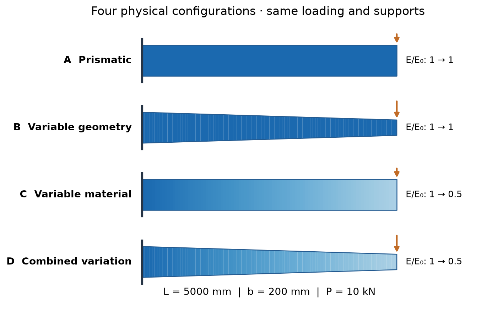
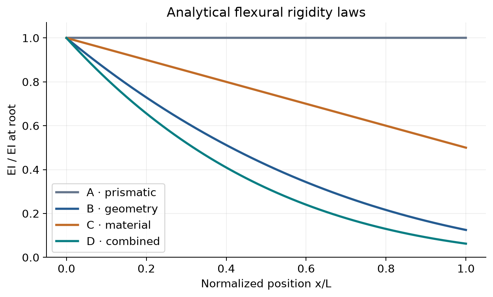
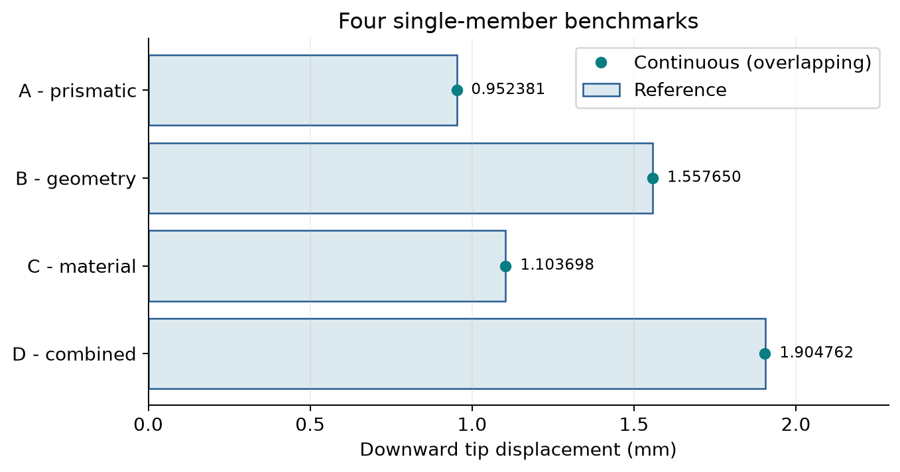
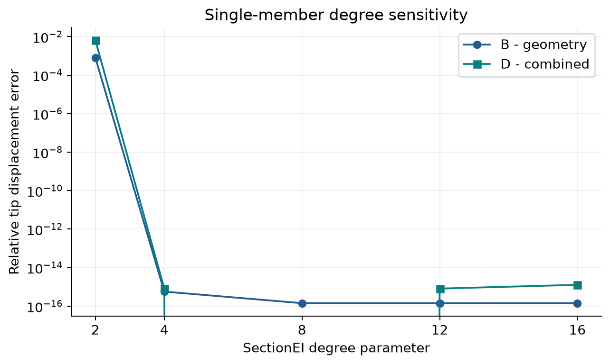
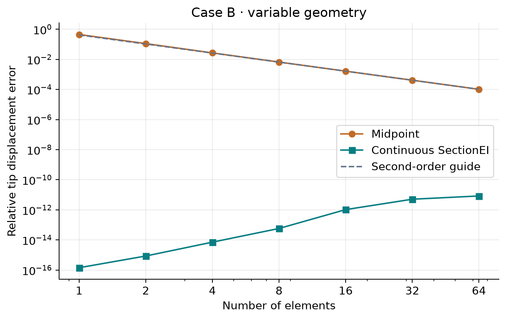
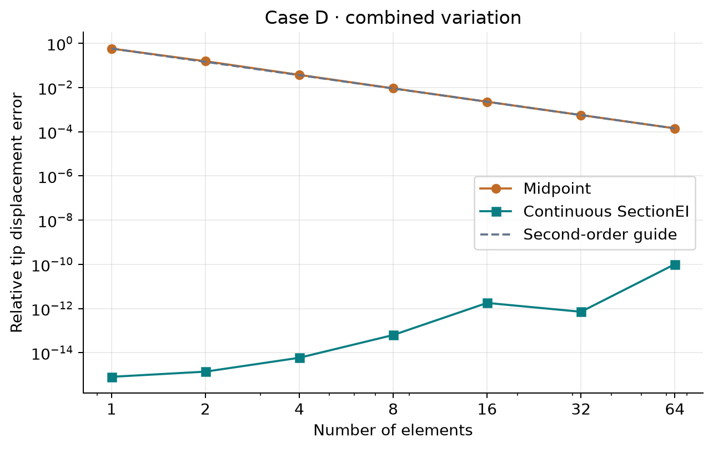
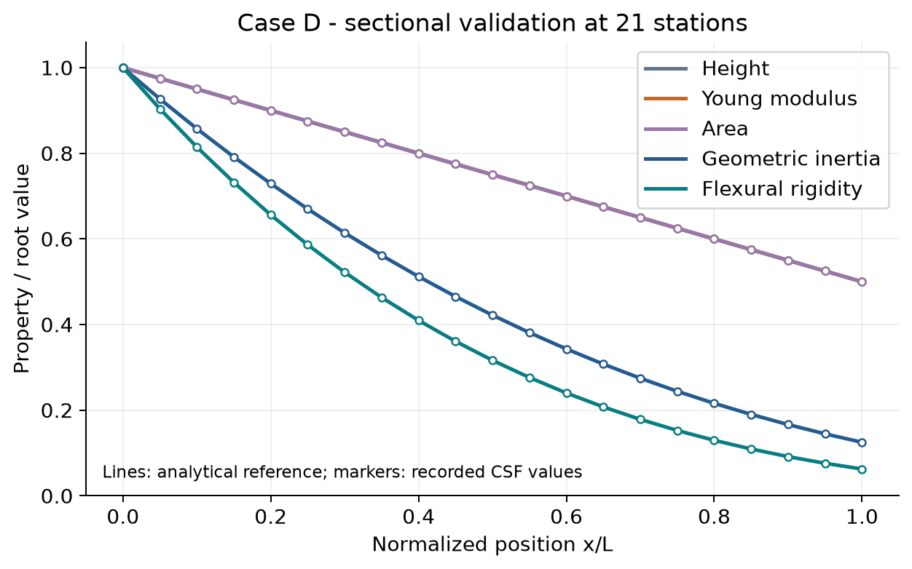
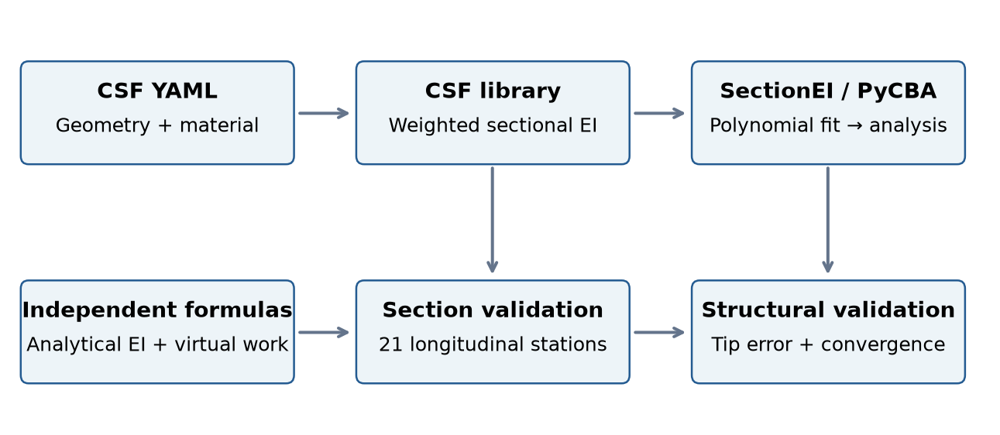

# Theory and independent reference solutions

[Back to tutorial](README.md) · [Numerical validation](VALIDATION.md)

This document explains the CSF–PyCBA benchmark from the physical model to the structural solution. It introduces the sectional properties, derives the independent reference displacement, and then explains how PyCBA constructs the non-prismatic member stiffness. The reference derivation does not depend on either CSF or PyCBA.

## 1. Physical model and assumptions

### 1.1 Coordinates, geometry and loading

Consider a straight cantilever with a rectangular cross-section. The left end is clamped and the right end is free. A downward point force acts at the free end.

The following notation is used throughout:

| Symbol | Meaning | Unit |
|---|---|---|
| $x$ | Longitudinal distance from the clamp | mm |
| $L$ | Total cantilever length | mm |
| $y$ | Transverse coordinate in the depth direction, measured from the sectional centroid | mm |
| $b$ | Constant sectional width | mm |
| $h(x)$ | Sectional depth at position $x$ | mm |
| $h_0,h_1$ | Depth at the clamp and free end, respectively | mm |
| $E(x)$ | Young's modulus at position $x$ | N/mm² (MPa) |
| $E_0,E_1$ | Young's modulus at the clamp and free end, respectively | MPa |
| $P$ | Positive magnitude of the downward tip force | N |
| $\delta$ | Downward tip displacement, expressed as a positive magnitude | mm |

The longitudinal domain is $0\leq x\leq L$. The section remains centred about the same straight reference axis.

**Coordinate mapping.** CSF calls its longitudinal coordinate `z`. Its transverse coordinates are `x` (width direction) and `y` (depth direction). In this document, $x$ is longitudinal, not the transverse CSF `x` coordinate. The second moment of area about the centroidal width axis is denoted by $I$ here; it corresponds to the CSF property `Ix`.

The numerical values shared by the four benchmarks are:

| Quantity | Value |
|---|---:|
| $L$ | 5000 mm |
| $P$ | 10000 N |
| $b$ | 200 mm |
| $h_0$ | 500 mm |
| $E_0$ | 210000 MPa |



### 1.2 Mechanical assumptions

The reference model uses Euler–Bernoulli beam theory, small displacements and rotations, and linear elasticity. Transverse shear deformation is excluded; the PyCBA configuration uses `GAv=None`. Young's modulus is positive and uniform within each individual cross-section, but can vary longitudinally. The section is symmetric, so its geometric centroid is also its elastic centroid. The only applied load is the tip force; self-weight is excluded.

All calculations use N and mm consistently. The reference is exact within this one-dimensional beam model, not an exact solution of three-dimensional elasticity.

## 2. From geometry and material to sectional rigidity

### 2.1 Longitudinal variation

Introduce the dimensionless longitudinal coordinate $t$:

$$t=\frac{x}{L},\qquad 0\leq t\leq 1.$$

The physical geometry and material are defined independently. In this benchmark both depth and modulus follow linear laws. For compactness, writing a function in terms of $t$ means evaluating it at $x=Lt$.

$$h(t)=h_0+(h_1-h_0)t,$$

$$E(t)=E_0+(E_1-E_0)t.$$

At $t=0$, these give the root values; at $t=1$, they give the tip values. The width $b$ does not change.

### 2.2 Geometric sectional properties

Let $\mathcal S(x)$ be the rectangular cross-sectional domain at station $x$, $dA$ an infinitesimal area element, $A(x)$ the geometric area in mm², and $I(x)$ the centroidal second moment of area in mm⁴.

The area is obtained by integrating unity over the section:

$$A(x)=\int_{\mathcal S(x)}dA=bh(x).$$

For bending in the depth direction, the second moment is obtained by integrating the square of the distance from the centroidal width axis:

$$I(x)=\int_{\mathcal S(x)}y^2\,dA.$$

A horizontal strip of thickness $dy$ has area $b\,dy$. The depth coordinate ranges from $-h/2$ to $h/2$, so, suppressing the argument $x$ for clarity,

$$I=b\int_{-h/2}^{h/2}y^2\,dy=b\left[\frac{y^3}{3}\right]_{-h/2}^{h/2}.$$

The bracket denotes the upper-limit value minus the lower-limit value. Evaluating it gives

$$I=b\left(\frac{h^3}{24}+\frac{h^3}{24}\right)=\frac{bh^3}{12}.$$

Define $I_0$ as the root inertia:

$$I_0=\frac{bh_0^3}{12}=2.083333333333333\times10^9\ \mathrm{mm^4}.$$

### 2.3 Flexural rigidity

Let $K(x)$ denote the scalar flexural rigidity, in N mm². It is not the structural stiffness matrix introduced later. The general sectional expression for this benchmark is

$$K(x)=\int_{\mathcal S(x)}E(x)y^2\,dA.$$

Because $E(x)$ is constant across each section, it can be taken outside the area integral:

$$K(x)=E(x)\int_{\mathcal S(x)}y^2\,dA=E(x)I(x).$$

Substitution of the rectangular inertia gives

$$K(x)=\frac{E(x)b h(x)^3}{12}.$$

Define the root rigidity $K_0=E_0I_0$. Numerically,

$$K_0=4.375\times10^{14}\ \mathrm{N\,mm^2}.$$

Dividing by the root values gives the useful dimensionless expressions

$$\frac{I(x)}{I_0}=\left(\frac{h(x)}{h_0}\right)^3,$$

$$\frac{K(x)}{K_0}=\frac{E(x)}{E_0}\left(\frac{h(x)}{h_0}\right)^3.$$

### 2.4 The four physical configurations

| Case | Description | $h_1$ (mm) | $E_1$ (MPa) |
|---|---|---:|---:|
| A | Prismatic, constant material | 500 | 210000 |
| B | Variable geometry | 250 | 210000 |
| C | Variable material | 500 | 105000 |
| D | Combined variation | 250 | 105000 |

Whenever the depth or modulus varies, its tip value is one half of its root value. Introduce the auxiliary dimensionless function $q(t)$:

$$q(t)=1-\frac{t}{2}.$$

For example, in case B, substitution of $h_1=h_0/2$ into the depth law gives $h(t)=h_0q(t)$. The same substitution for the modulus in case C gives $E(t)=E_0q(t)$.

| Case | $h/h_0$ | $E/E_0$ | $I/I_0$ | $K/K_0$ |
|---|---|---|---|---|
| A | 1 | 1 | 1 | 1 |
| B | $q$ | 1 | $q^3$ | $q^3$ |
| C | 1 | $q$ | 1 | $q$ |
| D | $q$ | $q$ | $q^3$ | $q^4$ |

The exponent $p$ is defined by $K(t)=K_0q(t)^p$. Its values are 0, 3, 1 and 4 for cases A, B, C and D, respectively. It describes the physical rigidity law, not the numerical fitting degree used later.



In case D, the tip rigidity is $K_0/16$: the simultaneous halving of depth and modulus reduces rigidity by 93.75 percent.

### 2.5 CSF material weights and the interface

CSF describes the physical section and its material participation through polygon weights. Let $w(x)$ be the dimensionless weight of the single polygon in this benchmark, defined relative to the root modulus:

$$w(x)=\frac{E(x)}{E_0}.$$

Let $w_0$ and $w_1$ be its root and tip values. In case D these are 1 and 0.5. The model uses the weight law `solid,solid: w0 + (w1-w0)*(z/L)`, where `z` is the longitudinal CSF coordinate. The endpoint polygons extend from −100 to +100 mm in transverse CSF `x`, and from −250 to +250 mm at the root or −125 to +125 mm at the tapered tip in transverse CSF `y`.

Define $I^w(x)$ as the weighted centroidal inertia returned by CSF (`Ix` in the weighted sectional calculation). For one uniformly weighted polygon,

$$I^w(x)=\int_{\mathcal S(x)}w(x)y^2\,dA=w(x)I(x).$$

Multiplication by the reference modulus gives

$$E_0 I^w(x)=E_0w(x)I(x)=E(x)I(x)=K(x).$$

This is the bridge used by the example. Multiplying the weighted inertia by $E(x)$ again would incorrectly apply material variation twice. Geometric area and inertia can be recovered from their weighted values by division by $w$ in this single-polygon benchmark.

For clarity about the scope, consider a more general section with a modulus $E(x,y)$ varying across its depth. Let $y_E(x)$ denote the elastic centroid coordinate. For bending about the width direction under zero axial resultant,

$$y_E(x)=\frac{\int_{\mathcal S(x)} E(x,y)y\,dA}{\int_{\mathcal S(x)} E(x,y)\,dA},$$

$$K(x)=\int_{\mathcal S(x)} E(x,y)[y-y_E(x)]^2\,dA.$$

This illustrates why an arbitrary heterogeneous or coupled section requires additional care; the present example is not a general composite-section adapter. In the symmetric, transversely uniform benchmarks $y_E=0$.

## 3. Independent reference displacement

### 3.1 Actual and virtual moment fields

Consider a cut at longitudinal station $x$. The distance from the cut to the tip force is $L-x$. Equilibrium therefore gives the magnitude of the actual bending moment $M(x)$, in N mm:

$$M(x)=P(L-x).$$

Now introduce a virtual downward tip force of unit magnitude, with the same supports. Let $m(x)$ denote its bending moment diagram **per unit applied force**, with units of length:

$$m(x)=L-x.$$

Both diagrams have the same bending sign; their product is positive. The principle of virtual work, using the Euler–Bernoulli moment–curvature relation, gives the downward displacement:

$$\delta=\int_0^L\frac{M(x)m(x)}{K(x)}\,dx.$$

Here $dx$ denotes an infinitesimal longitudinal length. Substituting the two diagrams yields

$$\delta=P\int_0^L\frac{(L-x)^2}{K(x)}\,dx.$$

The dimensions are consistent: the final expression has units of mm. There is no shear-energy term under the assumptions of Section 1.

### 3.2 Reduction to a dimensionless integral

Use $x=Lt$, so $dx=L\,dt$ and $L-x=L(1-t)$. The limits become 0 and 1. Substituting the rigidity law of Section 2.4 gives

$$\delta=P\int_0^1\frac{L^2(1-t)^2}{K_0(1-t/2)^p}L\,dt.$$

Move the constants outside the integral and define the dimensionless integral $J_p$:

$$J_p=\int_0^1\frac{(1-t)^2}{(1-t/2)^p}\,dt,$$

$$\delta=\frac{PL^3}{K_0}J_p.$$

The prefactor has units of length. For all four benchmarks its value is $20/7$ mm.

To evaluate $J_p$, introduce the integration variable $u=1-t/2$. This is a substitution, not a displacement variable. Rearranging gives

$$t=2(1-u),\qquad 1-t=2u-1,\qquad dt=-2\,du.$$

When $t=0$, $u=1$; when $t=1$, $u=1/2$. Reversing the limits removes the minus sign:

$$J_p=2\int_{1/2}^1(2u-1)^2u^{-p}\,du.$$

Expanding the square and distributing $u^{-p}$ gives

$$J_p=2\int_{1/2}^1\left(4u^{2-p}-4u^{1-p}+u^{-p}\right)du.$$

We can now integrate each term separately. In the following derivations, $\ln$ denotes the natural logarithm.

### 3.3 Case A - Constant geometry and material ($p=0$)

$$J_0=2\int_{1/2}^1(4u^2-4u+1)\,du.$$

$$J_0=2\left[\frac{4u^3}{3}-2u^2+u\right]_{1/2}^1.$$

The upper-limit value inside the brackets is $1/3$; the lower-limit value is $1/6$. Hence

$$J_0=2(1/3-1/6)=1/3,$$

$$\delta_A=\frac{PL^3}{3K_0}.$$

The subscript A identifies the prismatic case. This recovers the classical cantilever formula.

### 3.4 Case B - Variable geometry ($p=3$)

$$J_3=2\int_{1/2}^1\left(\frac4u-\frac4{u^2}+\frac1{u^3}\right)du.$$

$$J_3=2\left[4\ln u+\frac4u-\frac1{2u^2}\right]_{1/2}^1.$$

The upper-limit value is $7/2$, and the lower-limit value is $6-4\ln 2$. Therefore

$$J_3=2\left[\frac72-(6-4\ln2)\right]=8\ln2-5,$$

$$\delta_B=\frac{PL^3}{K_0}(8\ln2-5).$$

### 3.5 Case C - Variable material ($p=1$)

$$J_1=2\int_{1/2}^1\left(4u-4+\frac1u\right)du.$$

$$J_1=2[2u^2-4u+\ln u]_{1/2}^1.$$

The upper-limit value is $-2$, and the lower-limit value is $-3/2-\ln2$. Thus

$$J_1=2[-2-(-3/2-\ln2)]=2\ln2-1,$$

$$\delta_C=\frac{PL^3}{K_0}(2\ln2-1).$$

### 3.6 Case D - Combined variation ($p=4$)

$$J_4=2\int_{1/2}^1\left(\frac4{u^2}-\frac4{u^3}+\frac1{u^4}\right)du.$$

$$J_4=2\left[-\frac4u+\frac2{u^2}-\frac1{3u^3}\right]_{1/2}^1.$$

The upper-limit value is $-7/3$, and the lower-limit value is $-8/3$. Therefore

$$J_4=2[-7/3-(-8/3)]=2/3,$$

$$\delta_D=\frac{2PL^3}{3K_0}=2\delta_A.$$

The factor of two is specific to these particular variation laws and the tip-load configuration.

### 3.7 Reference values and independent numerical integration

| Case | Exact dimensionless integral | Downward tip displacement (mm) |
|---|---|---:|
| A | $1/3$ | 0.952380952 |
| B | $8\ln2-5$ | 1.557649841 |
| C | $2\ln2-1$ | 1.103698175 |
| D | $2/3$ | 1.904761905 |



The module `reference_solution.py` evaluates the reference independently using SciPy adaptive integration and provides the closed-form results through `closed_form()`. The tutorial's `main.py` compares the two reference evaluations. The supplied original theory specifies `epsabs=1e-25` and `epsrel=1e-12` for the scaled integrand containing the reciprocal of rigidity; these are absolute and relative integration tolerance parameters, respectively. They do not imply an absolute displacement accuracy of $10^{-25}$ mm. See the executable source for the precise scaling and current settings.

## 4. Two representations of the same physical model

### 4.1 Global and member-local coordinates

Let $N$ be the number of equal structural members, and let $\ell=L/N$ denote their common length. Let $e$ be the zero-based member index, from 0 to $N-1$. The start of member $e$ is at $x_e=e\ell$. Let $s$ be the local physical coordinate within that member, measured in mm from its left end, with $0\leq s\leq\ell$.

The coordinate conversion is

$$x=x_e+s=e\ell+s.$$

This conversion is essential: `SectionEI` works in member-local physical coordinates, while CSF is queried at the corresponding global longitudinal station. Structural subdivision does not require redefining the physical CSF field.

### 4.2 Midpoint-sampled rigidity

Let $K_e^{\mathrm{mid}}$ be the scalar rigidity assigned to member $e$ by midpoint sampling:

$$K_e^{\mathrm{mid}}=K(x_e+\ell/2).$$

The physical geometry is not changed, but the solver receives a constant rigidity over each structural member. Define $K^{\mathrm{mid}}(x)$ as the resulting piecewise constant function:

$$K^{\mathrm{mid}}(x)=K_e^{\mathrm{mid}}\quad\text{for }x_e\leq x<x_e+\ell.$$

The value at the final endpoint is understood as that of the last member. For this statically determinate cantilever the corresponding tip displacement, denoted by $\delta_{\mathrm{mid}}$, can also be written directly as

$$\delta_{\mathrm{mid}}=P\sum_{e=0}^{N-1}\frac{1}{K_e^{\mathrm{mid}}}\int_{x_e}^{x_e+\ell}(L-x)^2\,dx.$$

Each term uses the exact moment diagram but an approximated rigidity. The integral in each term is

$$\int_{x_e}^{x_e+\ell}(L-x)^2\,dx=\frac{(L-x_e)^3-(L-x_e-\ell)^3}{3}.$$

This makes the source of the midpoint modelling error explicit.

### 4.3 Continuous polynomial representation

Let $d$ denote the integer polynomial degree supplied to `SectionEI`. This is distinct from $p$, the physical exponent of Section 2.4. Let $\widehat K_e(s)$ denote the fitted rigidity of member $e$. The hat marks a numerical representation rather than the original physical rigidity.

For the callable polynomial mode used here, PyCBA 1.0.2 samples the function at $d+2$ equally spaced local coordinates and fits a polynomial of degree $d$ by least squares. Let $r$ be the coefficient index (0 through $d$), and let $a_{e,r}$ be the polynomial coefficients:

$$\widehat K_e(s)=\sum_{r=0}^{d}a_{e,r}s^r.$$

The sampled values come from $K(x_e+s)$, not from a formula for the geometry inside PyCBA. After fitting, the stored polynomial is evaluated during structural integration. A polynomial of sufficient degree represents the physical rigidity laws of this benchmark exactly in exact arithmetic. General non-polynomial laws need not be reproduced exactly, and positivity of the fitted rigidity throughout the interval should be checked for more demanding cases.

Source: [PyCBA 1.0.2, SectionEI implementation](https://ccaprani.github.io/pycba/_modules/pycba/section.html), particularly `add_segment()` and `_Piece.__call__()`.

## 5. From sectional rigidity to the PyCBA element stiffness

This section explains the Euler–Bernoulli non-prismatic member without moment releases, as used in the tutorial. It describes PyCBA's flexibility-based construction rather than introducing an additional solver.

### 5.1 Member degrees of freedom and chord rotation

Consider one member of length $\ell$. Denote its left and right end nodes by $i$ and $j$. Let $v_i,v_j$ be the nodal transverse displacements in PyCBA's sign convention, and $\theta_i,\theta_j$ the nodal rotations (radians). Define the four-component displacement vector $\mathbf d_e$; the superscript $T$ denotes transpose:

$$\mathbf d_e=[v_i,\theta_i,v_j,\theta_j]^T.$$

For small rotations, the rotation of the straight chord between the nodes is $\psi$:

$$\psi=\frac{v_j-v_i}{\ell}.$$

The rotations relative to the chord are denoted by $\beta_i,\beta_j$:

$$\beta_i=\theta_i-\psi,\qquad \beta_j=\theta_j-\psi.$$

Substitution gives the scalar relations

$$\beta_i=\frac{v_i}{\ell}+\theta_i-\frac{v_j}{\ell},$$

$$\beta_j=\frac{v_i}{\ell}-\frac{v_j}{\ell}+\theta_j.$$

Define the two-component vector $\boldsymbol\beta=[\beta_i,\beta_j]^T$ and the $2\times4$ transformation matrix $\mathbf T$:

$$\mathbf T=\begin{bmatrix}1/\ell&1&-1/\ell&0\\1/\ell&0&-1/\ell&1\end{bmatrix}.$$

The two scalar equations can now be written as one matrix relation:

$$\boldsymbol\beta=\mathbf T\mathbf d_e.$$

### 5.2 Moment influence functions

Let $M_i,M_j$ denote the end moments (N mm), positive according to PyCBA's counter-clockwise nodal moment convention. Let $\mathbf M=[M_i,M_j]^T$ be the end-moment vector. On the released, simply supported reference member, equilibrium gives the two dimensionless bending-moment influence functions $g_i(s)$ and $g_j(s)$ (moment diagram per unit end moment):

$$g_i(s)=1-\frac{s}{\ell},\qquad g_j(s)=-\frac{s}{\ell}.$$

The first function has endpoint values 1 and 0, and the second has values 0 and −1. The negative sign follows the nodal moment convention. The moment field due to the end moments is denoted by $M_e(s)$:

$$M_e(s)=g_i(s)M_i+g_j(s)M_j.$$

This expression concerns the end-moment contribution to the member stiffness. Loads applied within a member generally require additional load terms; the tutorial tip force is a nodal load.

### 5.3 Scalar flexibility coefficients and matrix form

By virtual work, the chord-relative rotations due to the end moments are

$$\beta_i=\int_0^\ell\frac{g_i(s)M_e(s)}{\widehat K_e(s)}\,ds,$$

$$\beta_j=\int_0^\ell\frac{g_j(s)M_e(s)}{\widehat K_e(s)}\,ds.$$

Substituting the moment field and collecting the constant end moments gives

$$\beta_i=M_i\int_0^\ell\frac{g_i^2}{\widehat K_e}\,ds+M_j\int_0^\ell\frac{g_ig_j}{\widehat K_e}\,ds,$$

$$\beta_j=M_i\int_0^\ell\frac{g_jg_i}{\widehat K_e}\,ds+M_j\int_0^\ell\frac{g_j^2}{\widehat K_e}\,ds.$$

Define $F_{ab}$ as the rotation at end $a$ per unit moment at end $b$, where the indices $a,b$ in this subsection range over the end labels $i,j$ (not the sectional width). Define $\mathbf F$ as the $2\times2$ flexibility matrix, with entries in inverse N mm:

$$F_{ab}=\int_0^\ell\frac{g_a(s)g_b(s)}{\widehat K_e(s)}\,ds,$$

$$\mathbf F=\begin{bmatrix}F_{ii}&F_{ij}\\F_{ji}&F_{jj}\end{bmatrix}.$$

Since multiplication of the scalar influence functions is commutative, $F_{ij}=F_{ji}$. The preceding scalar equations become

$$\boldsymbol\beta=\mathbf F\mathbf M.$$

### 5.4 Inverting flexibility and transforming to nodal stiffness

For positive rigidity and a member of nonzero length the two influence functions are linearly independent, so the flexibility matrix is positive definite and invertible. Define $\mathbf K_\theta=\mathbf F^{-1}$ as the rotational stiffness matrix. The superscript $-1$ denotes matrix inversion:

$$\mathbf M=\mathbf K_\theta\boldsymbol\beta=\mathbf K_\theta\mathbf T\mathbf d_e.$$

Let $\mathbf f_e$ be the four-component vector of member end forces and moments conjugate to $\mathbf d_e$. Let $\Delta$ denote an arbitrary virtual variation of a displacement or rotation. Equality of virtual work gives

$$\mathbf f_e^T\Delta\mathbf d_e=\mathbf M^T\Delta\boldsymbol\beta=\mathbf M^T\mathbf T\Delta\mathbf d_e.$$

Because the virtual nodal variation is arbitrary, it follows that

$$\mathbf f_e=\mathbf T^T\mathbf M.$$

Substitution of the moment relation gives

$$\mathbf f_e=\mathbf T^T\mathbf K_\theta\mathbf T\mathbf d_e.$$

Define the $4\times4$ nodal member stiffness matrix $\mathbf k_e$ by $\mathbf f_e=\mathbf k_e\mathbf d_e$. Therefore,

$$\mathbf k_e=\mathbf T^T\mathbf F^{-1}\mathbf T.$$

This is the sequence used by PyCBA's non-prismatic member implementation: integrate flexibility, invert it, and transform from chord-relative rotations to nodal degrees of freedom.

### 5.5 Check against the classical prismatic member

If the rigidity is constant and equal to $K_0$, direct integration gives

$$F_{ii}=\frac{\ell}{3K_0},\quad F_{ij}=F_{ji}=-\frac{\ell}{6K_0},\quad F_{jj}=\frac{\ell}{3K_0}.$$

Consequently,

$$\mathbf F=\frac{\ell}{6K_0}\begin{bmatrix}2&-1\\-1&2\end{bmatrix},\qquad \mathbf K_\theta=\frac{K_0}{\ell}\begin{bmatrix}4&2\\2&4\end{bmatrix}.$$

Applying the transformation produces the familiar Euler–Bernoulli matrix:

$$\mathbf k_e=\frac{K_0}{\ell^3}\begin{bmatrix}12&6\ell&-12&6\ell\\6\ell&4\ell^2&-6\ell&2\ell^2\\-12&-6\ell&12&-6\ell\\6\ell&2\ell^2&-6\ell&4\ell^2\end{bmatrix}.$$

Thus the variable-rigidity formulation recovers the classical constant-rigidity limit.

### 5.6 Assembly and boundary conditions

Let $\mathbf K$ denote the global stiffness matrix assembled from all member matrices, $\mathbf D$ the global nodal displacement and rotation vector, and $\mathbf f$ the applied nodal force and moment vector. After imposing the zero displacement and rotation at the clamp, PyCBA solves the remaining equilibrium equations represented by

$$\mathbf K\mathbf D=\mathbf f,$$

understood on the free degrees of freedom. The downward magnitude of the free-end displacement is compared with the positive reference $\delta$ of Section 3. No axial or shear-deformation degrees of freedom are needed for this benchmark.

Source: [PyCBA 1.0.2, beam implementation](https://ccaprani.github.io/pycba/_modules/pycba/beam.html), methods `_flexibility()`, `k_theta()` and `k_nonprismatic()`.

## 6. Polynomial degree and numerical integration

### 6.1 Two distinct numerical operations

The fitting degree $d$ controls the polynomial representation of rigidity. It also informs PyCBA's choice of integration order. These operations should not be confused: fitting approximates $K$, while integration approximates integrals containing its reciprocal.

For a single polynomial piece occupying the whole member, let $n_G$ denote the number of Gauss–Legendre integration points. Let $\xi_k$ and $\omega_k$ be the standard quadrature nodes and weights on the interval $[-1,1]$, where $k$ runs from 1 through $n_G$. Their mapped counterparts on $[0,\ell]$ are the local coordinate $s_k$ and dimensional integration weight $W_k$:

$$s_k=\frac{\ell}{2}(\xi_k+1),\qquad W_k=\frac{\ell}{2}\omega_k.$$

Using these definitions, each flexibility entry is approximated by

$$F_{ab}\approx\sum_{k=1}^{n_G}W_k\frac{g_a(s_k)g_b(s_k)}{\widehat K_e(s_k)}.$$

For multiple pieces, the same mapping is performed on each piece separately and the contributions are summed.

The published implementation of PyCBA 1.0.2 chooses $n_G=2$ for degree-zero pieces and $n_G=\max(2d+8,16)$ otherwise. Here $\max$ returns the larger of its two arguments.

| Requested degree $d$ | Callable sampling positions | Gauss points per piece |
|---:|---:|---:|
| 2 | 4 | 16 |
| 4 | 6 | 16 |
| 8 | 10 | 24 |
| 12 | 14 | 32 |
| 16 | 18 | 40 |

Source: [PyCBA beam source](https://ccaprani.github.io/pycba/_modules/pycba/beam.html), `_gauss_nodes()`.

### 6.2 Interpretation of the degree sensitivity study

The physical rigidity laws have degrees 0, 3, 1 and 4. A quadratic fit cannot exactly reproduce the cubic or quartic law, whereas a degree-four fit can reproduce both in exact arithmetic. In the tested cases, increasing the fitting degree from 2 to 4 leaves the flexibility quadrature at 16 points. The large improvement in tip-displacement accuracy is therefore consistent with improved rigidity representation, rather than an increase in the number of flexibility quadrature points.

However, the flexibility integrands are generally rational functions even when the rigidity is polynomial. Exact polynomial fitting does not guarantee exact quadrature. The numerical results demonstrate sufficient accuracy for the present benchmarks, not a universal guarantee for every positive rigidity function. The sensitivity study also does not independently isolate all post-processing and integration effects.



The output file is called `degree_sensitivity.csv`, rather than `quadrature.csv`, because changing the degree can affect both representation and integration. The implementation description is specific to the published PyCBA 1.0.2 source. The installed code can be checked using:

```bash
python3 -c "import inspect; from pycba import SectionEI; print(inspect.getsource(SectionEI.add_segment))"
python3 -c "import inspect; from pycba.beam import Beam; print(inspect.getsource(Beam._gauss_nodes))"
```

## 7. Convergence and interpretation of validation

Let $\delta_{\mathrm{ref}}$ be the independent positive reference displacement and $\delta_{\mathrm{num}}$ a numerical downward displacement magnitude. Define the dimensionless relative error $\varepsilon$:

$$\varepsilon=\frac{|\delta_{\mathrm{num}}-\delta_{\mathrm{ref}}|}{|\delta_{\mathrm{ref}}|}.$$

Absolute-value bars denote magnitude. The reference is nonzero for these benchmarks.

For the midpoint representation the smooth, positive rigidity and smooth moment field lead to a second-order global tip-displacement error in this example. One way to see the origin of this behaviour is to expand the reciprocal rigidity about each member midpoint. The linear variation integrates to zero when multiplied by a constant numerator over a symmetric interval; the variation of the numerator and the quadratic terms produce a local error proportional to the cube of member length. Summing over $N$ members gives a global error proportional to $N\ell^3$, hence proportional to $N^{-2}$ for fixed $L$. This argument assumes sufficiently smooth functions and a rigidity bounded away from zero.

Using the big-O notation to describe the asymptotic rate, the observed behaviour is

$$\varepsilon_{\mathrm{mid}}=O(N^{-2}),$$

where $\varepsilon_{\mathrm{mid}}$ is the relative error for midpoint sampling. Doubling $N$ therefore reduces the asymptotic error by approximately four. This is not a general statement about all finite-element errors.





The continuous approach does not need member refinement merely to capture the polynomial rigidity variation in these cases. A single non-prismatic member produces a tip displacement close to floating-point precision. Very small errors may increase with refinement because of numerical conditioning and roundoff; this explanation is plausible but has not been independently established by a condition-number study.

The validation distinguishes the physical sectional properties from the final structural displacement. A direct comparison between the fitted polynomial and CSF rigidity at independent stations would be an additional interface-level diagnostic for general non-polynomial laws.



For the actual numerical values and convergence tables, see [VALIDATION.md](VALIDATION.md). The purpose is to demonstrate interoperability for the stated beam assumptions, not to validate every possible CSF geometry or PyCBA loading configuration.

## 8. Summary of the computational workflow



CSF defines the physical geometry and material field, evaluates sectional properties and supplies the original rigidity function. PyCBA builds a polynomial representation of that function for each member, integrates flexibility, constructs and assembles stiffness matrices, and solves the structural equilibrium equations. The independent reference derives rigidity directly from the prescribed rectangular geometry and material laws, then evaluates the virtual-work displacement without either solver.

The three representations must remain distinct: the physical field, the solver's numerical rigidity representation, and the independent mathematical reference.

## 9. Further reading

- [CSF repository](https://github.com/giovanniboscu/continuous-section-field)
- [PyCBA beam definition](https://ccaprani.github.io/pycba/general.html)
- [PyCBA SectionEI source](https://ccaprani.github.io/pycba/_modules/pycba/section.html)
- [PyCBA non-prismatic stiffness](https://ccaprani.github.io/pycba/gen/pycba.beam.Beam.html#pycba.beam.Beam.k_nonprismatic)
