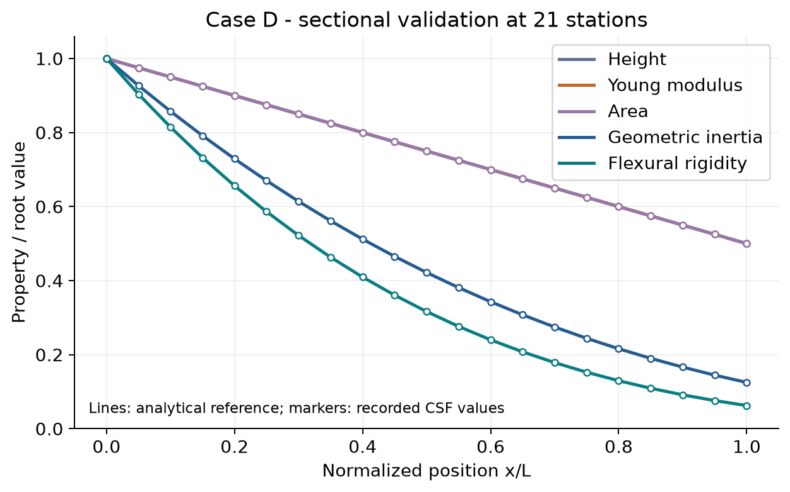
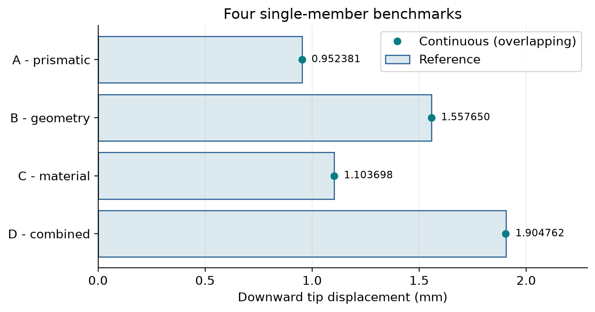
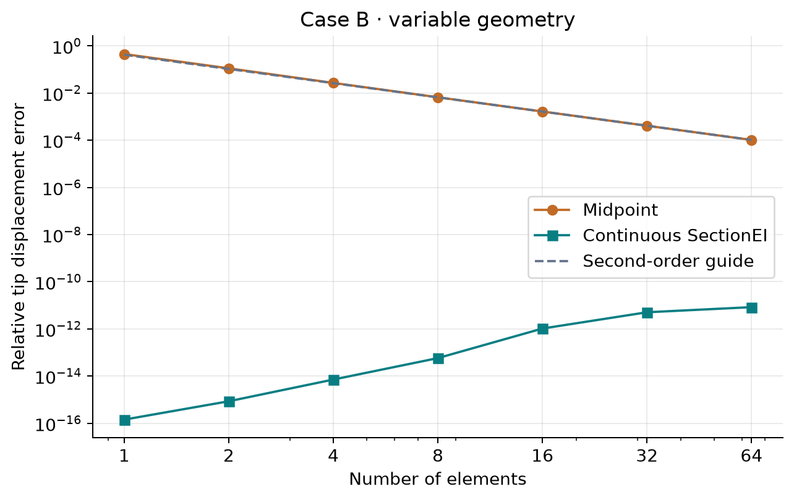
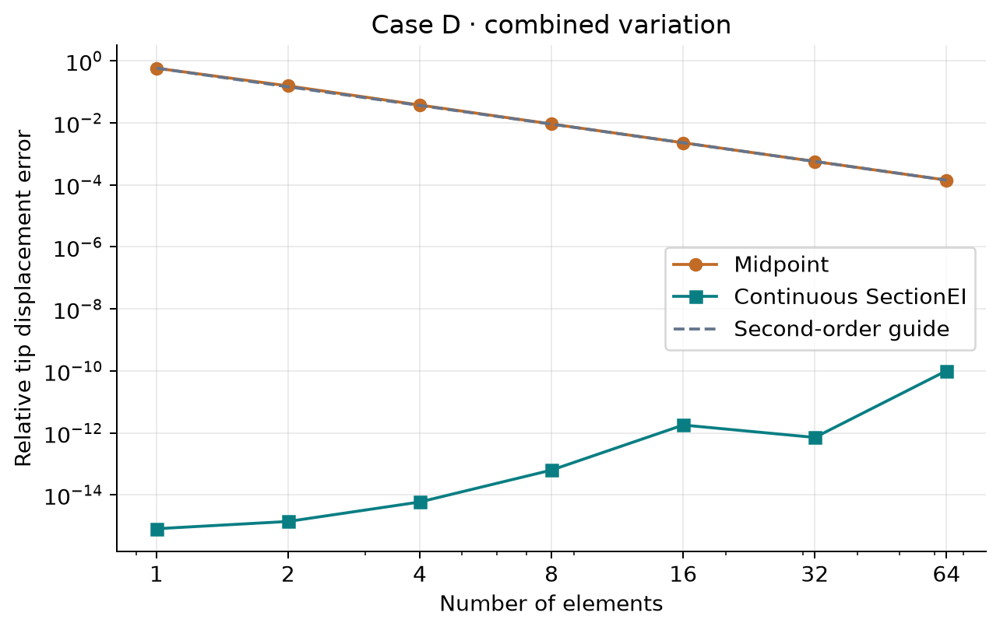
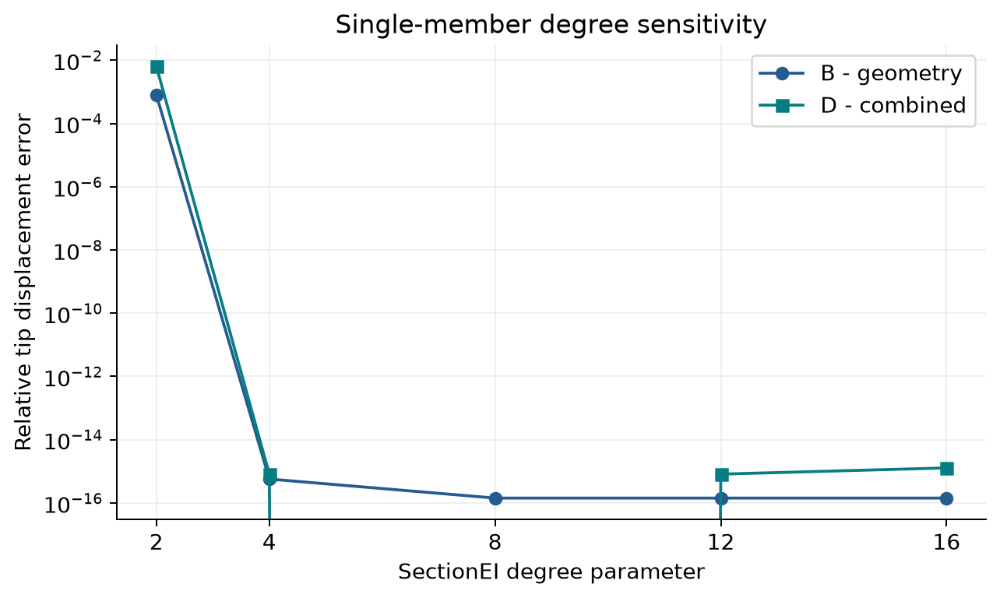

# Numerical validation

[Back to tutorial](README.md) · [Theory](THEORY.md)

## 1. Evidence and acceptance criteria

The included CSVs are preserved from the CSF author’s local runs using Python 3.11 and PyCBA 1.0.2. All four cases include 21 sectional stations, element refinement, degree sensitivity and a summary. No fresh solver execution was performed in preparing this review revision; the original `quadrature.csv` files were renamed without changing their numerical contents.

The relative error is $e=|v-v_{ref}|/|v_{ref}|$. The existing code checks sectional errors against 1e-8 and the single-element tip error against 1e-6. These are example-specific acceptance thresholds, not general certification criteria. The reference uses independent analytical geometry and material definitions, not CSF outputs.

## 2. Sectional validation - case D

All four cases were checked at 21 equally spaced stations, including endpoints (84 stations in total). Maximum relative errors from the included CSVs:

| Quantity | A | B | C | D |
|---|---:|---:|---:|---:|
| Height | 0 | 0 | 0 | 0 |
| Width | 0 | 0 | 0 | 0 |
| Young’s modulus | 0 | 0 | 1.260e-16 | 1.260e-16 |
| Geometric area | 0 | 0 | 0 | 1.265e-16 |
| Geometric inertia | 0 | 1.708e-16 | 1.144e-16 | 1.708e-16 |
| Flexural rigidity | 0 | 2.132e-16 | 1.970e-16 | 1.980e-16 |

Selected rows from the supplied CSV (rounded for display):

| x (mm) | h (mm) | E (MPa) | A (mm²) | I (mm⁴) | EI (N mm²) |
|---:|---:|---:|---:|---:|---:|
| 0 | 500 | 210000 | 100000 | 2.083333333e9 | 4.375000000e14 |
| 1250 | 437.5 | 183750 | 87500 | 1.395670573e9 | 2.564544678e14 |
| 2500 | 375 | 157500 | 75000 | 8.789062500e8 | 1.384277344e14 |
| 3750 | 312.5 | 131250 | 62500 | 5.086263021e8 | 6.675720215e13 |
| 5000 | 250 | 105000 | 50000 | 2.604166667e8 | 2.734375000e13 |

The rigidity falls to 1/16 of its root value. The sectional errors are compatible with floating-point rounding at the sampled stations. This does not establish accuracy for all possible CSF geometries or material laws.

## 3. Structural validation - four cases

| Case | Reference (mm) | Continuous (mm) | Relative error | Result |
|---|---:|---:|---:|---|
| A | 0.952380952 | 0.952380952 | 1.166e-16 | PASS |
| B | 1.557649841 | 1.557649841 | 7.128e-16 | PASS |
| C | 1.103698175 | 1.103698175 | 6.035e-16 | PASS |
| D | 1.904761905 | 1.904761905 | 1.515e-15 | PASS |

All four use one member and `degree=12`. Displacements are positive downward magnitudes. The displayed displacements are rounded; errors were calculated using unrounded numbers. These are Euler–Bernoulli benchmarks, not three-dimensional elasticity reference solutions.

## 4. Element refinement

Both approaches use the same CSF model and point load. Only the element count and representation of EI change. The midpoint model assigns scalar rigidity at each element midpoint; the continuous model builds one polynomial SectionEI per element, with the correct global coordinate offset.

### Case B - geometry variation

| N | Midpoint tip (mm) | Midpoint relative error | Continuous relative error |
|---:|---:|---:|---:|
| 1 | 2.257495591 | 4.492959e-1 | 7.128e-16 |
| 2 | 1.731545190 | 1.116396e-1 | 5.845e-15 |
| 4 | 1.599516359 | 2.687800e-2 | 1.725e-14 |
| 8 | 1.567946617 | 6.610456e-3 | 2.723e-14 |
| 16 | 1.560211764 | 1.644736e-3 | 2.120e-13 |
| 32 | 1.558289525 | 4.106726e-4 | 1.288e-11 |
| 64 | 1.557809711 | 1.026355e-4 | 2.498e-10 |

### Case D - combined variation

| N | Midpoint tip (mm) | Midpoint relative error | Continuous relative error |
|---:|---:|---:|---:|
| 1 | 3.009994121 | 5.802469e-1 | 1.515e-15 |
| 2 | 2.201820353 | 1.559557e-1 | 1.282e-15 |
| 4 | 1.976448946 | 3.763570e-2 | 1.865e-15 |
| 8 | 1.922290152 | 9.202330e-3 | 4.290e-14 |
| 16 | 1.909113127 | 2.284392e-3 | 4.106e-13 |
| 32 | 1.905847666 | 5.700248e-4 | 7.875e-12 |
| 64 | 1.905033215 | 1.424381e-4 | 7.739e-11 |

### Interpretation

The observed order $p=\log_2(e_N/e_{2N})$ tends to two for both midpoint studies. The final refinement reduces the error by approximately four. At N=64 the midpoint errors are approximately 0.01026% (B) and 0.01424% (D). With a single continuous member both benchmark errors are near floating-point precision.

The continuous results do not improve monotonically with refinement; at N=64 errors remain below 3e-10. Accumulated rounding and matrix conditioning are plausible explanations, not demonstrated causes. No condition-number or runtime measurements were provided. The data establish accuracy for these problems, not a quantified speedup or a universal one-element rule.

## 5. SectionEI degree sensitivity

The member count remains one. The CSV is named `degree_sensitivity.csv`; its independent variable is `degree`, which controls polynomial fitting as well as integration-related metadata in the published implementation (see [Theory](THEORY.md)).

| Degree | B tip (mm) | B relative error | D tip (mm) | D relative error |
|---:|---:|---:|---:|---:|
| 2 | 1.556414954912 | 7.928e-4 | 1.916900853060 | 6.373e-3 |
| 4 | 1.557649841370 | 2.851e-16 | 1.904761904762 | 9.326e-16 |
| 8 | 1.557649841370 | 7.128e-16 | 1.904761904762 | 1.865e-15 |
| 12 | 1.557649841370 | 7.128e-16 | 1.904761904762 | 1.515e-15 |
| 16 | 1.557649841370 | 4.277e-16 | 1.904761904762 | 1.865e-15 |

### Interpretation of polynomial degree sensitivity

Among the polynomial degrees tested, degree 4 is the lowest value that achieves near-machine-precision accuracy for both cases B and D.

This result can be explained directly from the mathematical expressions of their flexural rigidity. In case B, the linear variation of the section depth produces a third-degree polynomial rigidity. In case D, the additional linear variation of Young's modulus increases the rigidity polynomial to degree four.

From a mathematical point of view, degree 3 is therefore sufficient to represent the rigidity function of case B, while degree 4 is required for case D. However, degree 3 was not included in the present numerical study.

Once the polynomial degree is sufficient to represent the underlying rigidity function, further increases in degree do not necessarily improve the structural solution. The remaining errors in these benchmarks are already close to the limits of floating-point arithmetic.

### Generalisation to polygon-based CSF models

The polynomial rigidity functions obtained in these benchmarks are particular cases of a more general mathematical property of polygon-based CSF models.

When the longitudinal variation of the polygon vertices is linear and material weights are constant, the sectional properties have a well-defined algebraic structure, regardless of the complexity of the polygonal cross-section.

| Sectional property | Mathematical representation |
|---|---|
| Area | Polynomial of degree at most 2 |
| First moments of area | Polynomial of degree at most 3 |
| Centroid coordinates | Rational function |
| Second moments of area about a fixed origin | Polynomial of degree at most 4 |
| Centroidal second moments of area | Rational function |
| Centroidal flexural rigidity | Rational function |

A rational function is the ratio of two polynomials. Polynomial functions are therefore a particular case of rational functions.

This property also extends to sections composed of multiple polygons with constant material weights, provided that the polygon topology remains unchanged and the sectional properties are well defined throughout the longitudinal domain.

Higher-order polynomial laws governing the vertex coordinates increase the degree of the resulting expressions but preserve their algebraic nature. Polynomial material weight laws also preserve this property, whereas arbitrary non-polynomial geometry or material variation laws may introduce more general functional behaviour.

### Implications for CSF–PyCBA interoperability

This mathematical structure is particularly favourable for the integration of CSF with the polynomial stiffness representation adopted by PyCBA.

When the flexural rigidity is polynomial, a representation of sufficient degree can reproduce the rigidity function exactly in mathematical terms.

When the flexural rigidity is rational but not polynomial, PyCBA introduces a polynomial approximation. Provided that the rigidity function has no singularities within the member domain, it can be approximated by polynomials to increasing accuracy. The required polynomial degree depends on the specific rigidity function and the numerical fitting procedure.

The effectiveness observed in the present benchmarks is therefore not merely a consequence of selecting simple rectangular cross-sections. It is consistent with the broader algebraic structure of polygon-based CSF models.

### Why increasing the polynomial degree is different from mesh refinement

Increasing the SectionEI polynomial degree improves the representation of the longitudinal stiffness variation without increasing the number of structural elements or global nodal degrees of freedom.

This is fundamentally different from the midpoint approach, where additional structural elements are introduced to represent the same continuous stiffness variation through piecewise constant values.

CSF preserves the continuous physical description of the member, while PyCBA determines how that description is represented within its numerical formulation.

The present results demonstrate that, for the four benchmark configurations, a single structural element can reproduce the reference tip displacement with near-machine-precision accuracy.

This does not establish a universal single-element rule, nor does it constitute a quantitative assessment of computational performance. It demonstrates that longitudinal mesh refinement is not necessarily required solely to capture the variation of sectional stiffness.

Finally, the polynomial degree must not be confused with the number of quadrature points used for numerical integration. The original setting of `degree=12` is retained for reproducibility of the supplied benchmark runs, rather than because such a high degree is mathematically necessary for these particular rigidity laws.

## 6. Reproduce and review

Run `python3 main.py --case all` and inspect `results/<case>/summary.csv`, `section_validation.csv`, `convergence.csv` and `degree_sensitivity.csv`. Compare actual error magnitudes rather than requiring identical last floating-point digits. The documentation figures are generated directly from the included CSVs and analytical laws by `generate_doc_figures.py`; no solver is needed to rebuild them.

Before publication, record the exact CSF commit and installed PyCBA source, confirm the callable fitting description with the PyCBA maintainer, and decide whether to add an explicit off-sample comparison between CSF EI and the fitted SectionEI representation. A non-polynomial example would be a useful future test of representation error, but is not needed for the initial tutorial. The present evidence supports the proposed tapered-cantilever workflow and its geometry/material extensions.
